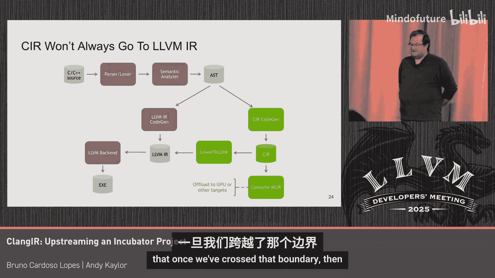

# LLVM开发者大会-US-｜-2025-Llvm-Developers-Meeting-p04-P03_ClangIR上游化_一个孵化器项目--BV1ejr5BAEja_p4-

Hello， everyone。 I wish you， you know， very fun week。😊，I'm Bruno Lopez。 I work for Mattta。

 This is Andy Ka， works for NVdia。And we're basically going to talk about how KayR came from an incubator state up to becoming upstream。

 which is the what we've been working on right now。So。A quick recap。

So when you look at the compiler pipeline in Kang。And you want to do like analysis and optimizations。

You could either work on things in L MIIR。Which because there's a big jump between A SD and all of M IR。

 it's like tuval level sometimes to be able to kind of figure out more semantic， let's say。

 from CR C plus plus。And if you're trying to do things at the AS T level。

 it might just be too high level。 You don't have like a good way to reason on top of control flow and things like that。

Even though you can make it work， a lot of the tests are more well suited for an IR。

 So playing I R kind of born out of this desire of dreaming more about things we can do with C plus plus。

We， everyone knows C plus+ is really hard。 It's hard to optimize。 It's hard to analyze。

So we feel like the more capabilities we have and one of the ways to get there is having a richer IR。

 we can do more fun things in C plus plus。 And so far。

 we have been developing like some idmatic analysis and optimizations。

 like trying to prototype some crazy ideas， like after a less use of an object if you're copying from it。

 might as well just turn that into a move。😊，I know that can be aggressive。

 And you guys might want to throw me stones。 But， you know， we， we might， you know。

 give us some gifts sometimes。So。嗯。Okay， so this is how the timeline of the project has looked so far。

Around like late 2021。We started Kangayar at Mattta。

 and we started it as an open source project under the Matts open source Github thing。

And after like eight months， we submitted an RFC to the discourse。

 asking for the community for feedback。 like we want to do this。 You know。

 we that's how we like look at C plus plus for the next decade or that's how we want to kind of improve our things internally。

 and we know that this is a desire of the community。

 We people have been talking about something like Lling Air for a long time。

 not something like we came up ourselves necessarily。 So， you know， lets， let's make this real。

And to do that， you gotta like， have feedback from the community。

 get expertise from a bunch of good people that are doing good work around。 So that's how we started。

😊，嗯。Then we got finally moved to the incubator， which is what I'm going to talk more about in a bit。

After a couple of years， we finally sent RF F for upstreaming the project into the L VM project。

 which is the main repo。😊，And then eventually， the the first PR landed。So， okay。

 let's focus on the incubator。So the whole idea with the incubator is， you know。

 a place where you can develop things。 You can do a bunch of experiments。😊，And as part of doing that。

 you gather feedback。 You get other people that are interested in the project。

 to also contribute to that project。And， you know， there's this kind of。

Movement of knowledge and expertise going around in different parts of the project coming from different people。

 And as that thing matures， you slowly get your coding into shape to kind of propose something like upstream。

 So the idea is that we've been going in circles with like developing things。

 trying to design things， get feedback from people using those things。 And as we go about them。

 we kind of improve the project and we have more like higher quality code that can be used then for upstreaming。

 Also， it's a good place to see what works and what it doesn't work。

 I'm not gonna claim or in behalf of my colleagues as well。

 we're not gonna to claim that we know what the best design might be because that might change with you the workload you have the priorities you have。

 But being this kind of process with other people。 it's a very good learning experience as well。😊。

So in practice， like， what is the incubator， right， If you go to L VM's Github。

The main project which everyone here uses is under LVM， islash LVM project。

The Kanggi incubator is within the Github LV M， but it's in a separate directory。

 It's basically a fork of the project。 And there are other incubated projects living alongside。 So。

 for example，30 or like polygeist， if you， you know， Githublash L V M。

You're gonna see like directors for all of those things over there。So what kind of led to like。

 us moving from RF to incubator was basically the outcome of a discussion we had during the first RF。

And the outcome as part of that was basically。Well。

You should get together with the other experts in the industry。

 You guys should probably meet or do something about it。

 So we created this CNNC plus plus MIR frontend working group。

 which we've been meeting monthly for three years now。 I think it's an open meeting。

 So everyone is welcome to join， participate， Give their opinion， ask questions。😊。

So we have that on the official OEM V M documentation as well。

 You can find more information if you would like to join us。And eventually， after that， it was like。

 okay， get together with other members of the industry。 You know， experiment， do a bunch of things。

And for that， you guys are now like ready to move the thing you have elsewhere into the L V umbrella of projects。

😊，嗯。So being incubated as a project has lots of advantages。Well， the main one， in my opinion。

 is visibility。Like because you're part of the， the umbrella， your project gets more like。

 it's not how can I say。It's not necessarily makes anything better just because it's under the L V M umbrella。

 But everyone knows like， if you look at that， there's some level of sponsorship in a way， because。

 you know， this is like under the umbrella of L VM or something like that。

 So you get more visibility， there's a higher chance of people showing up and wanting to contribute。

 I， we can clearly see that difference because when we were doing that on Me Github is what slightly different crowd than when we started doing that under the incubator。

And as part of that， we get more contributions， more visibility and also a lot of the support from LVM Github itself。

 like the infrastructure。C I， we can easily like inherit from what the main project does。

 And it's easy for us to test projects at every comet， like run claim format， all the。

 the good things that we can already do at in the main repo。Of course， you know。

 it's always a trade off。So even though we have some visibility is not nearly as great as being part of the main project。

 right。We， and we can see that as part of upstreaming， the the traction that upstreaming is getting。

 you can clearly see the difference between being an incubated project versus being upstream。So。

 and also， if you are， you know， a company and you're like doing your own compiler thing downstream。

 you are way more likely to prefer forking from the Lvan project than from a fork of it， right？

 it's already really hard to live downstream and keep up to date with things。

 If you have to do that on top of someone else's fork。

 there's a lot of way more problems than you can find and things you have to catch up with。

 So we've been hearing this a lot over the years by talking with companies and other folks that。

 you know， once you guys are upstream， then we might invest or we might like try to help。

 But just being a fork， it's still hard to kind of like get support from different parties。

There's also a risk involved， right， like management love。 that we're at risk。 Everything is risk。

 So being on the fork， you know， it， it might end up that your project is never upstream or it doesn't meet a bar or an imaginary bar because that's also hard you kind of set。

So。There's also that perspective， right， If you're， if you're not mainline， like。

 it's harder to convince some of your potentialation investors， Let me put it like this。

There's also an issue with how the incubator process is supposed to work。

We don't have a really like a way of established process。

 I'm not saying this isn't necessarily complain， but just， you know。

it's nice to know that the expectation is like you don't really know what to expect as as part of like。

 you know， when the incubation will end and we're gonna be like， we can be considered upstream。

 right， There's always a discussion after a discussion。😊，But yeah， it's not formalized。

 So it can be challenging sometimes because， you know， over the years， a lot of things change。

 organization changes， Mainship might change。So there are some challenges involved with that part。

 specifically。Well， one good aspect of incubation is like， there's a certain level of freedom。

This is one thing I。Think is great because， of course， you have， again， because of visibility， you。

 you might as well just have， have a reduced set of people reviewing code and participating in these discussions。

 So it's easier to， you know， kind of go about landing work and experimenting with things with a little bit less scrutiny。

 And I don't mean that like we're not reviewing patches。

 I try my best to kind of use all the L VM existing practices for every PR that we get in the project。

😊，But still， like， we have a a reduced number of reviewers， and that end ups reflecting。

In having a bit more freedom to do different things。And， of course。

 by following existing LVM practices， even just as part。Of the even even just being an incubator。

 but like falling all the good e practices， it's kind of a way to also like pave the long term role to upstream your project。

So there are a few challenges， of course。One of them。

 I would say is it's kind of confusing that now we have like both upstreaming and incubator。

 People like try one and blame the other for something not working like， oh， I tried this。

 It doesn't even build hello world。 I'm like， oh， were trying a different project。

 And this was a couple months ago where like beginning of the year where it wasn't hello world wasn't working upstream yet。

 But now that like and we did did a bunch of good goodness upstreaming。 We are catching up very fast。

 another thing is that we constantly go through rebases to try to keep things up to date against top of tree。

 And that's also a very challenging thing to do because it moves really really fast。

 Everyone here that that is a downstream client of L N knows the pain。So like。

 we're constantly working on this。 And， you know， it's quite challenging to keep up。

Especially because M IR would change under the hood。 There's a bunch of things that change。

 So whenever we， because we lower all the way down 12 Vm， there are many moving pieces。And also。

 as we， you know， started moving things upstream。We got more visibility， so we got more reviewers。

 We got more scrutiny， and。That means that also like upstream has started deviating from the way that things are done in the incubator。

 And this is for good。 But it's also at the same time， brings some challenges on like， well。

 let's backport this into the incubator。 But， you know。

 some of the things in top of three are already interacting with other pieces that the incubator isn't。

 So we end up having to do this whole kind of mechanism to rebase but also don't conflict with while we have upstream。

 So it it isn't the greatest place to be as things are getting upstream。 The incubator becomes。

 you know，😊，A bit more challenging to handle that aspect。So let's look at contributions a bit。

 We have like， I guess， a peak of。Burrst of comes around like this， the beginning of 2022。

 And we we were like kind of coming up with Kayhar and proposing directFC C。

 That was like a good initial time for landing working this project。

And then it kind of arrived for a bit until the beginning of 2024。

 That's where when we started getting like way more like consistent contributions。

And then I guess the momentum now is like we， we have a really good pace of contributions。😊。

It this year as well， but not only in the incubator， but also on upstream。

 which you're gonna show in a bit。Another interesting thing about like incubating a project is that。

Authors， they， they come and go。 It's， you know， it's open source。Oh， compiler looks really nice。

 Let me try to land a patch， right， Like youre gonna， you do that。 You do that once。 since it's like。

 it's not as cool as I thought it was。 Let me go work on something else， right。😊，So you。

 you never know it's people might come and stay for a long time， six months， two weeks， couple days。

It's a very interesting dynamics on how the community kind evolves。So to that aspect。

 it's quite interesting because in Glenangay R， we have a few pieces that are very mechanical because we look at classicalcogen for doing a lot of things as inspiration because that path is known to work。

 So it kind of like try to straight close as possible if we don't have a need for like raising or doing something that it's more like the richer things we need。

😊，So one of the things are like Bea teams or intrinsics。 Theyre really good starters because。

 you know， you can implement some bizarre instruction from arm。 and， you know。

 you do that in maybe 10，15 lines， you had a task case and then you wow。

 you landed your first you know， compiler PR and then you move on。

 So that's kind of interesting because by breaking things incrementally and kind of like asking people to do things incrementally as well as they go。

 even if they don't stick for longer that at least did something that you don't have to revert and you can actually count on it to build something larger。

 So this has been like a great experience by like dealing with people over time。

 and actually being a bit annoying while reviewing because you know that you cannot count with like people maybe staying for longer。

 So you gotta do your， you know， you're part of the work to make them break things down。

 So it's useful for everyone。😊，On the other hand， that's also like not grading in in some aspects because you want to build expertise。

 right， you want to have more people reviewing Ns。 And if the people don't stick for longer。

 there's a tendency of like keeping doing that work yourself or to the reduced number of reviewers。

So that's one of the thing。 So another reason that people might leave is that， you know。

 like we're saying for upstreaming some， it's risky for some people to rely on an incubator project。

 so。They， some of our contributors over time。 They just couldn't wait or they couldn't like spend more effort there at that point in time。

So I like， I， I was plotting this what I call， I guess。

 scorpion shape graph to kind of see like what the， you know。

 contribution lifespan looked like for people around in the project。And as you can see。

 theres a solid base for， you know， some of the folks that have been contributing for longer。

 But there's like a lot of different， like really small lifespans of contributions。

 And this graph doesn't consider people who only contributed once for those is like around 23。

 But everything you can see on on the graph in the left。It's basically two contributions or more。

 And as you can see， like， as well in 2025， between 2024 and today。

 it's where like most of the contributions have been happening。And were a total of like all time。

 like almost 90 people put up PR so far in the past few years and a half。So it's quite nice to see。

 And it really start catching up around the middle of like 2024。 kind of doubled from there。😊，So。

We also did like some， you know， try to see where contributions are coming from and things like that。

 And another great thing about the incubation process is that other people got involved。

 There was a shift between the project being like dominated by Me contributions to actually being like wider contributions from the community。

 So， for example， Nvi did a lot of work。 like David Olson initially。

 and then later in Ka and other folks showed up。😊，And they've been doing like great stuff on the incubator as well。

 All the upstream， most of the upstreaming plus backboarding and helping us getting like still getting like in a health kind of state So that one。

 the incubator and upstream can can， you know， keep being synced in a way that helps everyone。😊。

Here on the Google summary of code as well in red， if by the sake of this measurement。

 everyone whoever like all all students we had on Google Summer of code there forever。

 Google Summer of code student for the sake of this graph。

 So some of them like just stick for longer， which is great， right， that's the idea。

 We want Google Summer of code to be a place where you can learn and stick with the community。

 So we actually like proved that that's kind of true。😊，And also， we have here in purple order。

 which is a mix between different companies that help us along the way also。

 and also like just the random open source people that show up in the good work。

So that's kind of like a very interesting kind of direction and like， proof that， you know。

 there's a big community aspect of doing something like this。So if I have。

 if we have to look back and think about， like， well， was it worth doing an incubator project。

I think there are many challenges。 It's， you know， it's a community。

 So people think differently about different things and you get lots of strong opinions。

 ways to do things。 But I think in the end， all of this is actually very positive。

 because it's through over discussionscuss and overheated arguments that we finally find common ground。

 And we can move ahead as a community。 And I think that's that's kind of the gist I got from it。

 I met many people， I learned many different things。

 And I'm pretty sure most of the people also went through the same experience。

 especially with the C plus plus MR frontronend working group。

 like it's very nice to see the same people every month for like a couple years。

 you kind of build like more relationship。 And then you can discuss things more freely。

 And I don't know it was a very positive experience overall。😊，And now， more specifically。

 that upstreaming has a really good pace going on。 I think that's， you know。

 a wonderful thing for the project and for， you know， the way we want to do C plus+ looking forward。

😊，So finally， we did the RF for upstream。That happened like early in 2024。 At that point。

 we had support for a lot of the a lot of companies and projects that wanted the Kangga users at some point。

Which was very valuable for putting their F C up。And kind of like getting the consensus。

 like backing up， having a list of stakeholders and things like that。 We already had at that point。

 like proof of concept of a lot of different things in simple+ that we care about， like lifetime。

 a life a lifetime checker that is's aware of co routines， for example。

 some medium recognition analysis and like also optimization on top of it。 And finally。

 we're able to lower it to a bunch of different targets。 well， at least two targets。 But。😊。

We can lower all the way down 12 PM and keep going in the compiler pipeline as if Gleniro was never there。

 right， So it's like very in the middle of the pipeline。 And you can just use the rest as is。

 so now I'm going to talk about the upstreaming process。

 how we got things from the incubator to where they are today and where they will be。

 hopefully in the near future。So as you see here in the timeline， April of 2024。

 the first PR for upstreaming landed in the main repo and had a bit of trouble getting some traction from there。

 but it's been going pretty well more recently。So I wanted to start about the upstreaming by talking about a useful accident that happened。

 I'm pretty sure nobody intended for it to be done this way。 It wasn't planned。

 but it just happened that the group of people who are doing the upstreaming work and authoring the commence upstream are。

 for the most part， a different group of people than the people who did the original development in the incubator。

 Now， you might think that's terrible。 It's a tragedy。 But it turned out that that's been actually。

 I think a blessing， an unexpected benefit to it。 And it reminded me of the short story that I love by Argentinian author Warhase。

 It's called Pierre Minard， author of the Quiyote。😊，And if you， if you haven't heard of this story。

 it's it's about this guy in the 20th century who decides he wants to write Don Quixote。

He doesn't want to copy it， doesn't want to translate it， he wants to write it from scratch。

Word for word in the original 17th century Spanish。And that。

 that strikes me as a perfect analogy for what we've been doing with the upstreaming。

We have already this fairly mature code base of， this is what we want。

But we have to recreate it as if we were doing it for the first time。

 And so we had these new contributors who are coming in and taking this same code。

 But they're bringing a fresh perspective and they're having to learn it and they're having to go through the mental processes as if they were developing it。

😊，And。It， it has。You know， brought something that I think unique to the development process。

 And one of the great benefits of this is that as you're doing this。

 you learn the code that you're upstreaming。 you can't just you know。

 copypy and paste and you're done。 You have to you know。

 get deep into it and know what's going on with it。

 And so the result of this is that everything's been upstreamed that wasn't written by the person who did the upstreaming。

 We now have twice as many people who have a deep understanding of that code as we would have had otherwise。

 And and I think that's been fantastic。😊，So。Now that we're going live with this。

 where we've had it developed in the incubator， they made great progress and it is not complete work。

 but very very functional and mature， and now we're trying to bring it into the main LVM repo。

And so as I said， we're having to do everything as if we were doing it from scratch。

 you know just when we first got approval to do the upstreaming。

 the Kang maintainers weren't on board with just bringing everything in and dumping it and say， okay。

 we're going to merge。Here's， you know，100000 lines of code。Because LVM doesn't work that way。

 It's just not acceptable for the quality expectations and it just， you know couldn't happen。

 And because of the history of the incubator， the experimentation that had gone on。

 It had originally been developed in the MLAR subdirecty and then got migrated over to the cl subdirecty。

 some things， you know we explored pes that ended up being dead ends and had to go back and rework things。

 because of all that history， you couldn't just replay the commits。 And so there was you know。

 no order saying， okay， give me the first commit， I'm gonna upstream that and you know。

 no assembly line kind of thing。 So you're having to take things， know。

 one piece at a time where you just say， okay， I need to find a piece of functionality that is possible with what's upstream and you need something that is complete enough to be tested。

 but at the same time， small enough to be effectively reviewed。

 And so this this is the challenge that everyone who contributes to LVM， hopefully。😊。

As familiar with， you have to meet these quality standards and even though we have this mature code base。

 we're still having to meet the same standards that you would for any commit to LLVM so we need the contributor to thoroughly understand the code to know why decisions were made a certain way to be able to defend it in the code review。

All the functionality has to be tested by something in the pull request that's upstreaming。

 has to conform to the coding standards， we need it to be single purpose。

 keep the revision history clean all these things that you do with a normal commit we're doing with each commit and so we've got this know 100000 lines of code that we're trying to get upstream and we're having to do it one piece at a time like this and that's you know the right way to do it I think and it's been very good for the quality of the code to do it that way。

So Bruno showed earlier the contributors to the incubator。

 Here's a graph of who's been contributing to the the upstreaming。 And again。

 you see it's a good mix。 So you see， when the first commit happened back in April 2024。

 there's a long period of trying to figure out， okay， how does this process actually work。

 what are we doing And you know， other， you know， real life things that stall projects got got in the way。

 But then toward the end of 2024， started getting a little more traction， getting organized。

 And then at the beginning of this year in February of this year， we really started you know。

 getting moving with this。 And and since February， we've been going into really good stream。😊。

And so I wanted to mention one thing here with the Google Summer of Code contributors。

 you'll notice that the Google Summer of code contribution is not limited to just summer。

 and it's also not entirely captured by the people who are identified here as Google Summer of Code commits。

Because when we put out the the announcement that we were looking for Google Summerum of Code project。

 we had a number of great people who wanted to apply for this。

 And so they started actually contributing to the project before the decision was made as to who it was going to be。

 So we we had already， we were getting benefits from just having said we were interested in Google Summer of Code。

😊，But beyond that， we were only able to accept one candidate。

 And most of these things in red are are that one candidate。

 But we also had other people who applied， weren't accepted and stuck around anyway。

 and have still been contributing。 And that's been， you know， just fantastic to see that happening。😊。

So as far as our progress， I started this graph in February because that's where we really started getting traction。

 And you can see here we we're making a very steady project in progress。

 it's actually surprising me how consistently it's been going up it's about 1500 lines of code per week going through the review process and and getting into the main code base。

 And so we're chasing this line and because of the scale of things'， maybe not as clear。

 but the incubator is still growing too。 So so we're chasing it and we're we're making good progress。

 And if you're wondering， know， okay， so。😊，where is this really now。

 I would say this isn't at the point that you' you're gonna want to put it in a product or try to use it as your daily compiler。

 But if you're looking to build on top of it and you want to， know say。

 do some optimizations using CR。 I think now is probably a great time to get started。

 we've got enough language support in place that you things work。

 And if you you know run into something that， you know I'd like to work on this。

 but we're missing this language feature。 if you let us know we can do it on demand kind of we've been working with the open ACC development that way。

 And I think it's going really well。😊，So another thing about the progress。

 here's a few benchmarks that we've measured against using the LOBM test suite。The spec benchmarks。

 you know， we we we're looking pretty low。 we haven't even even in the incubator。

 nothing is has been done to， you know， specifically try to enable these。

 These are just things that through the other work。 this this， you know。

 came came live and is working。 And because there are so few of these。

 with so much code and any missing language feature just drops the graph down really quickly。

 The single source test is something I actually am looking at and， and you know。

 just running the test and say， okay， what didn't compile what's blocking that。

 And then we're picking things off of that just as a way to organize the work of what to do next。

 And so you see， we've been making very， very quick progress with that。😊，The multi source， again。

 with the upstreaming work， at least， we haven't been， you know。

 looking at that and trying to enable those yet。 But that's something that as the single source tests get up to speed。

 we're gonna start looking more at the multi source just as as a way to drive， you know。

 what language features we we want to focus on。So one thing I want to say here。

 what we've been doing so far is we're trying to follow the usual code path for know CPU compilation。

 We're mostly looking at Linux and X 86 as the default code path to get something working and this is。

 you so that we can test it and see where we are and have something that you can actually compile。

 execute and run， but this isn't always going to be what happens with CR and so this is you know even though we haven't started upstreaming this I do want to emphasize that we have this box consumer ML IR here on this graph that this is。

😊，Kind of intentionally vague in that it can， It can be anything， anything you want to do with MR。

 you know， do some other optimizations。 You might just optimize with ML IR and then lower it back to the L of VM IR and code Gen that way。

 or this might go to some offload target。This is where there's a lot of code pathfin to be done。

 but I think this is one of the really exciting paths that CIR opens up。So a few growing pains， know。

 Bno mentioned some of the problems in the incubator。

 and it's a lot of the same things have happened with。With the upstreaming。You know。

 we've had because。Currently， when you build the LVM project， KangIR is off by default。

 you have to give it an option in your CMake line to enable this。And because that's off by default。

 And we don't have build bots for it。 We're not mature enough to put that burden on other developers yet。

 because of that， we we occasionally will get broken by like， you know。

 somebody changes some interface and M IR and didn't notice that we were using it。

 And so we have to update。 But we're， we're working on this， you know。

 every day and getting pretty pretty quick turnaround on those fixes。 So that's。

That's not really huge problem。And then， you know， at the same time， the clang is。

 is always in motion and， and always doing new things。 And so， you know。

 we've had things where like one one of the trickiest things is some there have been some changes in the clang AS T interfaces recently that because of the rebasing the incubator is。

 is lagging a bit behind。 So well， we'll go to upstream with some code and it's calling some function that doesn't exist anymore。

 And we have to figure that out。😊，So that's， that's been going on and。You know， as I said。

 we're kind of chasing two moving targets here as we're doing this。And it it's。

 it makes it a little more challenging。 but， but it's， you know， it just the way the process is。

And so one of the challenges that we've specifically been looking at is trying to synchronize with what we call a classic code Gen that's the name that we're using for the L O VMIR code Gen path。

If if you're a backend developer， you might think code Gen is when you're actually generating the target machine code in the front end in clang codegen is generating the IR。

 So that terminology， let me explain。 But so we have one one group of code that is what everybody uses today that is generating LBMIR。

😊，And we're doing， essentially we're modeling that with the KangIR generation。

 we've tried to keep the structure the same so that if you're familiar with the LOVMIR code Gen and Kang。

 then you're already going to be somewhat familiar with the way things are structured in the CIR generation。

And so we're doing this。And another strategy that we've used。

 we're trying to the goal is we want to generate code that is semantically equivalent to the L O VM IR。

 We， we want to， you， align the same way they're aligning We want to， you know。

 do everything that that matches using， you know， generating the the same attributes and。

 and code decorators and。It it's difficult to do that without actual code sharing。

 And so one of the things we're doing is like we'll have when we generate a test our test test the CR path of generating CR and then lowering that to LVMIR。

 but we're also adding checks for what the other code path without CR does so that we can compare that visually in the test to see what we're doing different and what we're still missing。

 but it also alerts us if something changes in the LOVMIR code Gen that will give us an alert that hey。

 we need to update our code because they are doing something different now。😊，And eventually。

 we hope to be able to run all of the existing K Co Gen tests with C IR enabled。

 but that's going to be a lot of work to get there。

So I mentioned that we're trying to keep the same code structure。

 I said to somebody in a discussion recently that we're。

 we're giving new meaning to the the phrase embarrassingly parallel code。This。

 this is an example you can see on the left。 you have the a snop of code from the clang code from the C IR code Gen。

 And on the right， you have the equivalent code in the L VMIR code gen。

 And you might actually have to look at this for a second and see what， what is actually different。

 The the key difference in the reason that we can't just share the code is that the C IR is returning an MIR value。

 whereas the L of VM IR code Gen is returning the L O VM value。😊，And so we can't just say， okay。

 we're going to use the same code here for both。But we want to eventually get to that point。

 And we're trying to figure out how to do that。So。How how do we do that right now we've got a lot of comments in the code saying this code is nearlyly identical。

 we should be able to share this and you know over time we'll figure out places to move common code。

 but we're also trying to figure out is there a way that we can do this with like templates or concepts to be able to abstract the IR substrate and get。

The code that that can be shared to use this more abstract interface to those。

 And I actually put up a PR last Friday to kind of start this with the C plus plus AI handling。 It's。

 you know， very， very small baby step。 But it's， you know， we're。😊。

I guess the main thing I want to get across is we are thinking about this and trying to solve this problem because we realize that just keeping these two nearly twin code paths is not a long term sustainable thing to do。

So finally， I wanted to talk about， you know， the process of getting help with this。You know。

 Breno mentioned this also that we've gotten a lot of contributions from like people who are new completely to the LVM project。

 students who are， you， just looking to， you know， get their feet wet in this and and learn how it works。

 And this has been just a fantastic process seeing all these， these great new contributors。

 Some people have come in and said， hey， I want to help。 And it's very quickly， apparent that they。

 they really aren't ready。 But other people。😊，Have have come in。

 and I've just been really impressed with， you know， these people， you know， still。

 still in college or maybe just completed their undergraduate work。

 And we've gotten really great contributions from people like that。😊，And so。

It been it's been rewarding because the upstream work doesn't require you to have an indepth prior knowledge of how the clang front end works。

 It just requires discipline and a commitment to being willing to learn。

 and so I'd like to encourage anybody who's interested， please talk to us。

 We have a roundtable tomorrow at 215。 and we'd love to help more people get involved。

And so with that， I think we， we're wraping up。 I want to thank everyone who has helped contribute to the the project。

 everyone who's made contributions to the incubator or the upstreaming。 We couldn't。

 We couldn't have done it without help from everyone。😊，嗯。Bernno。

 do you have any last things you wanted to say， No。

 that's basically we're like very grateful to have been able to build a community around this。

 And I think that's the， the greatest thing that happened as part of Glen I。😊，Alright， so with that。

 we've got just a few minutes for questions。好。Have you guys thought about using some of the existing and optimizations？

Like I know polygeist， you can raise SEF to Aine so I can be doing vectorization that way。So no。

 we're not at that stage yet。 even the canonicalizer。

 which is something that might be more like directly usable。 It's too aggressive for us。

 So we like wrote our own can， you know， they composing to using the pieces that compose the ML IR canonicalizer。

 But so far， we are not using it any of those optimizations。 The idea is to slowly grow into them。

 But we're kind of focus on correctness first。 once things are correct and work。

 Then we can start like enabling passes more aggressively， yeah。😊，Thank you。

On your data do chart where you have。You know， some paths come out through L VM and some paths。

 you know， maybe go to offloading。 Are you anticipating that some of those offloading paths don't ultimately leave。

Du。Going through LVMIR。Yeah， yeah， so I think， you know， once you've gone into the consume MLLIR。

 there is definitely a path to you know， do some MLIR things from that and return eventually to L O VMIR。

 I think most of the the basic dialects can be lowered to the LO VM dialect。

 and so there is a path to get back。 So that's you know。

 depends on what the target is and how the target wants to generate its code。

But is that your question， I guess what I'm wondering is， why is that not just。

Sort of conceptually in the CR。Box， right， Like， why is that not just a loop in the C IR box。

 And then ultimately。Yeah， so I guess basically just the reason that I chose to highlight it as a separate thing is that once we've crossed that boundary。

 then it's， you know， up to the consumer to decide what they want to do with it and it it。

Can come back to us and do more， but not necessarily， right， We don't know what they're going to do。

I have a question about the upstreaming process as someone who's alsostreaming a lot of downstream code。

 I feel like the major pinpoint is always find a fresh pair of who's willing to look at your like 100。

000 lines of code and I'm thinking like being an incubator for like years。

 you're probably also exhausting the people who are both interested in the project and like a compile expert and you kind of turn turn into authors rather than the reviewer does anything like in this like incubator process will make this thing easier for you to do when you in the end trying to upstream everything。

I think I missed a bit on the like what is the real question the real question is like。

 does being an incubator project will make like funny reviewers in the end to upstream your code to be easier because I imagine as you incubating you're turning all those people who are interested in this area。

 turning to others rather than people who can eventually review your code。Okay， I got it。

 So I think it does。 Of course， there's the problem that we mention about people coming and going。

 which is you cannot avoid。 But you know， we have now， you know。

 I haven't been doing much upstream work myself。 but I basically review all the all the PRs。

 and we have people who did contribute to the incubator who are now putting upstream stuff。

 our previous Google summer of code students are also starting to review PRs。

 So same for Andry who's worked for used to work for a tradeoff bits and works for next silicon now。

 he's being like involved with the products。 He's the beginning。 he's doing both like he you know。

 review things on incubator， review things upstreaming。 And he does that I do that。

 a bunch of other people do。 So yes， even though people might you know， go away。

 there's a tendency of a few of them sticking around and actually working on both。

 So it's quite interesting。 Some of the stuff。 I I might have landed on the incubator myself a couple years ago。

I can， you know， someone is putting that PR for up streaming。 And I'll say， like， change these。

 these or that， cause。The role evolve， right， thank you。So in terms of performance。

What is how and when。TheCIR would be。I would have a message LBM myR。Do you have any。

 any any way to quantify that advantage， how much that would be or any， any。

Benchmark or any evidence to support that。So so far。

 we only tried like what we've been calling like library based Bpos， which is no substituting。

 let's say calls to the C plus+ standard library for some calls to Li C。

 And by certain like key functions in microbechs you get threexs， right。

 But we haven't been able to build all of those big C plus+ projects where we can extract meaningful numbers。

 So if I tell you anything here， it' will be out of speculation。

 But because there are many ways you can go about optimizing things。

 even if it's just like use claim Ir to do more analysis and a bit more L metadata。

 So the existing LM passes can work better， that's some other route of like getting more performance out。

 So we're very like hopeful on all those different strategies。

So you've mentioned a couple times keeping up with Mainline is tricky and as someone who is deeply involved with Sony's attempts to automate that。

 Im synthesized a great deal。 Do you have any automation for keeping up where are you doing this like periodically manually what？

I I'm sorry。 I didn't hear the the question。So。So you're needing to keep the Kang IR fork in sync with upstream。

Do you automate this in any way？So we， sorry if I didn't got it， but I think I got some of it。

 we plan like right now， it's we're trying to backboard things。 So I。

 but I think that eventually either we're gonna close the incubator or we're gonna just， you know。

 do a full initial rebase on top of Kang I are upstream whenever it's considered that that's。

 you know， we should just focus on that and forget the incubator。

 And maybe the incubator could just become。A place where we can like stage some of the optimization and analysis work that can later be upstream。

 I'm， I'm not really sure if I got your question right， but we can。

 we can talk because I see Tanyas like， you guys are over time。 Yeah， I'll catch up with。

