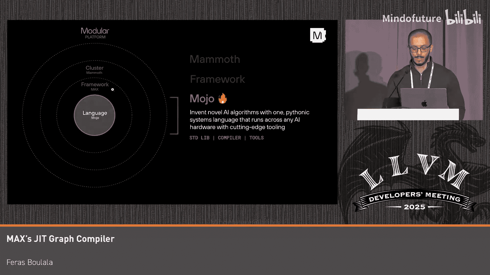
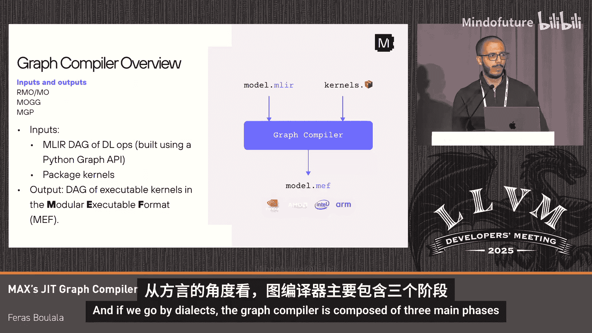
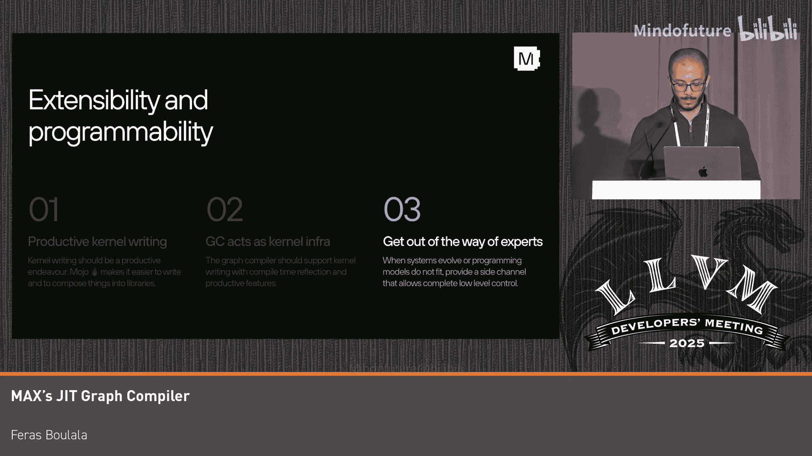
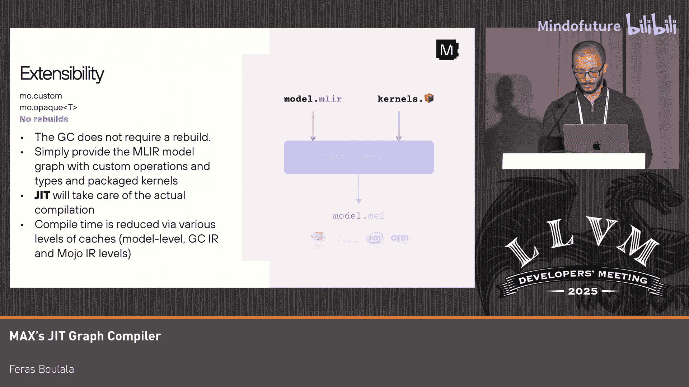
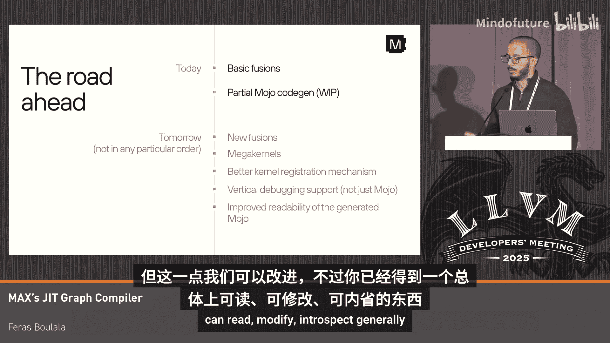
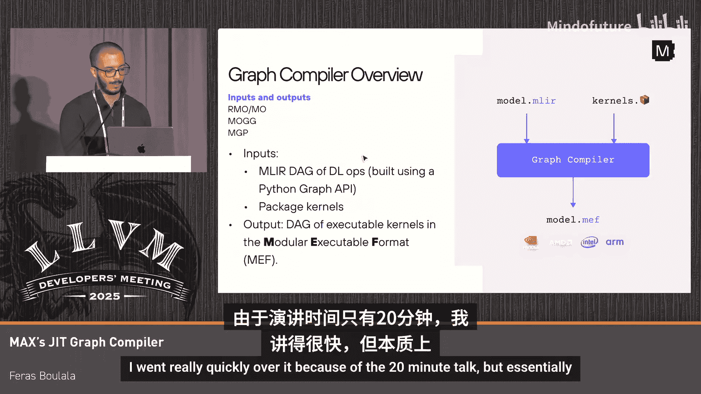

# LLVM开发者大会-US-｜-2025-Llvm-Developers-Meeting-p05-P04_Modular的MAX即时图形编译器--BV1ejr5BAEja_p5-

All right， so thank you for being here today， please to present to you the graph compiler name is Ferris。

 I work at modular if you're not familiar with what modular is。

 it's AI hardware sorry AI startup that operates in inferencing and it was cofounded by someone you may know him what I'm not sure his name is Chris Lachner。

And today I'll present the graphph Compr， which is one part of what modular offers。And I'll first。

Describe what the graph compiler is at a high level。

 Then I'll show you how we manage to design a graph compile that's able to。

Essentially be bulletproof in this fast paced environment of deep learning infrastructure。

Then I'll share one of our dialect， it's one of the phases in the graph compile that's where we do fusion among other things。

And lastly， I'll show how everything culminates into module coja。

So modular is a platform for doing DL。Infferencing its。

Distributed and inside there's a framework called Max， you may have heard of it。And。

At the very core of everything is the module programming language。

And the graph compiler is this red concentric circle you're seeing， it's not all of the framework。

 but it's part of the max framework。So what's the graph compiler if you're familiar with deep learning graph compiles。

 it's not that different at a high level， so it expects an input a da of highlevel deep learning operators I'll show an example later in the next slide and we build that using a Python graph API that's how we call it and it also expects a bunch of package module kernels。

And the output of the graph bar isn't executable in the modular executable format。

 it's not the main point of this presentation。 I'm I going to get into what meF is。

 but you could think of it as like being elf for arbitrary graphs。And if we go by dialects。

 the graph compile is composed of three main phases。

 first one is RMO and Mo Mo stands for modular operators and the R stands for Re。

 its equivalent to Mo it's just more lenient around implicit behavior like you can add two tensors that don't have the same shape and the broadcast will materialize as we do the lowering。

And it's very risk like in the sense that we don't have a lot of operators if you compare to other frameworks。

 it's only 135 operators， you have some examples here on the screen， you have your typical MA mall。

 your activations binary operation like a and aesthetic static broadcast。

And so you can think of vertices as being high level declaring operators and edges as being just regular tensors。

And we also support dynamic shapes。 If you look at the example here。

 the N M K are attributes and they represent dimensions。 And so it's。

Inherent to the graph compiled We also support side effects via chain。

 So MT SSA values just to maintain the ordering of operations。

 we do it explicitly in the used dev chain and we also support mutable tensors。

 which is how we do in place operations So you can think about it like if you want to do a nad instead of creating a new tensor。

 you can do it in place if that's possible and the typical optimizations。

 you'll find at that level are like symbolic folding。 So if you know what the operation is， you can。

 for instance， fold and Nad with a zero into just the input of the ad shape inference as well as constant folding and everything that comes for free in MLR like CSC or DCC stuff like that。

The second phase which right now I'm just going to describe at a high level but we'll come back later is called mug mugG stands for modular graph generators and this is where we do fusion so in the previous slide I show you high level the learninging operators。

 those all to the structured kernel you see here for mat Mo and that's what we use to do element twiceized fusion。

 prologue epipiag e fusion among others and the structured kernels you're seeing here。

 the inside of them because this is like a region with a block are destination passing cell or bufferized semantics。

And the last phase of the graph compiler is called MGP。

MGP stands for modular glue primitives and it's effectively the dialect that models runtime behavior and interaction with devices so you can think of like executing something in the device making memory allocations and stuff like that and the final phase of MGP is the Jit phase。

 which will take those package kernels that you provided that have unbound parameters like the parameters not have yet a value and then we're going to get it based on the input model。

And the optimizations you'll expect at MGPR sequence fusion。

 which is like inlining the body of the kernel into another one for the sake of reducing launch overhead memory planning that could be static or dynamic as well as thing that I like to call as runtime constant folding。

 you can do constant folding compound them， but if that can be too expensive。

 which happens in deep learning inference， you can just leave that in the in knit phase of your model。

 So typically models have a knit phase and then an execution in a loop。

 you can move some of the stuff that would be in the loop in the。In it。

 as for a regular like C plus plus or programming language loop。

And so with this current description of the graph compiler。

 it's very traditional in the sense that you have your high level deep learning operators。

 you have some fusion， and everything is pretty vanilla， but。As I said earlier。

 we had to design a graph compile that needs to provide peak performance or speed of light performance。

 as we like to say， and still remain that way as the industry evolves and the industry evolves very fast。

 every month， there's a new flavor of attention every year。

 hardware vendors have a new feature on their GPUs and you have to use those because if you don't you by you fall back and then you can't really get speed of light performance and inference the economics。

Can't let you get like 80% of performances and non negotiable， you have to get it。

And there's something that I omitted in my description that I'll explain in a second。

 but before that， I'd like to ask the question， how do you design a compiler that's going to be bulletproof to this rapid pace of change？

And so before giving the answer， I like to just model deep learning optimizing compilers in this 1D spectrum。

 the 1D spectrum doesn't do it justice because really it's many dimensions that I can't really fit on a slide with our 2D eyes。

 and so I just did a 1D and on the left hand side you have your kernel centric systems and so。

Think about it like you're just writing coder kernels or you just have a library of kernels。 Typ。

 you can get really good performance with that。 It's very easy to extend because you're just writing code in the end。

 It's not that much friction。 Of course， it depends on what programming language you're using。

 But generally， it's something that you can。Program， it's fully sensible， debugable。

 there's predictable behavior because you're the human writing the code， you know what to expect。

 you've probably studied the hardware on which you're running it。

 and so everything is kind of predictable， but it has low coverage and it means that every time there's a new model or just something that changes。

 you have to like all the burden is on you to write that new code。

And on the other end of the spectrum， you have your more compile centric systems where。

You're not necessarily writing kernels。 You instead provide some form of。Productive abstractions。

 you can think of it like a DSL or programming language that is specified for AI。

 and these provide typically very good coverage。 But the biggest problem is you're not going to get good performance because of the evolution of the industry and also because their abstractions。

 They're going to take some things away from you for the sake of productivity。

And it's not just performance' also compound time， deep learning is constrained。

 it's not like an arbitrary C or general purpose programming language program。

 but the search base is enormous and so searching that search space that can think sometimes I'm not talking about like five minute compound times I'm talking about hours or days。

And you don't get predictable behavior because what you're programming is you're really telling the compiler what you want to do and the compiler will figure out the rest like performance。

 loop schedules， vectorization， and everything。 and so there's not even something could really debug because ultimately you're just giving it a high level abstraction and then it maps it onto a hardware that's completely different from the abstraction。

And another big pain point of having something that's too compilecentric is。

You can't really extend it if it doesn't fit the programming model if you're trying to do something that the programming model doesn't capture。

Then what do you do like there's nothing you can do。

 the programming model doesn't let you do more things。

 and so you don't really have an escape hatch most of the time。

And so at Madur we came to a few conclusions， the first one is that there's no finite opposite said deep learning。

 sorry， DSL， the main specific language or programming model that can reliably cater to all of DL's inferes。

 especially when it's evolving。And so to go back to the original question。

 how do you design that compiler， how do you design something that can withstand this of fast piece of change。

And the solution is。You hedge by investing in programmability and extensibility。Well。

 that means at least for modules graph compilers。 first。

 you make kernel writing a productive endeavor。 We have a。

New shiny toy Mojo that's built pragmatically for writing kernels。 We have those open source。

 You can look them up。 We have。Less than a think at this point a million lines of kernels。

 and so it's an actual thing。 we write our kernels in Mojo and it's a very productive thing because we can do things like what I'm showing on the screen。

 we can achieve state of the art performance from scratch on a new GPU in just 14 days。

 that's incredible if you ask me。And the second step of hedging with programability and extensibility is that the graph compiler。

 when you design， you should do it in a way where it's infrra for writing kernels。

 So you make kernels easy to do and a fun thing。 quote unquote， but。

You also need to make the graph compiler support kernel writing。

 and so I'll show that in a moment for fusion。And the last point is you get out of the way of the experts。

 So experts know their hardware best and if you want to get peak performance。

 speed of light performance。 You have to let them do what they want to do。 And that's the。

The most important part for the graph compile is extensibility。

And what that yields is like。At Moular we typically validate ideas in Mojo。

 we start with Mo because it's very easy to do， you have full control over everything you want to do and then when we see some patterns emerge like。

 oh， we're doing this type of fusion manually a lot of time。

 we move that feature in the graph compile when it's the right time。

And I'll show you now how V extensibility were able to essentially get out of the way of those experts。

 as I said in the graph compile So the thing I said I omitted at first is this mod dot custom and mod dot opaque they're the building blocks of extensibility in the graph compiler。

 Mo custom is just you know it says abstract as can be takes arbitrary opera。

 if you look at the table Gen definition arbitrary results and has a dictionary of attributes that map to parameters in Mo I'll show that later。

And this is effectively how you can do anything you want in the graph compiler by design。

 It's already included。 You don' don't have to。Add your new operator or anything like that。

 You just create a more custom。 You give it to name and you provide the kernel implementation。

 and that's it。The second building block is Modot opaque。

 so the same way more custom is to your kernel， Modot opaque is to your arbitrary module type and so if you want to do something not just tensors because the areavv caches and things that are not necessarily tensors by default。

 you can do that with more opaque and it's completely opaque to the graph compile is just effectively manipulating something that it doesn't understand。

 but it lets you extend it without having any rebuild whatsoever。

 it just provide the kernels and that's thanks to the Git phase that I mentioned earlier。

 like the graph compile expects both your model。As well as kernels， there are pre-elaboration。

 as we say in the module world， it means your parameters don't have yet a value。

 and so the graph compile will give a value to those parameters at the very end of the last phase in MGP。

 if you recall。

So at this point you're probably wondering like， okay， so you have your graph compiler。

 you have your extensibility， but how do you bridge the gap between the left hand side。

 which is Mojo， That's the signature of the MacM kernel as you can find it on our open source repo。

And on the right hand side， which is a structured kernel for doing fusion。

You can see on the left hand side in the module you have a bunch of parameters。

 it seems like the user can opt into fusion， you register something for a MaMo。

And on the right hand side， you have like a structure kernel， how do you go from one to the other？

And the solution is you introspect the module。 So module starts out as text。

 but once once it's parse， it turns into the lit dialect or lightning dialect and。

The cool thing with that is。You as a graph compiler engineer。

 can build abstractions that could be traces， decorators， types。

 anything you want in the module as you see here with the Moad。

 And then it's going to appear in the IR of the module in lit I've truncated some things because it can be quite verbose。

 but the nice thing here is that you can find all the information you want。In D IR， programmatically。

And so what that means is that the kernel I showed earlier， like the signature of theOM mode。

 you can guess how we turn that into a structure kernel。 We just look at the kernel。

 you look at the kernels signature programmatically in linkeded。

And that gives you what you're seeing here， it's our fusion dialect mug is Lada base。

 so we have these Ladas， which is in this specific case for doing epilo fusion。

 and you can see like a reference to the mathmo as well as the parameters that were declared in Mojo。

And that's how we do fusion recall call the original graph you saw earlier with like the Mamal。

 the bias add plus the value， all of this gets fused in MoG into this big kernel you're seeing here。

 so I highlighted the equivalentvalence like you can find the broadcast。

 the MaMo again as well as the element wise fused into that land I talked about。

And so if you've been paying attention， I said the way we lower to structured kernels。

Is via looking at the signature of how it was written in Mojo。

And that means it works for custom ops as well， so I said custom ops opaque for the most part。

 opaque to the graph compiler I li it's just the first part of the graph compiler。

 the one that operates on high-level deep learning operators。

 but never have we when we lower to like a structured kernel representation。

 never have we looked at what the operation is like Mo MaM。

 we just lowered based on how the kernel is written。

And so everything you get in mug and later passes works for any operation。

 including the custom ups you may be adding to。Your model。

And all of this culminates into the last phase of the graph compile， which is where we emit Mojo。

 so recall at first we provide module package kernels。

 then we introspect them and then the last part is where we emit module again and the emitted module references the module that you provided to the graph compile so it's not completely foreign to you。

 you're going to get module file that contains references to the kernels you have written。

And here I show an example。 that's diffused。Colonel I showed you earlier with the broadcast and Matt Mo and whatnot and on the right hand side you can see the module that was emitted is almost one to one like you can pretty much find a reference to everything。

 It's as simple as it guess this is the last part of the graph compiler Every app you're seeing in here implements an interface for generating the text you're seeing on the right。

And the cool thing about emitting Mojo is that。We can also emit runtime boiler plates。 So you。

 as a user， you're writing kernels， you don't write runtime code。

 That's something that's handled by the graph compile， the max framework as a whole。

 But nothing stops us from even showing you what happens in the runtime。 So all those。

Pre unpacking of async values and their effectively futures。

 You can see that in the module that the Gs compiler provides。 And so if I go back one slide。

 the stub you're seeing here is getting called in there。

 And you have some like pro log or a pillow runtime boiler plate that you can debug and modify and do whatever you want with。

And。The reason the graph compiler emits Mojo in the first place is because Mojo， if done right。

 obviously if you made it right， is human friendly， it can be introspected， can be debug。

 can be modified。And。The great thing about that is that ultimately。

 if you can imagine doing an optimization or sort of a， I wouldn't say a programming model。

 but anything in Mojo， if you can imagine doing it in Mojo as a programming language。

 then it can be done from the graph compiles side because ultimately that's what it's going to generate。

 and then you can debug it， you can literally add break points to them and then look at how it' step through that modulejo。

 And so you'll get the source line of code for everything the graph compile with an asterisk。

 obviously， there are some things like entry points to the kernel where you don't have access to but。

We can do something about that in the future。And so today we have basic fusions， which I presented。

 we have like element twice fusion， proaggailag， view fusion。

 and we also have partial Mo cogenn because right now it's a work in progress historically we haven't generated Mojo we generated another dialect called Kgenn。

 which is what the lit dialect lus too and that came with all its technical debt。

 but today we're changing that and we're going to generate Mojo。And thanks to generating module。

 we're going to be able to add new fusions because as I said one slide earlier。

 if you can imagine it in module， we're going to be able to generate it。

We're going to do mega kernels， we're going to improve the registration mechanisms。

 we're going to add vertical debugging because the graph compile is part of the framework as I said。

 it's not all of the framework and so if you want to debug its not just that module it's also the python that created the graph and so we want to give people a seamless experience and be able to debug literally everything。

Or almost。 And we also want to improve the generated module。 obviously， if we。

 if I go back a few slides， can see that。All variables are effectively just incremented counter just to ensure they're unique。

 but this is something we can improve， but already you're getting something that you can read。

 modify introspect generally。

And that marks the end of my presentation， if you're into what I just talked about， compilers。

 runtime， even like serving infrastructure or anything related to deep learning。

 modular is the place to be， please apply we are hiring currently。And that's it for me。

Thank you so any question from the audience？Hi， can you say a little bit about the performance work that you did for the AM andD GPPU like you know two weeks is a short period so I'm wondering what changes did you do in that period to get I'm the wrong person to ask that that was mainly a kernel and performance engineering task and so that wasn't from the graph comp it was just showing you that if you make。

Colonel writing is a productive endeavor， then you can test out a lot of things really quickly and so I will probably direct you to some of my colleagues that's not a graph compile thing。

 but I was just showing that it's possible to do things like that with a productive programming language。

Yeah光。No有。Questions。是。Hi thank you for the very interesting presentation I was curious so say i'm a one of those experts writing kernels for my hardware that I understand very well and my hardware has very specific vectors and as an expert I say this kernel needs to target tensors or vectors with part these particular shapes so what is meant to take care of。

Colonnel receiving arguments using these shape because I didn't see any any tiling or any partitioning in your presentation or the graph compiler logic so I'm curious what is like what's the design who's supposed to take care of that。

 is it me the kernel writer or is it the graph compiler Yeah I'll go back a few slides just to illustrate something Yeah so this is the literal entry point of a modot matmo and depending on like which target you have is going to branch out into the appropriate implementation for the time being the graph compiler doesn't have like a tiling dialect or DSL or programming model this is the contract with the graph compile you have your tensors and then you do whatever you want inside and you of course obviously have to populate see with the outputs and so today everything is done as a library in module so the burden is on you the kernel engineer to do it but we have means to be productive as I said in。

We have something called layout tensor you can look it up we also have some blog posts about how to achieve performance on different hardware。

 but to answer your question specifically it's not the graph compiles job to do that at this time it provides you with some amount of。

Optimization features like here， you can opt into epipilogue fusion and there's a contract with that that you have to follow。

 but for the most part， it's something you have to do in a library and module。Okay， thank you。Hi。

 so do you or like plan to support AO mode in Mojo and if yes。

 then how it will work with the dynamic shapes？So at this time， I don't think we're going do that。

 maybe we're gonna rethink it when we work on things like eager execution whatnot。

 but for the most part， what the graphraph compiler does is it Js everything and we have appropriate levels of compilation caches to account for it because you know if you're Jing everything it could be slow but the module compilees relatively fast and we have enough caches that is still a good experience but we're not close to the idea of doing ahead of time and Chris wants to say something Fer what do you mean by Jit So like if I'm running a server is it Jittting on every inference is it what does Jit mean to you？

I'll go back a few slides again and I think there's also this question of dynamic shapes I the graph compiler respecializing for every input shape。

 This is very common strategy to handle dynamic shapes。 Yeah。

 so the graph compiler supports dynamic shapes。 like if we look at this simple example you have Nmk their attributes here but they ultimately will turn in Mgp into SSA values and so it's naturally dynamic we're not jting every single inference。

 this model you're seeing here is going to support all values of Nm that of course makes sense when you're doing like a well add some assertions to account for it but the Jit phase is effectively。

 you're providing some kernel package。 you have your model。 And at the MGp level。

 the last phase of the graph compiler， we're going to specialize as much as we can。

 And so that could be like I said， it's dynamic shapes， but you can have partial shapes。

 maybe you know what n is but you don't know M andk and so because of mods parametric system because of the Git compilation design at the very end of the graph compilation。

That's when we specialize as much as we can， but then it remains that way for that model unless you change the input itself。

Hows it it。Iits by invoking the module compiler。就这个声。Yeah。

So I think many people understand shit meaning。Yes， I'm doing cogen。

 of course you could argue like is this the traditional jit of like you're finding some optimizations as you're running it。

 this is like an ahead of time Jit sort of it's not your hardcore jit of like this is a dynamic language and a jitted as it was running this is。

Yes， it's fully AOT， but we're not compiling like a Ma for FP32， a Ma for F8， a Ma for this and that。

 we're doing it based on what you provide the graph compiler。好的，行。Hi， thank you for the talk。

 It seems there's a lots of， lots of very cool stuff here。 like you have tensil。

 like symbolic shapes。😊，Like different semantics than what we have upstream， right， Like here。

 you can reuse memory in ins。 Do you see like ways or like path towards upstreaming some of this stuff or what what's like in general。

 your， your view on that。That's not me to say， but from my experience we want to be as open as possible。

 there are some efforts to open the module compiler and the gra compiler is no different for now we're working on because like internally because we have things to change we're emitting module and we want the。

Designed to accommodate the influencing need， but there's nothing stopping us from opening it and if you'd ask Chris。

 he'd give you his opinion about it where it's not something we're close to we ideally would want to do this。

Thank you。So I have a question how user can use this， like what is the front end of programming？

That's a good question I went really quickly over it because of the 20 minute talk but essentially we have this thing called the Python graphra API and so it's effectively just a wrapper around what you're seeing the IR itself here。

 but we have a lot of things going on we're trying to make it more user friendlyend because although it's Pythonic it's still just a wrap around MLIR and no one wants to be building MLIR constructs and so we're going to be changing some of the stuff but today as I'm speaking you can use the Python graph API to build any model like the one you're seeing on screen。

Thanks。We can take one more question。哦，是。I want to ask where would actually the optimization or scheduling would take place or is it something that graphra compiler would look into in the future so for example in Mo MAmal I write a very naive kernel which is just multiplying those it's a 70 nested loop so is are you going to like optimize it somewhere how would that happen？

At this time when you write your kernel MoMa， we're not optimizing anything。

 the Mojo compiler may optimize things or ultimately the LVM backend could。

 but the graph compiles contract with the kernel that you've written is what I showed earlier it's this thing here and so all we let you do is opt into things like output input fusion and element twice fusion。

 but everything you do inside your kernel is whatever you want。

 we're not going to mess with it we're not going to look at the inside of your kernel。

 but as I said we're going to emit Mojo and ultimately we'll be able to do more things。Right。

 thank you for the talk。 Thank you。