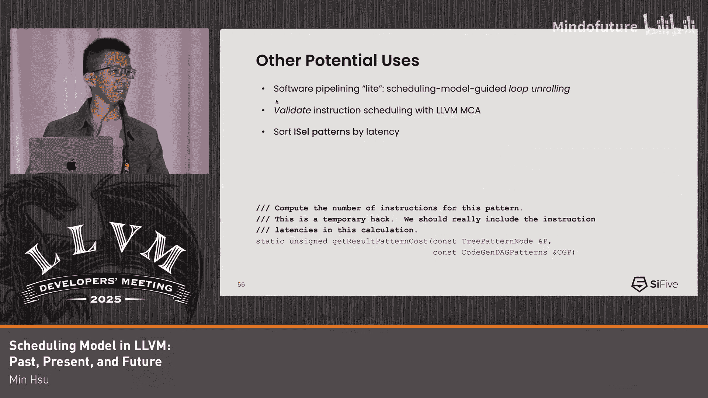

# LLVM开发者大会-US-｜-2025-Llvm-Developers-Meeting-p06-P05_LLVM中的调度模型_过去、现在与未来--BV1ejr5BAEja_p6-

Hi， everyone。 They told me they only have this microphone。 I I。

 I guess I'm going to stick on this little po。 My name is Min。

 and I am a compile plumber or get scifi。 And today， we're going to talk about sched model。

 So assuming I don't bore you 40 minutes later， at the end of this talk you learn that， first of all。

 what is sched model。 And how。😊，How do other part of LbN use scheduling models and what its connections with the actual hardware。

 and finally， I'm going to provide some footful thoughts about future direction of improvements。

Alright， so I'm going to， you know， we fast forward to 40 minutes later。

 Now I'm going to go back in time and introduce the scheduling model by asking what exactly why what it was invented for。

 So， of course， according to the name surprise， it was invented for instruction scheduling。

 So here I'm going to try to explain it in the slightly different directions and starting to ask like what ingredient。

 what information does the scheduling does instruction schedule use from the scheduling model。

 So to answer that。😊，We're going to the primary goals of instruction schedule。

 so we can really boil down the instruction schedule into two tasks first is to to improve the instruction level parallel。

 and the second one is to reduce the number of registered skills。

 and we're not going to talk about the second one。And for the first one。

 I'm going to explain it with an example here。 So your left hand side is a program in like a data dependency graph where the arrows means that the front data producer to the data consumers and what we really need to do here is to reduce the stalls。

 So what is stalls here。 for instance， if you look at the left hand side of this program， the load。

 So usually low it will have loan latency。 So if we do absolutely nothing。

 then it will just fire the load and just you know run in know and the pipeline will do nothing else and waste a lot of cycles until it finish it。

 So what we want to do here is to have some now filter episodes。

 but fill instructions in between the load and the consumer， which is to add instruction here。😊。

So that is the first time。 And if we go to hear this part of the program。

 we will also found that there are three instruction that can be independently scheduled。

So although it can be because they don't have any dependency。

 but now we have a problem of if they are competing with the same resource。

 now I'm going to be a little hand waving and it will become more clear later。

 But if you think of the resource here， it is some limited items。

 So we want to ask that if we want to schedule these three instruction where they are competing the same resource。

And so if we go back to the original like the load instruction。

 if we want to add the fill instructions， first of all。

 we want to know how why is the gap and the gap here is actually the latency。

 meaning you know how the total total number of cycle is going to take to execute this instruction。

 so that is latency。And when it comes to these three instructions。

 we are asking where you're competing with the same resource。

 so let's us assume that the multiplication and the subtraction instructions are using a different resource。

 One is IEAs L U0 and LU1 with this information we know that we can schedule in at the same time because they're now going to competing with the same resource。

On the other hand， the modifications they're using， you know， of course。

 they're using the same resource and the second modification it needs to wait for some time before it can grab the resource and start to use it and the time it needs to wait here is called the occupancies。

😊，So latency， the resource and occupancy， these three are the primary three ingredients。

 the instruction scheduling needs from the scheduling model。 So for instance， the Def table。

 it can be one the simplest scheduling model is just a huge tables with instructions and what are the latency resources and occupancy they use。

 This is probably what the scheduling model kind of looks like。

 and thatll be a good segue to you see what the actual scheduling model。

 Let's start from the legacy one is called the itinerary model。 Unfortunately。

 we're not using that anymore， but the ideas of itinerary model is it it will model instruction with multiple instruction stage。

 So for each instruction stage。 it will tell you well， the occupancy。

 how many cycle is is spent on this stage and what resource it used on this stage。

 and finally of course， the entire old stage the time to take will be the。😊，珍し。Now。

 we can really see the inspirations。😊，Oh。Processor pipeline model， you know。

 from the previous pages by splitting into know multiple instruction stages。

 So this diagram is why copy from the traditional textbook model about you know。

 processor pipelineing。 So if we apply our three key ingredients in here， the laencies， of course。

 you know， how the total cycle is executed throughout each processor stage。

The occupancy that poisons the instruction of zero。

 The occupancy means the the amount of time is spent on the execution stage Here。

 we really only care about execution stage and we don't really care about other processor from in scheduling models。

And so this is occupancy and it will become much more interesting if we put super scatter into this picture。

 So super scatter is basically that we are going to replicate the pipeline we see in the previous page into multiple unit so that they can execute it at the same time so here this unit we usually call it execution pipe。

😊，And as we say， we replicate the same pipeline and so that they can execute at the same time。

Same for occupancy， it has the exactly same meaning。

 So with this mental model is actually a lot easier to explain resource。

 because now resource just mean which execution pipe， you can run them。 And as you can see。

 some instruction can only run on some of the pipe like instruction0 can only run on Ie X 0。

 But for instance， instruction 2， it can run on either the I X 0 or Ie X 1。

 So that is the concept of like execution resource。Now， we have the intuitions of。

 you know how it maps to the hardware and we know what the instruction scheduler wants。

 Now it comes to the current generations of scheduling model。

 It has an end instruction scheduling models， but I will just call it scheduling models instead of spliting instruction into different stages。

 It start with an individual instruction and focuses on the operas。

 So it split operate is the one that writes and the one that read for the the one that often that write。

 It will assign a token and use that token as the key and map to an entity called write rest。

 So this entity write will contain the three ingredients we ran before the resource it used the latency and occupancy。

 the occupancy is represented by two different fields required as cycles and release at cycle。

 we're going to。😊，Details of them。 But basically， this right rest is what constitutes the scheduling model。

And to see this in actions。When were defining an instruction we will attach the token。

 which is the right ILU here for the instruction and usually on the different file on the scheduling model file。

 we will write the right Gr with this syntaxt which contains， of course first the resource here。

 which we use pipe AB in this example and occupancy here and finally we also have the latency。

So that start， you know， talk about the details of the resource first。

 So this pipe A B is declared by the product resource。 So for instance。

 here we declare product resource Pi A and pipe B。 And sometimes we want to say， hey。

 this instruction can execute on either or pipe A or pipe B。 In this case。

 we're using the product group。 That's how comes the pipe A B。And。Sometimes like some instruction。

 can only use one of the resource。 And if an instruction。好是。

And if an instruction want more like both resource at the same time。

 that it will just post a post resource in the right Ra records。Now。

 we learn the resource it use is strongly connected with the occupancy。

 So the way we express occupancy is through the acquired cycles and release as cycle。

 This is like two arrays， which has the same amount of element as the number of resource you could use。

 For instance， here we use two different kind of resource。 So you have two elements on these2。

 So the blue text represented the start of the cycle acquired pipe B。

 and the and of the cycle era releasease pipe B。 So same goes to the green1。

 which is know the second element of both arrays。 it start to acquire on cycle0 and release it as cycle 33。

 So the cycle 1 will be the occupancy it on pipe B and 33 will be the occupancy imply on I resource。

 So this is how we express occupancy and。😊，This is also a really example to show that， for instance。

 in this case， we roughly have the same latency， 34 cycles as the highest occupancy。

 so if this happens it's usually represent pipeline instruction I know it's 2025 it's hard to imagine some instruction or not pipeline。

 but it's actually pretty common for division instruction like this complicate instruction。

 it doesn't force it to pipeline， so this is how we represent on pipeline instructions。😊。

Now you probably already saw the fixs here that。The acquire cycle can actually be， you know。

 non zero。 We don't necessarily need to acquire from a cycle 0。 So for this one。

 I would like to point it toscos really good Euro album 2023 talk about when we need acquire S cycle not。

 not equal to 0。😊，But overall， this is how we express occupancy。Now。

 if we put everything together with the right grass。

 we can know that when we're scheduling the little instruction in the earlier example。

 because we know the latency， we know how we need to push the ad instruction that comes the result later。

 rather than earlier。 Otherwise， the ad result will be there and just waiting for the results。 Sorry。

 the ad instruction will be there， just waiting for the result when it's not ready。

And here we try to prevent something called data hazards。

And with the product resource as well as the occupancies。

 we know that although these three instruction they can schedule together， but they， for instance。

 the two multiplication instruction they're competing with the same resource so that the second one needs to be a little bit later。

 on the other hand， the mo and sub， they're not competing with the same resource so they can be scheduled together while it tries to prevent is so-called the structural hazard。

So these two data hazard instruction hazard and all these is what the schedule is trying to prevent and so that is just shuffle the instruction accordingly。

 but there is， of course， another way to prevent like this kind of hazard in the hardware and that is the auto order execution。

 What it means is that the same pipe we saw earlier。 But now we slap a buffer in front of them。

 So the instruction will be first dispatch into the buffer and we will just stay in the buffer until its hazard got resolved before it actually issues and started to execute into the pipe。

And to give you an ideas of how the other order execution works。

 I would like to introduce tools here， The El MC。 So elegant MCA is yet another tool that uses the s model。

 but instead of use it as to shuffle instruction around。

 it try to simulates what the actual CPUs or processor do。 So here。😊。

It shows the cycle and it will give you a timeline and I show the legends of the symbols on the timeline。

 what's more important is the D means dispatch and both the lowercase E and uppercase E means execution。

So， for instance， in this example， we saw that with auto of order instruction， the second sorry。

 the last multiplication instruction actually started to execute before the second instruction even started ground it。

 And that is because there are a data dependency between the first instruction and the second instruction。

 But there is none on the third instruction。 So the third instruction can， of course。

 just start to execute。 It doesn't need to wait。 So here is how it resolved how to have the hardware resolved data hazard。

For the structural hazard。We're going to use an example here where there are three modification instruction。

 and it can only execute on water pipe while the ad instruction can execute on arbitrary pipe。😊。

The same phenomenon we also hear it。The same phenomenon we also see here， the last instruction。

 the last ad instruction actually start to execute before the last， you know。

 the third instruction starts to run。 That is because they are not competing with the same resource。

 Like the multi depends on only one of them， but the ad can be freely executed on any of the pie。

 That is how the real processor resolve structural hazard。Okay。

 I I think I need to click it on the side of the laptop。 Okay， cool。

 And now we learn like how the other order execution works。 right， of course， the s models。

 of course， need to account for that。 How we represented or the diagram we saw previously is previous page is also known as the unified reservation station that。

 you know， all pipes are sharing the same buffer。 In this case。

 we're using the micro of buffer size to represent the quantity。 the size of the buffer。

 And at the same time， we need to set the buffer size equal to negative one as a。

 as a hint to individual pipe。😊，Another style that we have unified reservation stations。 So。

 of course， we have， you know， detached。Sorry， not detached decabo reservation stations。

 In this case， each pie has its own buffer， and the quantity of that is specified using buffer size attributes。

Another variance of this decoupled reservation station is you know more than one pipe and my share the same buffer。

 and the reason the highway wants to do this is it actually can give you more freedom when you resolve the structure hazard because now know an instruction can stay in one buffer and it can freely go to either of the pipe instead of just you know stuck in one buffer of the specific pipe and and just sta in case the hardware schedule something from So it gives you more freedom actually we can think of the unified reservation station as the most generic ways if we generalize the decoup decoup reservation station in this case。

 it will just become the unified reservation station So in theory the unified reservation station has has the highest flexibility。

😊，Now we talk about the auto order execution and the scheduling model， of course。

 need to account for， well in order， you know， in order core in this case。

 the most the first kind in order core， of course， just set a buffer equal to zero because it just doesn't have buffer In this case。

 if there is a instruction still executing in the pipe。

 the following instruction will just be refused to dispatch in this pipe。 Now。

 there's a special really special kind of in order in order in order ch。

Instead we actually set the buffer size equals to 0。

 We will say see a little bit more concrete example later。

 But the idea is that the following instruction won't be refused to dispatch right away。

 it will just stay in the read， really tiny buffer as like the staging area。

 So what other difference。 The difference is that we can actually see from you using MC again for buffer size equal to 0。

 we can see that the second instruction， the second division instruction will just not be able to dispatch until the first instruction finish its execution。

😊，On the other hand， if we set a buffer size equal to one， it was still dispatched right away。

 but then it will just saw in the buffer for a really long time。 So that is the different。

 But conceptually， both of them are scale in order execution。

 There's no way the hardware can shuffle in own。 So you might wonder if in a hardware。

 you're basically the same。 Why do we need to， you know， se into two different categories。

 The0 and one category。And that brings us to the next session is that although the scheduling models try to provide the same amount of information to the user。

 in this case， the Lv and MC and the instruction scheduler。

They actually have a different way to perceive this scheding model。

 So the biggest difference we're going to see here is the our order buffer size。

 the quantity of this size for Elvin MCC， one we all the di we saw earlier are， you know。

 the how the hardware looks like and MC basically had the same interpretations as the hardware as we introduce earlier。

 But for machine scheduler， it doesn't use the quantity at all。

 it doesn't use the buffer size at all。😊，And the reason is that， well。

 we cannot predict how the hardware scheduler， you know， schedule the instruction in run times。

 right。 So it's nearly impossible for the machine schedulers， which is the compiler to predict that。

 So it just not used the buffer size at all。 Of course， it is possible for you know。

 in real execution for instruction to overflow the buffer。

 Here's a formula that specific body conditions， where if you just keep pumping the instruction into a specific pipe。

 and you have a long execution， long running instruction like the K here。

 it is possible to overflow that。 But I guess people just think that its really happens。

 So it's not really worth the efforts to model this kind of overflow instance。On the other hand。

 in order scheduling is extremely handsome。 It will try to predict the stallings during the compile time because it can't because know what you predict is basically how the actual execution look site。

 In fact， the dive we saw earlier on the right hand side is roughly the same as the internal data structure the machine schedule uses to do the in order schedulings。

😊，And it is so much that。If there's a hazard， like the data hazard and structure hazard we mentioned earlier。

 if there's a hazard， it will even refuse to consider that into the core scheduling algorithm。

 So what does that mean。And this is another internal data structure that used by the machine classroom。

 So on the right hand side is the most righthand side is the core scheduling algorithm。

 all the fun things happens here， but it will only ses the instruction in the available queue。

 it will not see any other instruction in other places and how the instruction。

 you know into the available queue is from the pending queue the the instruction will become legal to when it become legal to schedule like all the predecessor the sensoror has been scheduled。

 it will go into pending queue and the transition between pending queue and the queue is the hazard。

😊，So for an order course， it will check that whether there is a hazard。

 data hazard and a structural hazard， and there is a hazard for any instruction then it will not go to the available queue。

 But on the other hand， as we shown here， it doesn't do that check for auto order for auto order。

 it basically do zero check and it will just the instruction will just migrate from pending cus to available queue。

That means。the machine schedule is basically more optimistic of the out order core because it just trusts the hardware will do the right thingss and it also means that there is basically no resistance from migrating from pen cues to available cu。

😊，And I want to add another thing into this mix is the buffer size equal to 0 because in this case。

 buffer size equal to 0。 in a hardware is still in order。 But in this case。

 it will not do the hazard check as well。 So that means is in order core。

 but it will schedule out of orderly。 That means also have basically no resistance from pendinging queue to the available queue。

 So what does means that it has a really dual or awkward situation is that conceptually machine schedule is a little bit too optimistic and expecting some capability in the hardware that never exists that you know。

 because it doesn't check the hazard， but in a real hardware， it will just stall on dispatch。😊，呃。

So for what is what is that。When it schedule buffer size equal to one instruction is still check for a data hazard。

 but is only used as more like a cost model or like a cause。

 instead of like a show stoper that will stop it from migrating to available queue。

 But on the other hand， sometimes this can be a useful tools。 because for buffer size equal to0。

 it will just not consider any instruction if there's a hazard。 But we seen cases that for instance。

 an instruction has a hazard of， you know， it will stall for one cycle。

 So it will not be considered in the scheduling algorithm。

 But it doesn't know that it will reduce the register pressure by a lot。

 And if it able to reduce the register pressure， it will prevent a register building that might bringss 10 cycles of penalty。

 So although it only install one cycle in the pipeline。

 But actually it can improve the performance by 10 cycle， the schedule it doesn't know that。😊。

For in order， it doesn't know this kind things because it would just say， no， no， no。

 you have stole for one cycle。 You cannot go into available queue。

 So you will never see that it can actually reduce 10 cycles。

So I hope in the past few slides I have convinced you that what really matters is not the scheduling models is about how it uses。

 how it perceived and how it interpret them and that is the point of studying or using scheduling models and at the same picture you might we've discussing like insurance scheduling and Lv and MCA。

 these are the two user in the final section I'm going to ask the questions。

 can we use that in more places you know while other places are using and can we use that in more places。

So right now， here are several other users of the scheduling model。

 I would like to start with the machine trace metrics。

 This is definitely an under appreciateci underutilized utility is pretty awesome because they actually try to give you the traces possible traces potentially using the V P the block probability informations。

 and it will give you the latency and the suit with all this traces。 Unfortunately。

 as I say is underutil。 And right now， it's only used by a， the machine combiner and B。

 the early if conversion。😊，And both of them only using primary under latency information。

 for instance， the machine compile used that to reduce a critical pass。

 and if conversion use that to see where it's worthwhile to turn branches into prediate construction。

Theres， of course， the machine pipeline internet that will use all the informations and is doing the software pipeline。

 So it will be helpful if the critical path of the loop body exceeds the size of the loop so that you might want to overlap the instruction from different iterations。

😊，Now， I want to， you know， certainly open questions here to explore the possibility of using scheduling model for the TTI cost model。

 So one is TTI cost model， T T I stands for target transform info is supply cost of individual Lvin IR instruction to multiple user mostly the vectorizers and what it gives you a through latency cosize and weighted combination of latency and cosize。

 And as I highlight here since it supply super latency， it will be interesting if this information。

 which is right now just implemented by individual target and supply with scheduling model instead。

And the pros and cons of this is that here's a huge gap between the scheduling models and the TTI cost model because well the advantage of this unification is。

 of course， now you only have one place a single source of truths and you only need to update in one places in the state of two places。

 but the challenge of that is the biggest one is there's just a huge difference between Alvine I instruction and machine machine instruction So in order to have a Facebook estimation。

 you effectively need to do some simple IE on the Alvine I instruction in order to use the scheduling model to give you let's say latency word through and another thing is just do we really need now because let's say in most cases we don't really care about the cause of simple instruction and we probably only cares about for complex instruction and maybe there's only。

A handful of complex instruction。 It is sufficient to use if L statement to， you know。

 give the cost of that。 So these are the post ands and these are of open question I want to throw out of here。

And other potential uses， including because software pipeline is hard。

 so maybe we can use a scheduling model to guide the unrolling so that it will unroll in a way that it will improve the scheduling。

There is only， so previously we mentioned there of different interpretations between the machine schedulers and the L MCA。

 so it'll be cool is right after the scheduling， we actually use MCA。

 which has a different interpretation to validate the scheduling results。😊。

And third one is actually a funny one， but I have to mention。

 So the instruction schedule right now in Elvin both schedule is using a greedy fashions。

 That means what the order of the I sell patterns matters because it apply in order。 right now。

 we order these patternss with some few but not latency and there's a comments in the table backs that generate I sell saying that hey we might can use latency to order these patterns and is notably to mention that this comments was written by no other but Chris himself over 20 years ago。

 So this idea has been floating around for 20 years。 And I thought it's funny to mention here。

 it is still possible but I just don't know how much and put is worth it。😊。

So in the past 40 minutes is you learn what exactly is scheduling models。

 what you provides and most important of all the key about the scheduling model is not about the model itself The model itself is just a function numbers。

 like you could even use a J file and it will just work。

 What it matters is how you use how it got interprets。 That's what we should focus on。😊。

Finally I provide some foot for thoughts of future improvement。

 future directions of scheduling models， so with that I'm happy to take questions。😊，没对。

So I noticed in the table gen， you can put multiple pipes for one instruction。

 but has there ever been a situation where a pipe。One pipe。

 the instruction takes longer than another pipe and are you able to represent that in T gen as well。

 Yeah， so you you specify different cycles each pipe needs。Yes， yeah。

 I think earlier example also shows different you know， cycles for each for different pipe yes。

 All right， yeah， thank you。Thanks a lot for a nice talk。 And perhaps I missed it。

 But you talked about Ri。 Write this talk and what about read side of things。 Yeah， so good question。

 I was debating with myself。 What should I play， I have a really long agenda this of what I want to talk about。

 So the the read is primary for pipeline bypaing。😊，Sorry， by pipeline bypassing， so you can。

 you can say that you know， this right of the schedule by token will bypass to this re token by how many cycles。

Then that's how you express pipeline bypas。It's also known as readad。 Well， you know。

 ingen is read advanced， but it's easier to understand。But。

You still have a lot of time for questions。 Oh I was speaking you fast。 I try to slow now， but。

It was a great presentation thank you。