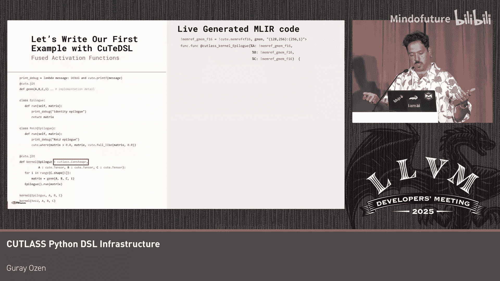

# LLVM开发者大会-US-｜-2025-Llvm-Developers-Meeting-p07-P06_CUTLASS的Python领域特定语言基础设施--BV1ejr5BAEja_p7-

Welcome everyone， and I am Guo Zang working in NVDA as a compiler engineer。

 and today we are going to talk cutla Py and DSR infrastructure that we have implemented。

So you might ask what is this Python DSL for Katla， isnn't Kala you know C plus plus for the library。

 Well， yes， it was。 It was a library。 but when project becomes so important。

 we have implemented a compiler for this and plus ship the DSL on top of it。

 And our DSL is called Q DSL。 It is a decorated base DSL。

 you can basically you know do PP install and then start using today。

 we have different decorator for you know host and device。

And since it's you know NviD GPU plus cutla， you might ask how fast is that what is the speed up。

 like how how fast I can go， Well， you can go very fast because the idea of this DSL is to give you the full control and the abstraction and by using these can you can really get the peak performance。

 and we have delivered a lot of examples kernels for different architecture and we also delivered Jupyter notebooks like tutorial for you And I am sure you will find a lot of material to understand and to understand how can I use this DSL。

 But today's talk is not about that， because here is a compiler confidence。

 And I would like to tell you like why did we implemented this DSL and what our like design choices by implementing this DSL。

 I am not gonna show any performance numbers。 please don't be disappointed。So let's start。

 So this is the place where we start。 It is our blue box。

 we thought that the ML layer is a good place to implement our abstractions because we can implement a dialects and we started with the MLRstream。

 So that is what we have。😊，And then we extend it。 They extend it means we model the Q algebra as a dialect in the MLR and on top of on top of the MLR oppositeidstream。

 And from this dialect， we have implemented transformations that cause the MLR Obidstream And here our critical dialect is the NVVM dialect right So we are actually pushing forward with this。

 So it is like a full dialect， there is no like inline assembly anymore。

 and and we are generating directly the LLVM inter6。 And then of course。

 after this we are going to LLVM dialect and then plus we are generating the Px。

 So that is our life now now we want to we want to make this programmable right And in order to make this programmable。

 I want to ship this from the Python。 And when I want to do this， I see this picture。

 the Python language right It's so large。 it's very large it is probably the out of subco and I don't have any tool to map any Python language in my MLR because you know we didn't build it yet。

And so， so then my question is， how can I capture MLR in the to the Python。 Like。

 how can I model the MLR in the Python。 right That is my question。 Well， actually。

 this is not even my question because I'm not developing a language this is not our goal And our goal is we need to deliver DSL for the cutla。

 And cutla is about the performance。 So my question is， what kind of Python feature。

 unlock the know writing the GP kernel fastly like quickly， and I cannot， you know。

 sacrifice the performance。 I can use all the Python features by we sacrificing the performance。

 So that is that is our goal。And before we start。So now let me tell you about the DSL like how they implemented there are like multiple ways to implement a DSL。

 and I'm going to talk about the three of them。 and the first one is the Python AsD and you basically take the Python AsD and then map to your MLIR or like IR。

 And the second one is the bytecode So you take the Python bytecode and then generate an IR and it's very like also called compiler。

 if you are coming from C plus plus or like Ras forran that is what everyone does there and the third one is like fundamentally different。

 It is the tracing。 you don't deal with the abstract synt today。

 you basically run the program and you capture as you go。 It is very different。

 So let's make an example， let's go like deeper。 So I would like to show you the ASD based like DSL idea you have the Python decorated function and you generate ASD say by to interpreter and then you map it to IR。

That is the whole idea。 But， but let's make it a little bit realistic example。

 And this here I am showing you an example。 This is very like simple， but yet complex。

 and it is very realistic in the machine learning。 What we do is we just do gem。 And then after gem。

 we have an epilogue like epilo， you know， I do， I do something with it。And in this case。

 for the epilo， I have two classes and the one co is basically dye and the epilogue。

 it does really nothing， but another class is doing the you know radio activation function。

 It is like， you know， and I I'm using the polymorphphyismman style because they are nice cool concepts and my code is is readable。

So now let's generate an ASD for that。 So this is the generated ASD。

 like alphatheically generated ASD for the decorated function， not for the everything。

 because I am only interested in decorated function that I am implementing a decorated base DSL。

So here is my A S D。 Let's understand the notes。 Go let you know line by line。

And our first line is the for loop。 and for loop exists in AD。 How nice is that。 You know。

 as I don't need to understand the cycles and do do stuff。 It's just there。 It's， it's very cool。

 So is it works for me。😊，And for the jam， I have a call。 and for the simplicity。

 we assume that we have implemented jam in a function。 and it is like really fast。

 And it is fine for the S the IC are not all good。And for the epilogue。

ops something bad to happen because you know Python is dark type。

 and I cannot understand in the AsD level。 what is this epilo。

 Like what is this calling what I am calling it is not really clear。 and what I need to do。

 I need to put more decorator insert more decorator to analysis for every epi stuff。

 So it is very hard So let's summarize the advantages。 So the advantages of AsD for me。

 it is like know your program structure is clear。 loop controlflow is there know everything is there It's nice theses is you don't get the Python features for three。

 you have to basically implement everything what you want in yourython AsD And when you do this I am sure it is not gonna be Python anymore It's gonna be something else It's gonna be DSL。

 So people to think in your DSL rather theyon Python。

 I think and your DSL will always evolve slowly because you have to first implement than go to DSL implement the mapping it is going take。

 So this is probably。The best idea。 Now， let's go to Ter and phase1。

I'm gonna to keep the the second one。 the byte code base one because it's very similar to the AsD is just the low level。

 but the one is fundamental different。 So I would like to， I would like to explain。

 And here we are not gonna deal with the ASD， but we are gonna execute the program with the interpreter。

 So let's execute。 since we interpret， I'm gonna also show what interpreter is doing。

 and first it read all the code and if you hit the the function called of the kernel， right。

 And here our the decorator will kick in。So on the right side。

 I am showing you the generated MLR code because as we go， we generate the code。

 So for your function， we generate some sort of MLR function。 It's cool。 And then for loop。

 we executed it and something bad happen again， now the python interpreted a。

 my loop because because in this case， Pyon is executing the python and I am capturing what I am capturing and the for loop is Python right So my loop is gone and my control if I had a control it will be also gone。

 So is this is not good right but let's run the epilo when I run epi。

 something magical happen is the magical weapon， like many， many many things happened。

 So what happened here I build the class， construct the class。

 and there is a polymorphic function call it worked And plus the function call is in line So my generated is that beautifully simple I didn't pay any cost for this So it is everything got generated nicely and I got the python features for free because the Python interpreter Python more than everyone。

I got those features for free。 So now let's go to the second kernel。 the invocation。 In this case。

 I have a different activation function， which is really。And I'm going to keep all the steps。

 but go to the the last one。 And in the last one， you know， you will see， you know。

 everything work as it worked。 We regenerated the IR， but the the epilo part is different。

 And now I am able to use the， you know， the the the re activated function。😊，So， okay。

 let's also summarize what is this。 Well， it is cool because I can use the Python features for free and I can use Python。

 you know， just just the meta program， but I am doing。

 but it is advantages is the interpreter going too wild and I can control is eating my program control for all my function calls and everything。

 And yeah it is probably not the best idea。 So which one I need to choose right I'm stuck here。

 but I'm not because I' mean in N mediadia， I can ask。

 I have a luxury asking people who is writing the kernels but do you need What do you do And so I I have collected two facts。

 and the one fact this is not I mean， it's very obvious that GP kernels。

 the fast GP kernels are like simple at randomta， but like bely simple。 There is no function calls。

 There is no know object programming polymorphphy no complex branching or like deeply fued logic is nothing You can have all of them in the GP。

 but not in not in the fast kernel， because we are shooting for the peak performance and that is。ど後？

But when you look at our you know kernel loads， they level of this concept。

 like meta programming and stuff， you know， the using the classes and because it's good。

 It makes our code， you know， readable and unless it C plus plus and but also it keeps our code clean and improves you know。

 readability。 and we we love those kinds of things。 but we don't want to pay cost。 So the。

Then our idea is the combine， you know， these two approaches and the combining means combining A SD and the tracing and。

 and we let the users to， you know， be friends with the Python interpreter。

 So the interpreter doesn't go via， you can't stop， which means capture the IR。

 And if you want to let the run the Python， then you can let the run Python。 And how do we do this。

 we have a constant expression concept。 And if you have the con expression。 your。

And we will run on the Python interpreter。 So what can be constant expition。

 like function arguments it can be or like， you know， variables。

 your controltour flow can be constant expition shapes。 if you care， it can be constant expression。

 but you will choose not me， right， because you know what what has to be captured what。

 what things doesn't have to be captured。 So then how is our compilation follow looks like。 like。

 we have like two stages and then one pretging， And let me tell you from the top。 like。

 look at the Python code。So from the Python code， we go to prestaging phase and in this prestaging phase。

 we read your python AsD and we generate another python。

 which is like a metapyython right And here we understand your control flow and the program' structures and we generate the callback and then you go to meta stage in this meta stage we have the metapyython program and we execute this with the Python interpreter。

 So in this we do miniing。 so we implement the callbacks and we do the tracing。

 we do the partial evolution， my type inference， you know。

 everything is here and then this result an object I like MLIR is like statically typed and the MLIR one that basically results the Q dialect and then I go to MLIR。

 this is the object stage So we finalize the code we generate the binary。

So let's make some example to understand like how you can use this debug this meta stage or like is what is happening in this stage and the debugging tool is not surprising。

 but it's just print because print working on the tracing tracing phase。

 It is our metapha and so how you can debug like what you can understand what kind of meta programming you are doing Let's make an example。

 I have three of them， I will show you all all of it。 Let's start from the beginning。

 and the first example， we have a and B， and they are not Mars cons expression。

 they are like and if they are not not cons， they are like dynamic。 They are the full。

 So I have a result and I do computation with them and when I do print。

 I don't see the data result because they a result is not evaluated in the metapha is not evaluated in the Python interpreter。

 you have to execute this program on your target architecture。And the second one， again。

 we have A and B， and B is a constant expression because you might so。And a is a python value。

 So it is also called expression by definition， right， And when you do the evolution。

 you see its value right away in in the print， because we evaluate it in in the python with by the Python interpreter in the meta stage。

 So your result I the object I has value of it。And the last one is hybridbri。

 like one of them is the B is the constant and the A is the dynamic。 and then in this case。

 we obviously like promote the constant monodynamic and you don't see the results。And of course。

 we have the， the regular printf our the cute print f。 And then if you use this print f。

 it is going to print the result， but it is gonna print the result on on on the binary。

 like after you execute the program。 So this is coming from your probably GPU。 So that that's。

 that's different。Okay， now let's go write the example I was showing you with the Q DS SL and we are not going to change a lot of things actually。

 And but but what we want， we want actually two things in this program。 I want to use epilo right。

 and I want to run this epi in the Python interpreted because I am using some meta programming and for du loop。

 I want to capture it actually it is it is not very hard。 So for the epilo。

 I am annotating it as a constant expression right。

Because I want to use the Python interpreter。 and the the for loop。

 let's go the for loop in the for loop， I don't annotate it with anything because I want to capture this value and。

 and if we don't annotate anything， if we use the Python's regular range and you will see the。

 you will see the I。 Currently， we are using the SF dialect for that。

But if you want to mark with the con expition， it is also fine。 You know， we have another one。

 And then in this case， you know， your loop will be run by the python。

 so it will be automatically unrolled。😊，And for the epilo， yes， it is， since it' a con， we will。

 we will evaluate by the Python interpreter。So that's how our DSL cogen part is working basically。

 And now I would like to tell you like like how how how this DSL can work with any other like the dialects we have in NVDdia because in NVD。

 we have like multiple dialects internally and we want to use the same DSL， you know。

 to to use them to use other dialects or to program the other dialects。

And when we look at the DSL features。 So here is I am showing。

 and the features are actually target agnostic。 I mean。

 they are not really they are not very they don't differ from when you go to one target to another target。

 like， for example， and the Aot T right it's kind of a target astic or like the G caching。

 It is like the target agnostic or you have， you know。

 you need to run the ML execution engine and G compile， all of this stuff。 like the LP。

 they are like target agnostic。 There are two things， which is the two big things。

 which is not target agnostic or and they are like type inference and。And the ASD。

 like the callbacks that is generated by the Python ASD。And。

 but we make sure that they can be extendable。Like， let's look at the， for example。

 the type inference and we have the built in types， right。

 and these built in types are shared by every other dialect because everybody is using the scalealrs。

AndBut when you have your DSL implementation， in this case， we are talking about the Q DSL。

 you will have own types and those types you know can work together with the existing the the DSL types。

 so our type inference is extendable。And another one is the。

The another one is the like generating the callbacks So so here like previously I show you the compilation flow and I mentioned that we have a python code and we go to like the the prestaging where we read the ASD and we generate the meta code like metapyython code in this case。

 our metapyython code like generates the callbacks So you have to implement this callbacks your own DSL like。

 for example， if you a DSL we we implement this callbacks to generate SCF like SF dialect。

For the control flow and for the other things you know， you can implement any other things。 But like。

 for example， if you want to implement another DS DSL S say my DSL hypothetically and you can implement these callbacks。

 know that can generate any other control flow that exists in your dialect and it is totally fine because so we want to make sure this the metapyython code is same and can work with you know every kind of dialect that we have that we want to use with with this DSL infrastructure。

And the last thing is the calling convention I would like to talk about because you might ask like how Python is your DSL Where is like very much Python。

 So we make sure this you can call Python basically from anywhere。 and here is our the calling con。

 I mentioned that we have like two decorator one decorator is the kernel that is the GPU1 and another decorator is digit。

 which is like any function， it can be host or device function。 and you can I mean。

 as you are seeing in the table， we can basically call from anywhere to anywhere。

 there are like two things missing here and for example， the last one kernel to kernel。

 we don't support it， we didn't find any useful case， So we don't support it。

 And another one is the Python function calling directly the kernel。 we also don't support it。

 we also didn't find any useful case because we always need to go to host to generate the TmaA scripted and then go back the device。

 But I mean， if you find useful cases we can implement this two of them。

 So it is not it is not like fundamentally hard。Alright， let me summarize my talk。

 So we have implemented the infrastructure and we delivered the DSL Q DSL under the Kaar supposed postorory。

 It is target diagnostic。 It can work with， you know， many dialects。

 It is working with many dialects internally。And our DS SL is like two staging and then one pre staging in the pre staging。

 we read the you know Python ASD capturing the structure and in the meta staging。

 we run the Python interpreter and in the object staging。

 we basically compile the static type code with the MLA。thanks， everyone。 This is the end of my talk。

Great patience。Hi， I think I saw that you allow custom decorators to inject your own ops from a custom dialect。

 is that correct？Yeah， you mean this one？Yes， so is there also a pass that you can register in with the pipeline to then lower that or how do you configure No like here you have we have the Python code and in the in the prest we generate like metapyython code。

 and I mean， for this example， we generate another decorator， which is basically a callback function。

 you have to implement in your sub DSL Okay thank you。Any questions？

Really cool How do you see this playing with the Python bindings We have an MLIR do you think like do you use them somehow or do you think this could augment them like provide a better way upstream to write like MLI from Python what's say our view on that So we are heavily using the Python bindings So we do there is the autogenerated Python bindings and we have reper for all of them because where we do where we convert our types and where we implement our type inference to basic MLR types so we are using it but we have a raper。

You， you can't directly access the Python bindings in this DSL it is not something that that we do。

Like， do you see this as like useful extension augmentation of the bindings that like would be beneficial to have upstream or I think it will be beneficial there of upsetstream。

 it is not up to me and up to management， but yes， since it is like target diagnostic and since it is using you know the builtin types we can't totally upstream it。

Thanks。Any further questions？I wonder how， how you deal with early exits in Python control flow。

 So are you able to map any Python control flow to MLLAR dialect of my choice。Yeah。

 that that's a good point。 So if we execute the control law on the Python interpreter。

 So if it's like a con expression， it is completely supported。 But because the Python， in this case。

 the interpreter does the early exit， not， not the MLIR， But from the MLIR side today。

 we generate anF dialect。 and we don't support the early exit。 But we have Pilan to support it。

What so so what would you， what would your reaction， I mean， it's dynamical code。

 SF doesn't support Alex we don't have to go the SF if there's a line if we can go。

 we can generate af， okay。Okay， thank you。嗯。So for the the second stage。

 the intermediate Python code。 So do you insert or do you like youve， like， how do you。

Executed the second time， like once you completely execute the entire python。Yeah we。

 we do well this。 Okay， so you are that。 Okay， cool thanks。Are there any more questions？

SoNow let's thank the speaker again。