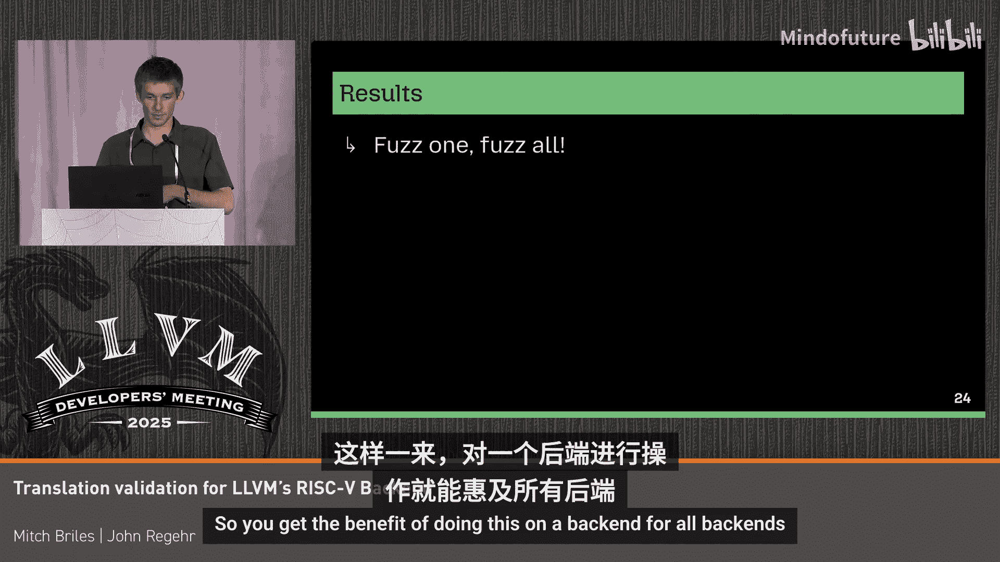
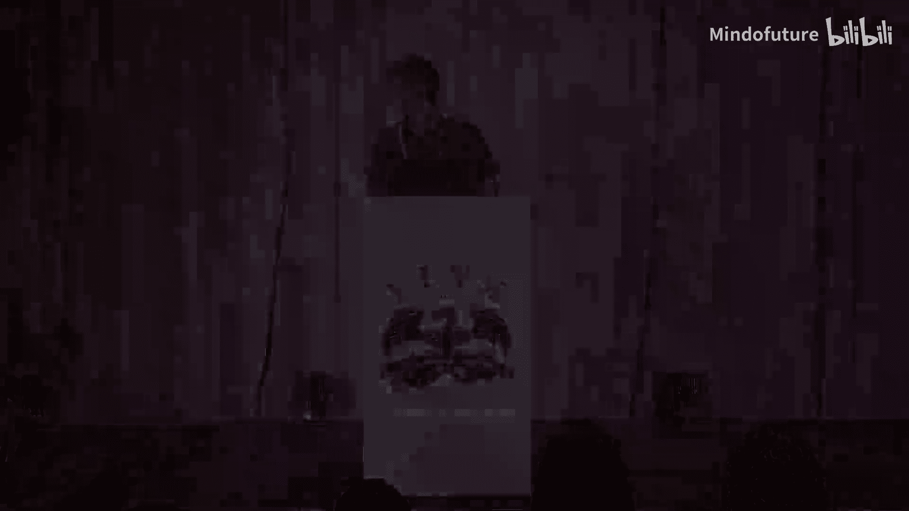

# LLVM开发者大会-US-｜-2025-Llvm-Developers-Meeting-p08-P07_针对LLVM的RISC-V后端的翻译验证--BV1ejr5BAEja_p8-

What's going everyone？My name is Mitch。I am an undergrad at the University of Utah， studying。

Computer science and applied math。I do some cool compiler research under polymer gear。

So today I'm going to be talking about translation validation for LLBM's risk5 backend。

So for this tool we need a life to， so just as a show of hands and peers， who here is used a to。一史呢。

Okay， soL2 has a tool called the Live TV， which formally validates refinements and it's used for like middle line optimizations。

And for those who didn't raise your hands， you can go hand。Tried out at aotitude。lvm。org。

So I like to or verify optimization using Z3。And it's designed for middle and optimizations。

 so it looks something like this。We have some optimization and we give the source IR and the target IR and give it to a live too and it tells us whether the。

Target is a refinement of the source， and we'll clarify what that means pretty soon。

So before we talk about verse5 TB。We're going to first talk about the first tool， which was on TV。

So this can be thought of as happening in four steps。Step one is to just invoke LLVM's backend。

Generate some assembly。Step 2 is to lift the assembly back to Ir。And keeping it。As a refinement。

And then step 3 is to call opt to。Get a smaller。IR to deal with of it。Arrive。And then finally。

 step four， we verify that the target is a refinement of the source。

What this means is the goal is to show that。Each of these steps， one， two。

 and three were all refinements of the previous。And if we get an error。

Alive says that this translation did not violate。Then that means that one of these steps was not a refinement because refinement composes。

So where I come in here is with riskk5 TB。And risk activity is mostly the same thing。

 The main difference is going to be in the lift there。

So there's a couple of reasons why the lifter is a little bit easier for wristwi。First of all。啊。Well。

 the main reason is that。There's no flags， so we don't have to deal with state and we don't have to deal with undoing flag computations。

Like wehab to with R。So。Let's talk about how the lifter works。

So the first step is going to be allocating storage for the registers。And。Then we allocate a stack。

And you at the AI。And。The reason we're doing all this is to basically emulate a execution environment for a risk body function。

So once we have this emulation， then we can translate each instruction into L ofVMIR。

And the way we do that is we load from our emulated register file that we have on memory。

 we get the arguments。And then we do some operation on them with semantically equivalent IR。

And then we store the results back in the destination registers。

So here's an example of the internals of the lior。So what we're just doing is we're getting the up brands from the registers。

And then。Using ad operation from。LBM and the reason this is so simple is because。

We're lucky in this case that LDM's a function has similar semantics or exactly the same semantics as the risk5 ad instruction。

But this doesn't always happen。So sometimes there's some edge case like maybe it handles one specific input differently and we have to do some trick。

 or in the case of some instructions， there's just no LLVM equivalent。We have to fully。

Fluush out the semantics of it。And one thing to keep in mind in these cases is that if we're implementing some instruction like this and we need several。

LLV instructions， then we want to do this in a way that is solver friendly。

 not necessarily performant or something else。So you could implement this with a loop or with some vector operation。

 but it turns out it's best in our case to just stream together some bit manipulation operations so that alive can more easily prove。

The translation。So after all that， we get a bunch of lifted code。And the system。Like a lot。

 but most of it， the stuff and yellow is just。Like register allocation。

Or buttonten by Ro shell ising mean， storing the registers in memory。

Allocating a stack and some other spur empty basic rocks。So if we turn all that down。

 what we're left with is a nice mapping here。嗯。We can kind of think of this final target function we have here as having a pro log where we're doing all of the rest allocation here's an example of。

emulating a register number。And then we can see by the highlighting that each instruction has its own basic block where it loads in its arguments。

 does whatever it needs to do， and then stores the result back in the destination register。

 and then that's kind of the body and then we have the epipalo for the ABI on the return instruction。

Basically enforcing bit widths or sign extension， there's zero extension， whatever it needs to do。

So once we have this whole system， then we need to start feeding tests into it to look for bugs。

So where do we get test？Well， one place is LDster suite。This basically contains a lot of the tests。

 basically it's designed to be testing what we're testing。

 so of course it's going to contain the patterns we want。We also use YRP Cha。

 so YRP Cha generates randomMC functions and then we compile it to IR and use it as an input。

Then we have a lot of mut made by Yuf。It creates slight variations of existing IR。

 so it could be inserting some instruction or inserting some argument or changing a bit with something like this。

Then we also use this。Kind of a mouthful name of a project， elegant mutation based Bu service。

And this has another good indicatorator。 It's made by。因为将。WHas helped us a lot with this up。

So let's talk about an example。Here's some IR where we have a count trailing zeros。Being called。

 And that that second flag just。Determininees whether an input of zero returns poison。

So what this pattern is doing is saying if the input is zero。

Then returned 0 else returned the number of trailing zeroes。And in risk five。

The count trailing zeros instruction does not behave this way。

So it returns just the bit width in the case。That we have an input of zero。

So if we look at the assembly now。We have this or with 256， which is setting a sentinel bit。

So that if we do call count trailing zeros， we get the bit without out of it。

Then there's this and instruction here that is masking off。The high bit with the eighth bit。

Sorry not to get the be forlift。Which just is handling the case where we get an answer of eight。

And so we get this select thing kind of cleverly handled within this single and instruction。

So a lot of mutate took this function and said， what if we had an I7？

And then the problem may or may not be apparent now where we have a problematic mask。

So this mask is six。Binary 0，1，1，0。And now half of inputs are wrong。 so it appears that。

The way that this mass is computed is by just subtracting one from the ditwi。诶。

That doesn't work in this case。So we realize we can't do this optimization。

 this folding in the back end with non powers of two。

So I made a PR and now we have some different cogen， but now it's correct。

So what are the results from doing all this testing？Well， with RTV。

 RTV was a big project to had a bunch of people involved and paper just got published。

We found 45 previously unknown miscompilations in the AR64 backend。What about risk5 TB。

 but we found just one miscomple thats specific to risk five？So that's pretty interesting。

 but it's a little misleading because。We also detected some unfixed bugs found by RTV。

 and we're just kind of trying to avoid double counting here。So。Why首。Why are there a few bugs in the？

Secondend。Well， it could be that because of the nature backckons。

The amount of shared code on TV may count。Ma have found a lot of these lower hanging and fruit and easier to find buck。

It could also be that a lot of these bugs were fixed by。Folks like Craig Topper。So thank you。

So we learned that by fuzzing one backend。We got the benefit of fuuzzing many backends or all backends because of the amount of shared code here。

So。Not only are we finding less bugs because they're getting fixed and detected by previous buzzuzzing attempts。

啊。But're it's also becoming easier to make the translation validate。

So you get the benefit of doing this。On it back end for all backends。

And that's all I have for you today， thank you。Thank you so much。

 which got a few minutes for questions。Any questions。Great talk and thanks for working on this。

 I think this is like a really interesting area。And yeah。

 I'm also really surprised to see that it was just that one book that was fine and I'm kind of skeptical almost because I know there's a lot of。

And written code in the specify that。ProI'm curious。

 were there any particular riskfi architectures or？

Profiles or extensions that you were looking at whenever you were lifting。If this might be。

Our reasons lie。明明知道。Yeah， so great question。 We chose to use a very specific set of。Extensions here。

 it was just like fit manipulation， some floating point extensions。And。

These are just what we were told are kind of the common extensions to use。One question might be。

 can you have you tested every like combination of the extensions or something like that。

 and that could be something useful to do， it's not really clear We also didn't test the re vector。

Extension， which。Double or triples to the size of the ISA， I think。

So this is probably a place where we could find bug the reason we didn't do that is because aI doesn't support these scalable vectors。

Thanks。不知道。I'm curious about like how to if somebody's interested in using。

Theres how much of this infrastructure is like already the upstream。

 is there a way to I kind of trigger just like buzz tasks right from the upstream audio here。

 what is it？Part of a different court base and you a point of end。This lives in its own repo。

 but none of this is really upstream。So。A lot of the work is just the lifter that's specific to this project。

嗯。We also don't have a way to do this like from。F my logian， that's interesting。嗯。Yeah。

 does that answer your question Yes thank you Amy， one more question is kind of an extension to this question。

Is there like anything in the approach that prevents you from founding？Micompilation box。哦。我自己系食个线落嚟。

To be having any plans about exchanging your analysis。Do I find other。但完食咗之后。

We're not really sure what exactly what classes of bugs we're not finding there's some interesting ideas like it's possible that we can undo a bug。

That's annoying， and I don't want to speculate about how likely that is to happen or anything like that。

啊。But。Going forward， one thing we might do is first of all。

 be able to support more extensions and test more of the back end。Another thing we could do is。

Improve our buzzing。So right now we don't know if。We don't know if our fuzzing is sufficient。呃。

We could just need better mutations， more mutations， something like that。Any other questions？

I was curious if the RT may be just overcounting wondering if you tried anything with like WLOVM or you you don't need a lifter。

 you just have LV bit code the SART， or if you're sure it's happening in star selection or register allocation for arm TV stuff。

 could explain why you're seeing so much fewer for。Rek five。It's not totally clear。

 I didn't really talk about that much because we don't really know it's a little hard to track what bugs were fit。

 whats were。Existing in both backends。嗯。We probably have to go back。嗯。あので。

Look at PRs and what people are talking about。啊。So talking to me after， but I don't want to。

I don't want to speculate too hard about why it's so low。All right。

 let's get pitch another round of applause please。

