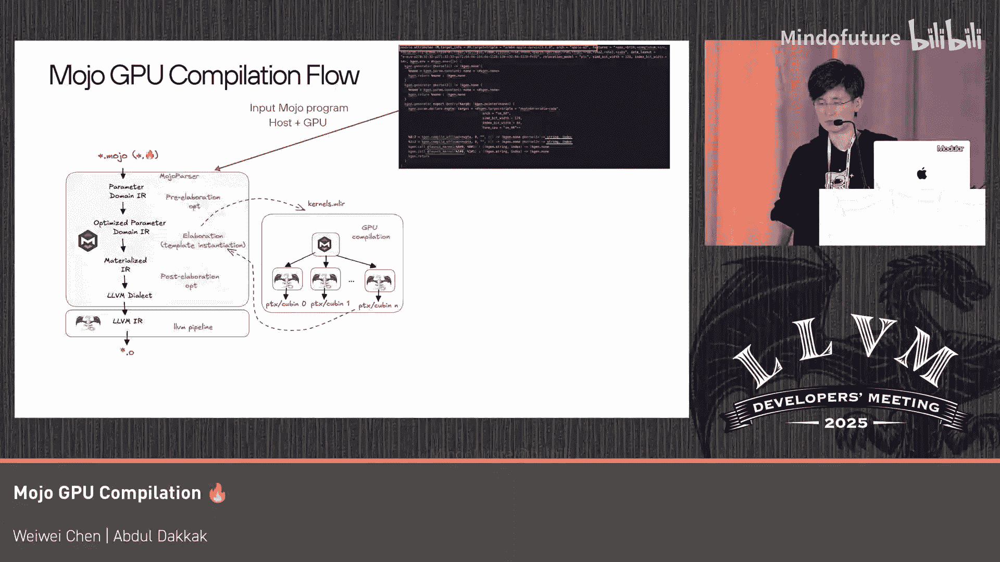

# LLVM开发者大会-US-｜-2025-Llvm-Developers-Meeting-p09-P08_Mojo的GPU编译--BV1ejr5BAEja_p9-

Hello， I'm Wei Wei。 I work at module language team at moduleular。 Today。

 I'm going to have a quick talk Let talk about module GPU computation。

So Mojo is the Pythonic system programming language that we're building in modular。

 it looks somewhat like Python but it also has a lot of superpower kind of features for support for generic programming。

 a strong type system and memory safety is we believe a best way to extend Python to both CPUs and GPUs it is very fast。

 it's Python， but it's like CC++ kind of performance。

 it is also one of the badro for modulus max inference engine One of the feature that we really help us building stuff internally and also get more and more interest from the community is that Mo provides a unified programming model for for both CPUU and GPU so you can unlock the fullpower of a standard Kuda and rockM but you do not necessarily have to use we do not actually。

The vendor tool it to get those performance features。

 so you can still have threads and walks and the WMMA instructions written in the Mo library without having to use Kuda and all of the GPU kernels that we have are written in Mo and they are scalable for different GPU vendors including NV MD and Apple most of the GPU features are actually part of the Mojo standard library。

 so they are Mo code instead of compiler magicic， so which also makes the compilation much。

 much faster。So this is how kind of a unified module program look like with a GPU kernel defined at the beginning of the program and the CPUO driver code that we get the device context。

 we create the buffers on the device and then we do this inQ function function call。

 we provide the kernel function as a parameter to that function and then underneath the compilation you will do compile the kernel and launch the kernel around the kernel and after that we can bring the buffer back to the host。

So zooming into the module GPU compil flow。 So there are multiple stages。

 big stages for module compil。 module file source code goes through Passer。

 We will first land into the parametric IR domain where we will do semantic checks and some of preliminary optimization。

 and then we enter into the elaboration phase， which is similar to C template instanti So after that。

 all the parameters will be， all the I are computerized and then we do more optimizations and then go to allM to generate binary code。

 So GPU computation happens during elaboration phase because as you can see in the previous slide that a GPU kernel functions is provided as a parameter to the in function and compile。

That library interfaces。 So before elaboration， we have everything in one MLL module。

 both GPU code and the host code。 So during elaboration。

 we know that we want to compile two kernels to NviD backend so we will slice these two kernels into one a separate MLL module attach the target information Here is NviDdia to the module and we will run through the whole compilation the same as the CPU side just with the different target information and then we will use our parallellyzingium backend to generate to slice different kernels into separate L module and then go to the kernel So after this part we will have here we are trying to compile two kernels and we will get two p X for each of the kernel and then we will plug in this compiled result as the return value of the KGn compile offload up so that we can consume it。

On the host site to either do print or go to launch the kernel to run it。

So this is more or less what the competition flow look like。

We can also control when we want to stop the computationil for the kernel to support debu。

 We can say， oh， I want to see the M I R or do I want to see the assembly I R。

 or do I want to see the final object code so this can all be control at the the library level so that the library will tell the compiler when to stop。

So as a conclusion， module provides a unified way to write both CPU and GPU kernel in one language。

 So most of the features are driven by module library as a module code that makes the compiler much simpler。

 We don't have to do a lot of heroic magic to accommodate the programming model ML is very helpful here for us to have a seamless compiler integration that we can just add different ops to extend the capability of the compiler。

 We do not have to change the parel of the language。

 and we can also use upstream dialects for like NVBM rock DL and L VM directly plug into the library because module is also syntax tri for M dialects。

So this approach is actually not just restricted to GPU generally it is。

 we believe that it's generally applicable to any other accelerators as long as they have a backend。

 then will be pretty much similar as this flow looks like。 or if it's based on M IR。

 then we can plug in that as a module DSL to support that。

 So all the module GPU kernels today are open sourced So you can see how we implement those performance kernels in in the module code。

 and we will be at the post session tomorrow。 So come talk to us if you want to learn more about it。

 Thank you very much。