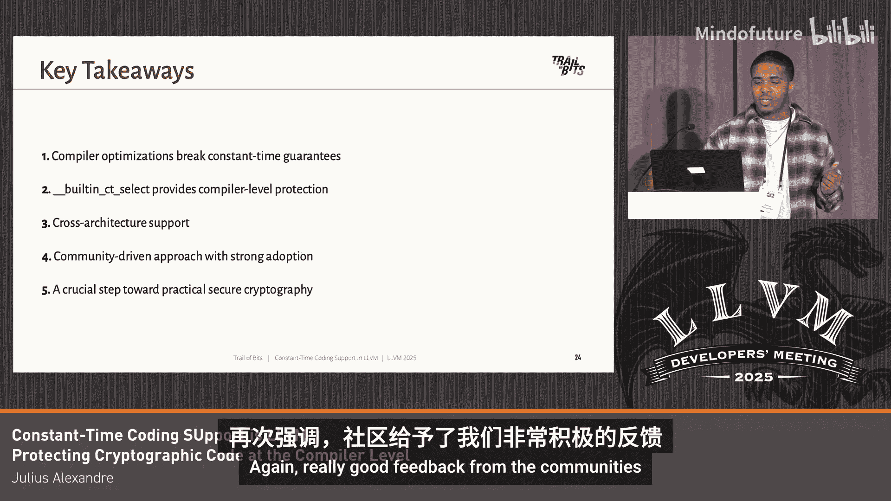

# LLVM开发者大会-US-｜-2025-Llvm-Developers-Meeting-p10-P09_LLVM中的时序抗干扰编码支持--BV1ejr5BAEja_p10-

Hey everyone， today I'll be giving a talk about how compilers break cryographic co bases。

So compilers are incredibly good at their job， maybe too good。

 and over the past years it's just been improving， especially when it comes to optimization。

 we have commonly known features such as low vectorization， deco elimination， constant propagation。

 and so much more。And while these optimizationim magic could be features for most co bases。

 in the case of crypttographic libraries or cryography。

 it becomes a liability and essentially breaks it。Because an example。

 crytographer rice is carefully crafted bit mass code， expecting it to be constant time。

 it goes to the e pipeline， goes through several optimization passes。

 or' to the middle end or the back end and results in this X86 General assembly。And as you see。

 there is a JE or Juif equal， which essentially means we have data dependent branching。

 which open doors for timing side channel tag。And what this means is attackers are able to measure the different variations between each instructions。

So， in the case of。If I'm sorry， if I is equal to secret index。

 then we jump and because of that jump， it requires a few more cycles compared to if we didn't jump。

And because of that， attackers are essentially able to infer or leak secret information。

And while this seems like a relatively simple optimization。

 it leads to like catastrophic vulnerabilities affecting millions to billions of systems。

And we could take this a step further， a group at the University of ET Zurich did a study called the Breaking VAd。

 which essentially showed that they compile eight cryptographic libraries。

Against LLVM and GC across different compiler versions。

 different optimization levels and different architectures showed that there were over 44。

000 test configurations that had compiler induced vnerilities affecting normal library researchers boringing SSL。

 open SSL， HHL， and so much more。And this essentially tells another story。

 showing as that there's possibilities for even larger scale vulnerabilities affecting systems。

At a rapid pace。And theres there's been work to try to mitigate it， but none of it got upstream。

 so we were never able to reap the benefits of it and you're probably wondering like you know what are photographers doing nowadays to mitigate it。

Their solution is not any better， they're using some sort of like inline assembly。

 which isn't portable nor is it maintainable， orre doing some sort of bit mass hacks in the hopes of it bypassing optimization。

 but even proven that it doesn't and sometimes it still get fold resulting in the timing side channel vulnerabilities and if push comes of。

 this's just disable optimization which kills performance。And so what do we do about it？

Our team at Chlippis created this built in the Tics。

 which offers constant time guarantees across all optimization levels and across multiple architectures。

 it essentially acts as a optimization blocker or barrier。

Otimization passions like ins tocom will know this intrinsics is off limits。And， it's。Prescriptive。

 not descriptive。 So we're telling the compiler what to do or rather than describing it what to do。

So we go look at the same vulnerable goal we saw previously， but where built intrinsics。

 it goes to the L pipeline and goes through those optimization passes and results in this x86 generated simply and as you see there is no branching happening or data dependent branching and。

We just generate the X86 constant time code associated with it and the great thing about our intrinsics is that for architectures that have native conditional move or conditional select instructions。

 we just resort to using that and for instructions that don't have it like in the case of arm 32。

 we just generate bitwise operations still offering the constant time guarantees。

We could look at one of our pipelines for the architectures that we have support for in the case of X66。

 arm 64 and arm 32， and go to the storage code， go to the clean front end。

 the IRABuilder which creates the L intrinsics that's associated where built in intrinsics。

 goes to the selection day then at postRA or postri location， essentially where the magic happens。

 we essentially do the expansion at postRA after all optimizations so we don't have to worry about optimization passes folding or merg or code。

 allowing us to generate the needed constant time code for the associated architecture。

 and we also have support for thumbumb1 and thumb2。I 386 follows a similar path pipeline。

 except this is like a bit of a unique case， so we have a two we have two phases we have a customer serverer to help alleviate some of the e flag issues along with  type legalization。

 but we still do。Post expansion at post RA allowing us to have a bitwise operations and like the same story for arm 32。

 there is no sea move or yeah conditional move， so we just resort inter generating the bitwise operations still offering the constant time guarantee。

And the great thing about our implementation is for architectures that don't have native support or we didn't add native support or also doesn't have like a native conditional move or conditional select instruction。

 we still offer a constant time guarantee， this pipeline takes the full by pipeline takes a different strategy instead of us doing it at postRA we do the constant time enforcement at selection D phase。

 we do Dg chaining operations essentially creating artificial dependencies between them。

So once it goes to the LVM pipeline and gets lowered， LVM is known not to touch it。

 so wont break the dependencies。We got very good strong feedback from the community there's been previous proposals to try to medi this and like I mentioned previously none of them got upstream。

 we got some good feedback from cryers along with Aivium developers and we also were able to work with the group at the ETA Zuric to use our built in intrinsics against their testses showing that we got really good results for all the architectures and also showed that。

Chotographers have a easier way of using or built thes rather than doing some you know。

 weird hack in the hopes of a bypassing optimization。And outside of C plus plus support。

 we're looking into adding these intrinsic into。Rs。And also since Sw。Since so if it uses LVM。

 it could use or build an intrinsics too。Since we already have support for Web assemblymbly。

 browser based cryography。Benefi feltt for this too。

 and GCC and Cranlifte could look into following footsteps into having these constant time guarantees。

We're also looking into having like these built in intrinsics for certain arithmetic operations。

 so for like in case of division of multiplication。

 along with having the constant time intrinsics or constant time guarantees for entire expressions too。

Some key takeaways， compilers killed the integrity of cryptographic libraries built in intrinsics。

 essentially it offers。A compiler first concept in terms of having these compile level of protection works across multiple architectures。

 again， really good feedback from the communities， and we were able to this is a really large step in terms of having a security for metigating timing side channelnel tech specifically for branches。

那。