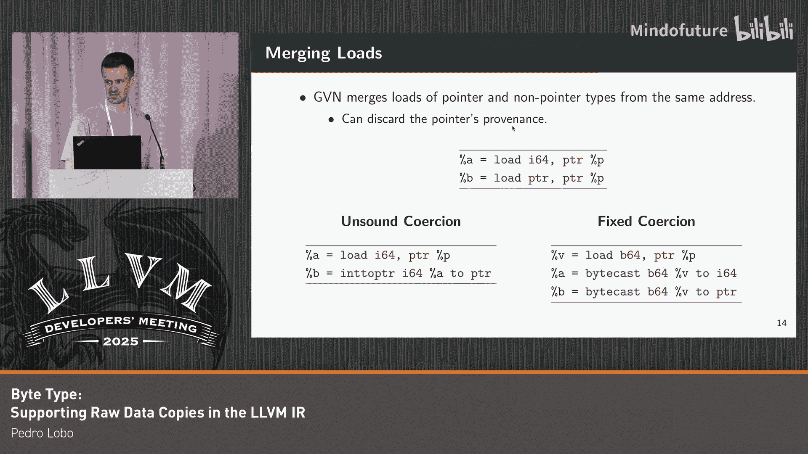

# LLVM开发者大会-US-｜-2025-Llvm-Developers-Meeting-p11-P10_支持LLVM-IR中的原始数据拷贝的字节类型--BV1ejr5BAEja_p11-

I like to start by by sharing some shocking news， which is that we cannot currently implement them copy in L VMIR。

If we consider MMC implementation in C， as you see here。

 we see that a copy is performed by by byte using the unsigned chart type。

This particular implementation is correct as it is backed up by the C standards， which says that。

Any value may be copied into an array of ens charts and that and we may access and manipulate the the object representation of that value。

 This object representation is given by the set of widths that compose that particular value。

So on the intermediate representation on the right。

 you can see that the loads and stars through the uns chart type are now represented。

 as you can see here， in loads and stars through the IH integer type。

This invalidates the IR implementation as the integer types in L VM do not possess the same properties as the unsigned chart type。

There are two main issues with the M copy implementation。

 The first issue lies in copying patting bits and the second issue in preserving pointer provenance across pointer copies。

 So I will now delve into。Each of these problems in more detail。So for the first problem。

 which lies in copying patting bits we see here a structure as a structure composed of a short and an int。

 as you might know the short is2 bytes wide， so the compiler is free to introduce two bytes of padding between these two fields in order to satisfy alignment requirements。

EBelow， we see the definition of the same structure in the L O VM intermediate representation。

As you can see here， the two bytes of padding are made explicit by the array of two8 bit integer values。

So currently， LLVM uses the poison value to represent patting bits。

 which constitutes the first problem with the M CO implementation。

So currently integer values track provenance on a per value basis。

 which means that if we try to load the whole structure as an ICC4。

 as often occurs when performing load widening optimizations。

We will load the whole structure as poison， even if a single bit of the 64 bits is poison。

 which is problematic， as we will copy the whole structure as poison and start to memory。

So to give a background on the second problem which lies in copying pointers。

 I will now briefly introduce the concept of pointer provenance， which is not widely known。

 So as you of some of you might already know， pointers in LVM are not represented as plain integer values。

 These are represented by some additional metadata that is meant to be used to justify optimizations。

So we can represent a pointer as an object identifier and an offset value。

Different allocations return a pointer which refers to an un unique object identifier。

So in this particular example， we see two allocations given by the called tomaloc。

 and these two allocations return to pointers P andQ。

 and as you can see both PN are based on different objects and therefore they get assigned a distinct object identifier。

Furthermore， pointer arithmetic operations are set to preserve the pointer's provenance。

 only modifying the offset portion。In the example， you can see that adding both two pointers P and Q originate two different pointers B and QJ that maintain the same object identifier。

 but have distinct offsets。So tracking pointer provenance has the main advantage of simplifying AliaIS analysis。

 which enables other optimizations。In this particular example， we see stars through both pointers。

 B I and Q J。And the compiler saying these two stars is allowed to assume that the two stars do not all with each other as these pointers are based on different objects。

 so this is valid even if P and QJ end up having the same underlying address。So as I already said。

 pointer provenance simplifies alliance analysis which can in turn enable other optimizations here in this example。

 we want to print F the value pointed2 by P。And as some of you might know。

 we could constant propagate the value in the store and directly print the value1。

 This is only possible because we use pointer provenance to guarantee that the two pointers are based in different objects and therefore we can perform this particular optimization。

So the second problem with the MC implementation lies in preserving this provenance information across pointer copies。

So currently in memory， LLVMIR has typed memory， meaning that we can distinguish between two types of bytes。

 The first type is a pointer byte， which along with a value holds this pointer provenance。

All the other bytes can be thought of as a integerbyte， which contains a numerical value。So。

 currently， loading。The current semantics of the IR defines that loading a pointer through an integer type in order to avoid casting the pointer to an integer and discarding this provenance。

The load result is poisoned， so when we load a from memory as an integer， the result is poison。

So if we're trying to copy in mem copy a pointer value。

 we'll load the whole pointer by as poison as you can see here。

So there's an alternative semantics currently being discussed。

 which was proposed by the Ru community， where instead of returning poison when loading a pointer through an integer type。

 we instead return a pointer with no provenance。This is good because the resulting pointer has no provenance and it cannot be the reference。

 which means that it can only be used in comparison operations。However， even if we adopt semantics。

 the current mem copypy lowering is in sounds， as we still discard the pointer's provenance。

So our solution to this problem is adding a new type to the IR， which we call the byte type。

 this new type is able to represent the raw memory value as it is。

 being able to load both pointers and integeror memory without discarding the pointer's provenance。

Furthermore， loads of padded values do not taint a load result。

 as the by type can maintain and represent individual poison bits at bit granularity。

So our plan is to also lower C and C++ RA memory access types。

 which includes the character types and the C++ Turn byte type to the byte type， as you can see here。

This new lowering， lowering this types to the by type， makes the lowering of the M copy correct。

As we're now stor a bitte to memory and loading a bitte from memory without introducing implicit cast。

Our proposal also adds by constants， which are needed to initialize global variables。

 These by constants are strictly equivalent to their integer counterparts。

 So here we see a structure containing an int and a cha field。On the right。

 you can see the corresponding LLVMIR， and this cha field is mapped to the byte type。

 which is anH bit byte type in this case， the B8。And that constant， the constant C。

 is map to the by constant 67。We also add a new byte cast instruction。

 which allows conversion of byte values to other primitive types。We allow two versions of the cast。

 So by default， the default version of the cast performstying。

 which it means that it reinterprets possible pointers as integers by discarding their provenance。

We also allow a variant which does not perform type panning by specifying the exact flag。

 which returns poison if the type of the value held by the byte does not match the cast destination type so in this particular example if the load on the right loads a pointer bytes。

 we're trying to cast it that pointer byte to an integer type and we will get poison as the integer type does not match that pointer type。

So here we see a simple C function， which adds the cha value to the constant one。Currently。

 L of V M and soundly lowers this cha value to an 8 bit integer。

This8 bit integer is then sign extended， the addition is performed。

 and then the addition result is truncated back to an 8 bit integer as required by the C standard。

So with the byte type， now the cha value is represented as a B8 value of the byte type。

 this byte type is then cast to an integer with the type pointing variant of the cast。

Possibly reinterpreting pointers into their integral representation。

Then the addition is performed as before， and then the the truncation result is cast back to a bite as this function returns at cha value。

Furthermore， we also extended a truncate and logical shift right instructions to accept bite operas。

So this is beneficial to implement star forwarding optimizations。In this particular example。

We store a byte to memory and then load it back at an offset instead of starting the byte and then loading it back again。

 we can instead shift the byte by 16 bits， then trunccate the byte value to a single B8 value and then reinterpret that as an integer through the byte cast instruction。

It is important to note hear that the truncation between bytes is needed as if we did bite cast the big T2 to。

To an I32， we could spread poison bits if the B 32 value originally contained either padding bits or pointer bits。

So with a new type， as you can see previously， loads and stars were performed through the integer type。

 which had the problems of discarding pointer provenance and spreading padding bits。Now， the new。

 the new lowering， the new lowering stars and loads this， the these values through the byte type。

 which maintain the raw memory value without introducing implicit casts and spreading poison bits。

Similarly， we now altered mem compare because mem compare previously lowers。

The raw memory value as an integer value， which disabled pointer comparisons as if we load the pointer as an integer。

 we cannot use M compared to compare pointers because the load will result in poison。So similarly。

 now we load the raw memory value through the byte type。

Which does not introduce type implicit cast and type pen。

 And then we cast the resulting raw memory value to an integer type performing type pen。

 which re interprets pointers into their integral representation。

 This is beneficial because then the two pointers can be compared with the sub instruction。

It is important to note that if we adopt the alternative semantics of returning poison。

 of returning a pointer with no provenance。Instead of returning poison when loading a pointer to an integer type。

 we avoid changing this current mem compare loading， which will be sound over pointer values。

So another application of the by type is in some and sound value coercions that are mainly performed today by GVN。

So here in this example， we have two stars from the same memory location that typically happen in different branches。

 and Gvian typically tries to merge these lotss together。So on the left。

 we see an unsound coercion as the value of the pointer in B is replaced by。

By a load of the integer and then we cast the integer to a pointer to the into pointer instruction as you might know this is in sound as if a pointer is stored in memory。

 the original program on the top will return that same pointer in value B and the end sound coercion on the left the value of A will return poison and the value of P will itself be poison as well。

So with the byte type， we can load the raw memory value without introducing implicit casts。

 and then we can use the bycast instruction to cast it either to an integer or to a pointer avoiding this implicit type burning。

So we did implement the solution and benchmark it using the For suite where we selected a set of 20 CNNC++ applications。

 as you can see here。So for compiled time， we did not observe any meaningful regressions as this type between minus1 and 1%。

 and most of these can be justified by statistical noise。Similarly， fund and time performance。

 we didn't observe any major regressions。For peak memory usage is the same story。

 This fit in a range of 0。5 to -0。5%。And for a binary size。

 we initially did identify some regressions which were mainly caused by loop vectorization differences in the cost model。

 which caused us to our version to vectorize some loops， which then extended code size。

So I'm going to skip this slide because we're short on time。

So we also implemented the byte type on a life 2。EAnd ran live2 over the LL VM test suite。

We found that by introducing that by type to the LL VMIR。

 we fixed this tests that were previously reported as in sound by。

So mainly these tests were caused by unsound lowerings of mem compare me copy to load star pairs。

 and some of these tests were also caused by unsound value coercions mainly performed by GVA。

In conclusion， the， the introduction of the new type fixes longstanding issues in the L of VMIR。

Which now can represent raw memory values without introducing implicit casts。 Furthermore。

 the new type enables the native implementation。Of various intrinsics， such as Mem copy， Mem move。

 M M compare。We also use the new type to fix existing and sound optimizations。

These optimizations caused miscomulations in real world CNC++ programs。

 and adding this new type lays a solid foundation for existing optimization passes to manipulate raw memory values。

Our implementation spans across 2。6，000 lines of code， which corresponds to roughly 0。

05% of LLVMs and KLGs codes。So this then the byte type does not incur in any major performance regressions and constitutes a major step towards a more correct compiler。

And thank you for your attention。Thanks， Peedro， we have five minutes and a little more for questions。

And I'm not checked recently， but I think as of last year。

 this representation of explicit representation of padding was not。Consistent， sometimes it is。

 Sometimes it is not explicit。Yeah， I don't know if it's not related directly to your talk。

 but I don't know if， you know the reason behind that and why it's made exclusive that all。 Yeah。

 I don't really know the reason behind it， but I know sometimes it gets lower than  zero initialize。

 I think。And sometimes it gets lower at poison bits。

 which makes sense because if we are emitting to real hardware。

 we might need to initialize it to some concrete value。 therefore the zero initialized。

 but I can say that current semantics implemented in a alive are that betting bits are represented as poison yeah。

And that cannot change easily。 you， you know， like， for example， sitting into 0 or something is not。

facinging some problems。 I don't I I。So I think that changing that to 0 would be a refinement。

 So I don't think that will be that willll introduce problems。

 So I think we can go from poison to to 0 initialize if there's some stronger will to do that， yes。

Can you go back to slide 11 I don no，1414。Could those bike casts be exact。yeah。

 it depends on the context， on the context， on the。

 on the semantics we adopt for the load instruction， so。There are， as I explained。

 there are two main semantics。 So we either dis typeing by returning poison when loading a pointer through an integer type。

Or we return a pointer with no provenance。 So if we adopt the second semantics。

 I think the the nonex broadcast would be would fit here。 So with the current semantics， yes。

 this by would need to be exact， yes。

So course。Hello， yeah， on a。You know， CC plus plus compiler。With。え。

It's not just car and bite and such that can alias random types in the real world。

 although that's what the standard says。 I was wondering if you had tested this with， you know， like。

We have unions that allow arbitrary type casts。 We have no strict aliasing that allows you to。Do any。

 you know， type pun you want。 I was wondering if you had tested or implemented any support for all of those real world things。

 The standard says you aren't allowed to do， but it actual code does。 Yeah。

 because I think what the standard says is that y sign chart chart。

 sign chart in standard byte can be used can alias with any other pointer can be used to access an object representation。

呃。That trick， you mentioned about the the unions and the type burning。I I'm not really sure。

 but I think that's undefined behavior。 So that's why。 no。

 so it'shi it's undefined behavior in the standard。 But in planning and Gcc both document this。

 supported extension。 They yeah， they emit the M copy， I know， but yeah。

 we did not test it with we just adhere to the standard。 So we only support， yeah。

 we don't support union is char and San the character types and standard。 I guess。

Given that you observed no runtime performance difference。

 would you expect to see one if you omted every load in store。Instead of just those as a byte type。

If we emitted like every integer load， every size of integer， right， If I load an int from memory。

 Yeah， if I do that as a bike type as well， not just the。Size， one mite load。I mean。

 the by type is meant to be used only if we want to preserve the raw memory value。

 If we I understand that。 But if I'm writing a M copy， Yeah， I might do that word at a time。

 I might use an int， right， to load and store my。Pointers from memory。 if I， you know。

 happen to know that it's more than4 by， so。And， and， you know。

 real implementations of me copy do this， even though it may not be strictly， you know。

 be extensions or whatever， right， So I guess。Yeah。I guess the answer is， no。

 you haven't tested that。 Yeah， we haven't tested， but we could test it Yeah， but I don't know。

 I don't。 I don't have any idea if we we' have any， any impact。Thanks。即 can you explain playing。

Can create the defense between the pointer of the low buffer type and the point of the I H what。

The pointer what the difference over there。 I I didn't get that power。

 So I think I didn't get a question， but it was， what's the difference between loading a pointer。

 The pointer of low points and the pointer of the I 8。 okay。

 so the difference between loading pointer through an I8 into a B 8。

 So currently lowering a pointer through an I 8 integer types do not track provenance information。

 So。The current semantics is that when we load a pointer through an integer type。

 the result is poison。 The byte type is more more accessible。

 as it can represent a pointer without discarding the provenance。

 So if we load the pointer as a byte， we have the raw memory value without implicit cast。

 So you have the pointer。 if you use an integer type， you get poison。Gly should moved the point。

Sorry， can you generally just remove the pointers in the memory。Remove Egypt。Yeah。

 because you don't have the pointer in the memory with the pointer of the bike buffer low buffer。

 low bite by。 So I did didn't really get the question。 It's not remove pointers from。I。

 I want to know when you are like doing the memory copy things。 And actually。

 because of you are using the pointer of the low width。 So there's no point over there。

 So the copy or like， okay。 Yeah， the copy would be okay because the by type can represent either pointers or integer values can represent anything that can be stored in memory。

Time for one more question。I don't think it is。All right possiblysibly related to James's question I was wondering if you had looked into only using a byte type and so like eliminate the integer type or give it the semantics of the byte type was that so that's a common proposed solution。

 but we cannot do that because we need integer types。

 we cannot simply get the integer types and extend it to be a byte type because then we would extend provenance information to integers as well and that would ruin alias analysis because when we load something as an integer we might be loading a pointer and therefore we also would disable integer optimizations because if we have an integer I and added to0 if I and0 have different provenance。

 we can fold it to I for example， so that would have a major performance costs so we need bulk bytes and integer。

😊，Yeah， if there's no more questions， let's thank Pero again。 Thank you。

