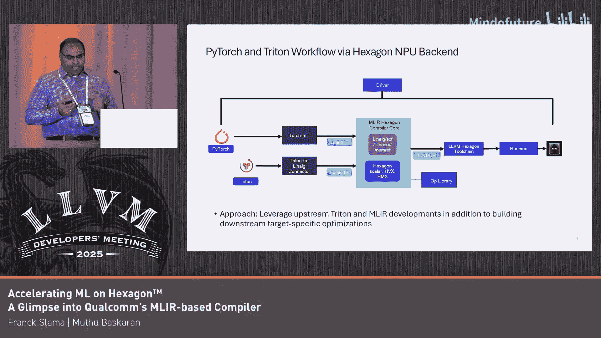

# LLVM开发者大会-US-｜-2025-Llvm-Developers-Meeting-p14-P13_加速Hexagon上的机器学习_高通基于MLIR的技术一瞥--BV1ejr5BAEja_p14-

Hello， everyone。 I'm Mo Baster with my colleague， Frank， and。

We have a large team working on our hexnaI compiler， some of them are in the audience。

 and some of them are back at office， I。Doing the latest and greatest optimizations。

So we are building an MLIR based compiler， though at Calcomm we have some legacy compilers。

 we are building a new MLI based compiler based on the learnings from our legacy compilers as well as taking the advancements from open sourcecing community in MLIR。

we are focusing on three main areas。 One is building a compiler core， which means。

Start from our Ingress dialect linealge and successively lower it to LVM。

 then use the subsequent tool chain， but then in the front end we are currently focusing on Pytoch and triton。

 Pytoch for the full models and Triton for kernel authoring。

We have gotten really good encouraging results from the work that we've done so far。

 We have a functional inter workflow showing full model compilation and execution for LLM's GPT to Lama。

 and we have written like some simple to non trivialvi Triton kernels and map them successfully in our hardware and。

😊，The ballpark of like 70% to 80% of un optimist code is a good start， we think。嗯。

So what is the hardware， The Hexagon NPus is VIW multitra hardware。

 It has K unit vector units and matrix units。And we have dedicated memory， vector registers。

 scratchback， so the complexity of all the A letters that you see that needs to be addressed in a compiler。

 making sure that you choreograph all the computations and data movements properly and take advantage of what the hardware offers you is what we are handling。

This is the workflow that we have with that Pytoch and Triton workflow。 So as I said。

 like the the the。

Corode that we concentrate is on our MLR hexagon compiler。

 which takes lineal just input and produces LVMIR and all our optimizations is within the past pipeline in that code to make it end to end。

 we rely on the community tool chain， for example， for Pych we use the ta MLIR converter to take Pytch into lineage as well as for triton we are among the few people that are developing this triton shared middle layer。

 which is the triton to lineagege converter that takes triton to lineage and then we use the compiler code to lower the lineagege to LVM one thing that I want to point out is that the key approach like build our own target I mean hardware specific optimizations but。

Reuse and leverage all the advancements that is happening in the community has been our approach。

And we also take advantage of handwrittenton kernels that are already there and which has been developed for many years within quaualcomm。

 So if there is a handwritten kernel， I mean we take advantage of that and use that library。

 but if it's not， we ought generate the code， so it's a mix of autocode generation and reusing existing handwritten libraries。

A lot of optimizations that we have built are like target specific and that makes use of our hardware and particularly choreographed the computations and data movement with respect to our hardware constraints and so on。

 but building it on top of what's available upstream has been our approach。So we do fusion tiling。

 tiling for multiple reasons， you want to distribute a computation across the parallel units。

 you want to make sure that you fit the data footprint of your scratch pad like I mean your computation within your scratch pad tiling for vectorization and and so forth。

嗯。Data movement is going to be key for performance。 I mean。

 you need to make sure that you're using the right amount of buffers and create them and place them at the right place and do the data movement in such a way that you can prefetch at the right time and make sure that the cost is amortized as you're doing the computation。

 So all optimizations that you would see in a compiler fusion tiling vectorization data movement has been our focus。

 In addition， I mean， we have special hardware units for doing vector matrix computationuts and they requires special data layouts。

 and we also use the Linuxage pack and pack that the previous speaker talked about for doing the data tiling to make sure that the data is transformed into a layout that our hardware needs so making use of the upstream dialects。

 but turning it into a way that our hardware can use it is has been our approach。😊。

So quick illustrative examples like in the left you see like code that goes through a level of fusion to maximize the data that you bring to the scratch pad。

 then once the fusion is done like doing the tiling as it told for multiple reasons like distribute the parallelism。

 fit your data into scratch pad make sure that in the most loop can be vectorized and then also create for each tile that you're creating。

 bring the data into the buffer and move out off the buffer put the DMs at the right place data prefetch so all this has been like need to be properly choreographed and done to get an optimized code as I said。

 like in the process we reuse a lot of the upstream dialect。

 but we also create our own target specific dialects。😊，I mean。

 this example is another I mean from the triton so we try to take Triton code that others have written or be write。

 so it's very agnostic to the target and using our compiler take any generic triton code and map it to the hardware in the process doing all the optimizations that I just talked about。

And there are a lot of libraries， as I said， like that has been written over the years。

 So this example specifically shows that， okay if you have a hand optimizeim library that you can tap into the pass pipeline makes sure that it maps onto the hand optimize library instead of auto generating the code。

 So having that functionality to get the best of all worlds like auto code generation and using existing libraries。

😊，So Frank will talk about one of the optimizations that we do for。

Enhancing this pipeline to be scalable。 I mean， for current as well as for future models。Thank you。

 Meu。 Yeah， just a few words about thepa that we had to develop recently。

 So the starting point is that for large models， La M L models。

 we want to be able to split the module into various parts that will be loaded by the O S independently。

 So instead of or produce instead of producing only one shot of brake。

 we want to be able to generate a bunch of them and to load them separately。😊，In order to do that。

 since more than 99% of the memory footprint is due to the constant parameters。

 which are typically the weights and the biases， etc ceter。 If we want to do that。

 then we need to lower the constant separately。From the code。So we haven't penalty this。

As an ML layer pass， which works this way。 So it starts with an original ML layerA model containing code and constants。

 And this pass will split it up into n plus one modules。

 The first one module 0 will contain only the code and one to n will contain only data。

 Only constant parameters。😊，So this ML AR pass is a bit peculiarier in the sense that it's not one to one pass。

 It takes an input one module， but it produces a bunch of them。

It is responsible for mostly two things。 So creating U MLIR modules on the fly and also modifying the original module So the code one。

 mostly replacing the I dot constant by an X， which references the constant defined in the other modules。

 which are getting compiled independently。So then there's a bit of work to do to compile and link all of that appropriately。

 So as you can imagine， the first one for the code needs to be linked against all the other ones because it uses it with advances the constants defining the other ones。

But it's easier for the constant mergers that don't need to link against any dependencies。

So as a result， we are able to split up a module into a bunch of them into a bunch of shell objects and to load them independently on Qerto OS。

 which is the OS used by the Hexagon DSSB。😊，嗯。Just a。You want me to do it。 Okay。

 so so we are at Qualcomm building an NR based compiler for M L models。Which targets the hexagon NP。

 as Matt said， Sevic averagevers both enhancement from the open source community and also from the legacy compilers that we have at Qualcomm。

We're able to lower both Pytoch models and triton channelss using the same compiler。

 and we're already able to generate code for a variety of M models。 So the GPT family。

 the Lama family， etc。 And we're currently improving the efficiency of the code that is getting produced。

😊，At the moment， we only support one NP， but we have friends to support a bunch of them in the future。

And more importantly， we are going to upstream and release all of that to make it available open source。

 And that's going to be in December， White please come and talk to us you find us in the very part of the。

Thank you。 Thank you。