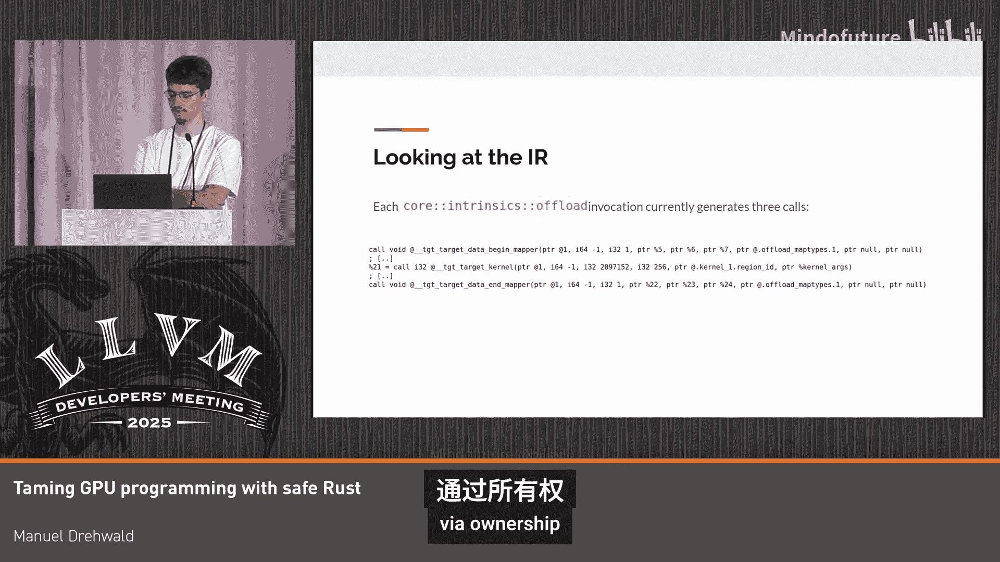

# LLVM开发者大会-US-｜-2025-Llvm-Developers-Meeting-p15-P14_用安全的Rust驯服GPU编程--BV1ejr5BAEja_p15-

Hi， thanks for the introduction。 Yes， so I'm a PhD student at the University of Toronto and for the summer I've been working at Lawrence Silververmore National E doing my internship to figure out whether we can have safe GP program and rust my general research question is since as you all of you know。

 Ru is quite strict language we have a borrowcheer which prevents a lot of your code but on the other hand preventing some unsung code also gives us a lot of confidence in what attributes we can add to our ABMIR what information we can give to ABM last year I've been giving a talk about automatic differentiation where we saw that safe rust has actually quite interesting performance benefits of unsafe rust So going on I was curious to see whether safe rust also has some benefits for GPU programming and what the challenges for that are。

😊，So I've been working together with。My supervisor runs through Alma Nnet。

 as well as Marclo Dominguez， who was a G student working for the Ross project for the summer。

 and he has been doing a great job at we right now front end。So。

One of the challenge like the main challenge for safety to programming is that we have a lot of guarantees on Saferos。

 so if you look at a simple function definition like here where you have two variables， x and y。

 both are references， there is the Saro version of pointers which you have other languages and they both point to some double values if you look at the AVMAR which we generate from there。

 you see that both x and Y have no AS attributes and a few extra things like align information no underF and generally information about2 do not capture。

So that's already quite a lot。 And in comparison， still Ol probably heard， we have an unsafero。

 which is a superai where you can do a couple of extra things which sayfero prevents you。

 it's especially useful for if you want to do low level for some embedded stuff if you want to directly talk to other languages and we cannot guarantees things from a compiler perspective in that case you're responsible for writing sound code and function an unsafe function looks like this。

 So first we have the unsafe keyword， which enable these extra things like de referencing a raw pointer and then the definition where instead a reference we know really have a raw pointer the first point again is con the second is a mut variable and if we look at the LVMR which our compiler generates for that。

 you can see that no AliS attribute do is gone which means if we write unsafero。

 we directly have some performance challenges with that and unlike other languages like C or super where you have a restrict keyword which you cannot just to your pointers。

 we don't。😊，Any equivalent in rust So if you use unsafe rust with raw pointers。

 you get a lot of liberties but in exchange， you might miss out on some performance benefits and also just as a small side note。

 even for the safe rust version， we have a couple of magic types which give you the ability to even though you have a constant reference。

 maybe mutate some underlying data in which cases also we might not generate the idIS information but generally that's the main difference between safe and unsafe rust。

😊，And so from there we can already probably see what the main challenge for GPU program is。

 I just took the very first example from the Kuda guide。

 a simple vector edition to see why we cannot directly translated。 So on the left side。

 we just do the classical GPU things， we look up our block dimensions。

 our thread index And based on whether we are like in the range we have an index。

 which we want to process when we might update our array C by adding A P。

 Now for the Ive added a say rust version of that pretty much a one to one translation for Kuda。

 at least for N GPus， we have a threat index function which tells us where we are And based on that we might also check whether we are。

😊，Whether we have an index which wants to write into C。

 Now the unfortunate issue is we have a very strict audio single in rust which stairs where you can have as many immutable references to some data to some object as you1 the only condition is as long as you have at least one immutable。

 you may not have any mutable the existence of a singlemable reference prevents you from having any other access to their data just so that we can fulfill the no audience guarantees on the ABM side and now the issue with obviously we want our kernels to run on more than one thread and we want our kernel to compute some data and the data should be written somewhere right so we have to have some mutable output state if you would compile this code with the normal rust compiler if you try to parallellyize it through our open P equivalent and code rayon then the code would probably not compile if you try to call it in parallel。

😊，We have the borrow checker for these things now the question is how can we get that saved？

Before we go into the Es for that， I want to talk a little bit about what infrastructure we have the moment on the rust side。

 so we have a variety of different CPUU and GPU targets on the GPU side if you just print our target leads。

 you want to see NVPTx 64 it and that's considered T2 which means we do run it in C certain that at least compile but that's about the state。

 we have a smaller standard very part of our core， which also perhaps a couple of NVR functions。

 for example it gives you a thread ID index or some shared memory but that's most of what we have on the NVS side。

 NV side is currently even smaller than that， it is T3 target which pretty much means we have some code in the RoOS compile of it。

 it may or may not comp， actually when I checked it out for a month ago it was in the did not compile state because it was trying to generate F28 bit floats for the GPU targets which we not support on the MD side。

😊，I've done a small bugs now， we at least have the ND site compiling as well。

And as a third element which we have right now in RusI， we have a GPU kernel AVI。

 which depending on whether you comply for an M or an NVA target， lost the corresponding AI。

 does some basic sanity checking and makes sure that where your Ru code is suitable for that target。

So that's the infrastructure which we have to work at the moment。And generally。

 when we were talking at the beginning of intership about what features we generally want for a GPU feature in Ru。

 where it is rust if you are compiling GPU code and Ru。

 you probably want to make use of our features so it should be safe and convenient by default。

 one of the nice things which we are hoping to achieve is automatic memory transfer by default because we have this ownership information we know whether things can ideas or not it should give us enough hopefully to figure out when to move your data and where to move it The second thing we usually provide on the rust side is an unsafe escape page because we are aware that。

A lot of cases， you as an entries on might of information which you cannot express to all compiler yet。

 so maybe for performance reasons， maybe just for feature reasons， you want to have extra control。

 so memory transfer， for example should be optional， you should be able to do your own thing。😊。

Finally， and that's one thing due to which I started implementing a non solutionolution was we want to support almost our rust functions and types on the G side for example。

 there was some inspiration from Tra， and finally we want to support multiple ends。

 So we're looking at the state of GPU programming in rust at the time there were multiple solutions for example。

 Raskua， which obviously as an enterprise only supports one deckend also this issue that as I've been showing on previous slides。

 we cannot support multiple output references trivially。

 So Raskua was forcing users to write unsafe code everywhere， which might not be go ofos Yeah。

 there are other projects like cubeBC， which mostly were implementing a DSl on top of rust by passing most of the compiler so。

😊，No rust types were support for those。And guess as to why we've chosen offload。

 we are able to support multiple vendors。 although at the moment， we only have N and VR。

 So I've been told that an inter PR is under review。 and as we kind of done in。😊。

Two talk later we might have more coming then the other big benefit for us on the right side is we already have the underlying feature tested via Open P and C++ and forn so we can hope that it can be stabilized in a somewhat reasonable timeframe。

It has generally the ability to support native types and its AVM base so we can play along with all the other features which are interesting to us。

 for example if you already have a standard Al module and rust which provides automatic differentiation and it's based on enzyme and AVM plugin so by also having a GPU solution based on AVM we can differentiate our GPU code。

Once GP is available， finally GP Lipsy is a nice project which allows us to also have things like IO working on a GPU。

 It might not be the most performance solution， but I think it's a great help for debug mode where you just want to know what your kernel is doing。

AndYes， so I personally have been buying some A&D GPUs for the summer and called Comped and Run and as I've been the confirmation approximately 30 minutes ago。

 we now also support NDD GPUs， so that's good support up。😊，And yes， as our current interface。 So we。

 we implement normal CPU code at the moment。 You can see it on the right side。

 It accepts Rus arguments in this case for example。 But we have a mut reference to。😊。

Tune in array of 256 float values and we just go over it and write into it。 So fast so good。

 that's a pure CPU implementation。 We obviously want to run it on GPU。

 So what we do right now is we providing you core intrinsic called offload。😊。

And that first register us the function name， so we know later on in the compilation steps which functions must be compile for a GPU target and it just forwards arguments to it。

 we have plans to extend it because right now at the moment we just hardco the number of threats for example of the blockss and all which should be very straightforward to just pass along with these arguments so yeah the compilation process is twofold we compile all these functions once for the host and then for the device with some selection and generally these rep should already be enough。

As long as we ignore the safety aspect to which I get back because with those， we could， for example。

 define an external blast functions of external blast libraries and just call these BL functions through our Offload intrinsic。

 which would automatically trigger the data movement to and from the GPU as needed。

 so you can easily call P+ or rockM+ versions without having to worry about copyho to device or device to host。

😊，Our compilation pipeline at the moment is obviously a bit。😊，Experimentally。

 weve been getting it into work， but we still part rely on sampling playing features which I've highlighted here and which we hope to optimizeize for the future and either right in via cargo and plus C or just directly called as part of AM。

 So the first step is obviously compile our host code cargo plus Offload cargo that case is our big manager Offload is just the two chamber which we use。

😊，So as an alternative， you can clearly use stable on I be good and really smart and so fast so good。

 as the next step， we we call RC directly， which is our underlying compiler。😊。

We try to not have users rely on that directly and provide good abstraction but we're not there yet。

 so we provide the source part and make sure that we emit both AV and BCC and AVMIR。

 we enable our new experimentaled and uns Off feature and Ter see which GP to targets on our case on like3。

 we see that we can now target the GfXx 90A which is an MI 250x I think this means we now target the Gku side。

We build our， we use the experimentaled bit standard feature。

 which means as you've seen M is a Ter3 target。 So we do not inbed the compiler let alone our standard library or the core。

 the small subject of our standard library。 So as an end user。

 you now have to compile everything with from source with the benefit that it also runs for GQ。Now。

Yeah， the next steps are unfortunately still very manual。

 we use the Kang Off packager and later the Kang linker wrapper， but does work on automating that。😊。

So yes， I highlighted the red parts which we have to get rid of in order to stabilize this。

 there's work on the rust side to stabilize the build core feature。

 but also there's the option that in the future Ru project could upgrade ND and the media targets from tier 3 and tier2 to tier1。

 or at least the tier 2 with host， in which case we would provide these for users。😊。

So looking at PIR， we've seen previously that we have an offload intrinsic and under the hood that offload intrinsic is quite simple。

 so for whichever location is in， it generates three functions。😊。

targetar data Gimpper where we pass a lot of information to AVM to say which data do we want to transfer to the GPU in which way do we want to transfer to the GPU do we want to directly allocate。

 do we want to copy it there and potentially copy it back do we want to update some existing data that's all the information which we can get from the rust。

 especially our medium IR MIR and later alone then we have the actual kernel launch。

 the target target kernel for which we define， for example， hard code in that moment。

 the block dimensions and the kernel which we want to execute as far as the algorithmgons。

 and as the third that we do the target data endmpper。

 which means right now the actual kernel launch is quite expensive because for every single location。

 we copy all the data back and fo and that's something we are looking at optimizer。

But now that we generally have it working， looking again at the safety aspects of how we can actually make GPU programming not being unsound and UB so the problem which we had in the past was that accessing the mut like C through multiple threats in parallel is UB because it gives multiple threads the ability to right to the same location。

So now it becomes a bit ugly。 So we have two options for fixing this specific use case。

 The first one is going through raw pointers and doing the indexing logic manually， raw pointers。

 as I mentioned before， don't have any ideas guarantee whatsoever， not in strict aing。

 So we can get our threat index。 And based on that。😊。

Just add to our raw pointers manually and from the row pointers we can now generate a safe slice。

 so we have a moment where it might look like we have some asing because we have the we run the code obviously in parallel so we have the raw pointer C as well as the mutual references C。

But there's a rule in rust specifying a bit closer what may or may not are as and the rule is even though we have a mut reference here and the raw pointer pointing to partially overlapping data。

 the raw pointer is never used to either read nor write from our memory So just doing some offset logic to create a reference in that case we are fine and thats sound the second case which we could do is if we have some more complex indexing logic for example we want each thread to another write into one output element but in a range of output element we can create instead of just a reference we can create a slide。

 so a subset of our input and Yes in their case again we are safe。So obviously。

 this code can be autogenerated。 Rossy has all the information we need。 if you pass us an array。

 we know it compile them， how long you input is and we know how many threads you have。

 if you pass us a slice， in that case， we know at one time at very least how much elements you have。

 And again， we can do the indexing logic for you and provide that。

 Now we cannot obviously not expect that we always gonna get that right for you So some of the issues we have is well。

😊，Users might want to have a more interesting indexing patterned than just one element or like couple of batch elements consecutively。

 And looking at some benchmarks for Ra Perf， we've seen that the approximately two third of the benchmarks were covered which just either single scalear batch indexing logic for the rest we need to find something slightly more interesting。

 That's where unsafe for comes in。😊，It's a very simple logic。

 we have this input argument which we have to subdivide in a somewhat sound way。

 and so that's where an NS interface comes in。😊，Looking at the Perth benchmarks itself。

 we see four of those Perth benchmarks are really just scalar indexing。

 Three of them are slightly more interesting because they shuffle based on that index and the last ones just have。

😊，Multiple nested loops， which we do not cover at the moment。

 so to give some examples here and Brad highlighted are the problematic areas。

 So in the first loop we have we loop our re loop over our index type II and use there to index the real zones from where we get the real index which we later use to index B so that's something which we need to make sure to not overlap and on the right side we can have the complex index logic。

So looking again a bit further I mentioned we have safe data movements for the users is that enough probably not because most of the linear algorithmberg code in rust is actually unsafe our matrix site is used raw point us under the hood both or three of fair Nagira and and the array so it would probably be really nice if we can actually support the existing code out there and at least for data copying we have a very easy solution because there's a trade code clone which is usually just implemented for the CPU site and like we authors define how their objects can be copied。

what if we just inspect those traits， look at the AVMr implementation of that and replace all men copies with a mem copy of copy host to device or device to host。

 So that's something we haven't experimented yet。 but for most times it should actually be safe So that's some future extension which we' are looking at and now to get to an net。

 So the optimizations which we have in mind to make use of us is obviously we only want to copy through the needed direction。

 everything is constant by default。 So you are in a lot of cases where you do not have to copy data back。

 we want to allocate variables directly on the device more impossible to cover the most common case where you write a GPU kernel you just want to allocate a lot of memory upfront and then you do not want to allocate within your hot path on the GP So that's something we should also be able to reasonably cover through ownership and yeah the next thing leave data on the device between kernel if un or unused on the host as you've seen right now every single offered invocation generates three。

Movement of data to the GPU， the kernel launch and the copying back。

 we couldfuse those hopefully we want to introduce shared memory that is currently only export to an DV side。

 so we need to work with on the MDD side to also have that feature available before we can use the journey and finally fu kernels。

So。Yeah， and so I've shown for most cases， actually two third of our benchmarks。

 we are able to safely provide the features on the RoOS compiler side。

 we hope that users can extend our indexing lot and separation logic so that that these can be shared via credits and verified by other users and performance should be hopefully good so。

😊，Let me know if you have any questions， thanks。Hi， thanks for the talk。

 Do you already have ideas on how to support shared memory Because like how I don't know。

 Like what do you think about like barrier placement users place barriers。

 How can you guarantee like with safe rust， do want to guarantee that every threat definitely hits the barrier。

 So what your thoughts about kind of I mean for shared memory first。

 there's a discussion right now since India already exposed it And And has its own implementation of it。

 which is not upstream get。 So I think the current consensus that we probably are not able to expose a fully safe interface to it。

 there were some solutions via globals and globals is safe and rust are unsafe。

 So that's going be tricky to make safe， unfortunately。

 I know that for the open peace side under the hood。

 they might be able to introduce some shared memory automatically for performance optimizations。

 which should be safe， but。Exposing that to use is hard。And have a second question。

 So could you explain briefly again how you represent or reason about like which thread owns which data and like you would need areas there as well like can two phases where threats access different data that other threads row2 or something I think there would be this slide likely So yes。

 we start with a row pointer on like the function code vector。

 So we have a mut to an f32 and the size separated。

 This is the same as we have four slide except now it's one level lower that's how we would pass it to ABM as a pointer plus an integer。

 that is safe and parallel because it's a raw pointer。 Now we do the indexing logic。

 and so you can see here we have a C dot plus our index。 and we again， we don't access C。

 we only add an offset to a pointer So we neither read nor write through that pointer。

 So that does not interfere。 even if this thread for example。A bit slower than other threads。

 Then we create a new to reference， which is only accessing this specific offset。

 So this reference by its own is unique and does not overlap with any other reference。

 any other safe reference， every single reference which gets created overlaps with the raw pointer。

 but since we don't breathe or right through the raw pointer we are sound。😊，Does that head yes。

 so what is if you do have some dynamic indexing， like if I don't know if you load the value and based on that you want to index somewhere。

 you can you represent it？I think there would be this case here from the Russia Perf benchmarks where they iterate。

 They have looper shape paralyzed that gives you an index Ii and then they use that index to index into array and the result of that array。

 that value is the actual index。 I don't think we can support that fully safety by default。

 but that is part of the three extra benchmarks， which I can cohere。

 they must be in order to be saved， they must be injective。 if you have two array elements。

 which point to the same give you the same integer， then it's going to be UB。

 but then you're also gonna have a data array in any other language。

 which you probably want to avoid。 So yes， it would be unsafe， it would go through raw interface。

 but it's the most basic case because unsafe abstraction， would take an index。

 and it would take the element。 The raw pointer and it would do the indexing logic。

 So that's not what the user would implement guess in this case it could also like sorry run time。😊。

In some cases we can do runtime checks， yes I already do that for the automatic differentiation interface where the underlying the Mpl has the assumption that two point has have the same length。

 so we just add check check to checks for that。😊，Thank you sure， thanks。啊。

In order to keep data on the device between kernels。

 what are the challenges for that or is it just a haven gotten with yet。I mean。

 the most basic solution to that would be let me see the slides Yeah so the most basic solution would be to skip the target and data map at the end of these pre which is the one triggering the data movement back to the host and then if we have following if we know that we are following offload intrinsic calls then we just leave skip for our following course。

 the target data begin map so that we just have one data begin map at the very beginning of all of our offered calls and a second target data end map at the very end of all of our offload calls and so we skip the copying back and forth then we have to verify whether data is used on the host in between those code because if we skip the copying back to a host and you print the intermediate results you'd obviously get wrong results。

You should be able to figure that out the codinging。So via ownership， sorry， yeah。

Yeah， regarding the shared memory you mentioned open MP。

 So the next version standard is going have some close to that some variable。

 saying it shared memory。 and L VM open MP， we already has has the dynamic shared memory。

 So you call a function return on pointer and that pointer actually points to the shared memory。

 So you can use that。 So do you consider that kind of solution。Yeah。

 is that through the D pointer the extra first argument which we have at the moment。

 or would that be different？So right now via the openMP interface we have this extra di pointer with you there to request the shared memory or whether it so yes。

 we already generate that thin pointer so on the technical side we should be able once lip offload or lipMP provides it to generate it the question is again just how do we provide that soundly as I mentioned on the raw side we think we have to make it shared memory unsafe。

😊，Because we cannot prevent you from causing UB if you really want to， but yes。

 we are definitely exposed points that's available for our vendors。Yeah。Thanks again， Man。

I I have time to prepare the next talk。