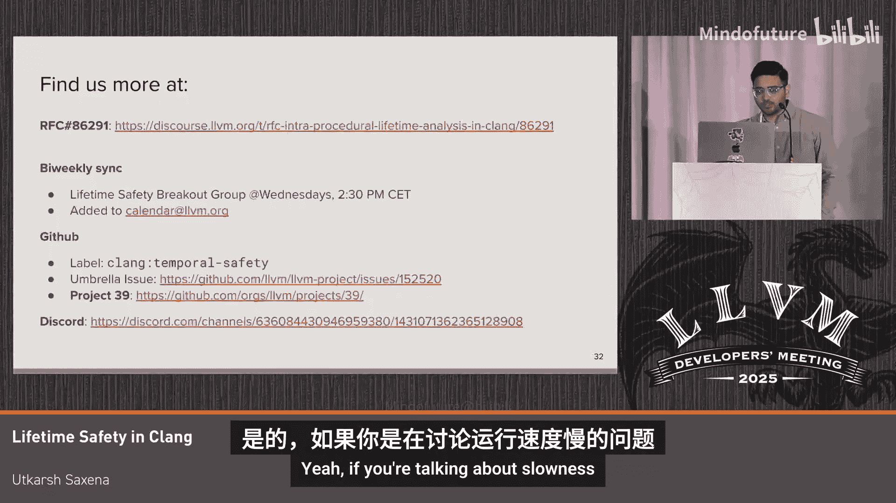

# LLVM开发者大会-US-｜-2025-Llvm-Developers-Meeting-p16-P15_Clang中的生命周期安全性--BV1ejr5BAEja_p16-

Hello， everybody。 My name is O Krssh， and I work at Google。

 and I've been lately working on C+ bus memory safety。And today。

 I' will be presenting our work on lifetime safety analysis in Kang。Before diving in。

 I just wanted to start with， let's take a look at the problem that we are trying to solve at hand。

That's the problem of temporal memory safety。And it。

The problem is it is an undefined behavior to access a memory that has been delocated or freed。

 And this manifests through。Dangling pointers， and it manifests as crashes。

 data corruption and even security vulnerabilities。And。This is。The the impact of this is not small。

 It is quite important， and it is a big contributor to production crashes and security vulnerabilities。

 For example， the thing that you see on the screen is shows that more than a third of critical security bugs found in Chroium project are contributed by use Op free。

 and this is classic temporal safety。也须。Let's quickly see what use after free issue looks like。

We start with at some point of time in your， in your program it。It creates a memory somewhere。

 It could be on stack。 It could be on heap。 It could be。Stack managed he object， for example。

 that you see on the screen。Next， while the object was alive。

 we start to alias that and stored that pointer to it to in any variable。

And at some later point of time， this memory is delocated。 For example， here。

 X goes out of scope and it。Not just Gar's scope， but also clears the and deletes the memory that was backed by this object。

Followed by this following this point of time， any access to that memory that was held before is use after free。

 and this is undefined behavior and any access that we see a deep dereence to it is a use after free。

Moving on。I wanted to briefly give an overview of the analysis that we are trying to propose here。

The lifetime safety analysis tries to find these。Temporal memory safety issues at compile time。

And this is an alias based analysis。And this is a shift left approach to identify these issues at compile time。

And。It aims to propose an intuitive lifetime model。

And it tries to achieve incremental temporal safety example through gradual typing and stuff of that sort。

So let's dive into this intuitive part of this analysis。

Let's consider the same example that we saw earlier and try to see。

 how does a programmer or a C plus plus user identify and reasons about a user after free issue。

The first thing that we notice is。There is an object that was constructed， but more importantly。

 where is this constructeded。Second， we also see or we care about when an alias to this storage was acquired。

And whether there is a pointer that points to that thing that just got destroyed。

And at a later point， we also care about whether this pointer also called dangling pointer。

Is actually used or not。So。Broadly speaking， we have these three key questions of interest。

First is when is an object destroyed。So our first key interest is more broadly speaking。

 in validating operations。And destruction is only one of those kinds。

We will see more deeply what these invalidrating operations could look like。Second。

 more independently in the separate dimension， we also want to know where is a point or points to that that just got destroyed。

So a next key interest is some sort of alias analysis and。

We want to know what are the aliases of a storage。Next。

 we want to know whether the value held by an alias is even later used or not。

This can be answered by a liveness analysis or the liveness of that aliaius。So if that alias is live。

 it's probably a use of for free。Let's take a deeper look into some examples of invalidating operations。

These operations can be normal deors that we just saw or destructors of stack objects that manages heap memory。

 and that happen at just end of scopes， this deor can also be manually called in the code。

Which would be really bad。But these operations can also be hidden behind obstructions。

These invalidating operations can be caused by function calls， for example。

 when you push back into a vector， any iterator that you held that you are held before that call will now be invalidd。

It happens because the pushback can。诶。Cause of inherent free of the memory that is aliaed by the iterator。

We don't really care about what happens after that free or before that free。

 We just want to somehow note that a pushback can call call a free on that object。Similarly。

 it goes the same for clear insert operations and objects and。It， it doesn't have to。

Stick or be restricted to just container operations。 This is an inherent property of。

Any C+ list goal。Next， we care about aliasing。 We want to know what are the aliases of a storage。

In this example， the line highlighted is responsible for creating an alias to。

The storage backed by x and storing it into P。 So we say that P is an alias of x。

We can also include control flow here， and arbitrary assignments。So when we assign a pointer Q to。

 which was an alias to x to a new pointer P， we say that now both P and Q are aliass to x。

 and we want to。Answer such questions。This can be more control flow。

 arbitrary amount of control flow can be introduced， and we still want to answer。

What are the aliases of x， for example， here， all of the pointers that you see。

P Q R SD are now aises of x。This can have。Control flow like loops and function calls， and。

If statements， so any arbitrary sort of controlled flow could be introduced in a function。Next。

 on the last dimension that we care about is。Is the value held by this pointer actually used at a later point of time。

And this could be answered using a liveness analysis。

 Lightibness is essentially a pre computationut to decide whether a value held by a variable is later read in the future by the programme or not。

 This is， again， flow sensitive。So as we saw， alias is flow sensitive， Lightness as， as well。

 is flow sensitive。So for example， if you have two assignments or two aliases being created。

The second alias p equals y or get。Actually overwrs the previous value of that aliaius where P was referencing to x。

 The second one P references to y。This， we， we call it it that it kills the previous value。

And the previous value that was held is not alive anymore。

So when we say in the upper highlighted part， we say that the pointer P is not alive and。

The latter part peak was vital get the pointer P is alive because there is a subsequent use of that that pointer。

And there is no use of the pointer' value， where P alias is x。So the latter is alive。

 The previous is not alive。Now， let's。Define a lifetime model and certain terminologies that would be required to answer these questions that we care about。

The， the three questions that we were already looking at。

The lifetime model that will be introduced is inspired from the Polonious Bocheer model。

 but adjusted to the needs of C plus plus so。Rust can be as strict as they are right now。

 but C plus+ cannot afford to be that strict。And。This lifetime model also aims to have the similar。

Lifetime semantics as rust has。 and at some point of time。

 it also wants to support rust like seman syntax in Kang or in C++ if required in the future。

The first concept that I want to introduce is loans。When we say。What is loan。

 It represents the act of borrowing from a memory location。

And it is defined by where is this loan created and what memory was borrowed。For example。

 when you assign an address of an integer to a pointer。We say specifically on the right hand side。

 lo L1， let's say。To， the path X was created， and this X could be any storage。 And， for example。

 here， this is just a stack variable。 It could be any arbitrary。APartath to a storage in your memory。

For example， structured at some field。And things like that。Next， loans can expire。

When we say loans can expire， we want to represent some action that says that。We。

 we want to represent invalidations that we cared about。And when a storage is invalidated。

 all loanss to its expire。So， for example， as we saw in the previous one， when we take an address。

 we reference x， we create a loan to that x。Again， we。

 if we have another statement that references x， we again create a loan to that X。

 These two loans are different because these are two different borough sites。

 even though they are referencing the same storage。Now， at the end of the scope。

 x goes out of scope and x would be disrupted if， if not trivially here。So at this point。

 we say that L1 and L 2 are expired now。And so both the loans expire。The next concept is origins。

Origins are essentially symbolic identifiers associated with pointer like types。 So， for example。

 if you have an instar P， we would say that this instar inherently has a property of。Aliasing。

And it should be represented through a symbolic identifiers。 Let's say， carrot01。

And it represents the aliasing part of the analysis that we want to， that we really care about。

Concretely speaking， this origin is a set of loans that an entity can hold。

 Think of it as as like the all the possible sources of data a pointer refers to。So， for example。

 when we start with an instar P， we have an origin O1。 It does not have any loan at this point。

When we D， when we reference x， we create a loan to that X。 It's still in the right hand side。

 we don't， we know。But when we process this assignment， P equals and percentageex。Or。

We say that this loan now is a part of this origin。And origin is a set of loans。

 and L1 is one of those loans that this region。Could contain。

Origins can have flow sensitive information， and we can introduce flow sensitivity flow sensitivity here。

 and they start to follow subtyping rules。Oh。Origins can flow from one into the other。

When we have two pointers， P and Q。These two will have two different origins1 and02。

 But when we assign Q equals to P。The origin from the right hand side flows into the origin of the left hand side。

If P's origin。Contained a loan L1 before this assignment。

 But loan now also becomes a part of the left and side origin Q。And when you process this assignment。

 we have now the lone L1 propagating itself from O1 to O2。 At this point。

 both O1 and O2 origins contain。The lone， L1。And this is not just restricted to assignments。

This could be any subtyping rules that you might care about。

Then we can talk about liveness of origins。If P borrows from X and then it's followed by P borrows from Y。

 this new assignment overwrites the original new loan。

And a subsequent read makes the latest value life。Any old loan that was held by that origin is killed and is therefore not alive。

 so。The old loan is not alive。 The new origin value is alive。Putting it all together。

 we can draft a lifetime violation， or we can define what a lifetime violation looks like in this model。

So at a program point， if you have a loan that L that expires at B and an origin that contains the loan L。

And that origin is also live at P。 We say that we have a lifetime violation。More concretely speaking。

In order to not have any life violation， a live origin should never contain an expired loan。That。

 that is the lifetime policy that we would be enforcing。Given an example， we。

We see that at at the end of the scope， the lone L1 expires。

We also had an origin O1 that contained that lone L1。And that origin was also live。 Therefore。

 this is a lifetime violation。It is already。A simple part of this analysis is already implemented in upstream line and is available。

Being in a couple of flags。 And on the screen， you can see that this allows us to do a three points diagnostic。

 very much like rust。First， we identify where the loan was created。

 The loan that is going to be the problematic loan。 This， we call it this borough site。

We also care about when this loan gets invalidated， the invalidation site。At the end。

 we also want to say in a diagnosis that the view the use。

That was responsible for making this original alive。 And we also marked the use site of this。Now。

 if there were no function calls and we might have been done here。

Our program might have been a single， large， completely in line main function。

 and we could just figure out all the things that we care about in a single place。

Let's see how we can deal with abstractions。What can a function call do， It can introduce aliases。

 It can introduce new aliases。And it can also invalid storage that it might receive from through the function arguments。

One way to do this could be an in interprocedural analysis。 but this doesn't really scale well。

 And also function definitions are not always available at。At all points of time， until link time。

So we want instead， a composition analysis that can compose well and。

 and analyze each function in isolation。And this can be done through if you let functions express their lifetime contracts。

 their alias contracts， their invalid validation contracts。

 which is already done using language extensions like clang annotations and API contracts。

What aliasing， let's say how functions can introduce aliasing。In the first example。

 the function accepts a string reference and returns an alias to it in the second one。

 it accepts two references， but only returns the first， the reference to the first input。

So it returns an alias to the first one。And we have some limited solution of expressing such asing contracts using the clang lifetime bound and the family of annotations。

It is not possible to express many kind of eing contracts。Moving on， we。

Function calls can introduce invalids。And。Common examples are pushback clear insert， but again。

 they do not have to be restricted to containers。There is no solution at the moment to actually tell what things you invalidate。

 but it can be introduced in the future， for example， clang invalidates something。

 very something similar。Oh。This analysis is under construction。 So look for updates in 206。

And before wrapping up， I just also wanted to。Clarify what this analysis is not。

Is this analysis is not a rigorous temporal memory safety solution for C++。

 it would still be possible to write use up for free bugs in C++ and is an opportunistic bug finding approach towards incremental temporal memory safety。

And it is not at all a implementation of N C plus plus。You can find us more at There is this RF C。

 H 6，2，9，1。We meet once every other week on Wednesdays。

 and that event is already added to the calendar of LLVM。

There are a couple of GiHub tags that you can follow。 We have this Github project as well。

 and there is this discardord channel as well for discussing lifetime safety。And yeah。

 that's mostly it from me。 And thank you for all the contributors as well and the amazing community and the collaboration that we are having。

😊，Any questions。系诶。So all your all your examples on your trade talk， by the way。

 all your examples on your slides had single pointers， like single level pointers。😊，But you could。

 in theory， you also have multile pointers in your program。

You kind of mentioned offhandly that origins only contain。Else， right， loans。

 Can they also contain other origins， Is that possible。啊。So a type。

 the example that I've shown is an instar。 It has one origin。

The way that we are going to deal with multile pointers is， for example。

 an in star star will have two origins associated with that type。One would point to the outer one。

 the pointer itself， and the other one would point to the pointer's value。手表。

So you said this is flow sensitive。 Is there any concern to running this in Kang。 because I。

 I worked in like did flow analysis in Kangktddy and so often them they like very slow。

So now if you're on this as part of Klang。Yeah， so this is part of Lang。

 And we use our hacked up version of data flow analysis analysis。 It's not the same one as inclined。

 It's not the same one because that one is very slow。 So yeah， if you're talking about slowness。

Yeah， we have some numbers which says that we are doing pretty much。 Okay， at this point。 So yeah。

 it's not quite slow。I'm curious about how it would have been to reimple this on top of Cl IR and reusing all some MRIIR mechanic to do the analysis and that a flow things。

At this point， this is。We try to work on the control flow graph as the starting point。

 And we generate a set of facts that is。That we put in the into the data flow engine。

If we have all that information at an IR level， it might be possible。

 but I don't really see at this point which IR has this kind of aliasing contracts or。Oh。

Youre using the AS SG Yes S。Hey，Thank you so much for the talk。

 I wanted to ask a little bit about iterator invalid and how this can handle checks for that。

 And if you currently handle or if you plan to handle stuff like if I do a set insertion and I give it an iterator and it returns me a new iterator。

 Will you properly handle that check， you're gonna to do a false positive in those cases。 Yeah。

 the return value is an iterator that is returned after the expiry of the previous one。

 So in the controlled flow graph， you would see three things。

 the expiry that happens before invalidates the previous iterators， but not the new one。 Okay。

 so that'll return a new origin， essentially， Yes， okay， cool thanks。😊，Hi， thanks for the talk。

How does the analysis deal with pointers that are stored in objects or allocated by objects？Yeah。

 right now， the idea is those mega objects that can store pointers in them at some point of time。

 we could have。Named lifetimes in which you can specify when you look at an object。

 you can also see the origins that can be stored inside them。 But at this point。

 this is the current implementation does not take care of that。 Okay， Thank you。 Hello。

 So I'm curious， are you using the data flow and analysis framework in Kang for this。

 or is there another。Framework。this。This is all written from scratch。

 So not exactly using the Kang Olang I data flow framework。 Is there a reason for that。

 I think it was mostly because it evolves around the AS SD， and we don't want to。

Consume the AS T again and again， for example， in a data flow analysis。

 while doing a fixed point iteration， we do not want to read the AS T again and again using AS T matches or something like that。

 So we just create some set of facts from the E D。 And then at this point。

 it's a bunch of 50 lines of code。 It's just a fixed point iteration that can。

Do the things for you without being too complicated。Thank you。Any more questions。

Thanks for the great talk。I imagine there can be multiple sources of false positives here。

 like correlated branches and functions that are not properly annotated。

 I wonder how you are evaluating this and trying to tune then analysis。 So it has a right。 Yes。

 so we are planning to use gradual typing in which if function is not annotated and it returns a pointer。

 we do not know anything about this， we would treat it as an opaque pointer or an opaque loan。

 essentially， And that will never be invalidd。 So that's one way of dealing with not introducing false positives。

And。Yeah， I think。That's， that's the planned way。There is there some。

 but you could still have some false positives， right？

 And I was curious if theres some core basis on which control flow， for， for example。

 can itself introduce false positives。 Some control flows would never be executed at run time。And。

Yeah， so we， we plan to have two modes of this analysis in which there is a permissitive mode and a strict mode。

 The strict mode can give you a lot more false positives based on the control flow。

 And if we are 100% confident of a violation， we would。Classify that is a permissive failure。

I to have some benchmarks programs on which you are trying to evaluate this and calibrate。

If we we are currently during the development。 it's in the early phases。

 So we only run it on Google 3。 sorry， at Googles code base。 And right now， at least in L VM。

 we do not have any positive。 sounds great。Thank you。Right， thank you。 Time for lunch。

Contting do one50。Thank you。