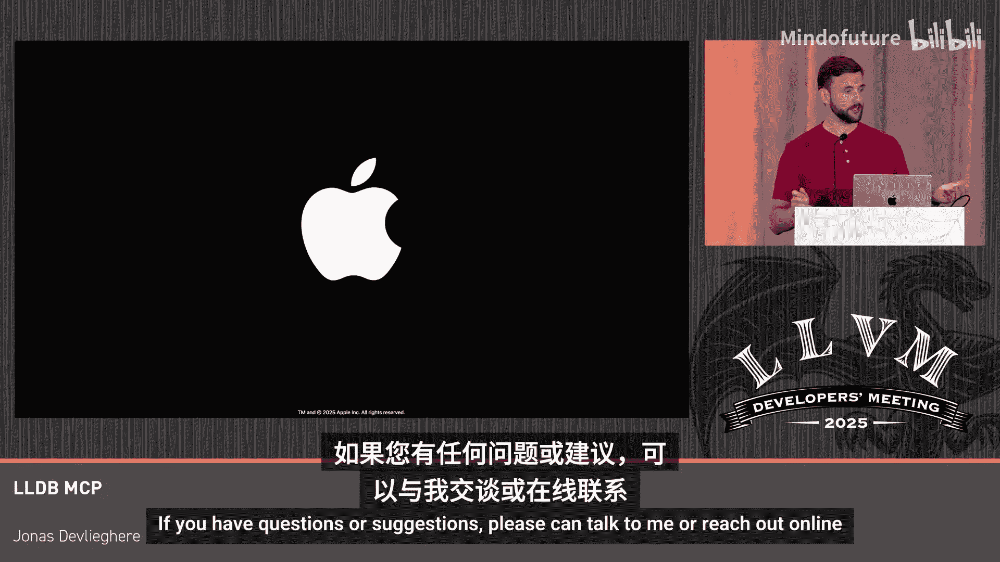

# LLVM开发者大会-US-｜-2025-Llvm-Developers-Meeting-p17-P16_LLDB_MCP--BV1ejr5BAEja_p17-

Hi， my name is Jonas， and I work on LDB Apple。 And today I want to talk to you about LDB MCP。😊。

SeeThere we go。There we go。 Allright。 As A searched in recent years。

 I've noticed two paradigms when it comes to integrating developer tools with AI。

 The first one is AI as a feature。 And here artificial intelligence is augmenting a tool's existing capabilities without really changing the workflows。

 It's the tools， you know and love， but better。 And sometimes they are a little worse for L an example of this could be trying to automatically explain a crash by looking at the back。

😊，The other one is a second paradigm that emerged with coding agents like C code and Copit。

 And this is AI as an orchestrator where it acts autonomously， and it invokes tools on your behalf。😊。

An example of that for LDB could be asking an agent step through this loop until it does something special。

And like many others， I started out quite skeptical of AI。

 LDB score principle is that the debugger never lies。

 and that's hard to reconcile with AI's probabilistic nature。

 but I've also come to see that people have different expectations when they interact with these coding agents and they realize that those things can be wrong。

 So that proved to be a more promising path for LDB。And this is where MCP comes in。

 MCP stands for a model context protocol， and it's an open standard for connecting AI applications with external systems like developer tools。

 and the goal here is to provide a unified interface between servers and clients so they don't have to implement custom support for each other。

 if that last sentence sounds familiar， that's maybe because you saw my talk about LDB D at your LVM where I said something very similar。

 and Db， the debug adapter protocol does the same thing for debugging LSP。

 the language server protocol does the same thing for syntax highlighting and code completion。

 And so now MCP does the same thing for integrating AI。An NCD server consists of three core concepts。

 namely resources， tools and prompts。Resources are static data sources that provide contextual information to the AI application。

 and I like to think of them as file as files that the model can read To， on the other hand。

 are executable functions that the AI can invoke to perform actions。

 and I like to think of them as APIs that your model can call。

 And then finally prompts are reusable templates that help structure interactions。

 They're like workflows that can model more complex that the model can use to accomplish more complex tasks。

 LDB MCP server implements resources and tools。 so let's look at those to in detail。For LDB。

 we expose a single tool called command。 The slide shows the definition。

 which besides the name contains a short description， and then there's a J schema。

 which I've omitted for gravityevity。 The command tool takes any LDB command runs it and returns the output and this turned out to be an exceptionally good fit for LDB because it's already inherently textual and most LLMs are already trained on our commands。

 I did experiment with trying to create multiple tools， one for stepping。

 one for setting breakpoints， but I found your experimentation that this worked best。😊。

LDB has thebugggers and targets。 when you're using it on the command line。

 you have a single debugger， usually with one target， but when you're using it as a library。

 you might have multiple debuggs each with their own targets。

 And so we had to decide how to expose this trimMP。 I started out with a tool。

 but eventually set on resources because those things are inherently application control。

 And what that means is that the client they can specify which resource to operate on。

 So in this case， which thebuggger or which target to work on or you can leave it up to the model and it will use heuristics to figure out the most relevant one。

Similar to LSP and Dap， Stud Iio is the default transport mode。

 the client launches the server as a sub processces and then talks back and forth over standard in and standard out。

 And for most clients， all you need to do is tell it where to find the LDBMP binary and your all set。

This approach works well when you want debug session to be fully managed by the LLM。

 but we also wanted to support this a case where you're already interacting with a debugger and then use AI to ask it question。

 So like， for example， you individual studio code。 you're using LDB D and you want to ask a a question about where you're currently stopped。

So in order to support that， you can start an MCP server from within LDB using the new protocol server command。

 instead of Stio， it creates a socket and then listens for connections。

 and we added a discovery mechanism to LDBMP。 So for automatically find these kind of debu sessions for now。

 that's limited to a single one， but in the future。

 we want to make LDBMP multiplex multiple LDB instances and present them as a single MCP server。

Please give all the BMCP a try。 If you have questions or suggestions。

 please come talk to me or reach out online。 Thank you。

