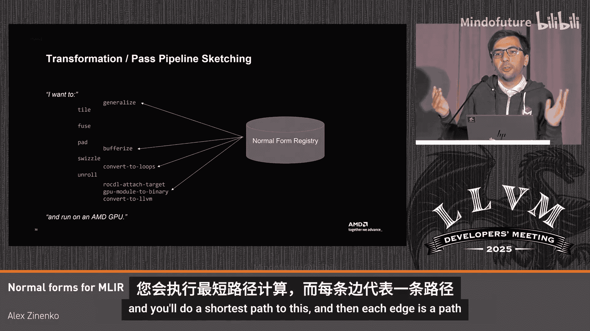

# LLVM开发者大会-US-｜-2025-Llvm-Developers-Meeting-p19-P18_MLIR的正规形式--BV1ejr5BAEja_p19-

Okay hello everyone， I'm Alex， I work at AMD and I'd like to talk about normal forms amount in MLAR and you know I work at AMD as a compiler engineer doing ML compilers for like all the cool amount stuff and at some point I realized I'm sort of a hobbybased researcher as a hobby I do research papers on things that matter and one of those projects was working on the large-scale ocean simulation。

 kind of useful to know for either climate or maybe you want to go swimming and you don't want to know how warm it is before you go into the water。

So I work with a bunch of folks on that。 And while I do MLR and they need efficient execution on hardware。

 So let's use a compiler for that。 have a project。 I'm not going to talk about that project match。

 but it's basically taking a huge ocean model， compiles it with two projects one called enzyme Another poly guys bother based on MLR to try and runs it on a supercomputer。

 it's big。 It's important。 So I was debus that。 I was like okay。

 let me compile this and see why it doesn't work correctly。 So I just take that code。

 give it to the software， run it。 And you know， it's a big codebase。 I work on compilers。

 I know it's slow。 So yes， I'm gonna go and get a coffee， check my email。

I come back it still compiles。 I'll have a snack。Come back， still compiles。You know。

 I just heard that Emilyar is kind of slow and it's expected。 so you know。More waiting， more coffee。

 E， coffee， coffee， email mail， E mail coffee。Yeah。

 there's only so much coing ring without having headache。 After 2。 like 2 and a half hours。

 I killed the task。 still did not compile。 I mean， it， it's a big quad base。

 It has probably like several million lines， but still 2 and a half hours。 That's kind of a lot。

So I started profiling that。 and ML AR has this cool option。

 MR timing that tells you how much time each bus takes。

So I ran that that's an aggregate result because it had like 200 passes。

 but what you can see here is 88% of the time in that tra that ended up toling like about four hours was canonicalization。

Like 88% of the time， I takes three hours doing canonicalize。I like okay。

 I've worked on MLR for a while， but what exactly is canonicalization。

 So I wanted to understand what it is and I do what old cool kidss do these days and I ask my favorite chatbot and everybody knows we are best friends with open AI now so that ChadGT and says。

 well canonicalization is something that brings your program to canonical form。Okay。

 there are many of those so I asked otherz chatbots and they're basically all telling me the same。

 yeah， it's a transformation that takes your program and brings it to economical form。Well。

 I'm kind of old school。 I don't necessarily trust these things。 So I went to like Wikipedia。

 which is incidentally referenced by at least two of those and says， well。

 it's the same yet brings to a canonical form。There is a blog post by a guy called Den Roman。

 I actually should not know the guy， but the post is good can recommend。And it says， yet。

 the same brings to the canonical form。MLlayR ci this chatbot ci this。 So I think that's right。

 So guess the next question， what is the canonical form of MLlayR。

Does somebody know in the audience what is economicical for familiar， Because I'm kind of puzzled。

Jeff。你出去。Yeah， well， my my best answer is like shrug。 I I I， I don't know what it is。

 I've been working on Malayar for like seven years。

 I don't know what the economical form of Malayar is。I guess we have documentation for that， right。

 So I should check out the documentation。 and yeah I usually don't read what's on my slides。

 I find it boring。 This time I'll do。 so MR has a single canization pass。

 which iteratively applies the canonicalization patterns of all law dial grid way。

 Its best effort and not guaranteed to bring the entire IR in the canonical form。 blah， blah， blah。

Okay， stillt Canada of doesn't answer my question。 What is that canonical form。And yeah。

 I guess there is more documentation。 So how about I do get grabbed on MLR docs for canonical forms。

 There's exactly about occurrence。Well， this one。So I still don't know maybe it's just clear to everybody but me。

 I'm just slow sometimes。So I searched the molecularlay forms and there is like this post about。

Convert trivial well to selectization and this one and this one and this one and more and more。

 So I suppose it's not as obvious to people actually。

 a lot of us arguing whether something is canonical enough to be in a canonicalizer or not。

 So theres a lot of contention in a Malayar on what should be a canonical form。

But at least there's a single pass right， the computation was saying。

 there is a single path to bring this to canonical form， which of course it is。

 and obviously normalization is a different thing than an canonicalization。

 So normalization passes are not canonicalization are completely different doing different things。

And obviously， all of the downstreams adopt alayar policy and have only one carbon equalization bus。

I guess that is all to say that， you know there's no such thing as a canonical form fromR doesn't even make sense to talk about a canonical form of anR that does not have a fixed type of operations or types or attributes。

 what are we canonicalizing the built in operations are module and the termminator。

That's communical enough。And when you think about it。

 many of the things we do require different sort of。Canonical good forms they apply to。 Like。

 my background is on loop optimization。 So there is one transformation that is a bit contentious when you do loop optimization。

 It's called loop andvari code motion。So you can have code that's loop andvariant。 It's in the loop。

 and normally you would say， yeah， your LVM policy says do not reeuate your loop and condition on every duration。

 So yeah， we don't want loop invariant code inside the loop。 We want it outside the loop。

There is a loop invari code motion that enables other good limitationss like common sub expressionpression delimination or inscombin or S A or all of the pointer analysis。

 It's kind of great。 We should do it all the time until the point that we don't because if you want to do a fine transformations。

 we want more stuff in the loops， because they are transforming loops if you want to do outlining。

 especially if you go to the accelerator like a GP。 And I remind you of work for GP company。

 I want that to be on a GP not only CPU。 So actually do not want to。😊。

Move my loop andvari count outside of the loop。 So there is a different form that I would want as precondition for my pass。

 And we actually have that。 We have a， well it's specialized and says GPU launch sync index computations。

 But what it does is basically and does loop andvari codemotion。

In the literature on political optimization， there is an entire paper on how to undo LICM in LVM people spent like a year undoing L ACM。

So that's kind of a problem。And what I would like to have is to say， well， these are。

 I call the normal forms。 it's abuive terminology， but I am trying to diverge from this being canonical。

 So there is a form where loop andvariran code is in the loop and there's another form where it's outside the loop and actually want boss and they want to be able to move from one to another。

My program can be in either of those states or neither， so I cannot guarantee one。

 So the suggestion is really simple。 Let's just start annotating whether my module is in a certain form。

 for example， in this module I can guarantee that all of the loop andvari code is in the loop or it is hoisted from the loop I can quote it that as an attribute on a module and then since MLR is very well designed。

 you can attach a veryifier to that。 So what you start getting with this is you start getting an additional verification that gives you invariance about the IR that are not a fundamental property of the IR but it might be useful for some additional transformation。

 so you can say， okay I am about to do loop transformations。

 I want loop andvari conversionmotion to have happened。Did it happen。 Yes， if it didn't。

 I would have a very fire error。 So， for example， if I had this English computation。

 it would tell me well， this normal form expected that you forgot a passing your pass pipeline。

So normal forms are basically a set of additional invaris about hair components。

If you have worked or heard of databases， they have this thing called normal forms like first seconds。

 there's a name normal form。 there's a bunch of those。

If you' are more from a canonical program language background。

 it's not exactly the normal forms we use in the literature because those are about rewrites and reucibility and confluential forms。

 basically a lot of things we do in MLLIR are not directly expressed as a rewrite。

So these are additional constraints that's what all they are。

 and these are important because we can give name to assumptions you make about the IR。

And we are not the first。 There is actually prior art if you look at LLVMR， they have loop forms。

 there are three of them。 So there is one called loop simpl form。

 and actually if you schedule a loop pass if there're still listening the LLVM pass management will automatically insert a loop simplified pass before you run a loop pass。

 So it has some assumptions you can do some transformations like enrolling vectorization on that form。

It also has a form called rotated loops。Like are they all become du and you can do additional things like well loop andvari and codemotion。

 and then there is even further form called loop closed SSA。

 which while LLVM needs MLR doesn't because it has regions but basically ensure the lifetime if your SSA values is copped into loops and that allows for memory analysis and parallellization and oftentimes an LLVN transformation will kind of break this so you would have to redo this transformation again if you wanted to go back to this form。

 So and not really inventing anything you Im basically trying to bring the context that already exists in the ecosystem and materialize it in MLR。

What these forms gives us is they can operate as pre and post conditions on the past。

 So I keep saying we can do that transformation or is transformation。

 So a transformation or a pass like it doesn't have to be a pass。 you know。

 I love my transform dialect a transformation has certain preconditions on the form of the IR。

 It wants to process。And having these normal forms allows us to guarantee that。 So we can say， well。

 I guarantee that my IR is in a loop andvariarian code was hosted form。

And because I have the verifier， if that additional verifier has passed。

 I don't actually need to do anything about this IR anymore。

The other thing Ive worked on is the Linuxage dialect。 So if you work on thebel compilers。

 you most likely have heard of it if you did not， well。

 think about a generic forocommatics multiplication or another tensor contraction。

 That's how you would write it。 It's a generalization of that。And has many forms。

 It has a so called named cleanal ops， so it has like a matrix multiplication or a batch matrix multiplication or something like a convolution。

And then it has a transformation called generalize that goes from a named operation says I'm a Mam to an operation says while I'm a sort of 3D loop accessing data with this pattern doing added and multiplying site。

So it goes to this form called generic lecos。 And those don't have a name。

 If I want to do a transformation， they have to be very precise that I'm rewriting these specific leops to that specific lecopy。

 It's not a dialect。 it's a form， but we just don't have a term for that， or at least not yet。

Then if I want to tile that， well I get to a different form which has these lineno operationss inside an a CF4 loop。

It's a useful form。 We can do more transformation with that。 So if we do something like fusion。

 while we will transform that， we will keep having a loop。

 and then we will keep having a linear operation inside it so we kind of get back to the same form so we can keep applying this transformation。

 That's why it's so powerful， we can keep applying them and we don't need to reachex precondition。

 Finally， when we are done， we can say， well， how about we now convert this to the loop。

Go to simple loopops these no knowledge in them with like arithmetic and mass that we can finally lower to like normal。

ABlock based L theR。 So now all of this， if you look at an actual pass pipeline。

 what will happen is there's little something generalize canonize C E DC， canonicalized tile。

 canonize C， canonized， blah， blah， blah bh。 So all the time you're trying to defend your past pipeline against the pre and post conditions。

 you have not materialized。 If instead， we can say that each of these。

Is actually a type transformation。 Then we don't need all of that overhead。

So a generalized pass or or an op， because you know， we can express your pass management as ops。

It generalize what's called it a pass has a type， it takes IR in alinage named normal form and produces IR in alinal generic normal form。

Then a tile pass takes。IR in a linear generic normal normal form and produces an IR in linear generic plus loops normal form。

Fusion is transforming the IR to the same form of IR。

 so it remains the same and we can do the same for many other passes so we can do these preconditions We can express this as sort of IR。

 we can verify if my past pipeline is actually respecting preconditions as we go and obviously we can also do it as a dialect you can watch my other talk on this。

So if you look at this， some of these transformations like generalize and convert to loops。

They don't do any optimization in particular。 They basically go from one normal form to another form。

 We start with a named form。 We get into a generic form。

With the only reason that we can do some further transformations on that。

So those forms can be defined somewhere as et ceter a verifier。

 So I'm thinking we can have some sort of normal form registry。

 that would be like it's like a dialect registry or an interface regiisttry that we could ask questions like。

I have this IR in this name P channel form。 How do I get？To a generic hi to tell， well， actually。

 if you have normal form A to get normal form B， I have this transformation that's registered。

Same like you can have multiple steps。 so if you go from named to loops。

 well it will tell you first need to generalize and then you need to convert to loops and if you think about it's kind of close to how the ABC dialg conversion was supposed to work and now doesn't and hopefully we are removing that because it's a whole lot of complexity。

But that's the level we were missing at。 We should not think about， oh。

 how do we compose patterns is how do we go from multiple normal forms one to another。

Or we can even ask， okay， here's this IR， what normal forms does it have， And I insist on forms。

 because N IR can have multiple forms at the same time。

 depending on what R the transformations you want to do。 So maybe one related to nage。

 There maybe another related to loops。 You can have line choose loops。

 And thus those loops are rotated。 Well not really those are four loops， but。You can read。

So you it will tell you all， this specific one has a name for it。 So you can do something about it。

What's great about that is you can actually remove the burden of。Nontrivial task pipeline management。

 because you say， well， I want to take this IR。 I want to Tha and fuser that you would usually do with like M L workloads and loops。

 I want to pad。 I want some shared members whizzling。 I won't unroll in the end。

 and then I want to run an M GPU。What's missing here Now all the canonicalize and C C and how do I go from an IR to something styleable。

 Well if you have this registry， it kind of knows that tile expects some certain form。

 So I need to generalize my IR to a genetic form before I tile。Before between padding and swizzling。

 so pudding still operates on tensor Swwizzling is a memory transformation。

 so we need to bufferize to get to memory， and then it also knows that if you want to unroll a loop。

 it might be useful to know a loop and it knows that because the unroll transformation is typed and so is a swizzdling transformation。

And finally， when you want to go to a GPU， it knows what form would the IR need to be able to exit on a GPU So it can give you this sub pipeline that you need to run before you can actually get to the form you need to do。

And this will give you the full pipeline from a sketch。As you can see。

 many of the lowerings and many of things we were struggling with about those lowerings are basically normal form changes。

 and what we have been missing is the definition of the normal form and some sort of verification。

Mar has what I call an make your problem。 So I'm going to make a concrete proposal of send an RF slightly later。

 I think we should define an MLR normal forms。 We can also just rename conversion to this because a lot of conversions are basically。

 What's good about is it allows you to put all sort of contentious patterns there。One thing is like。

 okay， all the discussions。 do we want this to be canonizer or not。Are not a discussion anymore。

 I can have my Alex normal form。 like Matiaas here can have a Matiaas normal form。 We can quite。

 It's not that we argue， but。We can have different forms that we don't need to argue over what it is。

 what it means to be canonical， we can just define that there is normal for number3 and put stuff in there in spine。

Another problem it solves， it solves a problem of dialogueg dependencies。So right now。Yeah。

 I think it's there。 right now， what we have in dialects。

 we have dialects that depend on other dialects， and they depend on other dialects for two reasons。

 is as they user type on an or an attribute from another dialect。

Or they have a canononicization pattern that may produce an operation from that other dialect。

And for past manager being multistred， you need to load all your dialects up front because implementation details。

But basically， that creates an artificial dependency between dialects。

 It's only there because we decided that something was a sort of canonical form that something required an operation from another dialect。

 We can remove it。 We can put it in a separate form， and we can prefetch it。 So with this。

 we can have for each pass it will load all the dialects。

 and then we look at what normalization that are available。 collect them， load the dialects again。

 and then for each normal form， Similarlyly to conversions。

 We can load all the dialect that would be produced when you go to that normal form。Okay。

 so to summarize， normal forms are essentially sets of additional invaris about air components that are can be verified。

 they are not part of the main verifier there as there when you attach an attribute or a certain property to something select a top level module。

Yes， it can be seen as verifiers。 They essentially materialize an existing practice of transform specific normal forms。

 We already have more than one commicalizer that just admit that we need more than one。

 Give them names and be happy about it。They allow for automation of pre and post conditions in passes so we can do pass by plan sketching。

 we can verify and we can avoid unnecessary canonizations or normal form changes between the passes。

They hopefully sidestep all of the fun arguments we have on MLR forum on what belongs in communicationization or not。

And they held disentangle dilatelateral dependenceencies。That's all I have。 Thank you。

 I am now in a forum where I can accept questions。Thank you， Alex。Yeah， great topic。 I mean。

 so ideas are great。 what's the status of like experimenting with this or like putting it in motion。

 Yeah， so we have a downstream projects where we experiment with this。 It has like。😊。

We basically for the entire project， we made one dialect and has five or six normal forms as it goes through progressive lowering。

 so I'm taking the Azure extreme， no more dialects in between only。

 and I'll see how it goes and based on that I will make an RFC I expect it to take several months for people to agree on that and in the meantime of experiment and hopefully upstream。

What's your recommendation for the existing canonicalizer pass。 Do we still need it。

We could like it will still be reused for pattern based passes。

 And I was thinking we can have like named bags of patterns。And then the canonizer will be， okay。

 apply these bags of patterns。 And we just have like the old or the legacy bag of patterns for compatibility。

 And then we have more as we go。厉害就。H， so if if we want to key。

 So with the existing legacy at the existing canonicaler。

 if we want 8 out of the 10 canonizations and， you know， want to。

Is the idea that we would use a normal form to。Exclude those those two that we don't want in some way that it would fail the verifier and wouldn't apply or would we need to like yeah change the current kernelronliza Yeah normally So there are two things normal form。

 one thing that we currently don't have at all is this verifier So gives you some invariance。

 we do not have that at all。 So canonicalizer is best effort。

 normal form conversion is also kind of best effort， but if it fails， at least it will tell you。

 I fail to satisfy the preconditions you want it。So that's one。 And then in another part， yes。

 you could define your own normal form and ideally you should be able to define one downstream。

To say， okay， there is my normal form。 Here' is a pass that composes the patterns to get to the normal form I want。

And if it's useful upstream， you just go， you call it whatever you want upstream， you do an RFFCC。

 it's accepted or not， and you put it there， but all of this， like similarly to rest of amalar。

 should be composable and usable downstream。Honestly thank you。

Do you see any impact in terms of compilation time。

 like if we enforce like specific forms before and after each pass。Could it be extremely expensive。

 So I think there will be a decrease in compilation time because we will remove all the canonicalizerizers we run all the time。

So I haven't tested that yet。 I sort of expect the question what happened to my like two hour compile time。

Yes， I we run condo equalization all the time。 and most of the time， it does nothing。有。

So if we drop that， I actually expect a decrease。 And then if it's an additional verifier and you are compile time sensitive。

 you can just disable verification。OKO。First， I want to say thanks for the talk。

 This is with Kang I R。 There have been some things that I've been trying to figure out。

 We have certain。Passes that need to be run in a certain order and there's no way to just look at the dialect and see has this been done and that this is just really eye opening like。

 ah， that's exactly what I'm looking for。So my question is。

Is there something you would recommend to prepare for this。

 is there something that we can do now to you know start going in the right direction to intercept with this one in the this is all upstream and ready Yeah it basically start having your invariance as a verifier and you can can have a pass that basically is all it does it goes through the IR and it verifies your environments it does emit error so it's not your normal verifier it's a pass that emits errors if you don't satisfy the environmentvari you have。

And once you have that it' basically， you pour that into an interface method more or less。

 and you give it a name。 And that's almost all you need to do。Okay， thanks。

Yes somebody wants to hear what happened to the two hour compile time。

So when you are applying a normal form and your IR is in like， let's say not any form at all。

 how do you determine the past that you can go from like not any form to one particular form。Yeah。

 so if it's not any formula there is not much you can do， you need to like it。

Imperatively tell run this bus until you get a printcondition。 You might also。

 say that's why I am speaking about verifiers。 If it's not in a particular normal form。

 you might have like a pseudo of verifiers that fails but doesn't print an error。

 And then you can do scoping。 like， is my module， All of it in a normal form。 No。

 is this function in certain form。 No， is this loop in this function form。 Maybe yes。

And then you can， okay this is the form my start with。

 and I bring So there is some like divide and conquer， but in the worst case。

 you have to like tell it initially starts in a form or run the first pot as a post condition。

And no precondition。 And I have one more question。 So if you have like this three different from like A。

 B and C。And then， you know， A can only go to B and， B can only go to C。

And you want for a to go to C。 Do you like implicitly run two different passes。 Yes。

 that's what's this too long。 But that's what the。Registry should have。 So basically。

 that thing would look like a sort of a graph。 I'm not sure if a dug and you will do a short shortest past on this。

 and then each edge is a pass。

Yeah， I was a bit curious like sort of first few slides that you show。

 you set something like a large scale ocean model and you were able to convert it to like MR I never heard anything like that。

 I'm just bit curious like how are you able to represent like a large scale ocean model like was the data。

 how are you able to lower to MR how does that work So there should be a separate talk or a paper about that。

 But very， very briefly It's written in a mix of C and Julia So you can compile both toR you can convert to MR and you can raise and you can over again。

Okay， I got you， thank you。Okay， I I actually don't have a slide。 but， okay。

 Mattia said he was interested ties nicely back with the previous talk。 So the。2 hours。

3 hour canonicalization was because we were registering 45 dialects。

 collecting patterns from all of them。 And we only had three in our input IR。

 So we spent two hours doing ease a check。On patterns。So thank you， Mao， for simplifying that。

Let's thank the speaker。