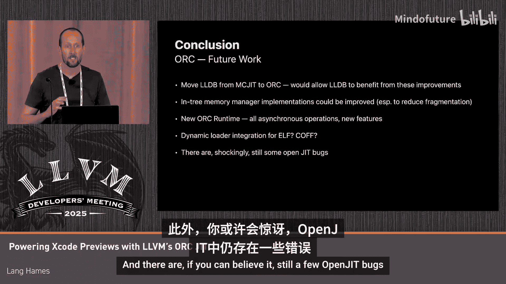

# LLVM开发者大会-US-｜-2025-Llvm-Developers-Meeting-p20-P19_动态加载任意程序_为Xcode预览提供动力--BV1ejr5BAEja_p20-

So thank you very much for the introduction。 Yes， I am Lang Haes， I'm a compiler engineer at Apple。

 and this is pairing Xcode Previews with LVM's or Gb。😊，So this is Xcode， it's Apple's IDE。

 and Xcode previews as a feature where if your application has some swift UI code like the Hello world UI that we've got on the left here。

😊，You can use the preview macro shown on the lower lefthand to get a live preview of your UI。

 the idea being that as you edit your UI code， you get fast feedback on the changes that on what the changes to your code are doing to your actual running UI and this is your running UI。

 we don't interpret or anything We're running your program and reflecting the UI into Xcodes campus so you can interact with it and do anything else you can with your app because it is just your app。

Now， when we introduced this feature， the way we made it work was to do a second build for this。

 You have your regular debug build， but then you had a separate previews build that had a layer of indirect added to enable fast function replacement。

Now that worked well。 It means that when you edit the code。

 we can quickly swap out functions to show you the new UI。

 but it did mean that we were building twice。So as of last year。

 we've replaced this with a scheme based on LLVM's Jit。In the new scheme。

 we're loading your object files from your regular debug build and using the LLVM Jt linker APIs to add the indirect we need for fast function updates。

This is great， we get rid of the second build， but it means that LOVM's Jt needs to be able to load and run any application that we would have statically linked and run under the old model。

So these programs can get large， thousands of files， hundreds of megabytes of code and data。

 hundreds of thousands of relocations。And it's common on Mac OS for programs to be split up into multiple frameworks and libraries。

 so the UI code might not all be in the main executable。These programs can also get weird。

 so mixed languages are very common here。 You must have some Swt code to use Swift UI。

 but objective C is also very common。 C and C plus plus also， and other languages are used too。

And it's also fairly common for projects to include precomplied static archives that the project needs to be able to link against。

We might build with multiple slices turned on， say arm 64 for Apple Silicon and X8664 for Intel Max。

 and we need to be able to pick the right slice。We might adopt nontri entitlements that change the behavior of the execution environment。

 like the Mac O S hardened runtime， which we'll talk about in a moment。

We might adopt interesting linker options like dashar， weak loading and hidden linking。

 which I'll talk about later， and interesting assembly options。

 We do see some handwritten a machine generated assembly which differs from the assembly that might be generated by clay。

😊，So we need to be able to handle all of that in order to run this pre feature。

The setup of the g that we use to enable this looks like this。

We always take advantage of O's ability to run in cross process mode。

 So you have a controller process that contains the previews Jit and a separate executing process where the Jitted user application will run。

 And this allows us to avoid polluting the executing process with the details of the Git and the libraries that it depends on。

As I mentioned， we're only loading object files here。

 so there is no laziness in previews we're taking the object files from the built products directory of your debug build。

We install what we call an override plugin into the jet linker。

 which allows us to modify the object files as they flow through the jet to add the indirection needed for fast function updates。

We use a custom memory manager to transfer the code and data from the controlling process to the executing one。

And in the executing process， we use what I believe is a novel dynamic loader integration in order to present that jitted code as if it were precompiled。

Finally， to deal with the scale of these applications。

 we always make use of a's ability to concurrently generate symbols。

 So we'll be linking multiple object files concurrently。😊。

And I'm going to step through each of these parts in a bit more detail。

We'll start with the override plug。 This is fairly self contained。

 We were able to do this because the Jelinker APIs are designed to give you a lot of flexibility with how you deal with the machine code flying through the jet。

😊，In particular， the Gitlink APIs can rename and ad code and data。 So adding some indirect is easy。

The first time we see a function， all we have to do is rename that function to make sure that the name doesn't clash with any other symbols in our program。

And then we introduce a stub with the original name and point the stub pointer at the original implementation。

So everybody who references the food function is going to bind to the stub。

 and we can redirect that stub at runtime， as we like。So if we want to replace this function buddy。

 either at runtime or at process launch。We can load a second definition that gets renamed to ensure that it doesn't clash。

 and we just update the function body st。Now it's out of scope for the previews jet to decide when this is safe。

 we pump that to our clients and they have a way to know whether they can replace a function on the fly while the program is still running or whether they need to do a process restart。

But this is very easy to express with the APIs that are already in in Elovvia。

The memory manager changes that we made for this project apply code signing to Jitted code。

Now we're not doing this for security， we're working in an IDA here。

 the whole idea is to let you execute arbitrary code。

But we sign code so that we dont have we don't affect the behavior of apps that adopt the Mac OS hardened runtime。

So this is an entitlement that you can opt into that says。

 I do not want my process to be able to load unsigned code。 So by default， it disables jtting。

 and it means that you can't load libraries that don't have a valid code signature。

So this is great for preventing code injection attacks when you're deploying your app。

 but it poses a challenge here when we want to inject the entirety of the app。😊。

So rather than disabling this or working around it。

We can make this work without reducing the security of the hard and runtime by introducing a custom entitlement called the previews signature type。

Not a custom entitlement， a custom signature type that works with this entitlement。

It is only applicable for programs that can have the debugger attached。

 So we're not weakening the security of the hardened runtime。 You can't use this in arbitrary places。

 But what it means is that when we load code for the jitted preview。

 we're loading valid signed code and the hardened runtime is happy。

The interesting thing is that the Gitlinker APIs are flexible enough to easily represent this。

 so our memory manager API allows us to split the linked code， which we send via shared memory。😊。

From sorry， linked data goes by shared memory from the linked code to attach code signatures。

 we have to create files because in Mac OS， signatures are attached to files。

 So every linked code section gets written to disk as a file signed and then em mapped into the executing process。

 at a assigned address。😊，The the code that's being loaded is signs the Hu runtime is happy in all of this one。

This is very macroa specific， but I share the story here because if anybody's been interested in using the L O VM Jit that thought。

 you know， I work in a constrained environment and I'm not sure that the Jt APIpis could work here。

 you can often get the Jit to work just by customizing the memory management interface to deal with these kinds of issues。

So the most interesting part of this project for me personally is the dynamic loader integration。

 And this came out of a question that seems like a corner case， which is。

 what should deal Sim of fo return if the symbol fo is in jted code？😊，RightSo those。

 for those who don't know， D L Sim is an API that lets you look up C symbols by name。

 If you call DL Sim and give it the string main， you expect it to give back a pointer to your main function。

So the answer is that deal Simmafoo should return the address of F。

 That's what it would have returned if it was precompiled， and we don't want that behavior to change。

The problem is that this call to D L Sim might be in precompiled code itself。

 which is outside the Jes control。 D L Sim on Mac OS is implemented in the system dynamic loader。

 So we need the dynamic loaderss help with this。So the way that we approached this was to teach the system dynamic loader to treat jitted code as if it were pre compiled。

You can think of this as a pseudodynamic library where the behavior of the dynamic library is provided by APIs and callbacks rather than by the dynamic loader reading a file in a known format on disk like Marco or elself。

 and where in this case， the callbacks will be implemented by AGt compiler。

The advantage of doing this is that Posss APIs like DL7 and DL open are very naturally supported。

 but much more interestingly in this world， precomplied code combined against jetted code。

 which means that you can selectively jett individual dynamic libraries。😊。

To see the advantage of this for the previews use case。

 consider an application like this with multiple libraries where we want to edit UI code that's down in the LibUI library at the bottom of the tree here。

In the old world， where Jitted code， where precomplied code can't see jitted code。

 we would have to jet every library back to the root。

 not because we actually want to jit them just because that's the only way for them to bind to symbols in the levels below。

In this world， where Jeted code is visible to pre compileed code。

 we can jet only the pots that we want。And the performance opportunity is that you jit the parts that are changing。

 precompile the rest， and that gets you the best of both worlds。

 We're never going to beat the system dynamic loader at loading unchanging prelinked code。

 but we can just reuse it and focus the attention of the Jit on the code that's changing。

And if you're wondering how you could actually statically link that Lib bar library when you might not have a Lib My UI on disk。

 that's exactly the problem that the L VM text API libraries solve。

So they allow you to take just a simple table， essentially for a dynamic library and use that to link against without having to have a full dynamic library compile。

If you're interested in learning more about T API， you can check out the talk using tapy to understand APIs and speed up builds。

 which I've linked at the bottom of the slide。So the reason this works is that there aren't that many things you can do with a dynamic library。

 you can create a new library at a path， you can open it once it's there。

 which is going to run the initializers。😊，You can look up symbols and addresses within it。

You can close the library which will run the D initializers。

 and finally you can delete a library at which point it's no longer openable。

So what we're going to do is turn each of those operations into an API or callback。

So create becomes register。 It takes a set of callbacks and a address range and a loadable at path predicate that you can think of as introducing a virtual file system to the system dynamic loader。

Whenever the system dynamic loader comes up with a path that it might want to open。

 if there's no file on disk that path， it can ask the registered pseudolibs。

 are you loadable at this path。If one of them says yes， the dynamic loader can say right。

 run your initializer， you're being opened。If the dynamic loader needs to look up any symbols within the pseudodynamic library。

 it can call the lookup callback， which will be forwarded to or core lookup in our implementation。

 which we'll see in a moment。But the interesting upshot of this is that symbols in a pseudodynamic library do not need to exist in any way in the executing process until somebody looks them up。

 So the pseudodynamic libraries can be populated lazily。

And we don't even have to compile something when you reference it， if you reference a function。

 which means you need an address for it， you can use Ac's La reexports facility to quickly generate a stub that will arrange for the function body to be called at runtime if anybody actually executes it。

So while we haven't done any laziness in this project。

 I've built a proof of concept out of T where you can have something that behaves like a dynamic library。

 but the dynamic library is backed by totally uncomplid source code that's being compiled lazily as you use the dynamic library。

So the last two operations are Dinitialized， which runs the D initialitializers。And dereged。

 which is the moral equivalent of a delete， means that you can no longer open the pseudo diet。

The implementation of these things in the orRC runtime was made simpler by the fact that we already have emulation of these operations in the jett runtime。

 so we already had an emulated deal open and DL S or the other operations。😊，So for this project。

 we just had to add the glue code to align the interfaces。

 modify the internals to add some caching for performance and adapt to DYLD's locking scheme。😊。

And we added auto registration and deregistration so that when you create jet Dilibs in the controlling process。

 a corresponding pseudo Dilibib immediately becomes openable in the executing process。😊。

So I wanted to run through an example of what it looks like for precomplied code to bind against jdted code in this world。

So we've got our executing process， running the system dynamic loader and containing the a runtime and separately our control the process has our preview jet in。

😊，And let's say we're in the middle of opening a precomplied library called L Fu。

 which contains an external reference to a symbol bar that we need to bind up。😊。

Bar is going to be defined in a pseudo diib called Lib bar， but nobody has looked it up yet。

 so it has no address in this process。The definition of bar resides in an object file in the built products directory。

 It's been registered with the previews yet， but no other work has been done for it yet。

So what's going to happen is the system dynamic library is going to come across a reference to bar and it's going to say。

 okay， I need to find the address of this symbol。It's going to call the lookup callback on the pseudo Dilib。

 which will be implemented by the Je runtime。The jett runtime will call across the preview Je and say。

 I need the address of this symbol。Symple lookup， as it always does in the or Jit。

 is going to trigger materialization。 so we're going to link that bad definition into our executing process。

At which point the Jit knows its address and can return it to the or runtime。

 which can return it to the dynamic loader， which can bind up the address。

 and we can now complete the open of our precomplied code and our precomplied code is bound against this jitted definition。

The practical impact and challenges of this， as I said， you can get the best of both well。

 you can jit the change code and statically link the rest。

This is a substantial performance win on previews that are broken up into multiple libraries because we can focus the attention of the Jit on the code that you're actually editing。

It might seem like this might introduce a lot of inter processcesed communication。

 but that address caching minimizes the IPC， and in fact， we cash on whole object file boundaries。

 So you only need one round of IPC per object file that you link in， which is fine。Now this works。

 but we are adding inter processces communication in the middle of a library load。

 which is a really fundamental operation， and in fact it's even worse than I've made it sound because linking in that bar definition might require you to resolve external symbols that force you to call back into the executing process and poke DYLD data structures on another thread while you're still in the middle of the library operation holding a lock。

😊，Now， we have made all of this work， but I consider it a bit brittle。

 I think we can improve this situation if we were to teach orRC to use its own version of D YLd's bind operations。

 We could say that the Giit binds up the symbols that it knows about and returns bind operations for the external symbols that it doesn't。

 Those bind operations could always be run on the thread that is doing the D L open。

 And that would mean that as long as the system dynamic loador is using a simple recursive lock。

 this should be safe。 So we hope to implement this in the future。😊。

So those were the changes to the execution environment as for performance。呃。

The easy stuff you turn on concurrency， right， this is easy only because we've been working on concurrency support since 2018。

Nonetheless， with the scale of the code we're throwing at this。

 we did find and fix some race conditions， especially in Marco platform。

We also had to introduce a custom dispatcher for this。 So I hadn't mentioned them before。

 but when the Gt discovers that it needs to do some work。

 it doesn't just run it on the current thread， it'll hand that work to the Or dispatcher。

 which is a class that you can customize。In this project。

 we introduced one that has a fixed number of linking threads。

 but an unbound number of what we call request handle of threads。

 And that's because requests between ac and the at runtime are still。

 many of them are phrased as blocking operations。 so you could starve a fixed sized thread pool。

We don't like this。 We consider that a bug， and we consider the dynamic task pool dynamic thread pool task dispatcher a hack。

 But what it is at this point is a battle tested hack。

 So if you're looking to do large scale concurrency with the or and you're looking for something that has been tested。

 This is what we're living on。 We're working on replacing all of those blocking operations with asynchronous operations。

 that would allow us to remove this restriction and you'll be able to run on any thread pool that you like。

😊，We also had to make improvements to a lot of utility functions for this project。

 So I'll let one example stand in for many。 The link graph split block operation breaks up content in the linker。

 For instance， the C string sections or the compact unwind records。

 This was O N squared for repeated applications that had never showed up as a problem before。

 but with the scale of the code that we're throwing at it here。 suddenly it was taking a long time。

 So we've added a cache。 We've made this analog log N Now it's no longer a problem。

 And lots of other functions within L of VM jett have gotten the same treatment。😊。

The biggest changes for performance were within a data structure called the waitinging on graph。

 So this is the data structure that allows concurrency in orc。

 It ensures lookup safety by tracking which symbols each symbol in the Git is currently waiting on so that they you know what you're trying to prove is when somebody asks for the address of a symbol are all of the transitively reachable symbols emitted。

 in which case I can use that symbol safely。 So this is the data structure that tracks that。😊。

It was an arbitrary graph， and we were able to make it bipartid in this project by merging two of the old APIs in the LOVMG。

 add dependencies and emit。So you used to say when you are materializing symbols in LL VM's Je。

 I've discovered these symbols and these are their dependencies。 and then separately， okay。

 I've written these symbols to memory。 now they're usable。If you merge the two of these。

 you only tell theit about dependencies for symbols as you omit them。

 and you can partition that graph and say that you have a set of emitted nodes that is waiting on a set of unitted nodes。

 That bipartid graph just ends up being easier to deal with in practice than the old arbitrary graph。

And you can apply the same logic to pre process the argument to the emit function that describes the dependencies of the symbols within your materialization unit。

Getting into specific terminology here， but。When you're materializing a set of symbols。

 you pass in a graph that say these are the dependencies。

 you can turn that into a bipartite graph using the same algorithm。

 You can do that preprosing outside the Jets global lock so we can paralyze some of the work here as well。

We also started applying coalescing to these nodes。

 So nodes within this graph that have identical dependencies are now merged into one larger node。

 And this is really helpful in practice because we see for large programs that lots of symbols end up piled up using a few common APIs that we're still trying to push through the jetit。

 So by coalescing these nodes， we massively shrink the graph。😊。

The waiting on graph has been lifted into its own type， it used to be embedded within the jet dilis。

 so the great news is that it is finally unit and performance testable， which it was not before。😊。

And as a little bit of extra polish， the node labels used to be reference counted types。

 but we were able to show that anything that was in this graph had corresponding references in the symbol tables elsewhere。

 so those reference counts were never going to drop to zero and they were redundant work。

 so we were able to adopt the new non-owning symbol string pointer type as our label for the nodes in this graph。

 and that eliminated that reference counting as well。😊，Taken together。

 all of these improvements were good for performance improvement on the order of 100 x to 10000 x on some of our pathological cases。

呃。So in terms of results， I only have rough numbers。

 These are the numbers from the previous team for last week。This is not just the Jit load time。

 There is a little bit of preview specific administration in there as well。

 So the Jit is slightly faster than these numbers would suggest。Um so。

About 87% of the previews that we're running run on in under 300 milliseconds。

 a further 10 and the bit percent run in under one second。

 about a percent and a half run in under2 seconds， and the remaining 07% run in over2 seconds。

So we're happy with this as an initial result， but we have to be careful about interpreting these numbers because there's a couple of biases that apply here。

The first one is that anybody who starts a new project and is playing around with this is going to fall straight into that 300 millisecond bucket and that's going to inflate that one。

And at the same time， for projects that do have pathological performance and see really slow previews。

 they're going to stop using the feature， and that's going to artificially shrink the longest category。

We think that the performance so far is reasonable。

 but we know that there are pathological cases remaining。

 and performance work on this is going to continue。 and I think we can make it faster。So finally。

 I wanted to talk about all the weird cases that you need to deal with to make this project work。

 the first problem I'll call naming archiveives。0。So the allKPs are very strict。

 if you say you want to add an object file， we expect you to add an object file。

 if you say you want to add an archive， we expect you to give us an archive。

The system linker on Darwin by contrast is very chill。 It really just wants you to succeed。

 So file extensions don't matter。 And as long as a file path resolves to something linkable。

 whether it's an object file or an archive or a universal binary， the the system loader will link it。

😊，Stem linker， we'll link it。So to match this， we've added a convenience function called ac load linkable file that takes a path。

 a triple and a load archives option for whether you want to be able to load archives or not。😊。

And this will handle object files， archives， universal objects， universal archives。

 non universal archives of universal objects， anything really that you want to be able to link。

 So this is now supported。LDDR so LD dashR is a link to feature that merges relocatable object files。

 and the interesting thing is that LDDR object files might contain duplicate symbol names。

 which object files coming out of a regular compiler never will。😊，So for example。

 you can take two C files that have a static variable of the same name。

 run them through the compiler， LD dash are together the resulting object files。

 and you'll get one object file with two symbols of the same name。

And very few projects do this deliberately， but the Swift package manager does it。

 And so transitly through that， everybody ends up doing it。This is sort of a common pattern， right。

 features that seem really obscure。 Even simple programs often depend on them somewhere transitly in their dependence chain。

So in any case， we've removed all assumptions that locally scoped symbol names unique。

 and this is now supported。Arm 648 pointer authentication。

 so this is a feature on arm 64 that allows you to add some bits to the high bits of a pointer and the hardware is able to trap if anybody forges a pointer。

 so it's a control flow integrity measure。So we're able to support this initted code now。

 And interestingly， we're able to do it without introducing a trivial articleacle。

 So we don't just have a function that says sign this pointer for the Jit。😊。

What we do is we install a link of plugin。 and every time we see an authentication edge in our object files。

 our plugin replaces that with an null puter and creates some instructions in a signing function that's run as a static initializer。

😊，And in this signing function， we're writing a fixed address with the signing bits attached into a fixed location。

 So my claim， at least is that we can't use this as a general article。

 I'm waiting for a security person to tell me I'm wrong。

There are so many more things that we did for this project that I wish I had time to talk about。

 so compactact Unwind has now supported C++ exceptions will work on Darwin Alm 64。

Subsections via symbols。 If you want a handr assembly on Darwin and you really don't like this directive。

 You don't have to use it anymore。 Weak loading and hidden linking are both working。

The dash allload and dashO C modifiers to static archive linking are working。

And we know how to synthesize objectives， C stubs that use the new Obsy message and stub synthesis syntax。

 So all of this will now work。In conclusion， or can Jit load programs that were intended to be statically linked。

 It can scaleleton on trivial programs， and it can support unusual build configurations and execution environments。

 And with dynamic loader support， precomplied code can interact with jitted code as if the jitted code was precomplied。

😊，We expect many of the benefits from this project to flow on other clients at the LOVM Git。

And we think that there are a new developer workflow opportunities to be pursued here。 In particular。

 could we use a jet mode for our edit test cycle that is rather than building everything that has changed。

 which is the normal incremental build model。 Could we build only what you need。😊。

This would mean faster compiles， but it would also mean that you you don't need to select your build and target options to avoid unnecessary compilation。

 If I'm working on a bug in L O VM Cogen for X 86， I don't want while I'm doing that at a test cycle to be building the other back ends。

Of course， this isn't a replacement for incremental builds。 When I want to validate my change。

 I do need to run the whole test suite。 So I think in an ideal world。

 we would be able to mix incremental compiles and Jit builds and ideally share the content between them。

😊，The content addressable storage that people are working on would be ideal for this。

So as a strawman， if you're trying to think about what would something like this look like。

 what if we took the LTO approach and had compilers produce dotdo files that didn't actually have any compiled content in them。

 We used the text API system to generate an interface， and we store the compile command。

 feed that through the build system。 and then at the other end， run L of VM J to execute the code。

And there's all sorts of interesting extensions that we could think about to this idea。

 per function requests to the front end changes to the build system and tooling。

I don't have answers for how all this works。 I have lots of questions。

 If some of you have thought about this and have ideas or opinions， I would love to hear them。

 if you haven't， this is your opportunity。So last up， in terms of future work， we need to move LLDB。

 This is immediate future work。 move LODB from MCGt to Oc。

 that would allow LODB to benefit from this。The entry memory managers are very。

 very basic and more and more people are living on them。

 I think there's a big opportunity to improve them here and benefit a lot of clients。

The New Yorkk runtime is being brought up with all asynchronous operations and new features。

The dynamic load of work that has been really interesting for us on Darwin hasn't been touched at all on Elphfin Coff。

And there are， if you can believe it， still a few open jetit bugs。 So contributions are very welcome。

 If anybody's interested， reach out Github issues， PRs， discourse。

 discussions or find me on the L O VM discord。 I would love to hear from you。😊。

All，Thank you very much。