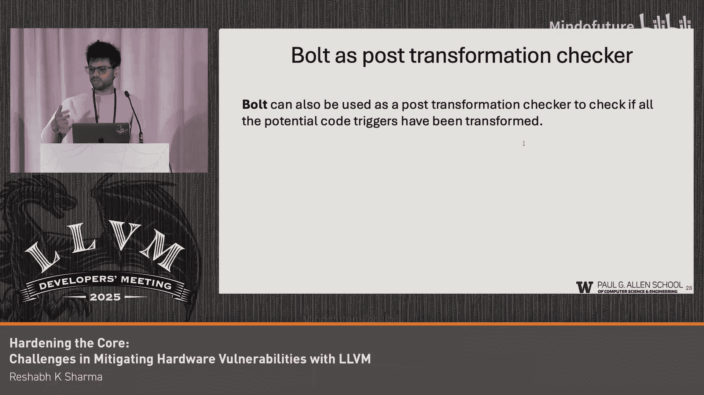

# LLVM开发者大会-US-｜-2025-Llvm-Developers-Meeting-p21-P20_强化核心_缓解漏洞的挑战--BV1ejr5BAEja_p21-

Hello everyone， today I'm going to talk about challenges faced in mitigating side channel vulnerabilities inside LVM。

Let me start with some background。Safety critical code needs to be hardened。

When I started working on security， it was very surprising for me， dad。

Security people don't care about securing things， which is not a secret。

So security people only care about secret and the software that deals with secret。

 let's call them safety critical code。 Here are a few examples of some safety critical code。😊。

Like password hash comparisons， cryptographic quality checks。

We do not care about general purpose code。 We only care about hardening these safety。

 critical cryptographic code。A little bit on side channel as well。

 So side channel works by leaking data through。Unintended side effects。 So， for example。

 suppose your programme wrote something into cash and someone was seeing your cash or someone was。

Indirectly reading your cache to extract the data， there are other type of side channels like timing side channels。

 supposeupp you have a program in which when you provide a password And if the password matches。

 it runs faster when the password is wrong。 Now， these things may seem trivial。

 but these informations can be used by a malicious actor to extract the password to leak other stuff。

But。To deal with these things， constant time programming has always existed。 As the name suggests。

 constant time programming means that you write a program in such a way that its execution for every input does not generate any。

 you know， variable side effects。 So， for example， you。

 you will write your code such that you do not have any branches on your secret data。 or。

 for example， if you have a big， if you have a big list of things， you will iterate over whole list。

 you will not， you will not， you know， exit early of that iteration because you found what you want to find。

But is constant time programming enough。Unfortunately， no。

 so we have seen with we have seen with Spectter meltdown that there are possible attacks which can also break your constant time programs。

But， that's not it。Even if you have a program that is perfectly constant time now there exists so many different micro architectitural side channels。

 which comes from your caches， your prefes that can still produce noticeable difference that our attacker can use to excfiltrate data。

So what are these micro architect side channels。 Suppose you have a constant time code。

 It looks like that this code should execute in constant time。

 but then the hardware can decide to do some optimizations internally。

 these micro architectitural optimization can make the execution of your program to have different side effect。

 than it would have when those optimization would not have been present。

 So one of the most popular and speculative execution。

 than there are others silent store computation simplification， and I'll give examples for these。😊。

Speculative execution is simple that what we see here， we see a condition， and then we see a move。

 Now， actually in the program， the condition was if the index is under the bound。

 then you do this move。 but the CPU decides to speculatively execute the move and then roll it back when it realizes that。

 you know， this condition doesn't hold true。 But during that speculative or that transient execution state。

 your cash is already changed， your cash state has already affected。

 which can help the malicious sector extract things。 and we have seen how serious vector was。😊。

But this is a complex example。 Let me go to a very simple example。 And this is my favorite。

 is called Sil store。 Suppose you have two stores。To the exact same address。

 But they have different registers。 What happens in the hardware that if these two values are same with the value of E A X and E。

 B X are same， Then the second store is just silence。 is's just optimized， right。

 like in the hardware， we have the store buffers， we can see what are the stores that are coming in what order they are coming。

 So it makes perfect sense。 Why， why do we want to go to the store cycle again and waste those precious cycles。

😊，But then this information can also be used by people have shown that this simple attack。

 like this simple optimization， which seems very trivial to us。

 like even as a compiler engine Israel， like this should happen。 and we would expect this to happen。

 But from security standpoint， this is bad。 This is。Really， very bad。Similarly。

 a much simpler example。 Suppose you have a ad。😊，What do you expect when one of the registers or argument is 0。

 I expect that it should not go to the AL U or you know whatever the complex circuit is for it today。

 it should directly return the second argument because a plus 0 is a。

This can this can generate a timing difference。 So now when one of your variable is 0。

 the attacker is know that， you know， this variable is0 because add returns faster compared to this other thing。

😊，So these micro architectural optimizations， which are very necessary like we cannot get rid of them。

 they may create side effect， which can be observed by an attacker and can you know。

 do data exfilration。The biggest takeaway is that these things break your constant time code。

 So all the effort that has been gone into writing all this constant time cryptographic libraries and constant time programmer hate compiler people because we undo their effort。

 like they write this program， which is constant time。

 And now we have we have these optimization inside the hardware。

 which is kind of doing the same thing。😊，One thing that we realized is that。

There are code patterns in our program。Which we as a compiler engineer。

 we focus a lot because we see those code pattern and we transform them into a more efficient and a more optimized version。

But what you also realize is that these code pattern are also used by the hardware to trigger these optimization。

 which may be potentially vulnerable。😊，So can we not just turn off the optimizations which are bad。

We cannot turn our speculative execution that's， you know， like that will be a big performance draw。

Can we not turn off these for people who care about security， Like。

 can you give me a button on my laptop that， you know， is of。

Probably not because no one has so far released such a thing。

Can we turn it off programmatically that， you know， now my crypto code is getting executed？😊。

Turn this off。 Now it's like now I don't care I'm in a noncritical section of my program。

 Run it normally。 This is somewhat possible， but still the support for this is very less。

 The example that I gave you about the ad instruction。

 You'll be surprised in Intel instruction said the ad was variable time。

 So I think last year or last last year， they released a flag。 When you used that flag at O level。

 not programmatically from your program。 When you use that flag in O level。

 they make sure that your ad is constant time。 I was very surprised to know that。

 you know that simple operation like ad multiply another athmetic operation were not constant time。😊。

So what do we do， Like we have seen this other side that， you know。

 it triggers this micro optimization。 What else can we do， So the this side of this thing is。

 can we get rid of all the code patterns。😊，Which should not trigger those optimizations。

So for example， if we know that this particular piece of this particular region of my program deals with secret。

Can I transform that part of my program， such that when it goes when the thing gets executed on a hardware。

 it never actually trigger those optimizations。And this is， this is smart。

 but this is also complex because we have to cover all the possible cases。

 But it turned out that this is a great fallback and a backstop solution because you can do it at。

 you can do it at day 0。 You can do it for older hardware。😊，So this day0 solution。

 a new attack comes out。 You can push out this mitigation inside your compiler。

 Everything now compiled with a compiler does not call the one the， the optimization。

 which was potentially one variable and and。This thing also works with your old hardware。 right。

 Like you don't like even if the vendor fixes the bug。

 the vulnerability or even provide some support， it will be provided in the future hardware。

 And we have seen with this with some we have seen with this Apple M1 chips。

 like there was there was a there was a attack。 It's called aug grid。

 It's based on the pre it based on the data dependent prefecure。 it came out the M1 was vulnerable。

 M2 was vulnerable。 But in M3 M4 its either fake or there's a way to turn it off。😊。

We need to perform a ta analysis on the program that we have to figure out that what are the regions in our program on which which deals with secret and these are the regions which we care about should not trigger these these these optimization and then we transform them。

TheSimpst case is the spec which most of you will be familiar about that we put fences right to stop that speculative execution and is the is the same concept。

 but it just is just that we already use this in practice。

 So suppose this is the code which was vulnerable。 and let's say that somehow this code is in the critical section or some section。

 which is safety critical， we put a fence。 And because of this fence。

 we know that this move will not be done speculatively。 And this is actually， in a way。

 turning off the optimization to happen。 And if we can do at right places at right time for right data。

 which we know our secret， we can efficiently protect our secrets from getting from spectrater。😊。

Without having to without having to go through that performance drop of turning off the speculative analysis。

 speculative execution completely or even doing it for， you know， all the things in the program。

 like putting fans before every move。Similarly， for Sil store， you had two moves。What if I pull。

 I put one more move in between them。 I put one more store such that I guarantee that R 11。

 the value in R 11 is never E， A X and E， B， X。 So what we actually do is we take the value from E。

 A X and E， B， X。 We split them。 So we take the upper half from E， A X。

 We take the lower half from E， B， X， and we invert them。😊，Now， doing this。

 we guarantee that the value that will be generated will never be sent to E X nor E， B X gi。

Making that that now Sil store does not trigger for E B X because R 11 is R 11 is never same as E。

 B X。And it also never triggers for R 11 itself， because R 11 is not equal to E A X ever。😊。

So I hope that I was able to give some intuition about， you know。

 how these attack works and how we think is the way to。Disable them。

 mitigate them inside the compiler by these selective code transformations。 Now。

 let me address some challenges that we as a we we faced while we were implementing these like I have been implementing these for past two。

 three years now for attacks of different complexity。😊，The first challenge is that， you know。

 where should we implement these things on like， we have this amazing transformation。

 We know that how to turn it off， Where do we implement it， Should it go to。

 should it be L VM Irpa Should it be a backckend pass before register allocator or should it be after register allocator。

 Suppose that you care about all the stores like silent store。

 And we want to transform all we want to care about all the stores。😊。

Probably we want to do it after register allocation when the spills and the fill have happens。

 and we know that these are the new stores when all the passing variables through stack has happened and we have all the stores that can possibly be emitted。

 but then there are mitigations where that is that that level of abstraction is just too low just too low level。

 For example， you want to allocate shadow memory。 you want to somehow deal with shadow memory。

 You probably want to do it at LVM IR， not at M I R at that too after register allocation。

 It just becomes a lot painful。😊，So this is the first challenge。

 And what we have realized is that there is no good solution。 What， what good。

 what worked best for us was that whatever works best for L VM IR， let's do L VM IR。 Let's go down。

 Let's keep tagging things。 like， let's keep that information around that where this thing comes from。

Another interesting thing is that， you know， if we want to implement silence tour transformations after register allocation。

We need to reserve R 1。 And this is a very common practice like if if you see some of the mitigation passes also written in bold temporary registers are needed。

 but for us， inside hellvium code， we have to reserve R 11 for X X6。 we have to do it。

 you know manually like there is no better way of doing that。

 But these are the things that these changes， even the way or these changes。

 even the way the the compilation cycle behaves。😊，The next challenge is。Where do I schedule my pass。

 I have written this mitigation pass。 It works Well。 Where do I schedule it， Ily。

 I want to schedule it at the end， because I don't want anyone to undo it。

 I don't want any other mitigation to undo it。 I don't want any other optimization to undo it。

 But if everyone is at the end， what is the end。Right， like if， if you have one mitigation partial。

 I'll put it at the。 And if you have two。What about the phase ordering between these two， And。

 you know， if you have 10， and given that， you know how this like how the new threats are emerging。

 how new attacks are how new attacks are being found。And also。

 how memory safety is in a very good direction of， you know。

 finally being tackled and probably memory safety will not be as big of a challenge unless in the next decade and side channel will become a bigger challenge because we will probably solve memory safety。

😊，There is also this perspective shift that when we do optimization。

 we figure out it the only thing that we care about， it should be equivalent and it should be fast。

 right， And we figure out， you know， these are the low hanging fruits。

 These are the places where we are0 percent sure it will be equivalent and interview fast， but for。😊。

Mitigation， you cannot miss anything If you miss a story， if you miss a quote pattern。

That's false sense of safety。 That's for that's， that's a potential vulnerability。

 And that's a much harder vulnerability to find because you claim that， you know。

 this is a mitigated binary。So some open research questions are that， you know。

Me as a person who is writing this pass， How can I reason about passes that are ahead of me And this also goes with this also goes with the pain of people who are writing constant time programs that they want to use compiler。

 They want to they want to have their constant time program to be fast。

 But the problem is the compiler is such a complex infrastructure that it does things in a way that is not trivial to realize until it's done。

 So this can also help people who want compiler for constant time program to work。

And this is one other thing， like， how can you figure out conflicting transformation。

 How do we know that this undo this and， you know， this thing is complementary。 This。

 this subsumes this。Similarly， one of the biggest challenges that you faced was in line assembly in line assembly inside a compiler is just a string。

 What do we do out there。 Like if you have a， if you have a mitigated binary。

And you didn't handle in line like in So you didn't handle in in line assembly。

That's no good because， you know， there are still a lot of places where our attacker can find gaps and go in for our experiment。

 What we did was that almost all the crypto libraries， they。

 they have a version which does not have a line assembly， like a non， highly optimized version。

 And we use that， but。😊，The best way to do it is to do it in bold or a binary like a binary。

 But then it also has its own challenges because you cannot bring all the analysis result in like you know even attain analysis just to tell you what are secrets is much better if you do it at LMIr level and things like dealing with shadow memory。

 supposeupp you have to create a shadow memory and use it it might be challenged to do it at bold。😊。

But also there is this another perspective， right， Like to figure out that are these two transformation conflicting or to figure out that。

 you know， how to order them， did I do right， did I do wrong， Sure， like this。

 that will require having semantics for each transformation having to figure out And you know instantcom past。

 Like there are things that are huge to even think about such semantics to be even written down。

 But then can we not have simple post transformation checkers， like this is the binary I generate it。

 Does this have this code pattern。 And these are simpler things which can be implemented with a binary writer and that we actually do that。

 So once I implement I do not do it on I do not use bold for this， But once I implement mitigations。

 I take the binary， I write a checker and then I check it。

 like are there anything like is there anything that is left and。Surprisingly。

 a lot of the time when I thought that I did a great job。

 I realized that there are so many code patterns and things that I missed。 and you know。

 compilers are so complex。 The backend is so complex。 So to even support all the stores。

 Sure you can write a MI IR pass after registered location， but to support every stores。😊。

At the place where it was made。 So， for example， I want to double the size of all the stores that are generated in the back end。

 It's， it's painful because， you know， you have sizes for calling convention。

 You have a lot of various going on。

To conclude。I would like to have you this like， I would like to have you the。

 I would like you to have this takeaway at the end of the talk， which is that， you know。

 compiler based defenses。😊，Are really flexible and timely responses to these emerging threats。

 You have new attacks coming out tomorrow。 You can push out a compiler base mitigation much faster。

 And we have seen this during spectra as well that， you know。

 compiler base defenses came out really quickly。😊，I100 percent agree with the sentiment that these things are slower。

But I also believe these things are necessary because you cannot go back and change the hardware。

 Like I use a laptop with M1。 If I care about the text set are on M1。

 I probably have to move to some other I probably have to move move to some other you know。

 new hardware that has fixed that or， maybe， you know， maybe these compiler is transformations。

 because I only have to apply it on the cryptographic code。

 the code that actually deals with our passwords are private key。

 And if you think from a bigger perspective， how much is this code versus the total code that we use probably small。

 how much is the overhead， probably huge。 But if you look from the bigger perspective。

 this huge overhead on this smaller part of code。😊，Is manageable。And。Compilrs are amazing。

 amazing infrastructures。 and， you know， well suited for optimization transformations analysis。

 They were actually never made for mitigations。 So that's why we are facing this challenge。

 You not saying that， you know， Comprs are bad like they are bad for mitigation。

 They were never made for mitigation。 But there is place to improve compilation infrastructure in a way that mitigation can also be a part of it。

😊，With that， I'd like to。 Thank you all for coming here。差。Hi， thanks for the talk。

 That was really thought provoking。 I had a question which is。

 how did you evaluate whether your program transformations were effective？ And in particular。

 like I'm interested in like you know what if for example， like the silent store optimization。

 like what if a compiler what if you know， on one piece of hardware that's enough to trick the opt the microarchitectural optimization。

 But like on a newer piece of hardware， perhaps already also in existence， that doesn't work， Like。

 how do you validate these sorts of things and also as new pieces of hardware come out。

 How do you check that some mitigations aren't regressing the other mitigations。

 Like what' sort of the evaluation strategy here。😊，Correct， so。

The thing that we implement is very architecture as well as micro architectureure specific。

 So suppose we implemented something for X6。 this particular micro architectureitecture is just work for that。

 We do not claim that it works for anything like any other version that the new version that comes out。

 The interesting thing is that a lot of our stuff is also very dependent on attacker community who figure out that。

 you know， this particular micro architectureitecture is vulnerable to these things。

 And they do a decent job in giving out the information of the attack that。 you know。

 this is attack is。😊，I can say that these transformation at this point are so simple that if you see the like。

 if you see just the spec that， you know， this new attack came out， it works like this and you ask。

 like， will this transformation work for it， you'll probably get answer by yourself。 But right now。

 we do not do that。😊，Thank you。Any other questions。No。Okay， yeah， thank you。

 So we have lunch now and the sessions will begin。 We'll re begin at 1，15。 Thank you。

