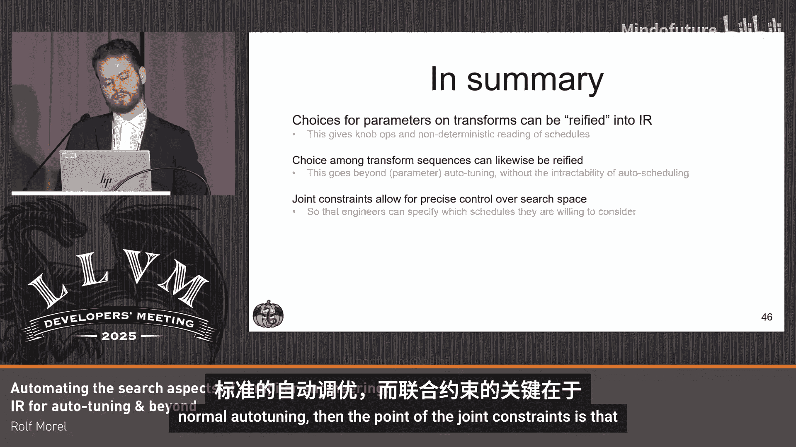

# LLVM开发者大会-US-｜-2025-Llvm-Developers-Meeting-p22-P21_自动化编译器工程中的搜索环节--BV1ejr5BAEja_p22-

Okay， good morning everyone， my name is Rolf and I want to tell you something today about how we can automate part of the work that we're doing。

 namely compiler engineering。Okay it all starts from this simple premise that in my view compiler engineering involves a lot of tweaking of pipelines and knobs。

 so let me make that a bit more concrete， I propose that for many of us or in my experience。

 the average day can look a bit like this， we can have a plan that looks like this。

 we have an existing pipeline that we want to optimize like the thing that we're seeing here on the right。

 we use our experience and insight to say okay at this particular point where the question marks are we are needing to introduce a new optimization in order to make better performance and a particular workload。

Again， from our experience， we say out of all possible optimizations to try。

 I think we should first try F。Then we evaluate the performance that we're getting。

 And if the performance isn't there， what do we do next， Of course。

 we start tuing whatever knobs are available enough。And of course， we need to evaluate each time。

And if F didn't work， well， we will try G and see what performance we got。That wasn't good enough。

 so we start tweaking Gs knobs and a lot of evaluating at each time。 And at that point。

 we might start to get a bit desperate。 and we have this face ordering thing where we're first going to try F and N G because that might give us performance and of course we tweaking knobs along the way and then we might try F G followed by F。

And that might already be as much time as we have on that day。

 So there's a lot of manual effort that goes into this。And if you ask me。

 there's a certain promise here in that if only we could express such plans for optimizing a pipeline。

 and then maybe we could apply mechanization， optimization to that process。Okay， so in this talk。

 I will be。Telling you something about how we can express such plans in IR to an extension of Sch IR。

So that we can give representation to these different choices that we're willing to consider。

And we will I will show you a mechanism for automating their execution of these schedules with choices by mapping them to constraint problems。

So that we then can hand off the combinatorial search that's involved to solves， so to computers。

Okay， there I will list some of the topics I will be offering。

 I will start with a quick overview of schedules how they relate to the transform dialects。

Then we'll introduce IR for tuning knobs， and I will give you a non deterministic semantics for these opbs。

Fya S& T， and I will introduce more new ops to deal with alternative transfer sequences。

 and we'll consider how we can optimize， well， optimize this optimization loop。First。

 what are schedules？Schedules come from this notion that programs are actually composed of two things。

 they are both an algorithm and a schedule， the algorithm defines the functional behavior。

 how inputs get mapped to outputs， and the schedule tells you how that execution is supposed to happen。

 which memory are we using。What loop ordering are we using， that kind of thing？

So let's make that a bit more concrete by this famous example from Helights。

 Helight says we have this high level algorithm for applying a blurer to an image。

And the actual programs that we want to run on our particular hardware look more like this here on the right。

 so the programmer would typically in a normal paradigm end up writing this program。

 which combines the actual algorithm， the functional behavior together with all of the details for getting good performance。

嗯。And then according to discussion paradigm， we can do this differently。

 we can actually write the high level code for the algorithm， so the functional behavior。

And we can say that there is a schedule that tells us how what kind of optimizations。

 what kind of lowering we should be applying to the algorithm in order to get such low level optimized code。

 so we write as a programmer， we don't write the low level program。

 we write the algorithm and a schedule that tells you how to optimize and then there is some machinery that applies the schedule to the algorithm。

So the scheduling fair dye。It has many instants。 here we see a couple。

 including TPM and all share the same basic idea。 We want thelar descriptions of how to transform code transform。

呃。So that brings us to MR's transform dialect。Wwhich is just another instantiation of the scheduling paradigm with MIR。

 so MIR's transform Me dialect allows you to write IR that describes which transformation should be happening on other IR so we have the schedules are transformer IR use the transform dialect and they tell you how to modify payload IR so in the normal IR that we want to lower and optimize。

And in this case we have some gem fee here and the schedule says we want to match。

 we want to find anything that has one parallel iterator type。

 so it finds this line generic and then it says to apply tiling to it。

So we give the payload IR and the schedule to the machinery that in this case is called the transform interpreter。

And the transform interpreter applies the schedule， which then ends up giving us this。

 this IR with the additional loop that we wanted。 And there's a。Paper here。

 and there are many some tutorials online， I recommend to check them out。

So a little more context for people not that familiar with Emily Ar guess。

 we can progressively the ideas to progressively lower trade dialects。

So we start with something very high level and then go to Linuxinnoock and then maybe add some tiling and then maybe get rid of Linuxinnock by factorizing and the idea with a transient dialect is that each of these steps can be described as a little schedule and we can even use reuse passes。

 for example， here。because the transfer dialect is like a proper programming language。

 these schedules also compose so we can have one big schedule to describe the whole lowering process。

 so essentially this is a replacement for your pipeline。嗯。Yeah， so that concludes the recap。

So as soon as you start experimenting with these schedules or even with pipelines。

 you will soon find that you end up with magic values all over the place。You are， for example， here。

 we have that the schedule tells us we want to find Mamals and apply tiling to it。

 you're going to do some cache tiling and some registered tiling and we don't quite know which values we want to use。

So each of these， these for each of the different files that want to use。

 we end up with a different schedule。And that usually involves some manual either manual tweaking or some generation via script。

 either way， it becomes hard to track what the different options are that we're willing to consider。

 we need some actual thing on top。To talk about these different options。

So my proposal here is that we can raify this notion of havinging some kind of choice into the schedule itself。

So what we do is we say， okay， we had a choice for。

Determining what the size should be for the caching on the and dimension。

 fortyling on the and dimension。 And we do that by we express that choice by introducing this transform tune dotn up with some descriptive name。

And we say it has a number of different choices。 So the semantics of this op is that it produces an SSA value with whose actual value is one of the options。

16，32 or 64。 And we can have multiple of these independent nodes。Oh。

That we don't want to somehow make a choice on。So the first thing we do is the first thing we observe is that we can just look。

 we can just walk the IR and extract this parameter space of these parameters that we introduced。呃。

Yeah， which brings us to an issue， namely that these transfer not tune knobs。

are not executable according to the transform interpreter。

 so the machinery that apply schedules because there's nondeterminism here。

 the Mc is going to be one of 16， 32 or 64， it doesn't know how to deal with that nondeterminism。

 so we need to help it， we need to do something。So the first thing we can do is extract that constrained problem that。

Search space。 then we need some mechanism for making a choice among these different values。

 different options。Whereupon we can have some kind of drive or some kind of script that automatically rewrites the schedules with the choices to schedules without choices。

 So here we just map the tune of knobs to constant。

So here we went from a non executable schedule to one that we can execute。Okay。

 so that we can make a bit more concrete。 How do we deal with these constraint problems。

And the way we'll deal with it here is through the S&T dialect。So S&T is satisfiability modular Ters。

 it's essentially just a language， a mechanism for expressing constraint problems。

The details are not that interesting， but I will give you a flavor so here on the left we have this transfer nottunenob and we're going to map it to S&ee。

 meaning that we're going to interpret the knob just as a variableable。

 a variable that can take different values so here we declare there is a variableable well which happens to have this name。

And here we say that it can either be 1632 or 64。And because here we're still in IR in MoOR。

 we can convert that to the language used by S&T solveuls。

 which is just very straightforward mapping。At which point we can just hand it off to any of the shelf as an teaover。

An S& T software will you can get the S& T software to enumerate all the fall assignments。

 So of the valid assignments for MCca in in this case。

 and those assignments we can then use to rewrite the nondeterministic schedule to a deterministic schedule。

And in this case， it's really trivialo， we have these three options。

 so we end up with one non deterterministic schedule giving us three deterministic ones。Okay。

 so that's a relatively straightforward approach to al choosing and where we just have these independent knobs and enumerating fellow assignments for independent knobs is really not interesting。

So one of the things is that we want to be able to express the constraints that we have in mind regarding the valid assignments for the different tuniables directly alongside the expressing the knobs。

And because we know we're going to map to ST dialect。

 we can make use of the mixing of dialects in MAC。 So in this case we had that for registered tiling we said there were only these valid combinations。

But in actual fact， we know that the constraint is more like this。

So now instead of needing to use just one knob， we can express it with multiple knobs and express that actual constraint。

So here we have another new op that says， okay， I know that these transform parameters are effectively going to be treated as S&T variables。

 so let's just map each of these parameters to an S&T variable and then I can just use the S&T dialect to express any constraint that I would like。

And then the translation of that is straightforward。 We just translate each of the knobs。

independentlydependently， so we have heard the translation for the first no here for the second one。

 and then the constraint is just a copy of whatever we had in a particular region。

And we map that to S&T， we asked S&T software for all of the to enumerate the fall assignments。

 we get lots of assignments in this case， all satisfying this particular constraint that we set should be satisfied。

Okay， that basically takes care of alt tuing with constraints。

My assertion is that we need to go further。Even to address this initial example that we start out with。

So at points， when you're optimizing your schedule。

 you will find that you say either I'm going to do this transformation or I'm going to do that transformation。

 I just want to be able to express that choice。And I hope it's obvious with doing this with parameter or not tuning。

 It's not possible。 Those are meant for tuning the parameters on transforms on passes。 here。

 we're going to express a choice among passes or transforms。Okay。

 that's actually straightforward enough to encode， we just introduced a new op here。

 transform to not alternatives， which is expressing that we're going to either use this first region or this second region。

So the the semantics of the tension or tune that alternative this op is to say。

 replace this op with one of its regions。So， indeed once we have this up。

 we can essentially get that the meaning of it。 These two separate schedules is exactly what we wanted before。

And to cover them mapping to S& T， we have that transfer tune of alternatives as any number of regions。

And essentially this， this name here， that we say。The thing that we need to represent the choice is that for this particular student of alternatives。

 we have an S&T variable。With a certain range。 So because of n n plus1 options。

 we have it the ranges from 0 to n。Wwhichch we then assert to be the case。

 then we have these formulas to check what the subcr variableable was actually assigned zero or 1 or n。

呃。So this allows us to check which of the choice which way the choice actually went。

Whereupon we don' need to make sure that whatever S and T ops whatever knobs or other choices are in here also get translated。

 and that must be conditional on。That particular choice being the case。

There's some details here that I'm skipping。Okay， to me， this still， okay。

 we we were able to express the choice among these two。Alternatives， but in general。

 we will find that not only do I care about making a choice at a particular place later on in my schedule。

 I might depend on the choice that happened earlier on。

 So here we have I just want these two alternatives this these two possible schedules。

And here on the left I'm doing some parallel tiling and then later on I want to replace the parallelF parallels with sorry SF for all ops with SCF parallel Ops。

 so that clearly depends on having tile with fors。And here on the right， I'm going to say。

 I had did a sequential tiling first。 So I will do something with a sequential loop。

So the straightforward and in the middle of what just want to do to say。

So the straightforward thing to do is to express this as two independent choices。

 to independent alternatives。 So we first choose between tying with for and  tiing with4。

 and then later on we have another independent choice of doing the the mapping to to parallel or do a coales。

Colos。But here we end up with four schedules because we have two choices for the first one and two choices for the second one。

The way to make the second choice depend on the first is to introduce a marker that's the result of the first unitnet alternatives that allows us to track which way the choice went so in this case we have that marker is set to marked parallel with the value1 and if we use the sequential region then we mark marked sequential which is just this value 0。

And then for the second alternative， the the one that's dependent on the first。

 we can just assert in this case， using the transform dialect's own ops that the marker should have been equal to marked par。

 So it did when we do something with a parallel loop。

 it better be the case that the marker says we did something with the parallel loop before。

And for the case that we want to do something with a sequential loop。

 we also assert that better be the case that we did something with a sequential loop before。

And here we have the lowering to S&T， which is quite detailed and I don't expect you to read right now。

Which lowers than to the the input that the S& T server can actually deal with。

W whichch we can feed to S&T softwareul and in this case there are only two valid assignments for of the variables that satisfy all the constraints。

 so in this case we were able to encode with two alternative choices that there were only two valid concrete schedules that we wanted to consider。

Okay， and now to wrap things up。now we have all the tools available to us to encode our average plan for an average day in IR。

Here on the left， we have this pipeline that were wanting to optimize。

 We already see the outline of that in the IR here。Okay。

 and now we're going to say either we're going to do F or we're not going to do F。And on F。

 we have some knobs so we can just add the knobs right there in the schedule。

And if we're not gonna do F， then we're gonna do G。And G has some nobs， the truth。

And now I'm going to express that either that another option is to say。

 I'm gonna first do G before F。And of course， it also has its ops there。So either I'm gonna to do。

 Im going do G here or I'm not going to do anything。 have a marker to say what happened。

And then I'm gonna make use of these tight alternative choices to say G after F。呃。Yeah， G after F。

 only in case that G was performed is not true。And otherwise， we don't do anything。 So otherwise。

 if we didn't have this line here， it would have been the case that we could have G。

And then F and then G again。 So now we're expressing a lot of control over which particular schedules we want to consider as the concrete versions。

And wrapping up。so now we have the full mechanism for automating this optimization of schedules of pipelines。

 which is we have schedules with the knobs and alternatives。

 which we map to S&T input S&T lip is the standard that the S&T solves can ingest so we give that to these constraints solves。

 S& T solves which we sure to always pick only these fileette assignments that satisfy all the constraints。

 whereupon we can rewrite the schedule to the concrete schedules without the knobs and alternatives which we can feed to the transform interpreter along with the payload that we want to optimize so we got to optimize payload we have some harnessness for evaluating and scoring that and we can just run this in a loop and for example。

 just automatically collect whichever was the highest scoring。

Assignment for for of thesenobs and alternatives。So we are now at this point in what we have working for ourselves。

 and we want to go a bit further and that we want to optizing constraintstrain so that's a bit smarter of where to search and we might want to optimize many different paylets at the same time。

Because we might want to optimize an entire pipeline for different workloads。Okay。

 that brings me to the summary。So we introduced a way for reifying choices for parameters into IR。

 This gives us thesenob ops with a non deterministic reading。

 We have made it possible to talk about alternatives among transfer sequences。

Which goes beyond auto tuning。normalormal auto tu， then the point of the joint constraints is that we can express a lot of control over the different concrete schedules that we're willing to consider。

If we weren't able to do that， we easily get into intractability problems。

And we can hand off the search for the satisfying assignments to a solveul so that we can automatically extract the executable schedules。

And that's it。 Any questions？How are you generating the initial transform dialect。

 Is this like intended that someone is writing this by hand and you're experimenting that way or。

other way so it in essence it's like how you would write your pipelines now right somebody is writing them in some programming language called the C++。

 the way that we're doing it is we're essentially manually writing these pipelines in Python using the Python bindings。

 but it's similar you write them manually yes。Because you want to somehow， you， as an engineer。

 know what the pipeline is that you're wanting to read。 That's my assertion。

 I don't want to go into automation of coming up with the different pipelines beyond expressing the choices that I have in mind。

H thank you for the nice talk can the ranges of the tuning parameters be dependent on the parameters to the kernel itself？

No， so in this case， we have that the payload。So the schedule cannot。No。

 so what I'm presenting to you here now doesn't allow dependence on the payload itself。

 but the transfer dialect can be made to have like little analysis ops that look at the payload and depending on that have a way of deciding to go either to a left region or right region。

And that can be combined with this。 So it's like an autogonal thing。Hello。Yeah hi so how are you。

 what is the process of coming up with tune the values which you' are tuning on like for each knob like and how do you ensure that you didn't miss out on a value which could have performed better？

Yeah， so in this case， we do not。In this case I'm just pointting that issue to just say the engineer should know they can just look at what's the valid value range for this particular parameter and they could go as far as say just try any valid value for this which is likely to lead to intractability issues so in general I would say again we use our when we are writing the pipelines ourselves as engineers when we're manually tweaking。

 we have a intuition for which options we're wanting to consider this is the thing that we encode into these。

NewD schedules with is non deterterministic stuff。嗯。Yeah。

 so there's a weighing there between trying to dig ranges four variables。

 but then you're probably not going to have a exhaustive search over it and I guess the middle ground is some kind of heuristic for how to tra the search space。

 but that's something that's not dealt with here。Any more questions。Going once。Going twice。Oh。

 so sorry。Hi， I had a question regarding if you have seen other people also use a transform dialect for auto tuning。

 I know， for example， of in Iory， they use shark tur from shark tank。

 which also use the transform dialect。 I I was just wondering if what your approach or maybe if you have seen also from other people approach using the transform dial like route tuning。

 maybe what differences have you seen or other interesting implementations from it。

 So I'm not familiar with A， particular auto tuning approach for transform dials。

 But the main thing that we have been looking at at Intel is。

Just being able to completely decouple the problem of specifying the auto tuning problem from the infrastructure that's going to run the problem。

 So here we just have complete representation of it in IR。

 And now we can have many different tools that implement the tuning process。 And otherwise。

 it's probably some Python script that is manually going to input the variable these magic values。

 And that Python script is also going to be the driver for the auto tuning process。 In this case。

 it can be decoupled。 have one representation of the whole problem。Thanks。Thank you so much。

