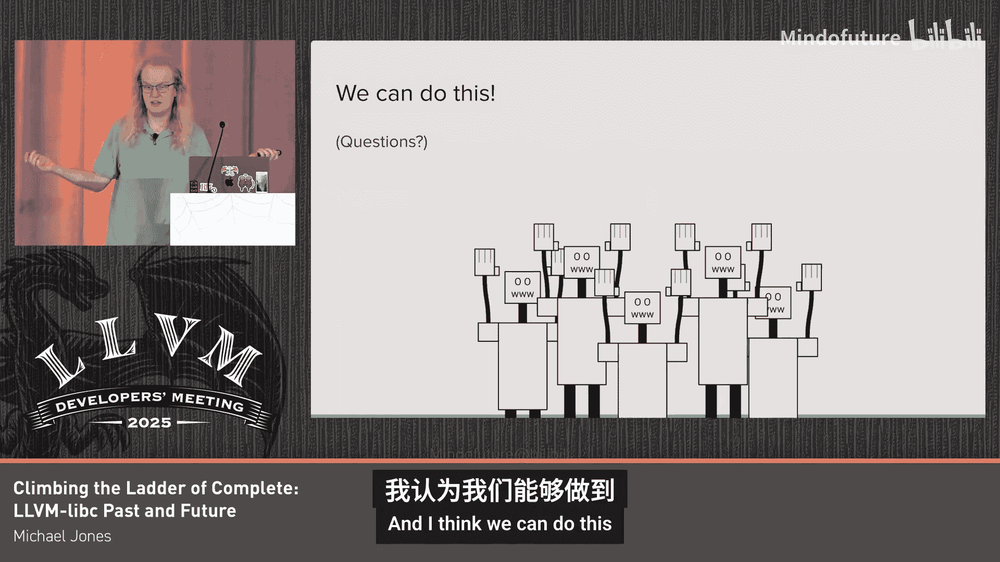

# LLVM开发者大会-US-｜-2025-Llvm-Developers-Meeting-p23-P22_攀登完整LLVM-libc的阶梯_过去与未来--BV1ejr5BAEja_p23-

Hello。Thank you。 So climbing the ladder complete， L and Liy past and future。😊，Let's talk about it。

 First of all， Who am I。 My name is Michael Jones。 I've been at Google for about five years。

And I started right out of college。 And so I learned a lot of what I know about Lipsy from the LVM community。

 And over the past five years， I have。😊，Learned enough that I'm now the lead maintainer for L VM Liey。

 which is pretty exciting。 Let's talk about。😊，The presentation。

 So I'm going go over briefly the 2019 proposal for L VM Lib。

 who our users are and what they're doing。 the updated proposal for design that I'm。

Giving to you now。 And what are we gonna do about it。 What What is our next step。

 What is the concrete thing we're gonna do。 So there's also a little robot guy who will be joining us on this adventure。

 let's talk about that 2019 proposal for LVM Liby。 originally written by Shiva Chandra。

 It laid out five guiding principles for LVM Libpsy， which are We should build Libpsy as a library。

 Now I'll get a bit more into this in a bit。 but like you might think Lipsy is a library。

 It's kind of hard to decompose。 We want to support static linking。

 We want to treat the standards as guidelines。 We're trying to build for our users。

 not just for the standards。 We want to be careful with vendor extensions。

 and we want to be an exemplar of LVM tooling。 We want to use all of these wonderful things that you're all building to make sure that we are building the best library we can a bit more about as a library。

 Here's a direct quote from the original proposal。 The project should mesh with as a library philosophy of the LVM project。

😊，Even though the C standard library is nomin a library， most implementations are in practice。

 quite monolithic。 I have a monolithic example for you。 I have this little brick of Legos。 And if。

 if we think of the top as like functions， you can see that some of them are pretty interconnected。

 It's hard to like pull out just one， you kind of pull a whole bunch of them with it。

 And if you want to replace that little blue brick in the middle with someone something of a different shape。

 You'd actually need to rebuild the whole block。😊，So even though it looks like it's somewhat decomposable。

 you， you'd have rather large chunks。Anyways， the proposal also laid out some things that we might not want to do。

 things that are not focuses。 those were dynamic loading and adding more architectures。 Now。

 we've generally followed this， although we did end up adding a whole bunch more architectures。

So let， let's talk about where we are now。 What have we done over the past six years。

 We've added over 1000 functions，480 of which are actually math functions。 So good job to it。

 And the rest of the， the math team， like getting all that done。 That's so much effort。😊，Yes。

 absolutely。We currently support about 6 processor architectures。

 Counting this is actually kind of hard because you have 32 B and 64 bit versions of like risk 5。

 Are those different are those the same。 You could argue that we support anywhere from about 4 to about 8 architectures。

 but。I'd say 6 is a number。 I can say confidently。We have about 50 people with over 10 commits and over 220 people with at least one commit in the Libpsey directory。

 And we've got 11 maintainers now， which I think is really exciting。 We've got a good group together。

 and。😊，We're building something exciting。 So what are people actually using this library we were building。

😊，People are deploying L V and Lipssy in known environments a lot。 So containerized servers。

 like what Google does。Embbedded devices like the new Pixel buds use L VM C。

 and you can actually build it for GPUs， like what Joseph Huber's doing。😊。

And then there are also people using our sources as a library。

 So project hand in hand is the project that lets other L O VM sub projectsjects use Liy sources。

For whatever thing they need that the C API doesn't really fit。

 So Liy plus plus is using this for string to float conversionvergence。

 Open MP is using this for some printf internals， and Kang will soon be using our math internals for con for evaluation。

 And then there are also external users who are pulling in our sources。 So Bionic。

 which is Android Lipsy is pulling in some of our， our wide character functions。 Fusia is。😊。

Also replacing some of their Lips C functions with newer L V and Liy implementations。

 And Mscriptin is actually providing an experimental configuration for using L VM Lips Z instead of their previous C run time。

😊，What do these users actually need， What do they doing with this that we can support。

 They're generally building Lipsy in the application。 What do I mean by this。 Well。

 the starting point is they， they're using static linking。

 they're pulling in our header library or they're doing what Google does。

 which is called runtime on demand。 you can get a bit more detail about this in my colleagues talk tomorrow。

 Brooks Moses is talking about what runtime on demand really does。

 But like you can think that as instead of building your library beforehand。

 you build your application and your library altogether。

 and then you link it as if it's all part of the same application。😊，And what does this let you do。

 So if you think about the， the standard Linux model。

 you have your application and it sits upon the system。 and the system is your。

 your kernel and your Lisey and。That means that if you want to update your Liby。

 then your application needs to support both the new version and the old version。

 that's not a problem if your A never changes。 But what if you want to have an A that changes。

 What if you made a mistake， That's how we get this newer model that we're more focused on。

 which is building that system library and deploying it as part of your application。

 So that's static linking or runtime on demand or just pulling in the sources。

 And that means that you don't need to worry about crosscompatibility between your。

 your library and your application， you can just。Deploy an entire new application that has the new version of the library as long as your ciscal boundary is stable。

 but it generally is。Other things that people need， portability。

 There are kind of two parts of portability。 There's a Liy that's easy to port to whatever architecture you want。

 And there's a Liby that has the same API across whatever hardware you've deployed it to。

 These are like upwards portability and downwards portability。

 We're gonna need to support both of these And then they're the quality attributes。

 Everyone cares about quality。 Performance is kind of implicitly part of the Lipsy interface for a whole bunch of functions。

 including like Sterlin。 But also code size and math accuracy。 These are part of your interface。 and。

😊，There are different trade offs you can make。 Maybe you care more about accuracy or more about code size or more about performance。

 There is no one size that fits all。 And so we need to have some amount of customizability。

And so this also leads into what is a lower priority for us。

 What are we not really focusing on right now， dynamicynamic loading。 It wasn't a focus in 2019。

 Still not really a focus。 If you're building your Liy as part of your application。

 you're not dynamically loading it， or you don't need to。 You can just。Statatic link everything。

 deploy it。 And then it just runs。 And this leads into not really needing A stability。 So for。

 for those applications， you just rebuild them with a new version of your library。

 And it doesn't matter if the old A and the new A are different as long as they still build together for the other libraries that are using our sources。

 it also doesn't matter as much because they have their own A。

 they're not exporting ours as long as their connection to us is all an internal detail。

 It doesn't matter to them if our A is stable。 They have their own stable A。Finally。

 legacy mis features。 Some things were added to the C standard library and。😊，You know。

 maybe they shouldn't been， maybe they were a bit of a mistake。 You know， how how what's。

 what's a good example。 locales as implicit arguments。 So when you call printf。

 you might not realize that an implicit argument to just the normal version is the global locale that is in your environment。

😊，And this can cause all sorts of weird issues。 Your program might suddenly break。

 despite not being different on like a different language。And。That's just an obvious thing that。

Doesn't work in a modern era， having global state， having this implicit argument that people don't notice。

 there's a better way and its explicit arguments。 Okay， let's talk about what what do we want to do。

 what is the new L VM Lib design that I am proposing。

 I have three new guiding principles that I am going to talk about。 modularity。

 multiplatform community oriented modularity， what what sort of modularity are we thinking。

 So we want functions to be independent。 So if you're think back to my solid brick。

 if the functions are all stuck together， then you end up with a case where you can't deploy one function。

 because you need all of these other functions， and maybe you don't want those other functions。

 So we want to have vertical modularity， You want to be able to deploy just one of those functions。

 And also you want your API to the O S level to be generic。 If you want to be able to。😊。

Build this Liy for multiple different targets。 Then you need to be able to pull off the O S module and replace it with a different one。

 And that's horizontal modularity。 And to help with this。

 I have another wonderful visual aid made of Legos。😊，We have our。

 our functions pointing out from the top， and we've got these library layers built on top of the O S layers。

 And if you look。Wow， you can disconnect the O S layer。

 It brings with it all of those O S specific functions and。

You can replace it with something else that fits in that slot and provides its own set of。O。

 S specific functions。 If you think about like Windows。

 you need a completely different set of cis calls as opposed to Linux。

So that that will be very helpful for affordability。 We want our modules to be reusable。

 We don't want to just have them on one platform or on one architecture。

 And this is helpful for using Liy as a library if you have。😊，If you're working on Liy plus plus。

 you don't really want to think about like， oh， what am I gonna pull in from this。

 You want to just use the generic code that doesn't need any other dependencies。

 We want our modules to be replaceable。If you are building for， you know。

 some vendor platform and you want to optimize this one specific function because it turns out that inverse arc tangent is the the crucial function on your platform。

 You don't want to think about like， how am I going to disentangle it。

 You just want to pop it off and put in your own。 And that's an important use case。

 speakingeaking of different platforms。 Let's talk about multiplatform。 How are we going to do that。

Easiesest way to like， make most of the code portable is make it in C plus plus and auto assemblymb。

 C plus plus is a lot easier to port， and it takes a lot less maintenance。😊，Assembly。

Being optimal takes ongoing maintenance。 So it it's much better if we can keep it all in C plus plus where we can。

 We want to clearly delineate platform specific code。So we want to have like at。

 a completely O S independent layer。 and then one that's you know， platform generic。

 but it stilllies on the platform code。 And then one that's platform specific。

 but with an API that is consistent。And that means we can have more modules that are easily reusable。

 This is an example of not properly separating your， your platform layers。

 FD open is a C standard function and open and FD open are very positive specific。 So if we did this。

 then。😊，If you wanted to port F open， you would need to either completely reimplement F open or completely reimplement open and F D open。

 which are Po specific functions。 If your platform isn't Posss。

 then you're gonna need to build this whole abstraction layer， which is not really efficient。嗯。

We want most of the code to be platform independent so that you can reuse it as a library。

 as previously discussed。 And this lets us have the idea of one front end and many backends。

 You can have the same API in many places。 And then there are many backends to connect it to your system。

嗯。Finally， community oriented。 I started on LVM Liberacy four and a half ish years ago。

 and I didn't really know anything about C standard libraries。

 But then the LVM community was very welcoming。 And I've learned a lot in the past five years。

 And I think that's really awesome。 And I think we need to continue to do that。

 And I want to make it an explicit focus moving forward。 So a library doesn't just appear。

 It is made by a community and a community is。😊，It grows。 It is。

one that people will join if you are welcoming to those newcomers。

 a community that is friendly and respectful and can handle this agreement is one where people will stay。

 And a project with new opportunities is one where people will strive and grow and move into those opportunities。

😊，嗯。I think community is important， but also， we need to know， what are we doing。

 What's the next step， What is the， the goal that we are moving towards。

I think we should get LVium Liy production ready for Kang by the end of 2026。 I think we can do it。

 And I'm going to lay out exactly how。😊，So let， let's start off with whylang。

 It's just a good stress test of L V and Liy。 It is a real production program。

 but it's generally pretty well behaved。 It doesn't do anything weird， like networking。

It doesn't use all of the like random esotea in P threads。

 But like it is a real production program that people actually run。 It's widely available。

 All of you have access to it。 Some of you may even know how to build it。 If we do this。

 It would let LVM have a self-hosting tool chain， which I think is pretty cool。 But in general。

 it's just exciting， I am excited by the idea of building LVium Liby into a library that can support Kang。

 And I hope that you are to， Okay， how do we get there。 What， what are the the things we do。

 We need to test those modules if， if we're building a module or library。

 we need to make sure that each of the modules works。

 We could do this by deploying the whole library at once try and build something against the whole Liby。

 But then。😊，If we run into a bug there， then we have to figure out which of the many functions is broken。

 Overlay mode allows us to replace just some functions in a program。

 Some Libpsy functions with our versions。 And that to let us test。 Does this one work。

 I this one actually slightly off on the interface。 How do we do， how do we do that。

 Google's been doing this for several years now。 And it's been great for Google getting performance benefits。

 It's been great for Lv and Libpsy getting testing。😊，Just generally good overall。

 we can also set up a LVM Lipsy slash clang or LVM Liy plus clang。 if you insist build bot， this is。

😊，Once we have enough to build Klang， we want to make sure that Klang actually runs and passes all of its tests。

 That's how we can tell it's actually ready。😊，And so doing that continuously gives us this sort of continuous integration。

 very handy。 There's also some refactoring and modularization we need to do。

 There's some technical debt we've built up and some pieces of the library that are not aligned to our new design。

😊，And so。Coming up， we're going to need to implement a whole bunch of new designs。

 I've written one to change how we handle cis collar wrappers in L V M Liby。

 But there's also some stuff needed to be done around files。 And other pieces。

 And if you're interested， this is a great time to get involved with design。😊。

So let's talk about what are we doing specifically。 So by the end of 2025。

I want to present this strategy。And I want to get done with designing all of those cleanups。And hey。

 I think I can check one of these off。Early 2026， I want to implement those cleanups。

 We've designed it all。 Let's do it。 There are a whole bunch of functions we need for clang as well。

 So they need wide character file functions。 They need some random bits of P threads。

 They need these like random cis color wrappers for poss。😊，We can go through and do those。

 And then once we've got a version that works， we should set up that clang slash L VM Liy build bo。😊。

By the end of 2026， I want to polish， clang， make sure that it's not just functional。

 but actually production ready。 Someone could deploy this in production。

 I don't know that we're gonna be able to get it all the way into production by the end of 2026。

 But I think we can get pretty close And I think we can complete the sets。

 So Kang uses three ish of the wide character file functions。 there are more than that。

 If we just aim for clang then we'll end up with a library with lots of weird gaps。

 We can just complete the set。 It's not that much more effort。 but we need to remember to do that。

 And finally， we need to set a new goal。 Hopefully， next year。

 me or someone else on the team will be up here telling you about the next exciting goal that we have and how good we did。

 And I hope to see you there。 So， yeah， this is a good time to get involved。😊。

And I think we can do this。 Do you have any questions。

I have a question about vendor replacement of individual functions。 How does that work。

 say if I have a malloc implementation I want to use to substitute whatever is in there。

 Like is this done through the bill system or do I need to change C and C+。

Mic is weird because we already， we're， we're just like pulling in the public functions because we don't have like a first class allocator。

 particularly。 But in general， it would be through the build system。 Basically。

 we have it set up so that there's， you know。Sour slash header slash Linux slash X 86。

 And if you wanted to add， you know， something for arm， youd add， you know。

 source slash header slash Linux slash whatever specific target。 And then tell it， oh。

 you wantan to pick the most specific one possible。 So it would be done through the build system。

Okay have another question static linking。 How much in size are we seeing like how much size increase do we anticipate seeing statically linked C library。

 I don't remember exactly what the size looks like， but。I wouldn't expect it to be significant for。

Cases where people are gonna care about it。 So if if you think about like， you know， for。

 for an embedded device， it doesn't really matter because。

 you need the library and you can like dead code eliminate what whatever is going get rid of。

 you're gonna get rid of for a server， you'd expect like some amount。 But if you look at like。

 how big is your Glib C do S O on disk。 It's about 2 MB。

 So I guess that would be the high end of how much you'd add to an individual program。Okay。

 thank you。First off， thank you。 I really appreciate the fact that we're working on our own LibC implementation。

 That's fantastic。 My question is specific to the static versus dynamic linking。😊。

One of the benefits to dynamic linking is is if there's a security vulnerability in the C function。

 then you can fix that security vulnerability， deploy it， and everyone automatically benefits。

 So what is the plan for security side of things on the static linking。

 If that's all we're focusing on currently， I'd say you can do that with dynamic linking， but。

At least for like a containerized server， you're probably going want to redeploy your your entire program anyways。

 So you just build a new version with the patched version of your library。Okay， thank you。

The other benefit of dynamic linking is you can load plugins for your program and Kang supports running plugins。

 as well as clang tidy and other things like that。 Is there any plan for。

Maybe only dynamic loading up to plugin support rather than like。Having Lipssy be the base of that。呃。

Eventually， I want to support proper dynamic loading as an option， at least for the first step。

I'm pretty sure you can。I'm aware that there are configurations of flying where you can turn off the。

 the plug loading。 So I I would say start there and then build dynamic loading as necessary。

So a question how is the platform support， you know Windows Mac OS and also want to know how easy it is at this point because I think you gave a talk of them last year about this about like thelicing of the library。

 you know， how easy it is to bring it in you know， into other projects to use as the library。

So platform support for Macs and Windows is incomplete。 Basically， we。

 we haven't had a lot of people interested and contributing ideally， once we。

Refactor a bit to make make the O S abstraction layers a little bit more generic。 it'll be easier。

 but。Mostly， it's just， there hasn't been a to of interest。The other question。Slicing， yes。It's。

Decently easy。 A lot of the code is already completely platform independent or mostly platform independent。

 And so you can， I， I mean， the open MP people are already pulling in printf Web plus plus is pulling in。

String to float。 And we're working on making sure the the math functions are。

 are properly independent。 So you， you would have an easy time pulling in any of those components for the other stuff。

 you might need us to do a little bit of refactoring work， but it shouldn't be too bad。

 It's already set up to be pretty generic。Great talk， Michael。 Good job， budny。

 for folks looking to get started contributing， where can they learn more Liby do L VM do org is one option。

 There's also a public meeting。 we have every four weeks。😊，That is open to anyone。

 We're happy to have new contributors。 And there's discourse and disord channels。

 if you are interested。😊，Oh， yes， and there's a roundtable today， Four，45 PM。嗯。

I think that's the last question。Thank you so much， Michael， let's thank the speaker。

