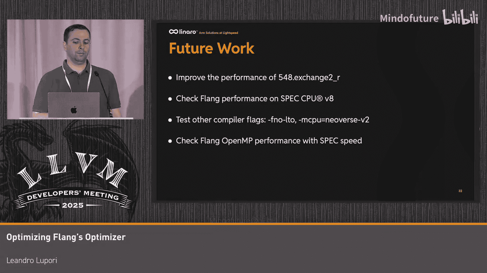

# LLVM开发者大会-US-｜-2025-Llvm-Developers-Meeting-p24-P23_优化Flang的优化器--BV1ejr5BAEja_p24-

Thanks everyone。I am Leonardro。 I work at Le Naro as a two chain engineer。

And today I'm going to talk about optimizations in flank。And。Just a quick review about what is flk。

 It is the L VMs For front end。And it lowers For train code to high level fortune IR。

That is then converted to fl inter fl IR， and then to other ML IR dialects。EFrom this point， all。

MLIR and LLVM。Performs the remaining build steps through produce and exable。And so in this slide。

 we have an example of the， this is step， the lowering from fortune to HL F IR。

And we can see that besides the operations with HOF and F。

 there are also some other MLIR dialects being used， such as funk and Earthith。

And an important point is that H of preserves many details of foreign and constructs。

So it's the ideal stage to perform 14 specific optimizations。That rely on  fer dollars。

So before trying to optimize flk， we need to first evaluate its performance。And for the end。

 I used a spec CPU 2017。But only the benchmarks that use F trend。

And the tests were run on a new verse Vi machine。And Leonardo's goal is that flank should be no more than 10% lower than G4 on any benchmark。

So by April this year， the latest stable versions of LLVN and GCC were versions 20 and 14。

And so in this chart， we have a performance comparison between these two。

And you can see that in most benchmarks。Flank performs equal true or better than G41 and or with GCC。

But in， in the case of Can4， it's 18% lower。So K 4 is a good candidate for optimization。And。

To identify the functions that accounted for most of the execution time。

Perf was used on a Ubuntu machine。And。I noticed when prod that the performance issues were spread throughout the program。

Which made it a bit harder to identify the functions with the biggest differences。

So here we have the perfect part output， and it's listing the 10 hotest functions。Of4。

And among these， I have selected A R red props S W， because if we consider the number of samples。

 we can see that almost twice as low when compared to Gcc。But when trying to inspect the function。

Only the asmbling instructions were being listed。And there was no de hopeful。And this was because。

 unlike GCC， L of V M sometimes loses debu information when L TO is enabled。

And our workaround for this is to disable LTO， at least to be able to map assembly instructions through far constructs。

So here we have the the output with LT O disabled。 Now we can see forn source alongside the assembling instructionss。

And。AR red props is a large function。But something that called my attention was the initialization of three dimensional arrays。

And here we can see that L then uses several star structures。

W GS C was able to initialize the array using two simple loops。And。

What it seems that is that that is happening is that L L then。

It's not realizing that this is anization of comp of the whole array。

And then maybe it could use single loop to initialize it instead。

So when trying to inspect what was the cause of the issue。

It's useful to go to each stage of call generation。Beginning with each of。That is the。

 the first translation from Fort to an IR。And here we can see that the whole initialization is performed by a single H of your operation。

 That is the assign operation。And。When it's converted to F IR。It becomes three acid loops。

That initialize that stars a double to each array element。

That in L LVM IR becomes a series of get element pointer followed by store double instructions。

This was happening because the two inner loops were completely enrolled。

But since this is conuous way。Maybe we can use flank to lower the assign operation to using a single loop。

 So maybe that could help L of them to produce a more optimized L of V M IR。And to do this。

 we would first need to perform the linearization of muhi dimensional array。

To be able to then go through it with a single loop。Yeah it。

 this code has the main parts that perform this optimization。

But I am going to focus on the F IR that is generated when this optimization is applied。

As you can see here， the three asset loops were replaced by a single loop。That now。

Goes over the flatten array。Sttoring the， the， the double value for each element。And in N VMIR。

 this also now is a single loop。And it was even able to group the stars of pairs of double this time。

And finally， in the assembling directions， we can also confirm that it becomes only a single loop for the initialization。

But unfortunately， in the end， there was practically no difference in the execution time of Ken 4。

And some possible reasons for this is that air red props S W is a large function。

 and it spends only a fraction of its time in a array initialization。And also。

 there were other performance issues spread in this function。However， in other test programs。

 there was a substantial performance improvement。As you can see in the， in the table below。

For array sizes between 6，64 kB and 256 kB。The speed up was about 30%。

And another benefit is that the number of instructions needed for the array initialtization has been reduced from 38 to 8 in the case of Ken4。

And。That was my first attempt to optimize Ken4。 But after some time I came back to it to try to optimize it again。

At that time， GCC 15 had been released， and I used the main L of VN version instead。诶。And also。

 at that time， the difference in performance between L L VM and GCC for the AR red props function had dropped thanks to contributions from from other fl developers。

So I use flame graphs to help identify the functions。That had the。

 the biggest differences when comparing GCC and L of VM。

 And when that was identified was they W A M X， I S。

And we can see when comparing the true flame graphs that the time spent in the version compile by。

 compared with L of V N is。Significantly lower。Zooming into it。We can see that in LLVM。

 some calls are made too trim and free。Whileing GCC， it。

 it has only a single code to the different chain compare string runtime function。

And this is confirmed by the pair output。Where we see that LVM makes two call string。

 two culture free， and the string comparison is performed in line。

And this function is actually quite simple。 It's only the string comparison of two trimmid strings。

But the interesting part here is that GCC was able to simply eliminate these two calls。

So let's try to see a how that was possible。Well， first。

 we need to remember that in for character strings are padded with blanks to the right。And also。

 if we check the language， the photon language specification， we'll see that in the the comparisons。

 the shorter string opera is always padded with blanks to match the size of the other opera。

And what all of this means is that it's safe to to drop the， the train cost。Because the。

 the relational operator already considers the space， the， the blanks to the right。嗯。

So to implement this expression simplification， the first step was to add a new H O3 operation to represent our。

Call to dream。This was because it made it easier to。

 to identify the the call and also to remove it when possible。 and when not possible。

 this operation was then converted to a runtime call that produced the same behavior of before。

And with it。have written a pass to simplify the comparison of characters。

That can basically be summarized in the following expression。

 where the comparison of two treatment strings became。The comparison of these strings themselves。

And here's the core of the code that performs this transformation。

But I'm going to skip it and focus on the age of before the optimization and after the optimization is applied。

It's possible to see that the that both chart train operations were removed and also the destroy operations were also removed in the optimized version。

And the result of this is that Canfire execution time went down from 217 seconds to 280 seconds。

 that its that is an estimated3 and a half percent speed up。

And I would also like to mention that there were many other contributions to flank performance enhancement from other developers。

 And this slide list a few of them some recent ones。And in in this chart。

 we have the current styles of L of Vien and GCC。We can see the performance evolution on both。

 the red columns represent LLDM。From 20 to the main version and the blue columns。Are the。

 the G C time， G C 14 and 15。And here， we can see that。

The only benchmark now where flank performs worse than G for10 is exchange 2。

That is 11% lower when comparing it to G 2015。Although came forecast can still be improved。

And in the future， we plan to improve the performance of exchange2。

And also check how flank performs on spec CPU V8。And another plans are to test other compiler flags without LTO and using targeting the newverse CPU。

And also， check how flan with open paper forms using spec speed for this。And that was it。 Thanks。

 everyone。Fantastic， thank you so much。 So we have a few minutes for questions。😊，Any questions？

Any questions？Last call for questions。All right， thank you so much， everyone。

 Let's give Leendro a round of applause。😊。