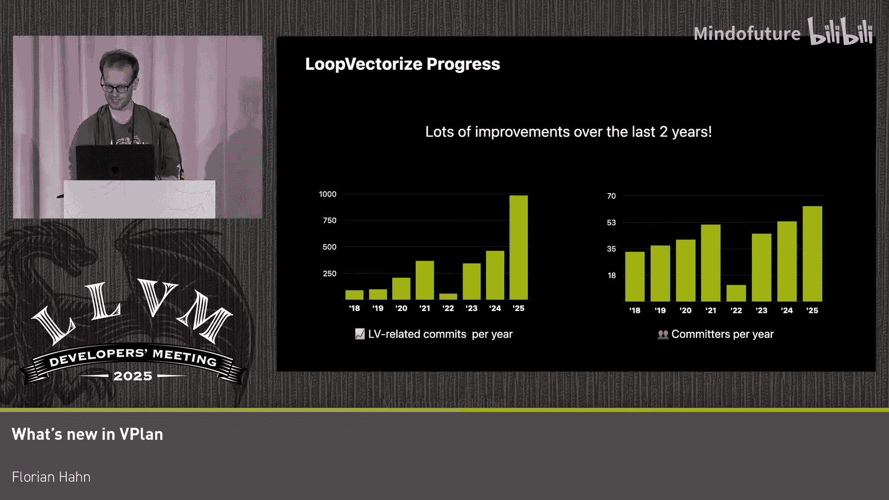

# LLVM开发者大会-US-｜-2025-Llvm-Developers-Meeting-p25-P24_VPlan的新特性--BV1ejr5BAEja_p25-

Hello， I'm Floria， I work on LLDMI Ops at AppleL and in this presentation Ill tell you about some of the major improvements to the Vplan infrastructure that landed in roughly the last two years and highlights some new optimizations that were enabled by those changes。

Before learning in， let's briefly take a look at some content。

Vreization Planner B plan is an ongoing effort to upgrade the loopback rise's infrastructure and also extend its capabilities。

The improvements we are going to highlight have all been introduced gradually to the code base and enableded by default。

 so there's nothing that I showed and discarded by flags。

There have been a number of presentations about deep in the past for additional context。

In this particular talk， we will revisit the roadmap that was outlined about two years ago in the talk that's at the bottom of the slide。

Good。So on a very high level， DP is an explicit model for describing vectorization candidates。

At the beginning of the vectorization pipeline， we start out with a single scalealar loop that's input in ABMIR。

From that， we gradually construct an initial DP， which then serves as a starting point for further optimizations。

In the process。Of creating the initiative plan， we raised the level of abstraction from the input ArabBMR。

We then create multiple B plans reflecting different vectorization strategies， for example。

 we create different B plans for different vectorization factors。

Once we pick the best replan from the set of candidates。

 we then gradually lower them to the the vectorized LBMIR。

Now let's briefly revisit the roadmap that was outlined in the talk in 20204 B。

 we proposed five different directions to evolve the infrastructure。

The first one was to refactor the initial V plan creation。

 so the process from going from LLDMIR to V plan to a set of modular transformations， second。

 we had simplifying V planN execution， which is going back from Vplan and back to LLD MIIR。

Afer to teach V plan to compute costs and use those costs to make cost based decisions directly on V plan without relying on the legacy cost model。

Fourth， we had converging inland out recization pipelines。

 and fifth we had converting the way we perform epiop recization also to be based on B plan completely。

Now let's first look at the improvements to this initial replan creation process。

 where we convert the initial input loop in LBMIR to an initial replan which then we serve as our starting point for vectorization and further optimizations。

 refer to this initial re plan to V plan zero。S you can zero。So the first step。

And the conversion is to create a plain TV per without any res yet。That simply wraps the input。

The N exit blocks to the V plan， that is the original loop pre header and the loop exit blocks are wrapped in a new type of block that we introduce VPR basic blocks。

 which simply wraps those input nodes。And blocks and instructions that are in the loop we want to vector are wrapped in VP basic blocks and scalar VP instructions at this point。

Values leaving the loop referred to as lifeouts are modeled explicitly by wrapping the loop close SSA files in the exit blockss in BPR for recipes。

 which then have the BPP value leaving the loop as explicit opera。Next。

 the loop is canonized by adding economic induction recipe。

 which is stepping from zero to the vector trip count。

 and we'll also update the exit condition that controls the loop to now be controlled by economic induction ensuring that the loop we're going to optimizeds in a form that's always guaranteed to be accountable。

Next， we complete the initial skeleton， we're going to add a few additional blocks that we then will use during the optimization process to place various codes so we will introduce a new block for the vector pre head where we can materialize some balance that we need in the vector loop。

 we add a middle block to dispatch between or decide whether we resume in the scalar loop after we execute the vector loop or go to the original exit block。

Then we convert this plainG loop that we the loops in the plan to dedicate the BPP region blocks which contain all the blocks of the loop that we are going to vectorize。

 this raises the level of abstract that we are working on。

 it will simplify the CFG transformations have to deal with down the road and also allows easy identification the loops we're going to optimize for our transformations。

So this now covers some of the bigger changes with respect to how those initial B plans are constructed。

This will give you a good overview of the general approaches and ideas we have in this area and the direction we like to structure the whole pipeline。

There are most of scalar transformations we don't really have time to cover today。

 like linearizing the control of law and performing predication。But yeah。

 now let's revisit this scope。What this model directed in VP on this slide you'll see what we had about two years ago where VP's scope included parts of the entry block。

 mostly used firsts cap expansions， we had parts of the vector prehead and middle blocks already modeled。

 we had of course the loop region and at this point the livehouses were still modeled separately。

 which limited them to basically only handling a loop with a single exit block。

If we now take a look at what's changed in the last two years。

 we can see that since then Dplan has been extended to cover the hoal vectorization of skeleton。

 we're not vectorizing the epipiloox so when we're dealing with epi recization。

 this is still handled separately， you can see that everything highlighted in green has been added since 2023。

We can see that now all empty and exit blocks are wrapped in those VR basic blocks I mentioned earlier。

 scale ahead and pretty head are model in a similar fashion。

So this is the scalar loop pair and the scalar prehead of the loop we are vectorizing。

This allows us to model the full control flow between the N exit blocks together with the corresponding runtime checks。

Resume values in the scalar preheader are now modeled also explicitly using P recipes and the exit values are modeled similarly with fire recipes in the VPR basic blocks wrappedping the exit blocks。

 this allows correctly updating those incoming values for those final notes off during VN execution and V plan transformations。

T。One major benefit of this approach is that it allows removing and simplifying code in various legacy code paths。

 for example this allows removing the legacy code for dealing with front objects and the corresponding blocks from in the vectorizer class。

 simplifying that implementation， it also allows removing the remaining epilos or allows moving the remaining epilo specific code to the epi rec specific classes clarifying the code。

And now that the full skeleton is modeling B plan， we get simplifications of things like tria runtime checks。

 branches and the block removal for free by just running the existing B plan transformations across the home plan instead of just the loop region。

So for example， if the minimum iteration check is in the entry block is known to always execute the vector loop。

 we can simply remove the branch to the scalar pre header， similarly。

 if we simplify condition the middle block， we can also remove this trivial branch。

 and finally after the simplification， we know that the scalar loop never execute。

 we can completely remove it by removing those VPR basic blocks that wrap it。

This results in simpler IR that's easier to review， so I think when the patch got merged。

 it produced removed like 10，000 lines check liness from various tests。

 which makes them easier to review and it also leaves less that code for less than IR for passes to process downstream or flu vectorize。

Increasingly， you can scope to include the exit blocks as well as breaking down the construction to this set of transformations。

 also enables supporting loops with early exits in a way that fits well with the framework。

By simply introducing another scalar transformation that performs this canonization of loops with multiple acids。

Where we convert them again to a form where the vector loop is controlled by single exit condition with some additional blocks to dispatch to the correct exit blocks after we leave the vector loop。

The explicit modeling of exit values means that they can be directly adjusted as needed by the transformation。

 making sure we compute the correct values when you leave the loop via the early exit。Next。

 I'd like to look at the spending amount again， that is lowering you back to LDMIR。

Similar to heat plant construction， this lowering can be simplified byparating it up into separate transformations that gradually lower the level of abstraction。

After picking the best V plan， we gradually make implicit decisions。

 we took explicit and finally convert back to a plain CFGV plan。

 which maps more directly to the final LDMIR。The first example we'd like to share is performing explicit into leaving a re plan transformation。

Besides vectorizing the loopt， way profitable to interleave multiple vector iterations during optimizations。

 deep plants are valid for a range of vectorization factors and any possible interlea factor。

But yeah， after picking the most profitable interleaf count。

 one of the first steps in this lowering process is applying the interleaaf count to the V plan。

For most recipes， this simply means cloing the recipe。

 interle count times and remapping the operas to the values that correspond to the interleaf path。

 like we have for multiplying the slide， one thing to note is that this interleaing preserves the order of dependencies in the original vector loop。

Similarly， we found subsequent recipes like the vector pointer recipe。

 some recipes need some special handling when interleaving most notably ones with crossiteration dependencies like inductions and inductions。

And those are also handled by the transformation。Performing this as a transformation has multiple benefits。

 on the one hand it simplifies the execute implementation of the codegen implementation for all the recipes。

 which previously had to take care of generating balance for all interlea parts。

 so we simplifyified the cogen part there。It also simplifies the mapping from BPP values to the corresponding generated LDMIR values during this lowering process in BPP transfer state to a simple one to one mapping instead of having to deal with a want to mapping。

The more explicit implementation also enables additional simplifications that are only possible once we apply this inter leadinging。

For example， computing the vector pointer for the first part is redundant or becomes redundant after we apply this。

Explicit interleaing。Yeah。Yeah，The second transformation I'd like to talk about in this context。

Is replacing going back from this form where we have this explicit regional representation back to explicit control flow。

 which lowers the level of abstraction and also brings the plan back into a form that directly maps to LLVMIR。

 the control flow that we' have in LLVMIR and removes the need to handle lu regionss during coregen。

It also enables a number of additional simplifications in the hierarchy representation。

 those loop regions are required to always serve an economically induction variable。

 they're required to be countable， so that limits some of the transformations we can do at that stage。

replacingplacing such reaches， this allows us to remove things like economically induction if it's not needed anymore as well to adjust how the loop is controlled。

 for example， on risk five the condition to control the loop can be replaced by one that is based on the explicit vector length on risk five。

Another big change has been the transition to a Vplan based cost model that is computing the cost of recipes and blocks directly to V plan。

And use this V based cost model to make cost based decisions like picking the most profitable plan。

In terms of the interface， both recipes and blocks have been extended to compute the cost directly。

 in some recipes do not yet compute the cost completely using this B based cost model and instead have to fall back to the legacy cost model。

But yeah， this transition should be completed soon。

The VP based cost model can compute the cost more accurately。

 especially in the presence of VP based transformations and also for some complex or more complex recipes。

There have been a number of new recipes that have been added over the last few years。

 like the VP histogram recipe to model histogram acquisition patterns。

 and those are only supported in the VP based cost model because supporting them there is very easy。

 adding support for them to the legacy cost model would be quite challenging。But yeah。

 now let's also take a look at the example when it comes to transformations。

 which is just a simple simplification in the plan on the slide。

 we have a redundant multiply that will be removed during BP optimizations。

 the B plan- based cost model handles simplifications like that automatically because once you' remove the redundant recipes。

 there's nothing to compute they've been removed we only need to deal with them during the cost computation。

If， on the other hand， to support the certificationifications like this in the legacy cost model requires a lot of special casing。

Because all the possible transformations or simplifications we could do would need to be anticipated at a single point before we can perform them。

On this slide you see the logic that is needed to support this multiply by one case in the legacy cost model。

 this is not scalable and you there are only a few cases that some people deemed important a while ago that are handled in the legacy cost model。

 but yeah， as I said， with the Re based cost model we get support for any transformation basically for free。

Now let's put all those changes together by reviewing how the leakcon optimization pipeline evolved over the last two years。

On this slide， we can see the pipeline in 2023。The main stages we had at this point were legalization。

 general and Europe and we have specific optimizations。At this point。

 all the cost based decisions were still driven by election。

Now we introduce this new scalar transformation stage。

 which performs this initial replay creation we already mentioned in the talk。

There have been a few additions to the legalization and general optimization stages mainly to enable new optimizations。

 like support for narrowing interleaaf groups and vectorizing floating point min max reductions without asthma flags。

At the last stage has been generalized to perform this gradular lowering we talked about and also perform theF andU vectorization factor and un factor specific optimizations。

So to wrap up， I'd like to summarize some of the progress that has been made over the last few years。

There have been a large number of improvements， as I mentioned over the last few years。

 thanks to the growing number of contributors on this slide。

 we can see both the number of commits and unique commits per year over the last。A few years。

And we can see that， you know both in terms of commits， number of commits， a number of contributors。

 we see some healthy growth， I think， coinciding with the V infrastructure maturing。

 I would claim and enabling more effective collaboration between people working on on different parts of the vectorizer quite effectively。

Yeah and yeah， there's been a couple of new kind of styles of loops that we can vectorize that has landed over the last three years。

 so we can now vectorize an FMX F Min reductions without fast math。

 we have this support for vectorizing initial support for vectorizing loops with early exits。

Vectorizing loops that find the last or first induction of for a given predicate。

We also have now support something called partial reductions。

 which is mostly used to vectorize or make use of hardware specific instructions like the top product instructions on A 64。

Tfolding has been enabled by default for risk5 and there's been a lot more smaller optimizations that landed and this is all thanks to a lot of contributors that are working on the factorizer so thanks for all the contributions and hopefully there will be more to come in the next year and y that's all I have from my side thanks。

成婚し。Wonderful， thank you for any questions？No。So I'll ask the question that you probably knew you were going get。

The assertion that checks the Le cost model versus the V plan cost model。

What have we got to be do to get rid of that sir。A few weeks， few months， hopefully soon， but yeah。

We are very close。 we are very close。