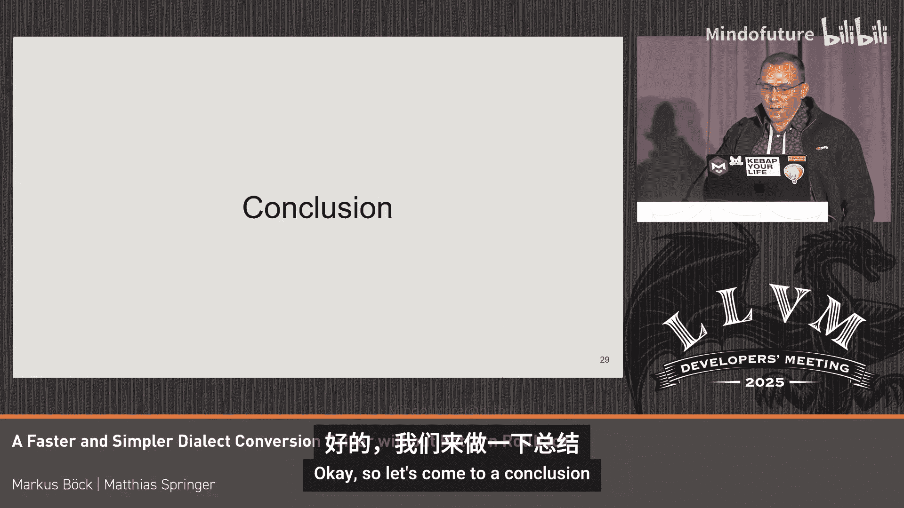

# LLVM开发者大会-US-｜-2025-Llvm-Developers-Meeting-p26-P25_更快速、更简便的方言转换驱动器--BV1ejr5BAEja_p26-

Lurron， we're giving a quick update on some of the dialect conversion changes that have been happening。

 This is part of a more bigger saga。 specifically what has recently happened is one dialect conversion without any kind of pattern rollback has been merged into MLIya upstream So this initially started in May 2024 and has been merged now since August 2025 so please go and use it what does it mean for it to not allow rollback patterns effectively all IR changes are materialized immediately and this has sadly also some impact on the API but there's a many advantages to this and the big motivation for doing this was manyifold So first there's way much way faster compile times and much lower memory usage due to a lot of states being gone it's also much more easier to debug so you can after every pattern application yourIR is basically always in a valid state that you can easily dump within your patterns within the debug or logging over whatever。

no like crazy C++ hidden state in there there's also then better support as a side effect for things like listeners and even like new features like a contextware type converter that is really hard to implement if you have a rollback mechanism please go try and use try and use it already if you can so upstream is already a conversion confi we can just use allow pattern rollback and equals to false and then hopefully it should already work with any of your conversion patterns that you have upstream where in a pretty good state or there were some fixes that had to be done but these are usually a bit will go through some of the API differences but for the most part it should hopefully work。

So the timeline here， it was sort of a larger project with a lot of lead up cleanups right now we're at the one shot dialect conversion and as part of this there was even the context of where type conversion merged before that a lot of things like 1 to end support had also been emerged and hopefully we're also trying to get memory of 110 conversion working。

😊，So some of the API difference that you need to be aware of so this is more like a user guide in a way。

 first of all， like what does it mean for rollback versus no rollback so in the old driver you could have a pattern match。

 the pattern already do some kind of modifications and then when you realize oh this pattern doesn't actually apply for my specific IR you could just return failure from your match and rewrite and it will completely undo any of the changes that you've done and this is even successive with multiple pattern so in this case where we have to say legal A for example。

 the driver could technically try out pattern one that goes to illegal B。

 another pattern that goes to illegal C and realize oh I cannot legalize pattern to rollback entirely and then use another pattern so this actually no longer works with the onetra dial conversion it's very much meant such that you do not add this kind of pattern or like multiple successive pattern and just do a quick rewrite over the entire IR。

With so with the no rollback pattern this could actually fail your conversion we haven't really seen this out in the while so hopefully it shouldn't affect anyone then a big change also of what I already sort of not hinted towards the hidden state a lot of the things like a lot of the IR like methods on the IR rewriter they're now immediate and not delayed anymore so in the rollback driver things like like erasia or up replacement。

 these things were actually not reflected immediately in the IR but rather placed in a hidden state within the conversion driver this was done instead of like IR cloning which you could technically also do right completely clone the module and create an U one sort of to not be too expensive。

😊，Exactly， so if they roll a new driver without drawback it now works more as you would expect from。

 let's say the3D pattern re that you're used to from canicalizations where it actually does all the changes immediately and I personally think this is also a huge advantage for debugging So here for example the table I don't even want to like go through all the details I don't think there's any point in doing so but one noteworthy thing is how basically all the kind of IR modifications that you want to do are now consistently done immediately there's still a few things not supported compared to like the3D pattern rer like block replacement but this you can actually do with like a block signature conversion as well and everything is immediately as you would expect I think。

😊，Exactly what is so this is what the old rewrite pattern driver looked like with the rollback support。

 So it basically had the stack of rewrites in the small vector and there was a huge class hierarchy of all the kinds of rewrites that you can do。

 each had like a commit rollback and a cleanup function and whatnot。 This is all no longer needed。

 This is also where a lot of the performance benefit that Matt will show you later come from just from not having a lot of this internal C+ plus state。

😊，So some of the API differences also that are very much user facing so since replace up and era up since they're now immediately erased there's actually quite a few of there's a few patterns that used to work that now generate either like an assertion error or even are caught by At sanitizer and would otherwise be unsaffey+ specifically a lot of patterns had a pattern where you were for example doing a replace up of the op or an era up and then afterwards you were still getting an opera and an attribute or something off the op so in the top case here this is the opt input call despite op having been replaced with the replace up above this is no longer possible since now the of the op is immediately the simple fix in this case and what we've actually had and basically all our upstream patterns is just to either safe to up ahead of time or just reorder to do your era later so not the big of a deal and if you're using At sanitizer it very nicely catches this because this is effectively。

A use after free， you'll get a nice tech trace telling you you're using an operation that has been deleted previously Similarlyly。

 this is replace all uses with。😊，So this now also works in the no rollback driver and it immediately realized that rollback driver could also do a similar functionality。

 but there was like this caveat of it technically being done later and the way it would actually work is that if you had create any new uses of the replace all uses with and then later had an adapter。

 it would get you the most recently fetched value。😊。

It's a bit confusing quote unquote also with the type converted。

 this is now way more simplified than it works as you would expect in the3D pattern we write them。

 we still don't yet have support for the special versions quote unquote to replace all users。

 so stuff like all users except or if replace up users withinbter are like selective replacements。

 so currently we only support to replace everything but we' planning to add these in the new neural back driverriver。

Then a big invariant of the system for this to even work in the first place and what the majority of patent that need to be adjusted are because of this is that effectively if you return failure from your pattern that means that the pattern must not have modified IR effectively your patent now need to have a very clear and clean match or rewrite section such that if you don't match there are no changes done。

 this is needed if you don't have a rollback mechanism then a pattern not matching is not allowed to do any changes。

 otherwise you cannot do successive pattern application of other patterns that might come so here usually there's easy fixes to again reorder the way you when you do your operational or modifications。

This is also easily cut using a CM option so there's a CM option which I actually highly recommend called MLII enable expensive pattern API checks this also works for the canonicalizer this effectively theyre more expensive checks in terms of runtime but they make sure that a lot of10 variants that the whole driver relies on or actually check than this is one of the ones so if you do have patents and you can try this all already with the config option if we do have patents that do make that do violate this invariant you can easily catches with the CM option。

Then something that is likely safe now。 So this has been personally speaking。

 at least I ran into this issue a lot previously since the IR modifications were kind of were were delayed There were actually a lot of like。

😊，IR structured that was like unlinked and fing around I'm going to call it for example。

 if you created a new MLIR block they would not immediately be inserted into the regions and these kind of things therefore traversing the IR can actually often be unsafe like would a lot of things that you would rely on from a to be verified by the verifier might in patents not hold such an up being within a block so some code like this where you're just fetching the checking whether a block argument is part of the entry up would previously actually correct with an allpoint to de referenceference in MLIR with the new pattern rerite since it's done immediately not a problem anymore since you always see the most reason IR so there's way fewer foot gunns in that direction。

😊，Exactly now for the performance materials。Let's talk a little bit about performance because that's the reason why we have that new driver in the first place。

So what I have here is a benchmarks I took at an integration test from MLR from the sparse compiler test suite and the test that I picked here is one of the largest tests that we have in MLR So this already takes。

 I think a second or so to compile and I don't know how long it runs but what you see here is the compilation time of the rollback based driver and the no rollback driver and what I plot it here on the axis is the problem size So basically what this test is doing is doing a bunch of sparse tensor conversions and then it prints the tensor and the printing in particular it expands to a lot of operations So when you lower up one sparse tensor dot print I think you have around 30000 pattern applications。

And here I just artificially increased the number of these print operations。

 So what you can see here is the runtime in both cases for the old and the new driver。

 it doesn't scale linearly， but at least for the no rollback driver for the one shot driver。

 we are considerably faster。 So in this case， for example。

 when I blew up the problem size by a fact of 80， then we are 50% faster with the new driver。

 And that's because we don't have all of that overhead of these IRB right objects。

 all the additional state that we have to keep and so on。

And what I find even more interesting is the memory usage so that's the maximum resonance size here so basically what I noticed is if you run with a roadback driver here we use up to 20 gigabytes of main memory and the reason for that is that this test basically has a bunch of large dialect conversions a lot of patterns that are applied and operations being created。

 deleted， replaced and so on but we never release that memory until the very end and that's what's different now we immediately release that memory so we use much less memory we also don't need to maintain all of these IRV write objects so basically we use like in the order of 100 megabytes or so with a new driver。

You can also see that in a flame graph so I try to pinpoint where exactly the slowdown is and what you can see here is we even see the malllo here。

 that's where we allocate these IR rewrite objects which encode all the steps which have happened throughout the conversion。

And this is the rollback driver and in particular where this is coming from for this test case。

 this is coming during the SCF to control flow lowering where we split a block and when you split a block。

 you basically have to move some operations to a new block and every time we do that we have to allocate one of these IRBrite objects。

So if we do that with the no rollback driver you can already see it's well this was the applied conversion here。

 it's already much shorter， we still spend quite a lot of time in applied conversion but what was interesting here is that a lot of time is actually spent in symbol table lookups。

 which is unrelated to the rollback versus no rollback discussion。

 but if we want to optimize that further this could be the next thing to look at。Okay。

 let's talk briefly about migration and small debugging guide。

So what I have here is a test case from MLIR， and this is an example of a pass that cannot easily be migrated to the new driver。

 so this one is incompatible with the new driver and I'm going to explain why that's the case。

So what we have here is a meF program which operates on i4 values and what this test is doing is replaces it with a meef that operates on i 8 values。

 So you go from i4s to I8s and everything is byta line that's the purpose of this past year。

 So the first thing that happens during this passes that we replaced this mefoc that operates on i4 with a me of e that operates on i8s and interestingly。

 I don't know exactly why but interestingly， we also change the dimensionality So before it was a 2D i4 me or now it's a 1D me and also we introduce a new unrealized conversion cast So this is what the new driver does。

 So at any point the Ir is valid and you can dump it and you don't have to worry about any internal c plus plus state that is not printed during a minus debug call So anyway so this is the IR you have after the first pattern application So now there's a vector dot load that we want to lower next and in order to do that we have to replace that with a vector dot load from this I8 me and the first thing we have to do。

We have to compute the offset from which we want to load and the computation here is a bit complex I don't really want to get into it。

 but you see before we had two offsets where we loaded from two indices and now we have one index and in order to compute this new index you have to know whats basically these question mark dimensions in your original me for so this question mark here and this question mark here and to that end this pass inserts a me that extracts drieded metadata operation so this will give you the size0 and size1 the size of these two dimensions as SSA values。

Okay， then we can do a memory of node load from this position。

 and then we bitcast our vector to an i4 vector。 So so far so good。

 So the problem now is what happens with this memory of extract strideed metadata。

 So that's the problem why this pass is not compatible with the new driver because this operation cannot be lower it any further。

 So you have an extract strideed metadata operation that as input has this percent buffer。

 which is an unrealized conversion cast。 And basically we have no idea from this operation。

 what the question mark here is。 So this cannot lower any further。 in the old driver。

 it was possible to download it because many I modifications were delayed。

 So the pattern was able to see the original I。 So that's another thing that's different with the new driver。

 The old driver was able to see the old IR and the new IR side by side and now with the new driver if you turn off the roadback you can only see the most recent IR and you don't see the old IR anymore。

So the error message that you get here now is so this is a typical error message that you see when you turn on this driver this new flag and your patterns are not compatible you see this convert vector load produced IR that cannot be legalized so in this case you can take a look into this new ops here and it will tell you okay these are all the ops that were created by the pattern and then you'll see here this memory of fixed extract metadata it's an illegal op and it cannot be load any further so that tells you what is happening here。

So in the old design， with the old driver there was a pattern called extract strideed metadata up Eoc folder。

 which basically takes a look at a combination of it looks for a combination of extract strideed metadata up where the operant is a member of eO。

 and then it could directly short circuits， this percent size0 to percent A。

 and percent size 1 to percent B， and that's no longer possible。Okay。

 let's talk a little bit about debugging。 That's another benefit of the new driver。

 So here I have a member of dots dim and if you run minus debug。

 you basically see the IR after every pattern application。 So if you run with the rollback driver。

 this is what you get after the funk Op conversion。 So after you convert the fun dot funk Op。

So what's interesting here is that first you have two functions here。

 you have the LLVM function and you have the funk dot funk。

 So the reason for that is that the old driver does not erase operations immediately。

 so the operation was just marked for erasia but is' still hanging around。

 that's why you see this old IR and this new IR here。

And then you also see these unknown SSA value things here。

 So the reason for that is that basically we do a block signature conversion here and block signature conversion is partly delayed。

 So there was a this these things still referred to the old。

The old SSA values from from this function here， but the block was already deleted or to be precise if it was not deleted yet。

 it was just detached， so this is where we get into the nitty gritty here。

 but the long story short is basically we cannot print this SSA value here because it's not in the IR anymore。

So with a new driver， this is what you get after the pattern application。

 you see the most recent version of the AR， everything has been materialized immediately。

 you see these unrealized conversion costs and you can see that for example。

 okay how these pointers are converted back into a meF and then that's connected to the member of the operation so this is much more dump friendly。

Okay， so let's come to a conclusion。嗯。

One slide that I wanted to add here is this was a very large reing。

 This actually took one and a half years to merge and there's a few lessons that I learned here that maybe are interesting for you guys and I'm going to keep it short。

 but I think that the most important lesson that I learned is send a lot of small Ms or requests。

 the smaller the better they get merged much faster also try to send a lot of NFC changes because these these are much。

 much easier to pass review and。For the larger ones that actually change stuff what I found very useful is to leave some time between the reviews between you send them out so you don't overwhelm reviews but also leave some time to get feedback from downstream projects So we had this a few times where there was a bug in my code and especially for the dialect conversion that's a component that's not very well tested in MLR we don't have many good test cases for that So oftentime it was not clear is my fix here or what what I'm changing is that correct and we had cases where I merge stuff too quickly and then I had to roll back a chain of like three or four pull requests that's just unnecessary and nobody and also for people who have to integrate those changes It's just unnecessary churn。

What I also found very useful is try to find people who are interested or who use this stuff internally and reach out to them。

 they can run they can do a dry run on your code and tell you if everything is al right with that so that was very useful so I sent for example my changes to folks from Erie or from Google because they have a large code base and they run much more test cases that use this functionality so these are some of the lessons that I learned throughout this refactoring。

嗯。So as a conclusion， so what we have today， we have kind of two drivers here or one driver。

 but it can operate in two modes， it can run in rollback mode and in no rollback mode。

I would ask you to try try out the rollback mode and use it when possible。

 So the benefit that you get immediately is it's faster， it's easier to use。

 you get better debugging messages， it uses less memory if you're interested in context there were type conversions so we didn't really talk about that but that's another new feature that was added。

 that works better with the new driver the reason for that is that you see fewer of these unknown SSA values so this artifact actually is a problem for the context that were type converter so。

There's another reason to switch。You also get better listener notification so specifically what's changed is that the notifications for op insertion and so on are properly interleaved with notify pattern begin the notify pattern end that was not the case before and finally we're trying to deprecate and remove the old driver so the fewer people are using it the better and the earlier that can happen so this would I think allow us to reduce the amount of codes in the driver by up to 50%。

So there are a few more items for future work that was partly also discussed on the RFC。

 So for example， one was pooling of unrealized conversion cost ops。

 So that's not implemented at the moment and it's also unclear if you look at any additional performance benefit from it。

 but that's part of the future work。 and also we're looking into maybe tightening down the API a bit more So to align it even more to align the conversion pattern on rewr API even more the pattern rewrite API。

 So for example， at the moment you can erase operations even though they still have uses and what will happen then is that the conversion driver will insert the source materialization。

 So that's something that we're looking at maybe we want to make it even closer to the rewrites pattern API and disallow stuff like that。

All right， that brings us to the end of the talk and we will be happy to ask to answer any questions。

Questions from the audience？You have the problem of the memory ac or the memory ac but not the solution。

 What's the solution to that is it just uses the Roback driver is there something else we should be doing for the test case that I showed yeah so the solution here is we have to fundamentally rewrite that pass there is no easy way this pass is even broken apart from Roback versus no Roback because it hard codes it hardcode certain pattern it looks for an extract strideed metadata off with an upnt of memory app alloc so if you have something else in between some maybe the results the upend that you passes the result of an SF if or over4 it cannot analyze through that chain of SA values so that this is not the only reason we want to change results we want to rewrite that also for other reasons。

Oh， yeah， no， more a question and more less of a question more of a comment on that that pass。

 it feels like it might make more sense to not have been like a diallectic conversion at all in the first place。

Like that could just be like greedy patterns。Yeah， but potentially。Yeah。

 that's that's that's a good point。 That may be easier， yes。

Thanks for all the workmat as somebody who is to blame for part of those decisions。

 I remember the original goal for dialg conversion was exactly that use case the allocation evolved。

 but the point was to be able to look at a type of a value before type conversion and was important to materialized parts of the memory so now like we have a variant of that case。

 we tried this in a downstream and we also hit cases where we would like to look essentially through a cast so if maybe you can think of adding and way to throw an unrealized cast to see through an unrealized cast and understand what the type was that could solve that problem that could solve like a bunch of outstanding unhandled conversions so in this particular case is actually not sufficient to see the type you also need to find the e and then look at the opera of the e。

Yeah， but generally like for we tried this， we can discuss this offline。

 but we tried this and being able to see the original type is what blocks adoption for us right now。

Have you thought about giving control over the iteration order for the operations within a region。

 like normally you hit write top down and I think。Preorder， but like we could iterate in reverse。

 Yeah， actually， we talked about this with Midy just recently because he's trying to implement the signal work。

 And for that， it it may be beneficial to go into the region first。

 And then so that that's something we're looking at right now， actually。Yeah。嗯哼。😊，Yep，对对对。

In the previous slide， you said that you remove the replace all users except and replace users with live。

And could you tell me the reason why its not supported and why is it only going to be added for the non robotic driver。

The replace all uses with except you mean。Yes， yeah。

 So the reason for that is that you replace all uses with that's that thing that's in the Roback driver。

 It's， it happens at the very end。 It happens at the very end of the conversion and。

So the the problem that that you have already the API for the replace or uses with is already is already different。

 So for example， So， first of all， the infrastructure， if you look at the data that we store in。

The data that we so because this happens at a later point of time we have to store all of these SSA values that we don't want to replace so the internal state kind of is getting more complex complex。

 that's one reason and then also the API here between the Roback driver and the no Roback driver is already quite different so for example you notice if you do replace all users with。

In the Rodic driver。 and then you create a new use afterwards。That use will also be replaced。

 that will be replaced at the very end， so this replace all uses with in the Roback based driver is already so different from what you think about when you use replace all users with so I'm not trying to kind of this is already in my mind fundamentally broken and it may not be worth spending any extra time on fixing that in the Roback driver。

Okay， a one be the alternative for those two functions。

So the alternative would be used the no Roback driver in the no Roback driver the replace all uses with will work as expected。

 I thought a little bit about if we can support the the real API of replace all uses with in the no Roback driver and I don't see a way to make it possible because basically the way this is implemented。

 we have an IR mapping and we just say this SSA value is now mapped to this SSA value。

 but in order to implement this correctly， we would have to also store all SSA values that all operations all uses we would have to store them in a list that would just blow up the internal state。

 we would probably not use 20 gigytes of memory in the test case but 40 so I don't see a way to implement that efficiently。

So it's going to be added for the Noobic driver right so again so it's going to be added for the Nobic driver Yeah for the No robotic driver so replace our users with is supported and the other one we're going to add it so we just have to make this yeah this is this super fairly easy。

Okay， let's thank the speakers once again。