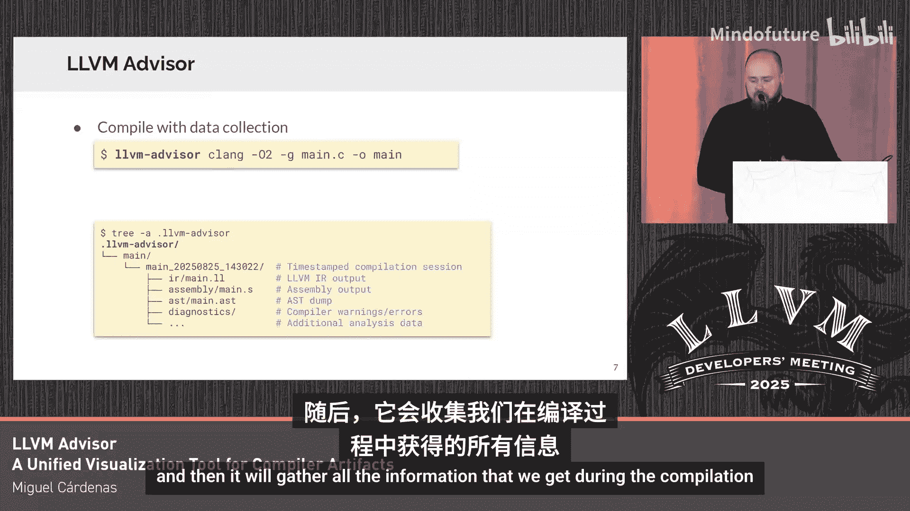

# LLVM开发者大会-US-｜-2025-Llvm-Developers-Meeting-p27-P26_LLVM顾问--BV1ejr5BAEja_p27-

Hello， I'm Kevin Sala from Larence Livermore。 I will talk about LLBM Advor。

 which is a unified visualization tool for compiler artifacts。

 This is actually a GO project developed by Miguel Carins。And I'm one of the。mentorentors。So。

Basically， you already know that LLBM reports a high amount of available compilation data。

 we can get optimization remarks， profiling， timing， and also diagnostics。

But the problem comes when we have multiple of thecompilation flags to enable all these data to be reported。

And the output files that we get are different， the output data formats are also different and it becomes quite difficult to find。

 for instance remarks in a specific region of our code， for instance。

 when we are trying to tune the performance on some specific regionss。

So here it comes one of the solutions， this is the LLBM advisor。

 it's basically a unified infrastructure， it's a tool that first gathers information about the compilation of your application using a compiler wrapper called LLBM advisor。

 and then it organizes this compilation data， it stores them in a folder and then it analyzes the data corlates it and finally you can be able to visualize all that data in a modern web interface。

So how that works， basically you have your compilation command or linkIn command with KAang。

 you have to put the LLBM advisoror command just in front of your compilation command。

 and then it will gather all the information that we get during the common compilation and then it just creates internally folder with all that information。

 for instance the LLBM IR， the assembly， the AC3， the diagnostics for each of your translation units。

And then finally you can see all these data organized it in a monoway in a web interface that is also called LLBM advisor。

 on one side we see the main tab， this is the dashboard we show some general information about the compilation of your application。

 for instance， the total number of files that you have， the distribution of remarks。

 that the agnostics， how many the agnostics of each type， the compilation time that you got。

Binary size breakdown and also a summary of the optimization passes and optimization remarks that have been reported。

Then there is another tab which is the performance one in this case we show for now two different traces of the first compilation time trace where we show how much time is spent in each of the passes and then there is for the case of your application that uploads to the GPU you can see the runtime trace of the uploading part and it shows how much time is spent on each of the operations on the GPU。

Then there is a third tab where we call the Explorer tab。

 in this case you can display the source code of your application in C++ Fortran。

 then you can enable the the diagnostics or Dreams in those small tabs。

And they are shown just on top of the line that they were reported so you can check them and in the other side。

 you can display the different generated outputs。For that source file， for instance。

 you can show the LLBMIR。 you can show the assembly code。So who can benefit from the LLBM advisor。

 we think that the advanced developers in LLBM， they could use them for reducing the time of having to go through the file of optimization remarks and finding the the specific part of where they are interested。

 newcomers in LLBM who be also could benefit from it to be easier to introduce themselves into the LLBM infrastructure and the compilation。

 and finally educators and professors in university so they can be used in。In the for the students。

So if you have any question visit the poster session tomorrow I will be there with a poster as I said this is a award performed by Miguel Cardis student from the University of Meaging you can contact him to and finally I have left here QR for trying if you want the LLBM advisoror live preview and the PR which is under review so any comment or feedback is very welcome Thank you very much。

