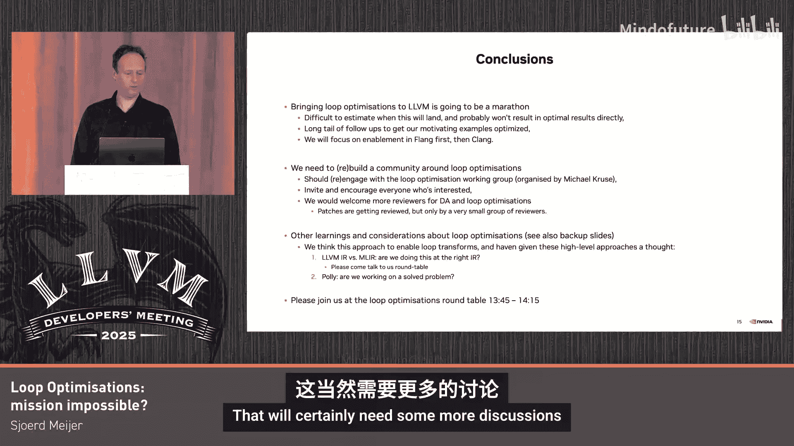

# LLVM开发者大会-US-｜-2025-Llvm-Developers-Meeting-p28-P27_LLVM中的循环优化_不可能的任务--BV1ejr5BAEja_p28-

Good morning， everyone。 Welcome for attending。 If you attended Peters。A keynote speech。

 just before this session， you learned about their migration from their proprietary compiler to the LVM based compiler。

And that reminded me something reminded me about something I was。I managed to to。

Contribute a critical back in one of the first releases。 I did this on， I think， on Code freeze。

 and we found out the day before release。 it was Ar Con F at 6。3。 So thank you， Peter。

 for reminding me about that。 So yeah， they were not happy with me。

 but I am supposed to talk about loop optimizations。 I'm doing this work with my colleagues。

 Madur Cameron and Sebastian， Cameron and Sebastian are here today。 So you can grab them too later。😊。

I will explain the second part of the title in in a couple of slides。

This is actually a follow up from our talk last year， last year we started。

Looking at the loop vectorizer in AlVM， and we wanted to know how well it was behaving for us。

This is a little outline。 So this is a follow up。 We want to talk about four different areas today。

 First， we want to give a follow up on on kind of the benefits of of loop optimizations。

 We had some data last year。 We have more data this year。

Then we wanted to reflect a little bit and share our learnings。

 there are kind of two types of learnings， more social learnings and development process within LVM。

 and then some light introductions about the technical learnings that we working on and we're working on and still working on。

 and then the plans for next year。We actually have quite a bit of material。

 we could talk about a lot more things actually it's been a big project。

 other topics that we could have talked about is are we doing the right thing， we want to enable LVM。

 sorry we want to enable loop organizations on LIR sorry on LVMIR but we have asked ourselves many questions whether this is the right approach whether we should go for MLIR。

 we have opinions on this， we think this is the right approach。

 we can talk more about this we are organizing Sebastian is organizing a roundtable where we'd like to invite you all if you have opinions on this。

Another topic is Po， there's another factorizer within the LVM project that solves a couple of these problems。

And that's something we would like to get your opinion on， if you have any。

 So the roundtable is today starting at a quarter to 2。 So hope to see you there， too。So as I said。

 this is a follow up last year we started looking last year we started working on a new CD extension it was new that times relatively Ne still SV2 and the question we want to answer is how well is the loop vectorizer performing Well we found out that。

We are behind quite a lot， and the reason for that is missing loop optimizations。

 This was the data that I presented them。 This is from TSVC。 That's a small artificial benchmark。

And basically what you see here is， for example， for the first kernel。

 we were 35 x slower compared to a proprietary compiler that implement loop Dis。

 and that caused a difference and then for the second entry， we were 22 x words。

Because in Kang we don't have loop distributed an interchan。Last year。

 I got a question from the audience。 why are you looking at a old artificial benchmark。

Why do you present the ESVC data， I answered the question， I could have answered it maybe better。

 so outside'll try again this year。The answer is if you get basic codes wrong in TCC。

 you get it wrong too， so we made a lot of improvements just as a kind of a cleanup。

But more importantly， the way to think about TVC is if you miss certain patterns then you probably miss them too。

 so for us TVC is kind of just a set of minimal reproduces if you miss a pattern in TVC。

 we look whether that's a pattern that occurs in real life workloads so that I think is a better。

Answer why we are why we present the T we see。Data。So it's not about T。

 So this is an update on kind of representative patterns and workloads。

So basically what we spent quite some time。Convincing ourselves that spending extra time。

 compile time on these kind of loop optimizations is actually worth it。

So I'm not going to read all the numbers。 but here you see benchmarks。

 different benchmark from Specus 2017， 2006 and 2000 some other ones， some older ones。

 But you also see Livermore， Pollybes， Raja， Perth， Eiggan。

 So the impression that I just want to give you is that。These are patterns that occur in。

In representative workloads， and sometimes you see that the gain is not really impressive because for example。

 it could trigger on in code， but it gives decent improvements。A few disclaimers。

 This is method on our AX 60 form platform。 So your mileage might put ferry a little bit。

 Another observation is that in some cases， the real benefit is unlocked when you compose the different transformations。

 So， for example， distribute an interchange together。

I did already mention some of the CPU benchmarks are older。

 but the patents are generic and representative。And if you try this in the LVM test suite。

 you'll find that it triggers a lot， but it doesn't really increase performance for a number of reasons。

 in LVM test in the LVM test suite， the program size are small。 sorry， the data size are small。

 The run times is small， Sometimes it needs better cogeneration in different areas。

 So for a different reasons， it doesn't give a lot in the LVM test suite。Okay。

 now let's discuss mission impossible。 That's just a teaser。 Don't read too much in it。

Our goal was last year since we presented this work in the previous LVM conference。

 And this year we wanted to get loop inters enabled， and we did not manage to achieve that。

 So mission impossible。 We wanted to have it running by default in the optimization pipeline with。

 let's say， O2 and above。W makes it impossible， we are still working on it due to the number of bugs。

 discussions and challenging and challenges around this area。

And I do want to say that we're not the first one to work on this。

 so thank you for everyone contributing to this， we are kind of building on top of this。Okay。

 to get some definitions and problem statements out of the way， when we say loop loop optimizations。

 we are talking about， let's say the traditional or classic loop optimization。

 So think about loop distribute， loop fusion， looper and gem and interchange。Now。

 the problem is that we have all of these transformations available in LVM。

 They're all off by default。 So from that point of view， we have a huge technical that。

And that's what we want to address。What is the problem， Well， some compilers。

 TCC and proprietary compilers， they do implement some of these or all of them。

 and that's why we are behind on some of these benchmark mark。So if the title is just a teasers。

 then， and if this is possible， what's our plan。 So we are still working on interchan。

 I'll talk about that a bit later。And our strategy is to first。

Get interchange enabled in flank first。 And then we would like to do the same in Kank。

 The reason is we do care about forran codes。Almost as much as C And C plus plus。

 The other good benefit is that scientific forn codes are really sensitive to these kind of things。

 So it's a very good use case。And sometimes For is a bit of a nicer language that help with this kind of transmission。

And after that， as I already mentioned。We want to look at next loop optimizations。

 and that is probably loop distributed。So what have we achieved， Well。

 we did not manage to to get interchange enabled， but we did a lot of work。 So for loop interchange。

 we managed to increase， sorry to improve the compile time quite a bit。 It was not good enough。

 There were kind of outliers of 1% for certain apps。 and it was perceived to be not good enough。

 So we got it down to half a percent Geamine on the city mark benchmark。We fixed bucks。

 we made it more， conservative， and then have extensively tested it。Depenence analysis。

 kind of the same story。 And that's what is blocking us at the moment。 So we are working on that。

We did a lot of performance analysis again， the table that I showed earlier is a result of that。

 just to make sure that spending decomp time is actually worth it。And。

And we did some early investigation in， for example， how and what kind of state loop distributors。

So where are we now， We are working on dependence analysis。嗯。Onto the learnings。

 what have we learned。We've learned a few things about。Let's say the development processes。

 So in a way we can say that LVM community has become more mature as a kind of a site product of one of the discussion。

 Nikkita make this developer policy change。 and I'll read this out loud。 So when adding a new past。

 the goals youll be to enable it as part of the default optimization pipeline as early as possible and then continue development incrementally and the past should have no known correctness issues。

 So that is kind of the expectation that we have currently， but that's not where we were。

The problem is that we have and because this was not the development process。

We have all this off by default transformations。 and this is really。

 really hurting for both depend analysis and entities， what we have to do for both of these cases。

We basically have to address the issues， which some in lot of the cases means we have to untangle the features。

 We are stripping out features。 So we are kind of untangling it and then building it up。

 And that is probably not the most efficient way of doing things。

 So I think this development process improvement is a good thing。As I read。

 there's now kind of a zero tolerance for open issues。 That is quite challenging。

 Maybe there is some nuance， maybe some issues could be less severe or impactful than others。

But that's what it is。 That's what we have to work with。Compiles。Really， really really important。

 People never stop talking about compile times when we talked about enabling interchange。

 The problem is that there is a compile time tracker。

 but we don't measure this because it's all off by default。 So on top of this。

 people keep adding features to it。 We don't measure it。 So things go from bad to worse， Basically。

 And that was one of the things that we need to ontled to。It's quite a lot of work。

 It's not necessarily difficult， but it's just a lot of work。

And what we need to do is we need to give other loop optimizations if you are interested in them the same treatment。

 so to fix the compound we have to look at compound time， measure it， improve it。

 and then do the correctness issues。Moving on to a little bit more technical。

 So this is an introduction to the problems that we are currently facing。

 which is related to dependence analysis， the A in short and the D linearization problem。

Why do we need depend analysis， That's to ensure correctness。

 So that's an analysis that decides if different array Xs read or writes。

From or to the same memory locations。And that creates different relations。

 and those relations need to be respected when you transform the codes。Now， for dependence analysis。

 identifying the subscripts make dependence testing easier， faster， better， more robust。

 So that's why identifying subscripts is important For this little source code example on the left hand side。

 we just have one global A and we have a little function that index a with subscripts INJ On the right。

 you see the corresponding LVMIR。If you kind of go up from the load， the user of。Of RA。

 we have a get element pointer as an operant and that has a get element pointer as an operant。

 so we build up this kind of nested linear expression of get element pointers that index a。Now。

 the problem that we have is， given this flated I R， what are the subscripts。

And we have an analysis for that in LVM， and that's delineization。

 so delineization decides that RA A is axised with two subs INJ。

This is a little bit of an oversimplification of the process。

 but the way this works is we start with the user， the loads and the annotations basically show you that we start looking for the gap instruction and then we create this linear expression and in this subitem there you see the corresponding scalar evolution expression。

 this scF。And what delinealization is doing is basically similar like factorization。

 It looks at the terms and then classifies them as subscripts。

Type information is also important as heuristic if you have an array that is。For example。

4 by  two in your source code， Then the delineization process can struggle determining that it's actually a 4 by two matrix and not 2 by 4。

 So this is where types come into play a little bit。And。During the last year。

 we have talked about IR in this context， we've talked about IR simplifications that makes this all a lot harder。

 so we are because of LVM IR simplifications regarding the get element， the gap instruction。

 that is typed the ideas that this type goes away because it has no real semantic information。

 but we do use it in this deinization process， so that makes it just harder and we are in the process of not relying on this。

嗯。Then there's also type information that that's just basically to。To， to find the sub。

 typey information can also be very useful to provide more information to the optimizer。

 So if your array has your in the example before， if the global has has 42 ins。

Then we can derive certain information from that。 And that's very useful for， for the optimizer。

 So what we would like to do is use that information。

And we would like to extract array dimensions from aocas and globals。And emit it in IR。

The exact syntax could change a little bit。 But if you have a global A。

 we would like to emit extra metadata that specifies the the dimension。 So in this case。

 it looks something similar like。Aray A has a range starting at  zero and ends at 42。

 so kind of a begin and start of the range。嗯。Going a little bit further so this was the easy case extracting type information from aesthetically declared globals that's easy。

 the more difficult case is dynamic arrays， including for arrays So for that we need something else。

So what do we need for that case， The idea is something similar。As you see on the right hand side。

 we would like， in some cases， we would like to emit。Extra instructions。

 So what we basically would like to emit is that I for that to be a valid index。

 it should be less than 42 because you're not allowed to access outside the array。

And we would like to emit that， as an assumption。嗯。That's what we would like to do。

 There's different pros and cons for this。 It has。Potential to regress optimizations。

 because we emit extra IR， extra users that could make this all very more complicated。

 But we hope that if we do this very selectively， that this gives the information that we need。Okay。

 what will we do next year， Our mission this year is to fix dependence analysis。 And if we get that。

Fixed。Then enabling interchange is going to be easy， I think that's what we kind of agreed on。

 that's a list of some of the dependence analysis issues， some of them are related。

 but a big theme is handling overflow in different cases and I would like to point out the work of someone else in the community。

 Riotaara from Fujitsu and he' helping some of these cases。AndAnd that's a very good thing。嗯。

After fixing dependence analysis， enabling interchange。That's kind of the first step。

But that will not give us the performance that we want。

 That's just kind of an enablement step to actually get the performance that is showed on one of the first slides。

 We need to do more， which is to provide this extra information。

And that's extracting the information from globals and dynamic arrays， as I just showed。

So we're not done， it will take a while probably， and we will need to have some discussions how some of this exactly look like。

 for example， extracting the type information and attaching it as metadata or in some instructions that will certainly need some more discussions。

One of the maybe the most important things that we realize is that we need to build a bigger community around loop organizations。

I think that has been a little theme that I heard from different talks too。 For example。

 Kang IR mentioned exactly the same thing。And that's also true for us。

 there are very little people that actually review patches。

 there's less than a handful of people that actually do this。Yeah。

 we need to do some community building and starting with ourselves。

 we need to start engaging more with the loop optimization work group that is happen happening every month that's run by Michael Cruz。

 So we are now。Attending that。 And if you're interested， we'd like to invite you too。 please attend。

 and then hopefully that helps。I already mentioned this。 I need to wrap up。 I already mentioned this。

 We have opinions on whether optimization should be done on the MLIR level or on LVMIR very quickly。

MLIR based transformations， we think that's very far out。

 We also need to lift quite a lot of the infrastructure。 We need to think about cost models。

 It is there are very， very many open questions， and we don't see this happening in the next couple of years。

And it may， they may also not be mutually exclusive。

 So we think that enabling these things on L VM IR makes sense。 And that's what we'd like to do。

 And that's it。 Please join us at the roundtable， if you have more。Questions or feedback for us。

Thank you。我是。And then you mentioned that Gcc implements some of these optimizations。

 right do you know how they express these kind of information in their I。

 which I assume is true as to say。主我觉得。So if I understand you correctly。

 I think they do this on their Sebastian， they do this on Gmppo where they have a lot of type information。

So they don't need to do all the tricks that we need to do。

 So we think LVMIR is really a very low level IR， where we have to do all sorts of gymnastics to recover all of this。

 And GCC has an easier case because they worked on a type IR。 Does that Did I you correctly。

 Did make sense， yeah。When we say enable by default。

Because we have multiple optimization levels0203 LTO is there any preference when we say enabled by default。

 which pipeline you mean So I think it's a microphone I come here the first part so when we say something is enabled by default right because we have multiple optimization level0203 LTO and other optimization levels too。

So what is enabled by Ne is something that is on an auto or auto three or any level。Yeah， so。

When it is running by default， I mean。Some optimization level， O2 and above。

 probably similar like the effectizer。 I think the effectizer also runs at O S， for example。 But。

 but at some optimization level， that's， that's what we mean。

I don't think there's a real big difference between  O203， but O2 and above。And and currently。

 it's not running。 Its that's following mean by default is just。

 you just need to add special flags to enable it。Right。Any finding questions？Okay， thank you， Su。

 cool。