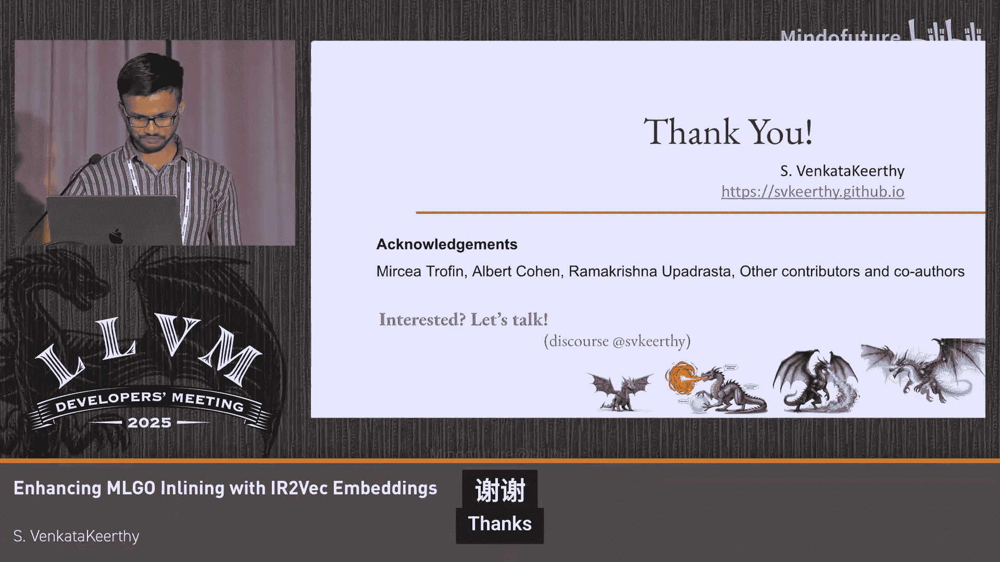

# LLVM开发者大会-US-｜-2025-Llvm-Developers-Meeting-p29-P28_利用IR2Vec嵌入增强MLGO内联--BV1ejr5BAEja_p29-

Hello everyone。 I'm Wekat。 I'm a final PhD student at IT Hyderabad。

 I am also a student research at Google。Today， I'm going to talk about enhancing ML guided optimizations in Google in LLviium in lineing with IRTV embes。

So the main question that we are trying to answer today is Okay， sorry about that。

The main question that we are trying to answer here is how we can represent programs in a better manner for machine learning applications。

 so。Towards this goal we have two different approaches one is a feature engineering based approach and another is embedding based approach in feature engineering we have human experts determining what features are more relevant for a particular optimization use that as a representation of the program and train a machine learning model for a particular optimization whereas embeddings is in itself is a learned representation we aim and embedding would discover what is important automatically so that we can use it in an task task agnostic manner for driving optimization decisions so hence the feature captures what we think is important。

 we could be limited by the fact that we may not end up encoding all the features all the features and embeddings discover automatically what is important。

And let's talk about embedding's brief background so embedding as I was mentioning is the learned representation so essentially we have a machine learning model that takes in an object as an input and tries to project it into an n dimensional space as floating point vectors which captures some meaningful information in case of natural languages the objective would be something like say the projected embeddings would capture relationship between a man and king in an analogous manner as woman and Kuwait right so now the question is that can we do something like this for LVMIR and how about we eliminate feature engineering at all。

So towards this goal we come up with an approach which we call this IR toV which is LLVM IR based approach which where we use program analysis information to drive the generation of embeddings and as the name suggests its a distributed encoding where the semantic meaning is distributed across the components of the vector as opposed to a typical feature based representation and the approach in itself is a bottom up approach so we start by learning representation of the entityTT level and then we end up aggregating them and arriving at representation at the regions different regions of the IR。

So。Let's get started。 I'll give you a brief overview on how we do this process right So let's consider a typical LVM IR。

 So this IR is decomposed every instruction， this I is decomposed into a set of triplets Each triplet is of the form Ht where H represents the head T represents the tail and the R represents the relation that relates the head with the tile entities。

 So now we broadly have three different relations First relation is the type of relation that relates the op code with a type of the instruction and second is the next instruction relation that relates the up code of the current instruction with the op code of the next instruction and thirdly。

 we have arguments that relates the op code with the arguments of the instruction So this decomposition is done for every instruction on a huge carpus of IR and we use a simple neural network training。

 So here we use a translation representation learning model called transy which learns。

This relation of head on application with relation R would translate to P tail so now at the end of this process we get a representation for all the entities that we encounter during training and this is all put together as something what we call a seed embedding vocabulary so this vocabulary is learning is done offline one time once we have this vocabulary we will be able to derive the representations of the IR at different levels。

So now you can imagine this vocabulary as a simple Json file with say。

 about 1 hundred entities where the key is the name of the entity and the value is the vector representations of those entities。

Now， once we have this vocabulary， what we do is we look up this vocabulary to fetch the representations of op codes。

 types and arguments and kind of compose them to get the representation of an instruction。

 So now the we at the end of this process we will be able to generate representations for every instruction that we have in the IR and this way of generating representation is what we call as symbolic encodings。

And we don't just stop there， but we wanted to encode some flow information。

 as you can see previously the op， the opera in the instructions would get a generic representation like a point or variable constants so on and so forth。

 but we want to specialize it and encode the notion of the context here say that we achieve by using the flow information So suppose we have the representation of instruction I2 derived like this and for i4 what we do is for the opera we consider what we do is we consider all the definitions that would potentially reach this point and encode the use make use of those representations to derive the representation of this instruction i4 So here as you can see。

 we have definitions reaching from I2 i3 and i 9。 So we conservatively make use of all three definitions to derive the representation of i4 this process could be repeated for all instructions and。

We we can end up encoding more contextual information derived from used de analysis to get the representations。

So this is what we call as flowware encodings。 So as you can see。

 this way of generating representations is simpler。

 but also it is more expressive So you can think of cases for cases like encoding the representation of the entire function and use that representation to represent the call site so this would in turn mimic the effect of in line right and you can also think of specializing this further if you happen to know the likelihood with which a particular definition would reach a use you can encode that likelihood and way the components accordingly so this can typically be derived by using profile information。

So。Once we have the instruction level representations。

 we can use different aggregators to combine the representations of instruction to obtain the representation of different regions in the code like it could be a function loop basic block。

 so on and so forth so you can think of various aggregators like a simple linear your combination averaging out or you can train models that would learn better way of aggregation to get better representation。

So。This is essentially what we have as IR toV which we derive from LLVM IR。

 so its derivatives are also there like we have representations derived for mission IR of LLVM mainly considering backend applications which we call as MIR toV and we also have another variation for binaries so once you have binaries if you want to do optimizations or transformations at the binary level you can use the representations derived from V IR which is the IR of vgri and derive similar representations。

So。😊，Now let's talk about what we have in LLVium So right now Itwa and MV are available in the LLVM upstream so we initiated an RFc followed by discussions and we start upstreaming it as a series of incremental patches So ItV is available under LLVM analysis and MAtac under LLVM Cogen we also have a standalone tool called LLVM It under LLVM tools which would help in generating embeddings as well as vocabulary training so the idea here is that you can use this tool or an upcoming Python library for driving your training generation of embeddings in Python for training and for during inference LLVM passes can directly consume it from the It analysis So the original source code is also available open source So if you are interested。

 please。Now we have three major components of IA contains three major components one is the vocabulary analysis the second is emr classes and third is the embeddings itself so the embeddings is just a wrap around the standard vector so think of your in dimensional representation being wrapped around as embeddings and the emer classes would contain the core functionality of how we can generate the representations。

 how we can generate the embeddings and the emer classes would use the analysis result provided by oocab analysis the oocab analysis would read JSN file which contains a seed embedding vocabulary and it's going to provide this information to the em classes。

And。How we can use Nium passes So first run the oab analysis pass。

 get the vocabulary result and create an embedded instance once you have the embedded instance you will be able to generate query and generate representations at different levels So we have representations for function basic block and instructions available as Sunday。

So again by a standalone tool you can run LLVium Myarivac using the embedding subcom to generate embeddings and you can run with triplet subcom to generate triplets that we can use for training you can have a look at this script that is made available in LLium mutles on how we can go about generating triplets on a huge corpus automatically。

So。As on date this is what we have so we use we used IRivV to drive different drive in model different ML based optimizations like loopbe distribution face ordering and register allocation these are all research projects but in LLVM we have two ML guided optimizations function in lining and register eviction decisions in regular log greedD I'm going to be talking about how we make use of IRivV and for function in lining in a bit but we going forward we plan to make use of MRivV for driving the greed eviction decisions in regular log greedD。

So。I had to work on using with M inline advisoror we saw about 2 to5 percentage improvements on different workloads in comparison to OS and OS along with the feature based MLgo representations So here as a first step we just concatenated the embeddings with the features and train a model the model was trained on an internal data center binary with about 50000 modules for about 20 million steps using PPO policy and this trained model was used to evaluate performance on different workloads and the model was trained to optimize for size so this is the state of the art we have right now going forward the idea is to start removing the features and and replace them with embedding as much as possible So as on that we have about 32 different features that drive M。

Lning decisions。 So most of these could be redundant given that we cancatenate the we uses embedding so they can be obviously removed。

So。Now what about the challenges like and the road ahead first thing is as you can imagine something like flowware embeddings you can encounter cyclic dependencies this is very typically even when you consider phi instruction where you can have multiple definitions reaching in a cyclic manner so there how we go about solving them so it turns out that when we model flowware equations it comes out as a set of simultaneous equations and you can very obvious thing is to use some sort of linear solver to solve it so if we use if you want to use a linear solver should we use an existing library like egan or should we have a simple handwritten code for solving this put it under LLV mutles or something and do this or we can use less precise iterative solutions where we can compromise on the precision but we still encode flowware nature of。

ForRepresents。And and another obvious thing is encoding more information。

 say we can start with memory dependencies， memed up analysis and memory SS analysis in allviium can even make the construction of these flowware embeddings more elegant。

 but one by nature they are highly conservative because they are all designed for optimizations so they which cannot tolerate false negatives but embeddings in itself we can afford to have false negatives so if we can relax this nature of them being conservativeness a bit and allow some false negatives we can encode better information so if that is the case should be specialize these infrastructures for the purpose of embedding generation or can we do some sort of memory profiling and by us which dependencies we can take into account。

嗯。And when it comes to MIR vocabulary we have target specific op codes and other opera。

 so here one major difference when it with respect to the typical LLBM IR based representation is that the size of the vocabulary the IRt vocabulary as just about 100 or less than 100 entities in total ased this including of codes types operate everything right but。

In contrary， in case of MR X6 but specific vocabulary。

 we have about 7000 opcodes available right so one thing that we tried to tried was to reduce this size by grouping the outputcodes say for instance you can canonicalize upcodes like add 32 R to say typicalical ad and you can end up encoding these additional prefixes and suffixes separately So the thing is that Xit6 provides a systematic approach to do this because it uses proper table to the table gen rules that defines proper prefixes and suffixes which we can make use of in canonicalizing the outputcodes but it is not very gentleized it is not across different architectures so in that case how we can do this grouping or canononicicalization is another question that we might need to answer。

And finally， we are also planning to automate the O generation， as you can think of。

The vocabulary keeps evolving or the compiler keeps evolving so we we see more and more codes and changes in opera coming up in MAR as against a stable LLVMR So in that case we might need to train a vocabulary at regular cadenceence and make this and make this vocabulary available so one obvious way is to use billboards so we can decouple this process into two phases one is a generation of triplets this generation of triplets could be done on the LLVM code base so we can use the LLVM itself as a data for generating triplets this process itself is lightweight with about 64 CPUs it takes about 10 minutes this can also be useful as an integration test right and secondly once we have this data we can train a model to get the actual vocabulary this can also be。

And we can we can actually train the models in a less frequent manner and make the vocabulary available。

So。Yeah this gets us to the conclusion in summary we have Iivic embeddings which are learn representations can which is upstreamed and we have addressed different performance related issues you can use it by forking a LVium the aim is to reduce the efforts towards feature engineering and improve the current MLgo infrastructure。

So we have seen its potential in both research and real world production environment environmentments。

 And next steps going forward is to reduce the features that we have currently and。

Start using M R to for driving the eviction decisions in regular greedy。

And for autoating the vocabulary training pipelines。And yeah， many more。Thanks。

 if you are interested， feel free to talk， thanks。

We'll take some questions up。Thank you。 So my understanding was that by training these embeddings。

 you don't have to do the feature engineering anymore and the feature extractions。

 But I see you don't fully replace those features you do some concatenation。

 can you explain a bit how this works。 Yeah right now we are just concatenating。

 but going forward we want to replace them。 So the idea was to just see how far we can see the how far this is going to positively impact the decisions。

 once we have now we have seen some positive impact。 So on the real world kernels Now going forward。

 we can strip some of the features or all of the features that's the goal。Alright， and。

What's your feeling like would it be possible to strip all the features and maybe that would reduce some of the bias that's used in heuristics now。

 or do you think some some of those heuristics or features should stay？

So it depends on the optimization and what we encode in the embeddings for ining for example Yeah so for instance in case of flowware information we can when we use such representation we can remove obvious features that are specific to the flow awareness right and we have very obvious features like the instruction counts and the number of callers。

 call etc those things if we encode them with the embeddings they would be more redundant so they can be easily removed right that's how I see it。

对。Hi， thanks for the great talk。 I want to ask about some technical details， so。

When we're doing manual feature engineering， there are certain fields about there are certain fields like externally used to describe whether this function is used by other modules。

 or even you can put thing outs index file into the feature list when you're doing embedding。

 does these kind of external information gets embedded as well。Right now no。

 thats so that's a good case for us to include either include them as part of the embeddings or to use them as additional features。

 especially for the cases that are not captured by the embeddings directly。Yeah。

 that's where I see the hybrid things coming one minor follow up。 So， for example， when。

 when you embed a function， does the linkage。Type getting embedded。 No， not right now Oh okay。

 thank you。 but I guess we can add it as a separate relation and bring it in like Sure。

 believe it's just a new vocabulary you can put it there。Thank you for your presentation。

Could you please elaborate more about how you try to train the vectors for actual concepts inside the embedding？

So how do you like train the。Like store or any kind of words inside the IR。

So I wonder about your training algorithm。 So are you talking about generation of the vocabulary。

Oh yes， could you please， Could you please explain the one more。Okay。

 so first we decompose or decompose the instructions of the IR into triplets。Like。

 and then we use a representation learning model called transy。

There is nothing specific or special about the model we can use different models and we generate the aim is to generate the representation of entities in the IR so here we at the end of this training process we get the representations for all the up types and opera that are available in IR right and using these representations you can derive the representation at higher levels like for your inference。

So training process should include like all features， including。嗯。Right。

Like last question just mentioned， like the global variables or any kind of control flow。

 and those all kinds of stuff should be embedded as a vector。Yes， so嗯。Control flow we don't。

 but all the entities in the IR， including global variables and other other things。

 are part of the triplets。 So the idea is that and mainly the goal of why we started learning at entity level is to enhance the coverage of or reduce the efforts that you spend on encoding all possible combinations of the instructions。

 for instance， say if you want to， for instance， if you don't learn at the entity level。

 but rather we learn at an instruction level right so in that case the number of data points that you need to encounter would be drastically higher because you need to enumerate all possible combination of instructions that can occur in the LMR or any IR that you want to embed so that would increase the complexity of your training as well as your vocabulary So we don't want that but rather we want to keep things simpler so we train the vocabulary at an entity level then you can just。

Oose them in the way you want。 And you can generate the representation at different levels。

 That the idea。And this also， of course， would avoid or reduce the probability of encountering out of vocabulary instances and whatnot。

Any more questions？Going once。Going twice。Thank you so much。

