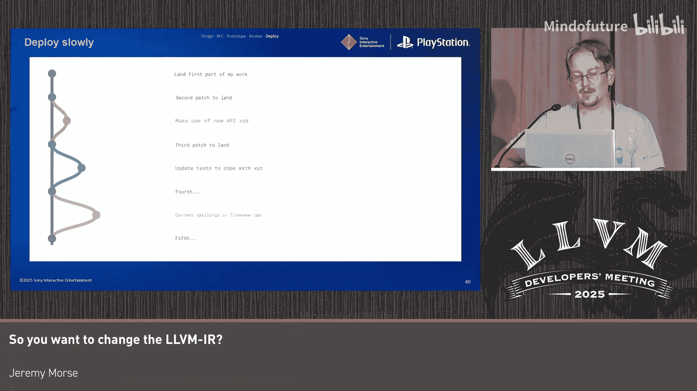

# LLVM开发者大会-US-｜-2025-Llvm-Developers-Meeting-p30-P29_那么_你想改变LLVM-IR--BV1ejr5BAEja_p30-

Alright， hellello everyone。 thank you for coming to this talk entitled So you want to change the LVM IR。

 Please filter in the pack。 This is pitched at people who have to add or remove or modify something in LVM that's a little more complicated than just one patch and what process to adopt when making that kind of change。

 It's sort of pitched at maybe newcomers， maybe people who haven't done that before。

 and we're thinking about best practices here。But first of all， hi， I'm Jeremy。

 I work for Sony Sony Make PlayStations and to do that we need a robust。

 fast and efficient and effective optimizing compiler and Kang and LLVM are the very natural choice for that。

 So they're part of our SDK。About five years ago， I joined a team that was working on improving the debugging information in LLVM。

 It's a priority for our customers to be able to debug their optimized code and we started to fix it and it became clear through this that we were going to have to change a lot of the plumbing in LLVM and make some re largeish modifications and it really wasn't clear how it was that we were going to try and get there because I was very much baby Jeremy who knew nothing about LLVM I wanted to get to a place where LLVM was better There's two parts to that like weve got to improve the compiler technically by making some kind of change to how it works。

But also， we need to make changes to the compiler that are acceptable to the open source community and that are accepted back into the open source repository。

Anyone in who's head any kind of downstream patch knows it's really hard to maintain anything downstream because of all the changes that come through and all the merge conflicts and so forth。

 so we want our patches to be in the open source compiler as much as possible。

Thus that's why I want to give this talk， I want to talk about the things that I wish I knew five years ago when I started working on LLVM because it can be a really daunting task it can seem like solving the problem is really far off and distant and hard to get to and we all get imposter syndrome along the way as well。

 thinking that we can't achieve this thing， but anyone can make changes to LLVM and we just have to string over several string together several changes to LLVM to make a big and significant difference。

All you have to do is follow the usual advice about following the detailed review process first of your idea that you are implementing and secondly of the code that you are submitting and it's that development process that keeps L ofVM fresh and flexible and effective so in this talk we'll talk about the process to do that I'll try and have some questions at the end if we've got spare time we could look at some examples of what I think a good RSE looks like maybe pull in opinions from the more experienced people in the audience a few nongos of the talk first。

It's not going to talk about just how to get any old change accepted we can't just continuously change the compiler every single day and make lots of endless endless changes it would be exhausting to keep up with that so improvements please we're also not going to talk about how to get an individual patch accepted that there's a lot of better documentation on the best process for that。

And also， I'm not going to answer everything you need to do in every single circumstance at all times while preparing a change。

 you need to use your own best judgment about how to proceed。 No one can do that for you。

So hold the process， it might be an obvious process but we'll go through it first you have your overall idea of what you want to change。

 you need to turn it into an RFC， seek approval on diss， then prototype your idea。

 prepare and submit your changes for review and deploy it。it might seem obvious。

 but each of these things by itself is actually quite a substantial amount of tasks。

 including deploying it， and ideally you also shouldn't really write huge amounts of code before you've had your RRC accepted by the community to avoid disappointment so all of these things are quite significant in themselves。

Throughout this talk， I'd like you to think about some some cool questions。

How is it that you're going to make your change to the compiler an invasivevaive。

 evolutionary and ergonomic？Uninvasive we'll get to in a few moments。

 evolutionary means that we don't want huge revolutions and huge differences being put into the compiler。

 If you have to make a revolution， try to get to it in an evolution of small changes。

 ergonomic means you need to make your facilities that you add easy for other people to use the developer experience of your other compiler engineers is really important。

Second part， who's the target market for this change。

 who is going to benefit from your change to LLVM， if it's just you or perhaps your business。

 then it's not as appealing for acceptance into the open source community。

 if there's a bunch of people out there who are going to benefit。

 then that's a great reason to accept your change into the open source compiler So identify who the target market is for this change。

And finally， throughout everything you do， you need to be constantly building trust and goodwill both in yourself and in your team By trust I mean that other people in the community believe that you have the same objectives that that you have the same priorities and we can trust you to be pursuing that in everything that you do。

Ideally， you would come to all of your changes with a track record of some smaller changes demonstrating that you can contribute to LLVM and have done in the past。

Moving on to this process， then， you've come up with some kind of idea。

 you've got some kind of input language that you're going to transform。

 You're thinking about the output of it， maybe in assembly。

 maybe you've got some kind of analysis that gets produced。

 Maybe there's some kind of extraada metadata that you're going to add。And。😡，First of all。

 you shouldn't start off by writing loads of code and just trying to directly implement it。

To quote Lis Tvan's good programmers worry about data structures and their relationships rather than the actual code itself。

 And I'd like to illustrate that for you now， you may think up。

 how is it that I'm going to store my information in LVMR in some kind of representation。

 You should start off thinking about relationships is a big block of IR。

 I think we're all probably familiar with it and all of you can point out， oh。

 there's an instruction， It's got some mo ands。 There's a constant in there somewhere。

 there's some metadata jammed in the side as well。 the TBA metadata。

 which calls some pointer information。These are all primitives theyre in individual elements and all of the meaning in this program doesn't come from the elements。

 it comes from their relationships to each other。On the left hand side。

 there's a direct data dependency relationship between those first three instructions， load。

 add and store。We also have a relationship between those pointer operations because the TBBAA metadata might encode some information indicating that the alias or that they don't alias。

 so maybe they're related or maybe they're not， it's a relationship。

There's also the cool instructions。 Traitionally， these have been considered optimization boundaries and that everything that happens before a call instruction has to stay before and everything after has to happen after。

 that isn't always true， but there's implicitly a relationship between these calls and everything before and everything after。

Finally， we've got a no signed rap flag in there as well。

 There's nothing in this function that depends on rapping behavior。

 but it's possible we could inline something in from one of the function calls。

 and that would then depend on the wrapping behavior that's in that flag。

What I want to be saying here is that when you add something to this function here。

 whatever it is you're trying to cook up， think about how it changes these relationships between different elements in the LLVM IR If you add something that causes change to many relationships or potential changes。

 then it is invasive。Your your element has invaded into other people's thought processes and other people's code。

 They have to consider your change and your element throughout potentially the rest of the compiler。

 and that's not a desirable thing because it adds complexity。

If you force other people to consider your， your change or your， your primitive you're adding to IR。

 that is invasive。 And we can have a little illustration here。 Imagine you're implementing， I know。

 some target machine or some transformation。 and you've decided。Signed wrapping， unsigned wrapping。

 It's too hard。 So for certain functions， I'm going to add in a tribute that says。

 just ignore all of the rapping behaviors。 And you call it no overflow at all。

 and you stick it on to a bunch of functions。In terms of like IR changes。

 this is absolutely minimal because you're just adding like one element into the attributes。

 No one really has to think about that。The code sites that consider whether to apply a wrapping behavior or optimization。

 they do have to consider that。 And you might go through L VM and change a few hundred core sites that then depend on that。

But it's still not a good design， even if you're not forcing anyone else to do any work。

Because if someone writes new code that depends on rapping behavior or uses it。

 then they have to think about your attribute and what to do about it in what they're implementing。

Or if people have downstream codes， they might have to know about your change and update their own compiler so that they're considering the relationship that you're adding between your attributes and all of these wrapping flags。

It's an invasive design， even if it doesn't immediately force any work onto other people。

 so that's something to be avoided in whatever you're implementing。

 it could be easy to describe and still be invasive。 So when you're designing something。

 try to avoid affecting too many of these relationships between IR elements。

Second part of what I mentioned， data structures。 Here's an illustration of the metadata hierarchy。

 LVM has two big hierarchies in it。 There's the valing hierarchy， which contains values。

 things like constants instructions， I think blocks and functions are values and they represent what you might call real machine things and then there's this metadata hierarchy that contains all of the extra information that you jam into the side that communicates about pointers about debugging information and stuff like that。

 if you're editing if you're editing data structures in LVM。

 try to make sure you're in these two hierarchies because you get all kinds of stuff for free serialization。

 a lot of hashing a lot of effective data structures that already exist but try and stay in there。

If you do have to add something yourself， then you just need to think about normal data structure concerns。

 the computational complexity， how it's going to affect compile times。

 how much memory usage it's going to take。 There's now better monitoring of how LVM or how fast LVM runs and a lot of people care about compile times nowadays。

 so you've got to keep that in mind， you should avoid reinventing the wheel。

 if you add some kind of data structure or algorithm。

 there's a lot of good stuff in the LVM ADT directory。

 that's abstract data types try and reuse those at first。

 even if it's not the best solution as it's there very little point in reinventing the wheel。

Movinging along。In theory， you've taken your idea， you've designed it some kind of primitive in L of MIIR that isn't invasive。

 I said at the start， don't prototype any code initially。

 is that likely I think we all want to write some code at first。

 but try to avoid really depending on it write code that's going to check your assumptions that's going to stimulate some ideas because the next thing you need to do is write up an RFC and you might have to change all of it。

Well， why write in RRC， even for small changes， you should probably do this because the codeb。

 it's 5 million lines long like， well， that was a couple of years ago。 it might be bigger now。

 no one can understand the entirety of LVM and clk and all the considerations and concerns in it。

 It's really useful when people put their ideas and proposals up on discourse because other people who know different corners of the compiler can just tell you if it's going to do something wrong。

 you might try to dig into the plumbing and go into the foundations of LLVM and seek out some kind of understand all of the corner cases and you might even find some kind of little toothpick that's holding the whole thing up and your change is going make the whole thing come crashing down。

But someone can just tell you that if you put it on discourse and， you know。

 give you guidance on what you should be doing。 Otherwise， it would take you forever。

These are some things I think are important in writing an RFC。Obviously。

 I't think everyone knows you need to have a concise and detailed explanation of the technical change you're making。

 obviously， but you also need to include the motivation behind your change。

 we can't read your mind and we don't know exactly what you're pushing for if you can describe what kind of world you want to be in and why you want to make this change then we're in a better position to say you know take a slightly different path or that some kind of application of your idea isn't going to work so put in some motivation try to identify the audience and identify how much benefit they're going to receive in your RFC proposal。

That is what is going to justify， including your change into the open source compiler。

 if people can look at it and say。Yeah， that's going to benefit these people in this way。

 they'll be quite happy about it。If you can try and quantify some of the extra costs in terms of maintenance and where there might be trouble so that we can sort of think about the cost benefit relationship and we could be convinced that it's worth doing that trade off。

I stuck on this slide an example of what I think is a really good like opening part of an RFC written by Quentin。

 I believe， saying， Chief Duncan， he starts off like in the first paragraph by really getting people's attention by calling out you know I'm going to change something fundamental you need to pay attention to this RFC and he goes into the details of what's actually being changed。

Almost everyone in the community reads the first paragraph or tour of an RFC just to see what it's about。

 you want to get people's attention in that portion of time so that they then read the rest of the RFC and are motivated to think about your change。

First impressions really do count。In the feedback for your RC。

 you're going to receive a lot of different kinds of detailed information I'm going to describe it as technical feedback and desirability feedback The technical feedback you've probably read some of it before somewhat you know it comes in ranges。

 someone might look at your proposal and say that's amazing we really want it please you know design and implement it and we'll review all of your code。

I think I've seen that happen once it's not very common。

 it's much more likely that you'll have some corner cases identified and people will give you advice on where your solution isn't applicable and where it is applicable and that's really useful as you've been enlightened on where you should focus。

It's also possible that you'll be told in your R C。

Don't do this it's a bad solution or it's not the right solution for this or there are better ways of doing it that sometimes happens and if it does you need to remember that the person communicating with you is taking time out of their day to well to save you time from doing the wrong thing they are motivated by improving the compiler improving your code as well and so if you have to respond to that kind of feedback do so in good faith and try and tease out why it is that your solution or your proposal isn't suitable for LLVM and then be thankful that they safety time。

The other kind of feedback I mentioned is desirability or direction perhaps here are some people saying some quite nice things about a change I proposed。

 and it might seem just reading the text of it that it's I don't want to say lukewarm。

 but they're just saying yeah， it's a good idea。But it's actually really important and useful feedback because these people are saying yeah。

 there's an audience for this， it's a good thing and we want it to be in the compiler so this is actually really significant feedback endorsing your approach if you get it。

 it demonstrates there's an interested audience who want it。

You might also get some non technicalchnical feedback saying， this will solve it。

 but I don't think you should take this direction because I know maybe they foresee something a few years down the line。

 you need to use your own best judgment to respond to that and decide what the correct direction for the community is。

In terms of when you've uploaded your RFC， when is it going to be accepted。

 or there's no one out there who has a rubber stamp who says RFC accepted at the end of the few weeks。

 but。You need to judge for yourself when you feel there's enough mass or inertia or feedback endorsing your approach to then make progress。

There's a third kind of feedback as well， which is silence and that happens on some RCs as well。

 and this is not a rejection of your proposal or your approach。

 What it's telling you if you don't get any feedback is that there's a small audience who aren't engaging with you or maybe there's no audience at all who want to hear about your RRC It's not a rejection of your idea。

 it's telling you that because the audience is small。

The barrierarris to entry for your change being merged is higher than you might have thought。

 The trade off isn't quite as good in terms of how much more maintenance you can put on the community for benefit because you can't demonstrate so much benefit。

If you've got some kind of independent， well contained change， you can continue on ahead。

 perhaps and upload the code for review and seek feedback there。

If you're going to be doing something much more invasive。

 then it may mean that you can't justify continuing with your change。

If you run into communication difficulties， if you can't agree something on an RRC。

 I have a great recommendation， which is to come to the conference。

 I'm kind of preaching to the choir here because you're all here at the conference。

 So I'm more or less going to address the one person who watches the recordings of this by coming to the conference I've really benefited from hearing about other people's opinions and directions and motivations。

 It's so much simpler in person to ask questions and receive direct responses。

 if someone has to respond to you on the Internet， they know everyone's looking over their shoulder and they won't deal with you quite so frankly。

 So come to the conference and have good constructive conversations with people over the years。

 I've really benefited from just people sharing their thoughts with me and it's helped me to do my job much better。

Some people I've spoken to the attitude of their employers has been。

 we send people to the conference as a reward for good work。And there's some truth to that。

 But I think it's even better to think of coming to the conferences， investing in your knowledge。

 in your connections， in your understanding， and helping you to get your job done better。

 So if you can come to the conference because you've got a problem to discuss， please do。

Moving further on， let's imagine you've had your proposal or your design。

 you've turned it into an RC and it's reached some kind of consensus for it going forwards and there's some kind of audience who want it and you're going to go ahead and prototype it。

Probably don't need to tell people how to write code here because you're all really good at it already。

 but I've been given this podium to stand on， so I figured I'd deliver a few hot takes on the things that I do and maybe it might enlighten you on how to approach prototyping your code。

I never write really high quality code as a first pass。

 Every single variable I write is like intfo int bars there's no point writing high quality code at first。

 because you're going to rewrite it anyway。 breakre all the rules。

 introduce loads of globals and loads of race conditions。

 I think the purpose of a prototype is to try and join up all the behaviors in the compiler that you're changing with everything else because you want to stimulate your new code against every other part of the compiler it might see so that you can work out what the trouble is going to be in the future and you can find out what you might have to account for。

 You might find some kind of project killer in the process So you want to find out as fast as possible。

In that process， I would recommend using LVM reduceuce if you haven't used it before。

 you give it an interestingness test and it automatically deletes parts of LVMIR until you've got the smallest test case that is。

That triggers your interestingness test。 You'll thank me in the future。

 you can use like if through your development， you produce a load of these small test cases。

 you can use them the smoke test in the future。 You can use them as a small regression suite during development。

 You can use it as the basis for writing the lit tests that you're going to need in the future for upstreaming your changes。

 It might remind you of problems that you need to solve in the future。

In terms of rebasing I did't see the point in doing it very often because you're going to rebase when you upload upload for review anyway。

 if it goes on for months， then maybe you should rebase there's something called Git reriri。

 which I won't explain here。 You can turn it on。 It can save you a lot of time。

 It can also be dangerous as well so reading documentation on Git reri。

As you're prototyping have some kind of QA target or way of assessing your code that's independent of LVM。

 If the proof is in the pudding as the English idiom goes。

 then you want to eat the pudding and test to see if it's all right there's no point on doing quality control on spoons on utensils on plates and knives if you are aiming to make a good pudding So don't try and assess the value of your code just by writing lots of lit tests or LVM tests have some kind of independent code base that you're assessing like something in the LVM CT mark suite or some other reference input or code design or code base that you're going be transforming if you are doing anything to do with runtime performance。

 please also have a workload that some kind of reference use case because we're gonna ask you what workload is it that your code makes better。

In the past for doing deeperA infofer changes， if we change the plumbing。

 we would demonstrate that we always produced an identical binary to before we change the plumbing。

 it provides a lot of confidence if you can demonstrate that something's identical over really big input that you've always making the right choices all the way through the compiler。

嗯。We're also going again with this。啊嗯。If you're searching you're going to run into a lot of bugs in your own code。

 I represent like the problem of finding a bug as searching for a little mode of dust in some party balloons。

 you can't get in the balloon， but you sort of shake it around and try and find the motor of dust and localize it to the end of the balloon。

 That is a normal compilation of the cobase your' targeting SeDbus or debug LVM with your changes。

This represents exactly the same problem if you're building in LTO mode。

 it's just a massive hot air balloon that is even bigger and is way off the ground so you can't get at it and you still get a little motor of dust in there that you're trying to find It's almost impossible。

 I say this because I don't think any code is like really truly tested until you turn on LTO because it just rubs every single part of the compiler up against every other single part of the compiler and finds every weird behavior you could possibly imagine all of the interesting problems that come out of our continuous integration systems at Sony they always come through LTO tests or building some code base in LTO。

If you have to change the or if you're adding a primitive or changing a primitive。

 it might feel that changing the texture IR is going to be the most exciting part I wouldn't say it is because no one really writes texture IR by hand it's almost always generated one of the great things you can do though is make your change ergonomic for reading when we got rid of debu intrinsics we introduce debug records。

 which is things those lines with hashes at the start that are indented and one of the best parts of this is that this code is now indented you can look and see the stuff that isn't indented。

 that's a real instruction that is going to get code gen and everything that's indented isn't it's metadata and your eye can pick that out it's ergonomic So if you're changing texture IR An ergonomics。

If you do change the texture layer on， you've got to change bit code as well。

 I used to be scared of changing bit code。 Actually。

 the guardrails on it are really strong and really useful。

 They force you down the path of doing the right thing all the time。

 I'm not scared of changing bit code anymore。I would say or remind you that you have to measure the change in size if you change bit code。

 that's the primary objective and remember that there are backwards compatibility requirements。

 there needs to be an upgrade path from the past into your new representation。

So enough of Jeremy's hot takes on developing your code。

We we get on to the point of your prototype being done。 You've polished this a bit。

 you've assessed it and you're happy that it's doing the right thing。

 It's meeting quality criteria that are independent of LLVM。嗯。

How is it that you're going to upload it， Is there a best way。

 There is only one right way It is to upload small and incremental patches， please。

Here's some code that I had to hand that I wrote， it's like 800 lines of C+ plus it's scattered all over the codeb。

 This is the kind of change that I would not want to review because review time is nonlinear with the size of your change。

 the more that you put into a GiHub pull request， the more parts of the compiler you touch。

 the more concerns there are that the reviewer has to think about and that becomes exponential very quickly。

If you've got a reviewer out there who can spare 30 minutes or an hour of his day to look at your code。

 then it might take them that amount of time for this size of a change just to think about all of the concerns that need to be accounted for when they finally get to actually reading your code and reviewing it it's nonlinear。

And so you really want to minimize the amount of change that you are making in each individual patch here is a reference example of what I think is quite good a colleague Alando implemented something called key instructions it makes stepping intodievoggs better by encoding more stepping information from language frontends into LVMIR's metadata it took him a few months to implement this。

 it was reasonably hard and after he had done it he had sort of 2000 lines of changes it then took him another two or three weeks to split it up into the 30 or so patches that you see here and it was totally worth it because you can immediately see the structure if you go from the bottom left upwards and then onto the first column we start off by changing some fundamental data types then there's some changes to the plumbing then there's instrumentation for individual passes and finally he gets on to the changes to clang instrumenting。

And putting in more information from the front end and when I reviewed this。

 I could just roll in and spend know， 30 minutes， 40 minutes looking at one patch， review that。

Move on to something else as I've got other stuff to do。

 and it really made my day a lot simpler than if it had been in much larger patches and the 2000 lines spread over maybe four pull requests instead。

嗯。In all of NLVM， there's very little review time spare， we're almost always blocked on review time。

And it makes a huge amount of sense to put a lot of your time into preparing your patches into small units so that then the reviewer can spend a small amount of time reviewing your patch。

 It does kind of follow from that that your time is worth less than the reviewers。

 It is kind of true in L of theM because there's just such a lack of peoples spare time to do reviews。

 You should try and optimize your changes for the reviewer to do it efficiently。

It can't always be done like that。 ideally， your project would follow the structure of Aium overall。

 like a bunch of independent passes。That can't always be done。

 maybe you've got some large algorithm to add that needs to be implemented independently。

 I suggest that you might be able to split up small portions of it and add unit tests for these portions and then slowly form some building blocks that are then pulled together into a larger a larger patch that puts a capstone on it。

Maybe you need to change a lot of the compiler over a lot of different independent cool sites。

It can make sense to normalize all of those cool sites in advance so that maybe you submit some big patches that just does mechanical changes so that a later patch that adds the real functionality just does exactly the same change to a whole lot of cool sites so that the reviewer can look at it and say。

 all right， it's just this replicated 100 times and then I can go and focus on the other parts of the changes so normalizing everything you're going to change in advance can help review a lot。

You might not be able to do either of these things。

 Perhaps you've got an entire optimization parc or analysis parc or something that you need to add。

 and it not make there may be any way to split it up。If so。

 you can seek permission to just land it as it is in a disabled state so that you can then slowly start introducing it to the compiler and enabling it for small code parts at first and then broadening it out。

 adding tests as you go。The review process for doing things like that isn't amazing。

 but it built a lot more trust and confidence by gradually introducing your change to the compiler over time rather than just one big bang submitting it and having it turned on。

Finally then let's imagine you've got your change that you've proposed RRC prototyped submitted for review。

 It's all approved。 So what do you do， You could in theory， just take all of your patches。

 Sc them into one big push it and then go home it will probably not work so well like that there are always going to be edge cases and unknown requirements that pop up at the last minute。

 It might be that your patch is completely perfect。

 but there's some kind of like line ending problem in it。

 or maybe there's some kind of path separate a problem between poss and Windows environment and it gets reverted anyway。

 You want to deploy your patches about as gradually as the patches that you uploaded for review。

 two things to consider as you're doing it。 First of all。

 how easy is it to revert your patch because if you're touching hundreds of files that's hard And second of all。

 what's the sort of size of input。That your your new code pass are going to be experiencing is suddenly a function going to be absorbing all of the inputs to the compiler at once。

 or can you introduce it more gradually？I say this is hard and like deployment is an important thing because there's like a reference bad case of like a really painful situation that can happen out there。

 Let's imagine you've got your your code， you've landed your patches。

 let's say you've landed the first one and there's subtly something wrong in it that you don't know about And then over the next couple of days you land all the other patches in your series six and total。

 let's say。Fine， that's great。 you're not aware of any problems yet。

 but there's a lot of CI happening in the background on the top left here。

 we've got the public billbots that you can find on I think it's LaLVM。

org and those's are constantly checking against the public test suites that your code is good and they'll mail you if there's something wrong。

there's a lot of people out there running their own integration tests that typically are deeper and wider than just what's public。

 and they happen less often。 and they take a lot more time。

 We've got a Jenkins installation that does a lot of Ci on things that are interesting to Sony。

 I know there are a few other businesses out there that do exactly the same thing。

 The bottom bar on there is the public chrommium builds that are constantly taking in new compilers and then recompilling all of chromroium for all kinds of different targets all at once to check that that it works。

This takes time。 It might be a few days before someone finds something fundamentally wrong with your patch or maybe some kind of edge case that you can easily fix up。

 But it is kind of possible that your， your first patch there。Has something wrong with it。

 And it's got to be ripped out。 And if that happens。

 we've got to rip out the other patches that you've landed in the meantime that depend on it。

 but it can get even worse because in that time， maybe someone's added a use of an API you've added like some function calls。

 So there's going to be a build failure when we when those patches get reverted。

 And at the same time， perhaps someone has added I can't read what I've got on the slider。嗯。

And so read it out， it's too smallwo in this now。The green thing。Update tests， yes， thank you。

 maybe someone has baked into their tests the new behavior that you've added and so now all of the tests depend on that if we revert your patches。

 the tests are going to fail and even better I remember this one maybe they've changed the spelling in your patches and they've sh around a few functions or added their own maintenance to their own facilities and so there's now a bunch of merge conflicts when your patches get ripped out。

I have seen reverts that have taken more than a day to complete because so much stuff has suddenly depended on it that it just takes so long to discover the next problem and then you have to restart and try to rip out again。

So please merge your patches slowly if you've got 20 patches， ideally， it would take 20 weeks。

That's probably not realistic because we've all got deadlines。

 but in an ideal world that would be what happened。

 but you need to allow time for other people to absorb and to complete the CI testing process as your patches continue to land。

Part of that as well is， as I say， measuring somehow the size of the input or the magnitude of the change that you're making so that you can space it out gradually so that you don't make your biggest change all at once if you make it incrementally then you won't just put a patch in。

 revert， put a patch in， revert， it can go gradually over time。

Again， the world isn't always that perfect。 there can be changes that can't be merged and you just have a step function from the old world to the new world。

 I think we had to do that for removing deeper intrinsics because there was no good way of switching the compileala over pass by pass if this happens。

 first of all， announce it in advance so that lots of people in the community know that it's going to come down the line。

 then find some way of having very limited test changes maybe you have to duplicate all the run lines in a bunch of tests to have two different modes。

 but if it comes with a huge bunch of test changes。

 then people are going to get upset have as small a diff as possible ideally just changing a false to a true so that it's a very easy revert and then after publicizing it try sending it in and seeing what people's feedback is。

Add lots of escape hatches so that people can turn this off easily because someone who's encountered a problem。

 they might think， is it that thing that changed recently。

 how do I test whether or not it was that if you've got an easy lever for turning it on and off。

 you'll make them very happy through evaluating that。

If you end up forcing sort of forcing people to take immediate action。

 you will encounter pushback because everyone's got a schedule and other things to do。

 adding things that allow things to allow the merge process to be spaced out over time makes everyone's lives easier because it can be scheduled for some point in the future。

 it also drags your project out but it's a necessary cost。Finally， maintenance。

 you need to add documentation for the thing that you're changing， the community。

 if it's a facility you're adding that everyone wants。

 we're going to you know do our own maintenance and add parts to it。

 expect other people to bolt things onto the side of the facility that you're adding because extensions are quite natural。

 natural。If you have some kind of very target specific or esoteric or a very narrow thing that you're adding。

 we do kind of expect that you're going to stick around and maintain it if there's something out there that keeps on breaking then the temptation appears for us to just or the community to remove it on the grounds of it's a maintenance burden and we don't know what the benefit is so if you can commit to providing ongoing maintenance again that builds trust that your priorities and directions are in the same direction as the rest of the community。

嗯。That kind of。Covers what I wanted to say， here's some summaries on some bullet points you have you come up with a design。

 you need to make it uninvasive， please evolutionary and ergonomic。

 seek early feedback and respond to that feedback in your RFC。

 you need to engage in good faith if you receive negative feedback because that's just a normal part of the review process。

Prototype your code by seeking out all of the problems as fastly as possible。

 Opimise your patches for review。 Just be aware of how little review time there is out there。

 You can't over preparepa your patches for review。 I would say submit them incrementally and deploy them incrementally。

 Thank you very much for listening。 I'm not sure where we would go from here。 we've got some time。

We could take questions。 I got some examples of RFCs that I think are good。We have a few minutes。

 so we do have a few minutes for questions。All right， thank you， Jeremy。Any questions？啊。

Any advice in a new feature that's really not touching anything， but it's a large piece of work that。

Contain， let's say， within one pass and unless it's turned on。

 it's pretty much no for everybody else。But it's hard to break it into 10，000 patches。

 the only value add is ease of review， I get that， but it's kind of like it's so isolated。

It's not touching anybody。When you say not touching anyone。

 does that then mean that unless you turn on the flag？No。

 I would I would say in that case that the so the review requirements are still。

 I think they're still the same for all I， but I would say it's much easier to accept that kind of patch on the grounds of less exposure to people and less trouble。

In addition， part of the acceptance process is that over time people use this people don't run into troubles。

 people use this facility， which is behind a flag。 I think adding things behind flags is a fantastic thing that we should do more often because it's just allows allows confidence to be built up over time。

Which yeah， is sometimes the only way to do it Okay， thank you。Thank you。Questions。I have have one。

So the order you had， so you said that first RF， then the prototype。I don't know about you。

 but a lot of people will write a lot of prototype first。

Yeah did you know I start that on the slides is it realistic I think we should accept that or I think it isn't so much saying that you shouldn't prototype things。

 it's more saying that your RC should be extremely close to when you start prototyping something because you come up with the shape of a design and the moment that you have a design that you're starting to implement that is already something that we would like to hear about the earlier the better and the moment that your design starts taking shape。

It really is that early because people out there might have tried it before。

 They might be doing the same thing and they might want to tell you about it。

 They might want to join forces with you。's as early as possible， avoid surprises and upsets。Yeah。

 that's I agree with you， that's well said。But my experience is people who will try three different solutions before they go to RSC because they want to know they don't know yet。

 what's the right way to solve the problem。So that。It can also be the case， Another way of doing it。

 as I say， is to you know， give the outline of what the solution could be before actually going and implementing it。

 I accept this you know， this might not be universally accepted。

 but I still think it's better to RFC as early as possible。Yeah。I was also going say。

 I see a few familiar faces in the room。 I don't know if anyone else wants to give opinions on what they think the development workflow should look like。

I I've put people on the spot。 so no they haven't thought of anything。 Paul。

 perhaps Paul has been around for a very long time。

I should also thank Paul for reviewing this presentation in advance。So I have been。

I have been part of several large changes。And。I think Jeremy' is procedure。Works。😀Yeah。

My first big change， this is reaching back pretty far， this is over 10 years ago， we added。

The opt none attribute。And it took。Let me think。I know we redesigned it at least once probably twice。

And then， the actual upstreaming。Took the better part of another year。嗯。And。Getting。

 getting buy in from。People in the community took a long time。Getting the implementation。

To be okay with everybody。Also， it took a long time。But we came out the other side。And。Suddenly。

 people were able to leverage this new attribute in unexpected ways。Okay。

 if anybody has ever tried to use the opt bisect feature。That's built on top of Opman。Right？呃。

The whole way that00 interacts with LTO is based on top of Opon。

And we had no idea that it was going to work this way。

 we' were just trying to find a way to selectively deoptimize。Single functions。Right。Because。

In the Sony universe， you basically cannot build unopimized programs at games and have them function because they're real time simulations。

 they just don't work。If they're not optimized， they have to run fast enough。So。

We didn't follow that particular procedure， we hadn't invented it yet。

And Jeremy learned from our mistakes。But。You can come out the other end with really good stuff that's valuable to the community。

Yeah。So I have another recommendation。So a lot of features。People don't finish them and it happens。

 right， And we have a lot of optimization There are。Unfortunately， in weird state， right？

And you also ni an email last year， I think about these passes that we want to delete or something。

So one thing the RF that would be nice to have is to have the plan how we're going to split。

What are the first batch， the second， what is the milestone。

 what's the plan so that if somebody else has to pick up？The worker wants to do it， at least。

He has a guideline where to。How to finish what， what was started and that something。

It's probably useful man I have。Recollection with the dot in some graphes， for example。

 the vectorizer。That was a very good R of sea where。

The plan was set and the original vectorizer at that time was Nadav and he didn't finish it completely and somebody else finished it。

 but because the description of the plan，On what we need to do to get where we want to get。

Was there in the initial R。I think part of that as well one of the examples I put together to examine if we had the time was there was in the past a splitting a part of the value and metadata hierarchy and they used Bailla at the time。

 but they had independent tickets for each different part being prototyped。

 how far they had got and all the commits involved with it。

 which I believe was as you described a documentation of the project how far it had got and the work involved。

 which because there were this was necessary because there were people from different businesses working on it and putting it all together and it can work quite well。

Anyone has any thought any experience with the process， anybody does not follow this process。呵。

It would be interesting to know。All right，Please thanks Jeremymy， if you have no question。

 we have a little bit extra time， let's wait in case somebody wants to join for their team update。嗯。

We're supposed to start at 5，15。And it's。5，5。👏So we have a short Thank you very much， thank you。

