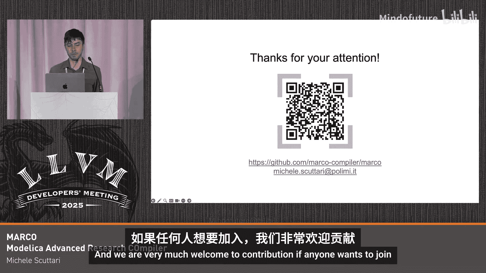

# LLVM开发者大会-US-｜-2025-Llvm-Developers-Meeting-p31-P30_MARCO_高级研究模型编译器--BV1ejr5BAEja_p31-

一个系咯喜湾。这是不行。I've been working on this project for the last four five years and yeah。

 it's called Marco and it's MRIIR based compile for DSL named Moa， of course， as the name suggests。

And yeah， first of all， a little bit of introduction and motivation to the project。

And let's talk about the DSL first so modelica is an a causalal and object and component oriented language which you can describe a system of differential antibioticic equations for example。

 let's say that we want to describe a capacitor and we can do that by describing each of the two pins and through the concept of connector and then what we can do is to connect。

Those who describing the equations that govern the system， in this case。

 the physical dose of the capacitor。And then of course。

 you can add other components to the system and make more complex scenarios。

I like to write two things about this code， and first is that you can see an unusual operator。

 which is the time derivative operator。And second is that the free qualities consist of equations and are not assignment。

There is no enforce order between those pre equations like。Nur really write by hand。

 and assignments are indeed not explicitqui， and in other words， Moelica is a declarative language。

 it's not a programming language。As such， the following code does not semantically represent an iteration。

 but rather a simultaneous iteration of multiple equations in this case， 100。

And that would turn out to be very important for me tool so but first also。

 why are we building a new compiler？Well， it turns out that the last feature that I was mentioning is not very well handled by NA compilers。

And what they do is to enroll those decorations and apply the DER algorithms to the unroll version of the source code。

And this is what they would end up adding within their representation。

And even though anrolling may have beneficial performance at some time。

 what happens is that it has a very terrible impact on completion performance and completion times quickly become unfasible and by feasible。

 I mean they are taking days of time。So， the。And also you get excludingding binary sizes with like gigabytes of executables。

So the main motivation of Marco is to go beyond the current algorithms for the AE system and devise new ones that are able to resume about array array variables and loops of equations。

 so I will call them just array equations。And with the goal more detail is to be able to simulate large scale systems。

 which are indeed represented often by this construct。Well， why atIR。

 I don't think I really need to convince you about why are we' using MLIA but anyway。

 so the benefits are， of course the use of an open source A infrastructure as well as having the use of concepts and optimization that I've shared across different domains。

 we also have tighter integration with the end end and possibly easier cogeneration for custom architectures and better debuability I will not like going to the details of all of these you I guess you already know all of them。

But let's see that how is the architecture and IR of Marco made。

So the structure is quite typical for an LDM compiler。

 so we have hour from 10 which processes the modelta code。

 which then goes into the middle and becomes of an IBM and finally gets linked to the libraries composing our in runtime system。

AndHowever， Marco is also integrated with the client driver with the goal of receiving target and optimization specific information and also uses the front end of Kang for C code whose used that is allowed for the implementation of external function by the modica specification。

For what regards the compilation pipeline within the front end of Marco。

 the compilation is divided into three main path， first we have some canonization passes which address some language specific features and allow for certain assumptions written the pipeline。

The second part covers the mathematical aspects of DAE processing。

 so for example it performs causalization where many of the new area where algorithms live。And apply。

 for example， also on numerical integration to the system。And finally。

 the as part is more traditional in some sense and applies some optimization musicians and lower the various dialects to I myya and then as I was saying。

 we give it to the middle end and back end of ideaN。Of course。

 there are also many other passes like potentially with all position enabled as of now the front end has a total of 85 passes。

 but of course we are not going to see all of them now it just makes no sense it's impossible with the time we have。

But。From the pipeline， however you' see that we have some new dialects on the left。

 so I'm going to now introduce you to them a little bit， we're also not going into detail of them。

 I will just highlight instead why certain decisions have to been made which may be beneficial to the community。

Yes。So the most relevant director is surely the B modical one， so you may wonder why the be。

So actually， Marco， as of now， doesn't really accept modelica code。

 but rather a subset of the language， which is called base modelica and。From there you to be。

And the moddeta code is actually given to another compiler that removes object orientation and Marco then starts from the potentially it can be done everything else inside Marco。

 but we don't have the manpower as of now。So the main concept， I mean。

 the corpus of the bi director is to represent differential algebraic systems of equation。

 so the main concepts that are captured by the direct are of course。The one of the model。

And we do that by just having a single regional operation with name。 and within that region。

 we actually describe variables and equations， which are less obvious to represent。

So what about variablesro， in case of Paras， we have an explicit design goal to preserve intererability with other pals。

Why is this goal really so this is well， you may know that some operations within the Ma ecosystem may have dis are called isolated from above trade。

 which prevents the inner operation of the operation。

 that the ones within these regions to actually reference SSA values that are defined itself。

And so if we want to really be open to any possible other dial that you may use within the yard。

 then we have to take this into account。And the solution to this is just to adopt s semantics for the decoration of the variables of your model。

 and we have some ph operations that mirrors the two words when you need to shift from s semantics to SSA semantics。

And then those operations and like the declaration of variables and the Beijing operations are lower differently according to the place where you use them within your your IR。

 for example， in case of models， you just get global variables and if you are instead declar variables inside your functions。

 you can just get allocation which optional that get the optimizeim， of course。

The representation of equations is also not immediate considering the cause of Marco and transformation that TR goes through。

The idea is to avoid coplication since the beginning。

Because actually the result of some analysis may depend on the indices of that specific equation。

 remember that you have already equations with an niration base with multiple indicees。And。

To achieve this， the equation body has been split from the actual instantiation。

 So we call the first the equation template。And the latter we call it the equation instance。

 as you see from the example。An equation temperature is parametric on the analysises without specified by the instance。

And also， the uses are backed by an arch implementation in house developed one。

Which is very efficient for compacting the range of indices。And also in this case。

 we prefer SSA semantic instead differently from variables because we have complete control of the IR structures and so the nesting problems are not there anymore anymore。

Also we have some additional dialects which I will just go very quickly through them but it's good to see them。

 so we have three dialects called Eda Kinsle and Sands。

 so their purpose is to integrate with some external solves in this case。

 EA and Kinel which are part of the Sandio suiteite。

And they are used during the models solving states， so the middle part of the completion pipeline。

 and they are used for either providing a V integration method or to numerically solve the cycles that are still there within the system。

So just a quick example of how the EA direct is made， the k of one is almost mirroring that。

 so we have an instance of the server which we declare the instance operation and then we inform say the EDA object about the variables and equations so in this case you can see we are informing the time that there variable differential variable and we give also some codeback functions to actually get and set its values。

And similarly， for equations， we adopt a similar mechanism of functions and we give the callback to them。

Okay， and， and we also have automatic differentiation to， to。To achieve those。

 to obtain those functions。 So we have achieve those functions and。

A partialial derivative socal function that is used to compute the echocoometric of the system。

 but yeah。And finally， we have the Rton dialect which interfaces with which interfaces with thetime environment of Markco。

It provides some sample functions， such as an implementation of sine cosine functions。

 but also expect some。Like it is used to provide some cool expansion that the runtime environment we expect to be there by the compile model。

So I've gone a little bit fast through that， but I would like to showcase one of the optimization examples that we have within our pipeline。

Where you will see two of the dials that being talking about so the idea is to parallellyze independenceencies of equations so imagine that you have these depend dependency graph okay where you have for example。

 that equation1 can be compute only if you have already compute equation zero and what you can do is to compute dependency graph among the equations and understand that for example。

 all the equations within group1 can be computed in an independent way and this may seem like naive and inefficient because you say okay use on two threads dust for two equations。

 but yeah I record you that maybe these two equations are array equations and they may be also independent one from another and so what you can do is to actually split all of the ranges and give them all the equations to multiple course。

And this is the main idea， not very， not very complicated。 From the perspective。

 what we have is that if you consider， if you consider that simple example。

 you have some opaque blocks where。You have just knowledge about the dependencies。

 so which equation is spread to which variables and needs which other variables。

 and you have an additional article saying if the k do can be parallellyzed together with others。

So first modification is that we applied that depend graph and we wrap the groups。

 so the prior scheduled blocks operation just represent the groups that was showsd in the previous slide。

And then what you get is that you apply a specific transformation to look into those blocks if it can。

 and if it's able to do that， then it is some runtime scheduling objects that manage by thetime system。

 and those will be actually the ones in charge of dispatching the equations。

 spliting the indices and dispatching the equations among multiple trends。And yeah。

 just one example where you see the performance of the project。

So let's consider this thermal model of a silicon chips。

 very simple model and don't expect anything like super complicated。

 so you parameterize your say your chip in three dimension。

 you can control the number of volumes according to those three parameters and you get a fixed power source at the bottom and a cool temperate fixed cool surface on the top。

And we have got the spector method， and we measure the completion time and simulation time for a Marco and another solution。

 which is the Ocommod compiler， which is open source。

And what you see is the you see this are the completion times on the left and the simulation times on the right。

What you see is that Marco really， really excels at the completion times because it takes advantages of those array aware algorithms during completionil and it has basically constant time completion time。

 which which is very different from Camm， for example， but those others。And simulation， time wise。

 you get。Some considerable benefit， and also you notice at some point you have an automatic multiizing activation from the randomtime system because it understands that at some point while you are scaling the system。

 it becomes beneficial to activate your dispatching to multiple core。

So conclusions does just sum up everything。So current statuss， Okay， its still a prototype compiler。

 Okay， so it has been going on for five years， but there's still work to do。 so we are。We have。

 for example， we are very interested in going to custom architectures， but even just TU use。

 for example， it would be a very good thing， especially for the use case of Marco and。

I would like to conclude with a few things that make very well interesting for the community。

 so I've been encountering a few difficulties throughout the development and first of all。

 was the integration with the current driver。which is not exactly easy to work with because it's a big good base so it' I think it may be sort a a little bit better at some point and some copy pasting was also required and still we have some question about how land source modificationification。

Also single tables of MLA， they are nice， but are manually they need to be manually updated and some points in the pipeline were scaling quasiically those points have been fixed。

 but yet I'm wondering like can we maybe do better， can we， for example。

 attach automatically the single table through a tray to the operation and have the infrastructure to automatically update them？

Just just one of them。And yeah， also last two things。

 really we would be very interested in developing some interface based mechanism to have a cost model for operations because the automatic grouping of parallel independent equation is very naive at the moment。

 but we would like to consider how much like every equation， like how much does it。

However it is with respect to others and so that we can better balance computation across multiple cores。

But this brings us many question here you can see just some of them。And early access。

 this was more of a problem within the very first few days of development， but I mean。

 I know some work is going on， but its im market moment disized， and we are fine at the moment。Yeah。

 so thanks for your attention here you have your career code to the project if you want to visit it and we are very much welcome to contribution if anyone wants to join。

Fantastic。😊。