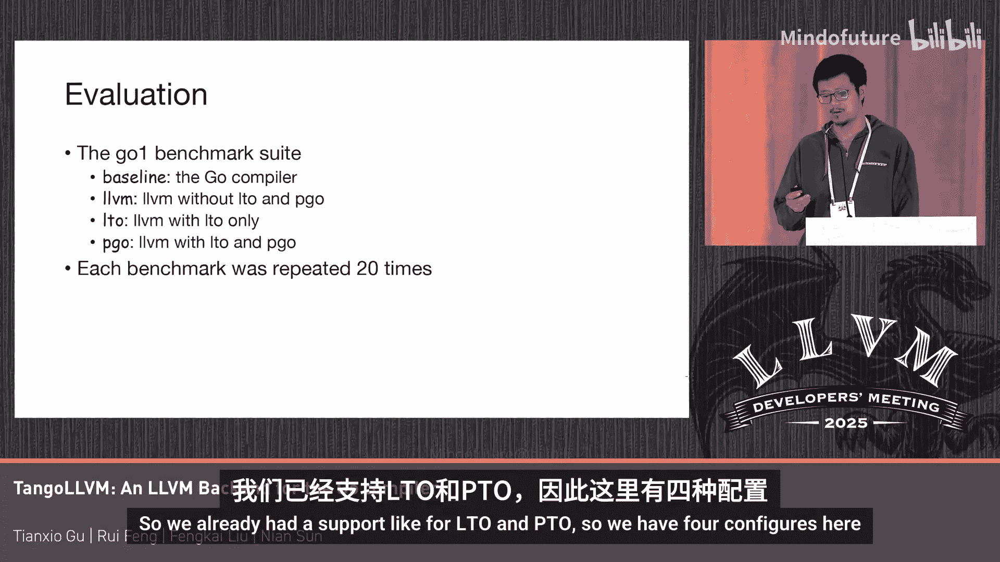

# LLVM开发者大会-US-｜-2025-Llvm-Developers-Meeting-p32-P31_TangoLLVM_Go编译器的LLVM后端--BV1ejr5BAEja_p32-

Hello， everyone。 I'm Tija Gu from Bys。 today， I， I'm going to give a talk about the tango area。

 So about physical compiler we built from the area yeah。

So I will first explain the motivation behind why we needed to optimize goal and by tense。

Then I will give you some introduction to the standard Go compiler as a background。So I oh， sorry。

 So I will explain my I approach a first。I give， I will first give a high overview of approach。

 So how to use as a backend。 Then I will dive into the details。

Of the most challenging task of our approach。 So that is to support the gold garbage collection in area。

 So at last， I give a information results。So why we need to do why we need to air in forgola。

 So Gola was designed as a proven language to be easy to learn。

 and the compiler compares very fast and it can produce some small battery。

 But in my understanding the performance is not the first priority in the go community。😊。

But at by times， it is。So Aliba dance the Go is the most widely used program language for the B services。

So to consume a huge number of CPU core daily。 So to reduce the cost。

 we have many teams I might then try to improve the performance of GoL。From different aspects。

 we have a team working on the IP PCC framework。 We have team working on the G library。

 and we also have team working on the runtime memory management。 So as a competitive。

 we first went to add some optimizations to the go compiler， so。So we。

 we actually try to migrate some loop optimization from area to go compiler。

 But due due to its complexity。 So we give up。So then when。

 we start to look some like error based implementations and try to implement the go in error。

So the first thing we we checked with is tiny goal。 Ta was was designed for the embedded environment。

 and it is not designed for the suicide applications。 So it has a longstand runtime and SD D K。

 So which means most， I think almost all the back service cannot be built with the tiny goal。

 So we also check with the go project。 So it has the same problem as tiny go。

Then we we start to try to build something by ourselves。 So here is the standard go tool chain。

 So typically， a go program is composed of not only the ghost source code。

 but it also has some like assembly in the go specific plan9 syntax。

 So this kind of assembly can only be assembled by the go asr。

And the Cors code has also been widely used in the go programs。

 So this C source code can be accessed via the foreign function interface。And。

 and in addition to this kind of code， a go program has also to be compared or linked with the go wrong time。

And go run time。 So the go run time depends on some like module data to to support its operations。

 So this kind of module data is kind of met data generated by the compiler。

 but it is used at the run time。 So this kind of met data is used to support like stack working stack generation garbage collection and reflection API。

 So let's take a look back。At the the the standard tool chain。

 So if you plan to implement the goal in area M， you probably have to implement all this kind of like thing like the goal A B I。

 the goal specific object format， the Google P G。 And also you have to to to make some changes to the linker to link the model data。

So as a small team， I， I think we we cannot afford such an expensive solution。 So we we。

 we try something different。 So here's the overview of our approach。

 We use the areaM simply as a backend。 So let's first go through the workflow of approach。

 So we start to build the compile source code by first run the go compiler to generate the go object file object file。

So then we started to translate the go programs to L at the generic S A level。

 So in this by this way， we can re some optimizations in the go compiler， for example。

 is given analysis。We we run the error back into to optimize the function。

 generate code and receive the result in EF。 We then extract the symbol data the data of the symbol and re of the symbol from the EF。

 And we patch them back to the good object G。 So in this way。

 we can avoid supporting the complicated object file format in area。And we。

 this is still a project at early stage。 So we may fail to build some function using L M。

 So in this way， we can fall back to the go compiler if we we cannot patch the code。So so it。

 I think the， so the garbage collect is the major reason that we cannot build a a function。

 So the go on time can allocate objects both at stack and he。

 So which means the garbage collect have to scan both the stack and he to find live objects。

And the goal is a little different。 So it does not move and copy hip objects。

 but it can copy stack objects， which means we have to identify all the pointers on stack。

So the garbage collection happens at a so called state point。

 A state point could be viewed as a core instruction anded with a stack map。

 So the stack map describes the stack layout。 It can tells it helps a garbage player to find all the pointers。

😊，And one fact about the Go API is that in the go API says no call save the registers which means all the values in registers are spareed to the stack at the state point。

 and we don't need to build a register map for， for for the goal the to support the go G collection。

And so this is how we implement the garbage collection supporting areaM。

 we simply based on the existing G data point instruction in areaM。 So basically。

 we identify pointers at I。 because， we have rich type informations。 and we keep those。

 we keep this information during the code generation and。 So we finally emit stack map inM。

 So the most challenging part is that most existing optimization passes in a lot aware of G C。

 for example， the loop loop environment motion we move D。 mean we very out of the loop。

But the point is not ready to be referenced at that time。 So it may cause the G C to panic。

So we try to identify all the CGC pointers at LN IR。And here。

 we basically treat all the R value with the point type as a tip point。

So a G point is used by the garbage collector to locate the containing object。

 so then they can scan all the points in this object。

 So a value point is a point within the within a live object。

 But the end of the lifeer is not a valid point because because if， for example， here， if。

 if the end of O2 is valid。It is actually the beginning of 0，3。 and we mark 0 3 instead of 02。

Oh to you。So how to identify invalid G pointers。 So we found that only GP can need to invalid C pointers。

 So here it may have an invalid GP may have an invalid base pointer。 For example， a long pointer。

 and invalid GP may also have offset。 So it could be out of bound pointer。

 So to identify those pointers。 We use static analysis。

 We first conducted static to try to identify all the pointers and it may。

 So if any G has maybe non base pointer。 We market as point。

 We also tried to propagate the size of the value of each pointer。So， so we found that invalid。

 so the， the staticness is very conservative。 You may report many， many invalid G pointers。

 but fortunately， we found that invalid G pointer is still safe if it does not recorded any step map。

 So if we found some like invalid G pointer。😊，We may move it right before its usage。 So in this case。

 we can avoid to erect this kind of embedded pointers in the stack map。So however， this can。

 this approach may notify the effect of some optimization like R。

So un points is a another challenge to， to support the average collection in area M。

 So go can convert the point to integer and and commit back。 Yeah。

 so we have to track the use defined chain in those values。 So during the in the chain。

 that may some like integer arithmetic operations。And to some kind of this obvious may be may not may not produce a valid pointer。

 For example， the addition of two pointer is are not a valid pointer。

So we mark those kind of value as ear formed pointers。

 So once we found these kind of ear form pointers are directly in a step map。

 we finally give up the compilation and the fallback to the compiler because we want we don't。

 because this this case are rare in practice， and we don't want to introduce some complexity job approach。

😊，Yeah， here is the evaluation。 we use the go one benchmark test as a subject。

 So we already had support like for LT and P。 So we have four configurations here was repeated 20 times So at first we were struck by the out data in the result because there is 100% performance improvement。

 So typically this may be a bug。 but we carefully check the output of the compiler。

 we found that do a lot of like loop optimizationization。

 turns lasting loop in a plain loop and use some vectorized instructions to the computation。

 So I think this result is sound。 Yeah， after remove out。

 we still get like around like 28% performance improvement。

 and a lot interesting funding result is that is too powerful。

 It it it may do some it may generate less efficient code。

If， if need has not be guided properly。 for example， in the time format benchmark， we found that。

L LM use the the L C， the loop environment code motion has moved too many values out of the loop。

 But in that bookload， only a few of the values has been really used have been actually used。嗯。

That's why we have to e like PO in in in the area approach。Thank you。

