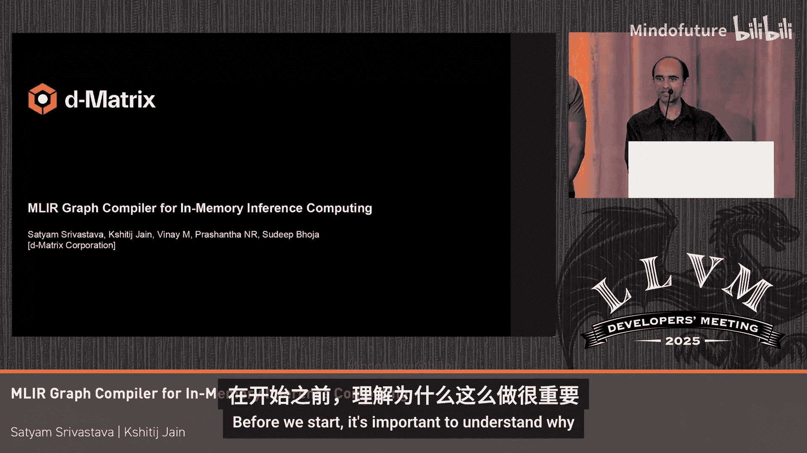
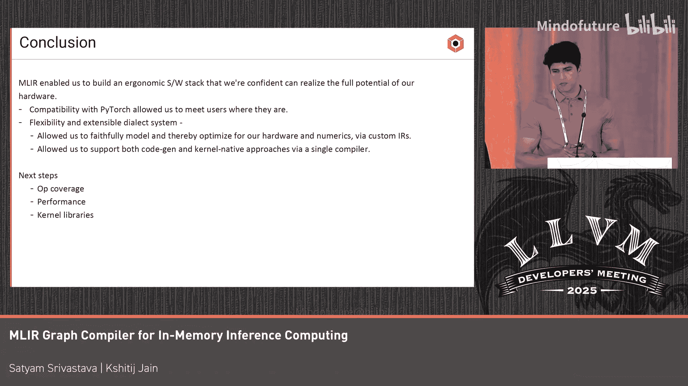

# LLVM开发者大会-US-｜-2025-Llvm-Developers-Meeting-p34-P33_基于MLIR的内存推理计算图编译器--BV1ejr5BAEja_p34-

Hello， everyone。 My name is Sahiium， and along with my colleague Shaitch。

 we are going to share some of our experience building graph compiler for the D matrixtrix AI accelerator。

😊，Before we start， it's important to understand why， why do this， Why even build an accelerator。

And some of you may have heard the term memory wall or the AI barrier or compute starvation。

 They are all the same thing and essentially mean that the traditional architectures with their fastest HBM memory cannot satisfy the demands of modern day AI computing。

So we set out to build something which is fundamentally different and which can give us 10 times 20 times faster memory performance needed for these。

😊，That takes us to the Corst accelerator。So Corst architecture is built using data flow and modular building blocks。

 which can be composed into larger systems。We use in memory computing technology for fast。

 as well as energy efficient matrix multiplications and augment that using copious amounts of fast and distributed asstrs on chip。

That are used for storing the tensor parameters。One thing to note for later in the talk is that each chipt is divided into four quadrants or quads。

 and each quad is a software targetable， independent unit of programming。

Another couple of things to keep in mind。 One is that we have pretty sophisticated memory hierarchy。

 including multiple tiers。But it is not based on caches。

 All of our memory is transparently visible to software and the onus is on the programmer and the compiler to carefully orchestrate both the placement。

 as well as the movement of data on these memories。😊，The second thing is。

Very likely when we have a model of a substantial capacity。

 it's going to require us to distribute that over multiple devices and in doing so in an adequate parallelism strategy。

Now， the question is， how do we even start thinking about program representation for this weird in memory computing architecture with。

Fancy memory hierarchy in a way that also scales to multiple devices。Thankfully。

 we have abstracted all of that complexity pretty much into a compact instruction set。😊。

So the Corsair ISA comprises of a handful of instructions comprising data movement， load store。

 vector and matrix computation， program control as well as data reshaping and on the right hand side you have a tall example of what a simple MacL is going to look like using this instructions and we will talk what about that in the later parts。

With that backdrop， when we start building out the graph compiler as part of the larger software stack。

 we will end up with a handful of challenges， obviously to this community。

 it's not a new thing that building a compiler is hard。Some of these challenges are unique to us。

 some of them are universally applicable， and in general， they fall into these three categories。

How easy or difficult it is to capture a large variety of algorithms through the compiler。

 And in case of machine learning， that would translate to。

What kind of ML architectures can be compiled。The second is。

 what kind of control and power do we provide to the developers or the kernel authors to be able to express their optimization hints as well as any programmatic constructs and its faithfully represented downstream？

And the third is using all of that， not only the compiler techniques， but the programmer intense。

 how well can we harness the true benefits of the architecture and get the performance that it promises。

So our approach to solving some of these challenges as well as more is to take a hybrid route。

And by hybrid， it means we have a compiler stack。 We'll talk about that。😊，Which is based on MLIR。

 and that is complemented by a rich library of high performance， as well as user optimized kernels。😊。

These kernels can come into an external dialect like triitton， which we can support functionally。

 but there are structural differences between what Triton expects and the kind of abstractions our DSLs need。

 so we have other approaches to writing kernels at a slightly better abstraction down below and in each of these cases the kernels get translated into an IR or a dialect of MLIR that gets ingested into the compiler for subsequent processing and optimization。

Now， to take a look at what happens inside of those core pieces of the compiler。

 I'll hand it over to my colleague。Thank키 Saam。So I'm going to start with a broad strokes view of our hybrid compilation pipeline。

 And then I'm going to dive deeper into some of the interesting components across our front end。

 middle end and backend。 So we start with pytorch models that we lowered via torch Himmalar into our compiler front end。

 In the front end， we perform SMD based partitioning， padding， tiling。

 quantization into our numerics and constant folding。

 The output of this phase is a bunch of a fine loops that are operating over tensors。😊。

Then comes the middle end in the middle end this is where Triton integrates into our compiler as a bunch of a fine loops In the middle end we perform producer consumer style fusion bufferization as well as vectorization。

 where we lower ops operating on tiles of data into ops operating over 64 by 64 virtual vector registers。

 output of this loop is a bunch of parallel loop nests。

 communicating with each other via the DDR memory Then comes the compiler backend。

 this is where our custom DL lowered into DLIR integrates into the compiler In the backend we perform Sre and register allocation。

 instruction selection， instruction scheduling， kernel stitching and lowering to a thread model。

Output of this phase is the DMX IO， the assembly for our hardware。

So I mentioned one of the transformations that we do is SPMD partitioning。

 let me dive deeper a little bit into that， we perform SPMD partitioning in stable EO as a result of which we get quad level symmetric compute graphs。

 the rest of the compilation pipeline thereafter operates on these quad level symmetric compute graphs。

SPMD partitioning isn't the only way for mapping a compute graph over a compute mesh for us however it makes quite a lot of sense。

 one of the most important models for us to support is attention based models and SPMD partitioning allows us to naturally tie the independence and the symmetry present across the different attention heads of a multi-headed attention model to quads which are the autonomous units of execution in our hardware。

Let's now walk over concrete examples to understand what a 512 by 512 MacM looks like as it's progressively lowered through our compiler stack。

 this will help illustraterate the rich abstractions afforded by MLIR that enable us to faithfully model our hardware and thereby optimize forward。

So super early in the pipeline， we have the high level L Ja brick up corresponding to a single Macmo。

This single Macmal op is then broken into 64 Macmals， each 64 by 512 by 64 in size。

 we choose to tile by those dimensions because that's the biggest MacL our Mac engine can handle at once。

Another thing to note here is that we've also lureed from FP32 numerics to Cosair BFP numerics。

So I mentioned that our engine can handle a 64 by 512 by 64 Mac at once。

 but in the hardware this actually happens as eight different 64 by 64 mNs。

 and there's 16 different vector registers involved， eight for activations and eight for weights。

 so in this slide you can see that we take a progressive lowering step towards this kind of representation。

We then finally vectorize the MacMo and make the 16 different vector registers that are involved in the computation explicit in the IR。

 Also explicit in the IR is the partial product reduction that happens across these eight different mamals that ties them together as part of a single MacM。

Finally， we lower to a thread- based model as part of which we convert each a fine parallel loop nest into a GPU called running on up to eight cores inside a gang。

 we model each of the cores as threads， one thing to note here is that although we're modeling cores as threads our hardware doesn't actually require us to do so and our cores can actually run divergent workloads。

Throughout the lowering， we use a number of fine dialect based optimizations that are being mentioned here。

 I'm going to avoid talking about them in detail in the interest of time。

Regardless of whichever path code takes through our compiler， whether it's Pytorch。

 Triton or custom DSL， they all converge to DLIR， our custom dialect that has feature parity with our hardware Ia。

DLI models are hardwares ordered Q execution primitives。

And a DLIR graph represents a fully scheduled workload on our hardware。

DLIR is our egress out of MLIR， and it lowers to our hardware eyes up pretty mechanically。

So to wrap things up， MLI has enabled us to address some key challenges of delivering a ML compiler tool chain。

 it's allowed us to meet our customers where they are today。

 and it's flexible and rich dialect system has allowed us to faithfully model our hardware and thereby optimize for it it's also allowed us to build a single compiler that can support both cogen and kernel based approaches natively。

 as for our next steps， we will be focusing on increasing our op coverage。

Improving our performance and building up a kernel libraries。With that， thank you。

 And have a great rest of your evening。