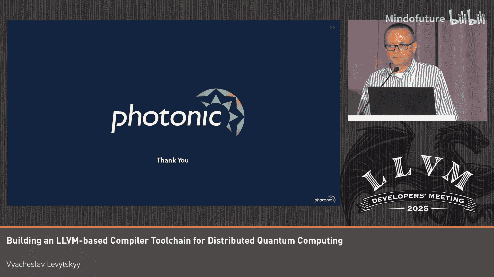

# LLVM开发者大会-US-｜-2025-Llvm-Developers-Meeting-p35-P34_为分布式量子计算构建编译器工具链--BV1ejr5BAEja_p35-

Hello and welcome to the technical talk about compilers for distributed quantum computing。

Quantum advantage is not yet here， but engineering challenges set only up。

 So I'll try to intri you with the future we see and show how we support our users。

Quantum software engineers and scientists， employing LEM and ML L AR。

It's a wide overview from how quantum dictates requirements to how photoonics compilers stack addresses technical challenges。

From timing constraints to languages and IR support。

An engineering intake is that a quantum computer is a heterogeneous distributed system with wired edge devices。

Exploiting superposition and entanglement to process information using qubits， A K quantum bits。

 the promise is much， much faster solutions for certain problems than classical computers and implementation of edge devices differ dramatically。

 with architectures ranging from fixed topology to high connectivity。Or reconfigurable systems。

Using historical parallels to eliminate quantum technology raise the road to classical computing wasn't a straight line to silicon。

 It was a competition among diverse technologies that shape progress before silicon dominated。

 Likewise quantum success depends not only on better qubits but on architecture centric approach。

 networking and distribution， a useful quantum computer requires millions of physical qubits。

 So the way to build it is to scale out。Compilrs need to understand the target hardware。

 Here is a very brief view on how diverse quantum hardware approaches。

Widely available technology is superconducting qubits with fast gate times and hundreds of qubits demonstrated。

A related approach LED by Microsoft focuses on topological qubits that offer stronger error resistance。

Trepiid ions offer along coherence times and all all connectivity gate speeds are slower though。

Natural atoms work at room temperature and support flexible connectivity by shuttling atoms into new configurations。

Silicon spin qubits， promising cost effective manufacturing。

Photn based qubits use quantum properties of light， providing high connectivity and easy scalability。

So as you see， available edge devices are not just where they are very different。

Control and measurement hardware is mod specific， and that shapes compiler requirements individually within the concrete technology。

 What's common across all platforms， precise control is essential。

 and low level operations are effectively hardly all time。

The diversity of technologies restricts reuse existing solutions。

 and the further we move from quantum circuit mass。

 the harder it becomes to satisfy specific modity requirements。

Were in a quantum era with limited qubits and higher error rates。

 While the quantum advantage error well see how a large scale faultle systems outperform classical computation。

But stop to think about numbers。 Comcial applications will need thousands of connected logical that is virtual qubits and orders of magnitude more physical qubits。

 Each modality struggles with its own scaling and stability challenges and scaling up alone is unlikely to solve this issue。

 with favor distributed modular design and horizontally scalable systems as a foundational element。

So for our L OV M based compiler， this means a focus on distributed computing and limited ability to reduceuse existing solutions。

There are well known open source projects in the field。

 a quantum compiler lowers circuits to hard diagnosticgnotic IR to pulse severe DSL and to vendor specific instructions。

 no matter how hard we I to the couple languages IRs and targets along the path。

 these abstractstructions and ontreeval and in line with the law of leaking abstractstructions is difficult to separate quantum modalities from technical solutions。

 including ML IR dialect。Modeling of quantum circuits must do not help to address details of scaling beyond the web。

And low level operations， like pulse detectors differ between modelities complicating obstruction。

There are distributed multi deviceice workflows expressed in the Malayar red modelity and had very specific constraints again。

 limituse。Her diameter， a compiler must respect time limits beyond which information degrades。

 meaning constraints on computation and communication。

 and most modelities also face connectivity challenges。

Our spin photon hybridbrid architecture at photonic addresses this by combining silicon spinqubits for memory with silicon photons for high connectivity。

 enabling arbitrary non local connections for compiler gates multistep probabilistic processes。

 network aware under resource intensive， requiring native control flow in lower level languages。

Practical constraints remain modly specific。 operationserations are limited by adherence time。

 making hard time processing and low la essential。We need closed loop control。

 incub controllers to meet la C demands and efficient interaction between controllers and the runtime to support non lookinging mid circuit measurements。

To pillar coefficient efficiency in ourmodity are reusable models and efficient hardware software co designign to meet nanoscale synchronized controller requirements。

Meaningful quantum requires networking individual models together so as techniques a compiler for distributed embedded systems。

 The photoonics control system is a network of qubit controllers。

 and compiler must translate a global control model into pair device binaries with timing and communication guarantees。

All tall connectivity is a big win of this architecture and a huge technical challenge at the same time due to the scale and complexity。

The compiler supports a complicated programming model for heterogeneous computing with distributed host controller inter interactions to provide the runtime with context for scheduling。

 shared resources like physical qubits themselves。This complexity is good news for compiler engineers。

 given the role of languages and IRs in in quoting， expressing and exposing this programming model。

Creating a scalable quantum compilers stack is challenging enough on its own。

So leveraging a major classical compiler framework like Lium is a major advantage。

 Its infrastructure and optimization and capabilities provide a strong base for building the two chain。

 However， we need to coordinate classical compilation with quantum resources and optimize for quantum specific metrics likes depths and gates count。

 As a result， the gap between high level programming and physical hardware control is large。

The in classical systems。At photonic ML supports quantum and modity specific semantics and enables virtual I S A。

 Our qubit controllers use risk 5 with added real time semantics。

 But pulse level control remains a to upstream ML dialects。

 existing dialects don't cap capture our control parameters。

So L VM and ML AR indeed provide many building blocks。

 but key pieces for building the quantum softwaret are missing in upstream。

Starting to build the quantum Capeller ground up， our initial focus is on low level control experiments。

 benchmarking and collaborationlib。Balancing local execution efficiency with a bigger picture of modular components schedulecheding and interaction control and doubt required on a second precision。

 So decisions are to be made at compile time。 But at the same time。

 control flow limits static scheduling making real time feedback loops a key challenge of hardware co design。

Quantum A compiler passes， essential photos such as qubit mapping and error mitigation are not natively supported in LVM and must be implemented as custom transformations。

This part of the stack is quantum compiler that interacts closely with the classical compiler to meet timing requirements dictated byqubit coherence。

Herdware control is only half the story though。 The compiler pipeline spans high level circuit optimization to a global control model。

 The quantum compiler bridges high level programming and physical hardwareware control。

 handling aor correction and adaptive execution。The constraints of the target hardware are central to both types of compilation。

Classical compilers consider a CPU's instruction set and architecture。

 while quantum compilers must account for the physical properties of qubits， including connectivity。

 errorero rates and the limited set of native gates available on particular device。

Our focus is on building a compiler tool chain that transforms userable flows into efficient。

 low level binary code， deployable in a distributed environment down to physical operations。

Quantum systems are deeply layered from high level languages and IRstrological gates and a correction to physical qubits。

 synchronization primitives and control electronics here。

 Lleium provides a strong foundation where MLAR offers a framework for integrating quantum and classical dialects with aor correction and not domestic protocols。

 matching the multi layered nature of。Quantum computing。

 This is crucial for low layers where precise schedules of pulses and communication are translated into controller level code and interaction with runtime environment。

This diagram shows how a multi layer compiler stack for distributed quantum computing。

Front end translates Q sharp and DSLs into ML dialects designed for the spin phototon architecture。

 runtime integration and definition of assist topology support native nondeterministic quantum protocols。

The middle end adapts to changes in system configuration and physical gate definitions at the low level。

 the languages of pulses form the building blocks for quantum circuits and provides a virtual IA from the perspective of high level comp。

A single IR is inefficient here， the multilevel stack bridges logical circuits。

 pulse control and distributed hardware using portable IRs to stabilize and abstract between layers。

 The layers are integrated but distinct with different scopes， goals。

 users input languages and constraints。In addition to end user creating quantum circuits。

 for example， in Q sharpp， there are two kinds of internal users。

 One is a quantum software engineer creating a row correction profile that turns a logical circuit into a concrete full tolerant。

 executable schedule。And another user employs low level languages for characterization， benchmarking。

 and eventually developing a better quantum hardware。

We need a unified representation of the programming model to serve as an anchor sation points between quantum compilation and fully hardware lowering。

 What's interesting in quantum computing。 the multilayer compiler stack offers multiple points for multiple portable intermediate representations。

Highlighted by red arrows in the diagram。Where QIR is an industrywide effort maintained by the QR Alliance。

The virtual IA encode the execution model of a network of qubit controllers expressing synchronization and communication primitives within the layer stack。

 the logical virtual IA is still abstract， it sit between52 layers not hardly executable。

 feeling more like an API for the compiler backend and the physical virtual IA abstracts hardware implementation details enabling portability between versions of quantum control system。

This approach supports forward compatibility， faster generationerations and independent innovation across layers。

K technical challenges include integration of non LVM languages like Pon the cells into O LVM ML AR based by plane。

 We support Q sharpp as a front end and naturally have quantum IR Q IR in the chain of O A。

 Q sharpp exists outside the LVM ecosystem， but Q IR extends LVM IR， and encodes quantum concepts。

 However， translating film from Q IR to MLl AR is nontri。

So improvements such as support for a pack pointers are underway in the Q R Alliance Re。

However virtual I SA ensures portability and stability。

 While pulse level language handles disory real time coordination discussed in the next slide。

It is important to distinguish between simulating quantum computations and physically manipulating qubits。

 Sims are needed， but precise qubit operations are what ultimately matter。

 So we prioritize pulse languages and the Is， pulse level use cases acclibration。

 control sequence design， fidelity benchmarking and experiments， to her improvements。

 It texts like logical virtual IA， a building block for quantum circuits。In the spin modality。

 in the spin photon modality， native control flow within the pulse language is critical as the execution model is probabilistic。

 network aware and requires alignment between control and measurement devices。

 ensuring correct timings， synchronization and communication is paramount for accurate quantum control。

Ourway compiler implements full quantum execution from logical circuits to Hd web using MLAR to encode user level virtual I I SA and controller operations。

The programming model ensures globally coordinated qubit manipulations。

 key constraints include exact pulse timing， resource conflicts and mid circuit feedback latency。

 hardware optimization and nanosecond timings are crucial and inconsistent delays in branches could break qubit alignment。

 So we use static scheduling and deterministic branching to maintain aligned coherent execution。

Synchronization and communication primitives enable conflict free resource allocation and consistently aligned operations in a distributed environment。

 but the latency and schedule challenges are stricter than in classical systems。

The compiler is implemented in C+ plus on layer and also delivered as a Python package。

 Python bindings exposed a full API for translation optimization analysis。

 Pyon integration is delivered。 Use manage experiments， data integration in Python。

 So hardwarevari and system and4 like device topology。

 collaborationration fees directly into the compiler。

 This allows users and developers to plug into the compiler at the right abstraction level。

 combining performance with easeu use。Returning to IRS as a key component of the compiler。

 we support Gi sharpp as one of front tens using Q IR to represent gates， measurements。

  cubit teleation and result handling。Integrating KR with ML IR is not real。

 ML IR at structured control flow and first class semantics， While KR remains L L V M IR。

 requiring careful mapping。Microsoft stack is not LEDium based。 So integration options are limited。

 either it lift LM IR to ML AR or intercept internal IR before lowering nondocumented implementation details are challenging。

 So now we lift Q IR to ML AR compiled down to the physical gates and lower to risk5 for execution and hardware。

A more attractive approach， as though， is to use ML AR as a stable intermediate layer between Q sharp and Q AR to provide rich flexible semantics。

Moio illustrates how aligning a programming language with Malayia concepts can benefit developers and the industry。

 Khar could follow a similar path to achieve wider adoption。

Lifting Q IR to structured control flow before fitting into a MRI pipeline is not the only problem of matching Q sharp and Q IR with modern allium based compile chain。

QR models quantum entities using pointer types and memory semantics。

 and we miss SSA value semantics that aligns naturally with quantum。

 ensuring a is assigned once and transformed explicitly。

QAR's neutrality has a cost is difficult to express the main specific features and to pass metadata to compiler to guide lower。

 We are not the first who think that M IR provides the ideal framework for the next phase of QR's development。

 and ML AR is uniquely positioned to advance the adoption of Q IR。

Standardizing architecture natural MLR dialects above QR could be a valuable stack for the whole industry。

 helping unify a fragmented otherwise quantum computing landscape。Going to platform specific terms。

 we aim to avoid hard coding passes for complex conditional algorithms。

And one of solutions is a standard library for quantum to customized transformations and error collection。

 This allows our users， quantum software engineers and physicists to specify lowering logic in a high level language is waiting back specific concerns from application logic。

Python DSL is a rope here because similar error code is status to write directly。

 users are comfortable with Python and DSL enforces the main specific constraints。

 When pulse sar dialects at a low level to express logic。

 the library empowers users to influence lowering， for example， by describing repeat until success。

 control flow in quantum error correction。To combine DSL's highle languages and low level hardware control。

 we must consider the compiler to chains execution model in adaptive quantum circuits。

 classical feedback guides later reparations， which raises the question of how to chain components interact and which layer drives the execution logic。

 Our approach is to use compile languages integrated with the distributed runtime for this heterogeneous environment。

 So similar to HC， DSSL is lowered into binaries for multiple Is along with metadata producing a host program and device specific kernels for qubit controllers。

Our goal is to separate back specific concerns from core application logic。

Providing quiet software engineers and experimental physicists with tools to explore novel transformation patterns。

 These abstractstructions must be lowered into M L IR。Though Pat Python's dynamic nature types。

 reflection and control flow conflicts with M IRs static SSA based design。

A viable approach is toistic Python to a statically anable subset。

 operate on Python SD and translate into MLAR treating external calls individually。

Similar precedents in the field exist， for example。

 catalysts decorator for hybrid quantum classical overflows and also libraries like P self for generating ML IR from restricted python。

This design is a compromise path en forcing a constraints subset of vital。

And then there is module as a very important source of inspiration for us from being a frontend for MLR to a compelling view on hybrid classical AI workflows as conceptually similar。

To classical quantum workflows and envisioning a future where classical AI and quantum systems interact。

And intersect in the unified for flows from mutual benefit。Until that bright future yet to come。

 we remember that while quantum systems are a bit weird。

 they nevertheless fall into the same broader category of heterogeneous computing。Finally。

 allivviium is a massive Q based staying current It requires effort。

 and we need to control the maintenance burden， but constability is permount for us。

Experiments with quantum hardware is the cutting edge of science。 So it's challenging by itself。

And it expects stability and predictability from software stack way lower to risk 5 for pulse level control。

 And this dependency is a part of constant considering what we should own or customize and what we use from upstream as E。

 And if so， what's the version。Oing parts of the lowering pipeline would give us fine grain control。

 which is essential fundamentalscale engineering challenges。

 but still the trade of is such that we work around and customize inside our E base and neither own nor customize back and target。

Touching C and version， we don't support multiple million versions to avoid complexity。

 QR support also has this price， but we really better work around than use LVM 14。

 So our version is LVM 21， and we try to align with upstream cas to simplify maintenance。

On this last last slide， I'd like to reflect a bit more broadly。In the 17th century。

 universal symbolic languages that could represent the world were conceived。For centuries。

 those ideas remain remained abstract， but now with large language models and generative AI。

 with is advanced implementation。Quantum computing sits in a similar place， immense promise。

 substantial uncertainty and huge technical difficulties。

Transistors in classical chips are essentially perfect。

Cubbits are in two or39s range for2  cubit gates。So that gap defines the scale of the engineering challenge ahead of us。

But the risk of missing the advent of utility scale quantum computing is simply too high to ignore。

 So if the debate has shifted。 It's no longer if we will have quantum computers， but when and how。

Luckily for us， the compiler sits at the heart of this transformation。Thank you。

Any questions。Yeah， I've got a small question。 So I recall this a M L I R dialect called circuit。

 Have you been aware of that that that's like maybe for a electrical computer circuit。 But yeah。

 I don't know the current status of it。 Is there any chance to like。

 reuse some of the in infrastructure there。So， yeah， there are a lot of。Version of M I。

 M IR dialg that we can see in open source， actually。

Probably are even more in close source implementation as our implementation， for example。

 our ability to reuse anything is limited by quantum modality specifics。

 So that's why exactly I made this very quick review of how diverse quantum modalities in the company in our company at photonic。

 We have this spin photon。Specs architecture with its old to activities， etc cetera。

 So we have our specific requirements。So the brief answer would be that it's hard to use anything in this field at the moment。

 this quantum race tries very different approaches。 So thank you。Yes， so my question is like。Well。

 the architecture for like quantum computing and classical computing is quite different。 you know。

 like you deal with superpositions， for quantum computing， you deal with superpositions， qubits。

 and then also error correcting codes， and then like for classical computers。

 you deal with like addresses and bits and whatnot And I was wondering like how like what are some of the optimizations that you do in for quantum computing And then like it seems like super different you know。

 And then I was wondering like how much of like classical computing like like optimizations can be applied to quantum computing。

😊，Thank you for the question。 So actually， one of the goals of my presentation is to is to show that quantum computing is not anything esoteic。

edge device is aware indeed。 It's cutting edge of what we know about physics。

And it's cutting edge of our engineering。 But other than that， you know。

 it's just usual engineering software engineering that you can expect。 It's very challenging。 Yes。

 it's very demanding in terms of that it is at the same time。

 distributed system and it's real time system。So it's challenging， yeah。

 but it's just usual classic software engineering。 It's， it's just usual classic software system。

 It reminds as a close analogy， it reminds current efforts in deep learning compilers in AI M L workflows。

 etc ceter。 So at the end of the day， it's the same heterogeneous system。

 But with very specific edge devices and with very specific requirements towards our runtime。

 for example。For compiler as well， for compiler in the meaning of expressing specific semantics in and ability to mix。

呃嗯。You know， user defines， user defines quantum circuit as a very small definition。 You know。

 it can be just several lines of code that express what quantum circuit does。

 but then goes a big addition from quantum software engineer with a quantum correction called policy。

 And it's the task of the compiler to join those ideas programming models。

 these semantics and produce valid binaries for this complicated heterogeneous system。So。About。

Descriptive languages。 I mean， in the very long run。

I'm talking like decades away that we have done with。

 we know that we got something working in computer in quantum computing， how do you see the actual？

Lguage that we describe the programming of those machines。Be any different。 Like for circuit design。

 I， I know that there are， there are。Projects that， for example。

 you take like one Newman like C program and convert it to some circuit。It is possible。But is that。

 is that the way that you envision it going for quantum computers also。

 or we're gonna need entirely different。Descriptive languages。For those kind of。Operations that。

Take place on a quantum computer。I think it's a very deep question。 It has several angles。

From mathematical point of view， current approach is to just describe this quantum circuit。呃， as这样。

Diagram， you probably have seen these diagrams for quantum cycles or its equivalent text representation。

From the perspective of us， compiler engineers， software engineers。

 our approach is opportunistic in a way。 So because we are in the middle of building this quantum computer。

 Nobody knows how。Well， not how but probably when this quantum advantage will be achieved。

 So we are what we are trying to do， we are trying to support our users。

 So answer any question our languages has a very concrete goal to support quantum software engineers and quantum physicists who are doing experiments who are measuring。

 collarating their hardware So we support them on their way towards improving edge devices to the level when they become useful and can solve some classical problems better than classical software is available to do now。

It's hard to envision what will be in 20 years because we are now at the stage when we are constructing。

 you know， given parallel with classical computing。

 we and the stage when we are constructing individual memory cells， individual bits。

 So we are constructing individual memory bits and just think about how different it from。

Creating programs for large， distributed or even for desktop systems。

Programming this top application， comparing with。Programming one bit。

 it it's very difficult to say what will， what we will see when this quantum advantage will come。

But we are pragmatic at the moment。 We， we， we have our goal right now to support our users。

So I don't know the space very well。 I looked at the Q IR alliance。 It seems not to be active。

 at least on the board。 I was wondering is it still， is it all done and settled。

 is it evolving and are there any alternatives。So the field is very dynamic。

 meaning that we have a lot of companies trying to get into this field。

You can see very big companies， like very well known efforts from ABM side。Absolutely great。

 in in the big ecosystem of hardware and software。 We see Google Microsoft efforts and many other companies at the same time。

Oh。So。What I'm trying to say is that there is a big diversity as well in standards as in quantum modities。

This Q IR thing is related to Microsoft efforts， specifically。 There is alliance related to Q IR。

 but it's just one of existing standards。 One existing approach how to do things。 For example。

 IBM software hardware tech differs from it doesn't intersect with Q IR。

 So answering your question directly。 Yes， there are as ways to encode this information。

 there are Is and our choice of what we support basically， again。

 is opportunistic it depends on our goals。 What we want to achieve in technological science and business sense。

To kind of extend on what he asked。Do you think that perhaps？The current paradigms for programming。

 you know， functional and imperative and logical and so on are。Sufficient for quantum computers。

 Or do you think there needs to be like a new paradigm。Again， a great question。

 So Im thinking about this constantly。 I don't have a good answer。 actually。

 The problem is that gap between what we have now and what we wanted to issue。

 So we absolutely not at the moment when quantum is able to。EDe promise。But the promise is huge。

 and indeed， we could imagine that we need another paradigm to support this。

Computs at the current stage， it's enough what we have。

 And the challenge lies not in new paradigms to support it。

 but in very concrete engineering challenges like how to survive at the same moment in heterogeneous distributed system。

 But provide some real time promises。 So that's what we are focused on。 But in general。

 it's very good question indeed。Just I I wanted to say something that I think。

 but I wanted to see if I'm thinking correctly the when I look at the models of quantum programs。

 they look more like circuits， not anything like volumeum and architecture so。In my understanding。

 it's closer to kind of like very log or VHDL kind of。

If you want to have a descriptive language for it， then。Some am I correct in that respect or。呃。

The thing is that you see just a very top of this iceberg。 So there is so much semantic。

 so much actions beneath the level of user facing features。In order to be useful。

 quantum circuits must be constantly measured and a error corrected。

 So this error correction logics is dynamical。 It needs control flow。 It needs conditions， as usual。

 it needs this classical workflow。 So when you see this circuit。 indeed， it's。

 it's just kind of declarative specification what what we should compute compute。

 but then we start to rope it into runtime logic and our classical workflow to make it actually useful to make textual work。

qubits leave， I don't know。 Let's say， for example。A couple of meseconds， for example。

Or from another perspective， after a very short time。

 you need to do something with this  cubebit that it remains valid from your perspective that it。

 it is able to hold its state。And it's not just schastic， absolutely random。

 but something that you expect it to hold for a long time。

 And in order to support these physical processes， our classical software is in a constant loop of doing something。

 measuring， correcting， applying some computation， again with when I'm talking about heterogeneous system。

 I didn't mention it， but a part of this heterogeneous system actually is GPU accelerator。

 X PU accelerators because this quantum correction algorithms。 again， they parallel。

 they need to be executed very quickly in real time。 So answering your question。 Yeah。

 it's very simple when you look at quantum circuit。

 there is a lot of different logic related to it to make it work actually。Yep， thank you。

 So the afternoon session will begin at 1，15。