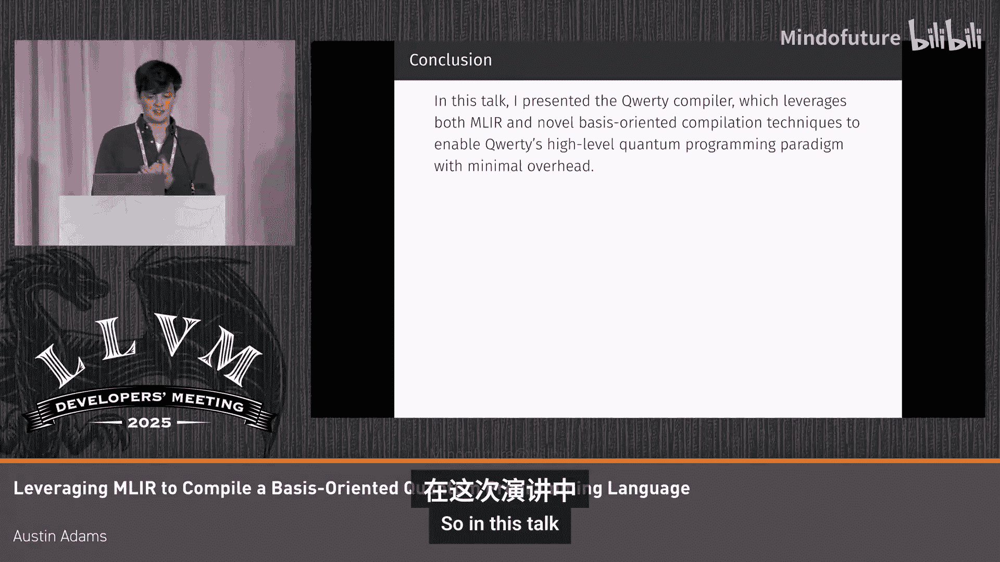

# LLVM开发者大会-US-｜-2025-Llvm-Developers-Meeting-p36-P35_利用MLIR编译面向基础的量子编程--BV1ejr5BAEja_p36-

Hi folks， I'm Austin， I'm a PhD student at Georgia Tech and I'm grateful for you all time and grateful to be here to talk about a compiler we developed for a quantum programming language that we made。

So I'm not really here to be a quantum computing， salesman or something like that， but I do hope。

 and I think other people also hope that someday we'll have quantum computers that are error tall enough and big enough that we could use them as accelerators for very specific tasks and give possibly。

Exponential speed up so however。Despite these lofty goals。

Current quantum program languages today are in my opinion。

 a pretty low level of abstraction because they're require you to think about circuits like this one。

 so I know about yall， but tweet that's pretty convoluted looking it's not really clear what it's supposed to be doing。

But it turns out， okay， that's a search algorithm， apparently。

 and I want to hone in on this particular part here that I've circled and show you how you write that piece of the circuit in mainstream popular Q programming languages today。

So as of the year 2000， you might。Write something like this in QCL。

 it's the first Quad programminging language that I know of。

 and then in a programming language with commercial backing and support today。

 you might write something like this。And in my opinion， it's pretty similar， okay？

And I'd say that because as a programmer when I'm writing this code。

 it's my responsibility to synthesize circuit circuits this is all me as a programmer。

 it's not something that's handled by the compiler。😡。

So I want to compare the same functionality that this is doing to。

Hide boot coordinate and you you just write this expression， that's it。

 And so we call this a basis translation in honor of the UniX TR command because it's really replacing that whatever on the left there with the thing on the right so it's replacing these four P states。

 these four plus states with the same thing but with it in minus1 in front。

So here's the overall code for the whole search algorithm。

 and I'm not going to walk through every line here。

 but I do want to point out a couple more interesting parts of it。First of all。

 it's common in quantum algorithms to want to run classical code on qubits。

 so in this search algorithm， for example I am。😡，That that classical code is a black box。

 Oracle but saying yes or or no for a given candidate input。 So in this case。

 this example oracle is saying， yes， if all the input bits are one。

 which is adding all the input bits together。 And it's really convenient to be able to write this kind of classical code as a classical code。

 instead of。Needing to figure out scratch your head and figure out how to write it as a column circuit look you would in typical mainstream languages。

 so it's nice that our compiler will synthesize this too at column circuit， this oracle up top。

Other thing to mention is that in typical mainstream quantum languages。

 it's your job to issueized states， you just get zero qubits and we have to figure out how to get them into the desired state。

 whereas here in our language query， you just write a qubit literal and the compiler figures out how to synthesize it for you。

Okay， nothing about the language though onto the compiler， first of all。

 why write the compiler role Well the reasoning is that there's all been all this effort on quantum compilation already。

But that work almost universally expects a quantum circuit as input， not query code。

 so it's our job as the query compiler authors to take query code as input and then produce circuits that you could pass quantum circuits that you could pass to existing circuit optimizes and then ultimately take that optimized circuit。

 hopefully pass it to a quantum backend where you could run it today crappy hardware or my grand subconlar on usable hardware。

I want to zoom in on the query compile part of this because what this talks about。😡。

And here's the software architecture for querydi compiler。

 So you'll note we start off here on the left with a Python EST and that's because this is not a language that we're just doing Python operator overloading or something。

 No， we actually parse the Python AsT and then we extract from that a queryty EST。

 which is in our implementation， a rust data structure， which then we do type checking on it。

 we do macro expansion， type inference， blah， blah， blah。

 but this is not the AST developer media LDevelop Read。

 So I'm going to focus on on these two demoR dialects here that we lower to。

 So the first one is this Q0。Eliar dialect， and this is anar dialect that we produced from the AST and this mirrors Cory semantics and I think it's pretty fair to argue this is the Emliar the quas of Emar dialect with the highest level abstraction。

 and I see that because our operations here in the dialect are defined in terms of bases instead of you writing a low level operation like a knot or have seen or a howmar or something like that。

So in general， this this corddi dialect has two kinds of obstinate。 The first。

 this has I just mentioned where it's if these aquao ops with。

With a basis basis attribute of some kind like this state change， this basis translation。

 state evolution， or a measurement in terms of some basis。

 the second category is functionally in opposite it kind of looks like the fun dialect a little bit in that you have like the constant call underdirect。

 they a call fuckk off， etc， but wait a minute， why not just use the fun dialect。Okay。

 because there's a twist。So in qua， as with honestly many other quantumroban languages。

 you can call functions in different ways， so for F here， for example， I could first of all。

 I could call it forward so that is I'm saying running it from top to bottom but I could also call it backward so I could call a version of that function that runs in reverse basically or even even a little more crazy is I could take the function。

 I could run it in some proper subspace of the overall state space and we call this being predicated it's a generalization。

 this idea of controls in typical quantumromean languages。

 we say predicate because this pattern here is like a predicate describing that the function should run on that middle qubit where the other score is。

There's even more trickiness to this because really when I'm writing F in all these examples。

 that's really a function value， not just a symbol name。

 And so it's possible to compose these crazy things and write something like this where I'm predicating a function。

 and then I'm taking the inverse of it and then running that。 which is pretty pretty spicy so。

How do we deal with this in the compiler， I want to show a brief example here。

 So let's suppose we're starting off of this code as an AST where it's say basically call the reverse version of this function F。

We would then lower that from the AST to the Cordi dialect and you get some IR like this。😡。

And the funk constant they calleddirect pretty much like the font dialect。 But the wild card here。

 the weird thing is this funk or revop， which is taking a function value as input and returning a yielding a function value。

 that's actually the reverse version。But this thing is like what the heck man。

 why are we doing call in direct on a constant almost it's a little strange。

 so then we run the catyizer and then we end up with just a direct call instruction。

And the thing is that this has this revers reversed attributes set the true to indicate that it's a reverse call。

So then we just run the MLIR inliner and oh wait a minute。

 how the heck do the inline function backwards， okay， so in the Cordi dialect？哦。

It's assumed this was the insane in the court link itself。

 it's assumed that every function that you can call backwards。Contains only one basic block。

 at least for now。 So then really this problem of inlining this reverse call reduces to how do you reverse a basic block。

And。So we do this by。Starting from the terminator to the basic block and then working backwards upward through the da from the terminator opera ends and then as seen on the right here。

 then rebuilding the reverse version from top down and the novelty about this in our case is that instead of hard coding this process for particular ops then different ops implement this reversible op interface and so each op just has a build build a method that so each op knows how to inverse version of itself basically。

So predication is similar in the sense that we have。

 if you want to inline a predicated call or call to a predicated version of the function， then。

We also work backwards up from the serminator up to the basic lock and then we're callinging we're using this predicable op inner face for each of these ops and so a lot of cases like this one here。

 we're just modifying the bases of all these base oriented ops here。

 so we're just propending these ones in this case to run the subspace where only the first three bits or qubits or ones。

Okay so if all has gone wrong， then the inliner has worked and so then our code is beginning withqubit allocation and ending with measurement and it's just a straight line of quantum operations in between。

 which is a good thing because a lot of quantum hardware does not even have a branch instruction may not even have a stack or a call structure despite query being a functional language。

 so anyway ideal getss this case where it's just straight line code pretty much。

Still in between cu allocation and measurement there。It's homoquity semantic。 It's not cis yet。

 So the next step here this copilulation process is then。

Doing a dialect conversion from this courtdi dialect to this quantum circuit dialect。

And this Ch circuit dialect be defined， it's not much to write home about， to be honest。

 it does a job。 here's an example of one of our ops in that dialect， if this is familiar to you。

 it's say a Z gate with two controls， for example。But。

We took inspiration from some prior work in designing this。

 the first is Mc Caki and Win here design the first play knowledge。

 first quantum and Maar dialect and so I looked at keep down a little bit and then these kindro and QSA papers are really nice because they propose this design for quantum IRs where the qubits flow through the different quantum operations just like SSA normally works。

 so the dependencies between thequbbit dependency between arts are explicit in the IR which is really nice if you want to you can replace this with one of these commercial dialects。

If you're really that expensive。Okay so now want to talk about how we go from our core basis translation primitive to a circuit。

 so the overall structure of one of these circuits we synthesize looks like this。

 so ultimately at the heart of one of our primitives here when we synthesize it into the circuit。

 the heart of it is this reversible permutation of classical phase strings and then just kind of layers of stuff on the outside of that。

 including this vector phase business， which basically it kind of like introducingcing or removing minus signs sort and then the standardized and desstandardize is like removing and reintroducing superposition on the outside there so。

I want to walk through how we synthesize the circuitry for this same a little bit of kind of quantum chunk of code that I was showing earlier in the talk for that search algorithm。

Here is this basis translation op here takes a twoqubit register as input and then its result is a twoqubit register。

 so we begin here the synthesis process by first unpacking that twoqubit register into two onequbbit values。

 then we take the state out of super position。😡，Then we impart this minus sign。

 which is this phase of pi。And then we go back at the secretion again， and that's the process。

 So this whole thing in even later terms， this whole thing I'm showing you the slide here is done in a dialect conversion pattern。

It's done without any biology context or anything like that， it's just people。

O at the beginning we packed of course week we packedbits backs， weid register this weekend。

Replace a space translation in place。Okay but that's not the only kind of circuit synthesis that we do。

 quantum circuit synthesis that we do because if you recall earlier in the talk I showed you could write some classical coding to synthesize a quantum circuit from it and I can tell you how that works too。

That classical function would be would start off as an AST。

 and then we would lower that to or we do lower that to a classical circuit dialect， the Cer dialect。

 and we do some optimizations， the classical digital logic optimizations on it because this is just like this is like a bitwise dialect。

 pretty much this is。 And then from that， then we synthesize a quantum circuit。 And。

That is that process is basically a implementation of this Tle done library from EPFO。

 which is a very nice tool， but it's not maintained， but it's still a very nice tool。Okay， so。

Now the question is though， okay， how good of a job is this？

Is this synthesis we're doing really compared to writing circuitrs by hand？

So what I got here is I've got four textbook quantum algorithms implemented incorty as well as three common circuit oriented languages。

 and then I run those with the respect to compile pilotrs for different numbers ofqubits so the X axis here is the number of qubits。

 and then I take all the resulting circuits and I feed them into a resource estimator that's guessing the performance。

I'm guessing excuse do the runtime of this on a perspective design for a future fault tolerance machine。

 so we're in the blue on the left there， lower is better。

 and you can see that we're competitive with the circuit oriented approaches for programming。

The takeaway is just that this compiler makes this abstraction competitive with handwriting quantum circuits for these kind of textbook algorithms。

So in this talk I presented some basis oriented tricks for compiling a basis oriented quantum language。

 and if you're interested in more details， then first QR code is a paper about the length itself。

 middle QR code is a paper about the compiler and the right QR code is a link to the source code。

 and I want to thank all these folks at the bottom here， especially Dr。 ShagiioCon who is here today。

でし。Fantastic thank you so much I' got a few minutes for questions。Start with M。I great time。

So when we're talking about the invertible functions。

What about operations that aren't themselves inver What do you do about those Okay。

 okay so what we do is is。It's not very exciting answer be ask what we do is in the up of AST level。

 we do type checking then we require I didn't mention this， but theres two function types in query。

 one is reversible and one's irreversible。 So if when you define a function。

 you mark it as reversible ir'reversible。And so if you mark something things reversible。

 then everything you put in there， like all your function calls have to be the reversible functions。

 you can't at least presently do classical branching or anything like that。

Maybe cool discipline like Jake Gilall ever heard of Janice。

 theyre reversible classical programming languages with ifF statements。Because that。心理。

Any other questions？谁关。Last call for questions。All right， fantastic。

 let's give Austin a round of applause。

