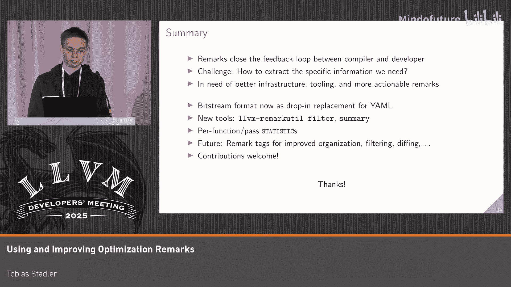

# LLVM开发者大会-US-｜-2025-Llvm-Developers-Meeting-p37-P36_使用和改进优化备注--BV1ejr5BAEja_p37-

So hi， everyone， I'm Tobias。 And today I will give an overview over the state of optimization marks and LD M and show some of the improvements we've been working on over the last couple of months。

I realize not everyone has used to even heard about optimization remarks before。

 So I want to start off with a small， motivating example。Optimization。

 especially complex one like vectorization， can have a huge impact on performance。

 depending on whether the optimization actually fires or not。 For example。

 you might write a simple loop that does a calculation of a value range of values like this。

And then performs a reduction over the result。There are now a lot of factors to determine whether the compiler can actually vectorize the loop or not。

 And the question we are asking here is， how can we find out if the compiler is actually able to vectorize the loop and if not。

 why does it fail。One option， of course， is to just look at the generated assembly output。

 but this can get quite tedious and is especially tricky for recization because you might even see some Sdy instructions inside the loop。

Even though the loop itself hasn't been fully vectorized。

 it might just be some S L P vectorization going on， for example。

So we need a better tool to do this job。And that's where optimization remarks come in using optimization remarks。

 The compiler can tell us directly whether certain optimizations fired or not。For example。

 if the reduction is computing a sum over floating point values。

 Remarks can tell us that we need to allow reordering of floating point operations for the loop to get vectorized。

Another example is， if， for example， the reduction function is defined in a different translation unit。

 this could prevent it from getting in line and。We also cannot vectorize call instructions。

 And this is what this remark tells us， in this case。Remarks have been around for quite a while。

 but we don't really used them much because they are still little cumbersome to use。First。

 most remarks are not as actionable as the first example I've shown。And second。

 you kind of need to know magic fls。 You need to pass the compiler to discover the information you're actually interested in。

 So if you don't only know what you're looking for。

You are somewhat forced to just generate all remarks。This is possible。

 And we have a nice tool called opt viewer， which allows you to inspect all those remarks。

 This is just a Python script that shows remarks inter leaf to scores code in the form of an H M L page。

😊，And the problem here is that even in the simple function。

 we are completely flooded with different remarks and。Most of them are not immediately useful for us。

So unfortunately， beyond small code snippets， it's currently quite difficult to gather actual performance insights using remarks。

In this talk， I therefore want to give some more background on these challenges and then show and show some of the improvements we've been working on。

Remarks were originally designed as some sort of third agnostic class to give feedback to the user from the optimizer and from the back end。

However。These diagnostics tend to behave more like telemetry than actual diagnostics。

 because unlike errors or warnings， if you see a remark in your code， you can't usually fix them。

 They are more designed to collect data of what the compiler is doing。

 So they are inherently very large volume compared to errors and warnings。

This is also reflected by the fact that we have multiple different types of remarks。

 So there are past remarks， which means that an optimization got applied。 There are mis remarks。

 which means an optimization opportunity was not taken， for example。

 because it would be incorrect or unsafe in certain cases。

And these missed remarks are usually the closest remarks we have to actionable diagnostics。

 similar to warnings。About performance issues。 And then the third class is analysis remarks。

 This is essentially everything else。 For example， the reasons a loop wasn't vectorized。

 certain heuristic decisions that are made and various statistics that the compiler wants to tell us。

Another part of the challenge is that remarks try to cater to two different use cases that kind of clash with each other。

On one hand， we want to present remarks as this teaching tool to bridge the gap between the user。

 what the user intended and what the optimizer can actually do with your code。And for this。

 we need very low noise and actionable remarks about the missed optimization opportunities in our code so the user can better understand which optimizations failed why。

 and based on this information， how they can guide the compiler towards better performance。

 for example， by communicating certain program invaris。

 providing certain assumptions or overriding heuristics that the compiler might employ using pragmas。

 for example。😊，On the other hand， most of our remarks were added by compiler engineers。

 for compiler engineers， most to debug optimization passes。

 And here we really want all the data we can get our hands on。We want us to tune tuneistics。

 understand regressions and estimate the impact of new optimizations。In particular。

 we want to be able to track remarks for real world projects in our Cs so we can analyze how the compiler changes across different revisions of the compiler so we can flag potential regressions。

😊，The main takeaway here is that we need to improve our tooling so we can actually show each user the piece of information they are interested in。

And to do that， I first want to take a closer look at how we actually get remarks out of the compiler。

Remarks are just key value pairs。 They have a name。 They contain the。

 the past name and the function name where they were emitmted and a bunch of arguments we can。

 for example， be strings。We have three different ways to output the remarks。

 First is through a diagnostic handler that passes them back to the front end。

 and then the front end can do whatever， for example， print them as diagnostics。

We can also stream remarks to Yaml files for later processing。 And there's a similar other format。

 which is a bitstream format， which also allows you to store the remarks in a file。

And this bit to form is more compact than the Yama representation。

So you usually get one remarks file per translation unit。 At least that's what Kang， for example。

 does。And。All the serialization infrastructure is part of L V M itself。

 but is set up through front and flags。 So below each of these formats， you can see how you can。

 enable them and clang。Optionally， you can also filter for remarks or filter remarks for specific passes using using regular expressions。

And the names that you have to pass here are the debug type macros you can find in the past or CPP file。

 And it's not the past， the name that you use from past manager。 So you have to be careful there。And。

Based on these different formats， we now have different tools to generate process and display remarks。

 I don't want to go into detail on every single one。

But I want to make people aware of like the tools that are already out there。

 so we don't end up reinventing the wheel a lot。So from a generation site。

 you can generate mark from Kang， M I R， Sw've， I think Ru as well and， and others。

M R and Swift are a little bit special because they can also output remarks for their own passes。

 not just enable the existing LL VM optimization remarks。😊。

And I would say the most much sure L VM remarks， you're mostly likely going to deal with other vectorization remarks。

 inlining remarks and unrolling remarks。Those have some very nice diagnostics in my experience so far。

And。Then for processing， serialization and parsing of remarks。

 this is all primarily based on the remarks。 C plus plus library。

 which is just part of the Mc core L L V M library。But this library also has some C bindings。

Then there are tools that are based on top of this library。

 The main one is called L L B M Remarkutil。 There this multiple sub subcoms for format conversion。

 aggregation and others。And then for Mac or binaries only， you can also use a tool called De u。

 When you combine the debug information for your program。

 you can also use that to combine the remarks from multiple translation unit into a single file。

 But as is， as I said， Mac only。Then theres opt of pi。

 which can be used to counter the most common remarks and optlift of pi。

 which you can use to compare remark files between two different versions。

And this just shows you which remarks were added and removed between those remarks files。

 The important thing is that those Python tools currently only work with Yaml remarks。

And the same thing is true for the up fewer dot Pi display tool， which I earlier。 But you can of。

 of course， also display the remarks shown by Klang or up fewer， as mentioned。

And there's also some other tools， for example， there's a tool called CI tool called L VM Op report。

 which is a more specialized version of Op Fu， which only shows inlining vectorization。

 unrolling mark and a more compact form and is written in C plus plus。

 So this one supports bitstream remarks as well。And then theres a compiler Explorer。

 which also has a。Tool to view optimization remarks in the on the website。

 which is based on the Yama remarks。So most of the tools have grown separately over the years。

 So there's a bit of fragmentation going on currently。

 And especially business remarks are not being widely supported。

 And this is kind of a pain point for just using all this infrastructure。So therefore。

 as a first step， we wanted to make the remarks a first class citizen or tooling。And we've。

 so invested some time overhauling the mysterystream remarkss。

The main reason for this is scalability because Yal files quickly become prohibitively large。

 So we are talking gigabytes of Yaml for a single code base or like hundreds of gigytes。

 if you dump multiple projects from a C I。 And the bits format is just 10 to 20 times smaller than the Yal format。

When we started out， the victory remarks had a lot of issues。嗯。

The primary one being that the they were only really supported on Mac O。

 reason being that the format required storing a string table in the object file itself。

This also meant that we weren't able to use the biting marks with tools like opt。

 which don't generate an object file directly。We definitely did a major overhaul of the bitstream remarkss infrastructure。

 So Bistream files are now completely standalone。There has no more dependency on the object file。

 and they essentially act as a drop in replacement for Yama now。So when you， also。

 when you're passing remark files， we now auto detect if the file is the yal or bitstream。

 So it's just a lot easier to use now。The bistream files also are now about 40% smaller。

 and we also can embed larger binary block or we can embed large binary blocks。

 It was wasn't possible before。Which you can， for example， use to store L O V M bit code in a remark。

 For example， to extract a reproducer from a certain path。To remove the dependency in the opt file。

 we sadly had to change the API of how you enable remarks， though。

 because we now need to more carefully manage the lifetime of the remarks file。

 So when setting up remarks， you now receive a special file handle that you just need to keep alive until you are dimating all remarks。

 You can find more details on the documentations for， for this function。😊。

Now that we can actually use bi remarks， we need some basic tooling。For example。

 the first thing we've added was a filter command to LM Remark uto。And as the name implies。

 it allows you to feature your remarks based on function， past， remark type and other things。

The filter flags are documented just in dash help。 and they also all have a version that accepts a regular expression for more complex filtering。

You can also use this tool to automatically convert between different file formats because you always try to detect the correct format based on either the magic numbers in the file or the file extensions you pass。

 for example， to dash O。AndYou can also use this tool to merge multiple mark files。

In a single remarks file， if， if you cannot use D YouTube， for example， because you're using E。嗯。

And there's also the exclude flag， which you can use to invert the filter。

 So you are not filtering for your marks。 You're excluding the remarks you're filtering for。

And you can also duplicate and sort remarks using this tool。

Then to help us deal with the information overload from all these different remarks。

 And we've introduced the tool to summarize remarks。This tool is more for generic harness。

 where you can easily add new aggregation strategies without lots of boiler platelate。

And so adding new strategies is simple as implementing the summary strategy interface。

 And you just need to implement three functions。 You get past the remarks。

 and you can easily filter and aggregate stuff。Currently， we only have one strategy implemented。

 which is called inline Collies and inlining remarks。Are emitted perqu site。

 so they quickly become very overwhelming。 And this strategy。

 strategy kind of overcomes that by summarizing inlining statistics per col。

The nice thing is here is having this essay post process tool。

 which allows us to summarize inlining statistics across translation Uni。

 which makes it easier to see like where definitions weren't available。

 for example and what were reasons in the entire program why things weren't in line。

This tool just outputs normal remarks so you can plugl them back into opt fewer after running it through the tool。

And you also get in about the cost of the least and most profitable call sites throughout just to ease debugging of inlining issues。

We've already used this particular feature to discover and pinpoint an inlining issue where standard bitet comp to some really slow code。

 And as I said， contributions to this are very much welcome。

 It is very easy to implement new strategies。 And I think there's a lot more opportunities to add new summary strategies。

And this is something that's， I think， very easy to get started with。

 So I would appreciate if people would up contribute upstream to this tool。🤧嗯。

You can also select a keep mode， which allows you to specify which input remarks to retain and the output。

 For example， if you use dash dash keep equals used with inline call。

 this keeps all the original inlining remarks that your summary remarks are based on。

So the best way to detect how compiler behavior changes between revisions is using L VM statistics。

 because statistics have a much broader coverage than remarks。However。

 if you spot a regression in the statistics， it is difficult to troubleshoot which functions are the actual c。

So。To get the best of both worlds， we can now extract per function per past statistics into remarks。

 This works by transparently replacing the sta macro that we currently use with a thread local implementation and some past instrumentation hackery to limit the remarks。

😊，I want to note that this particular feature hasn't landed yet。

 and we still need to develop the aation tools and comparison tooling to make this really powerful。

 But but the basic implementation is there on a branch。So you can see an example， for example。

 from SRA A， the statistics of。How many aocs were removed， for example。Furthermore。

 we're introducing a tagging system for remarks。This essentially allows you to assign multiple tags to each remark to group them based on certain properties。

For example， we can have tags to differentiate different mark is。Actionable for compiler users。

Or if it's more statistic， like for compiler engineers。

You can also group remarks that are related to like a category of optimizations。

 like inlining vectorization or loop optimizations。

And this whole system is designed to be extensible， unlike the remark types。

 So users of the remarked infrastructure like the Swifronend can introduce their own custom tags。嗯。

And this whole system kind of exists orthogonally to the remark types。

 There just like past missed and analysis。 There has been attempt。

 has been an attempt to introduce classes of remarks before using subtyping of these other types like analysis and missed and past。

Which looked like analysis， F P computer and analysis aliasing。

 But this requires a lot of boiler plates， and you end up essentially needing to add the Cartesian product of all the different tags you want as types。

 So we've decided to go with a more extensible tag like system。

So how's the implementation side of that， I've ever added support for storing tags in the remarks。

And。So what's next。Theres still some upstreaming to do。

 The current version of what I'm doing is living on this branch。

And some of the things that still are on this branch and haven't landed yet are the bitstream size improvements。

 the sta remarks and the tax realization and parsing parts。

But everything should land over the coming weeks。And once everything is in。

 we can then expose the tag to the optimization remark emitter API so we can start adding tags to all of our remarks。

Based on the text， we can then add warning like groups。 So they are the。

Remarks are just easier to enable and filter。 For example。

 we could have like a dash R vectorized tag， which just enables all vectorization remarks。

 So you don't have to dig through the suco to find out which debug type you need to pass to。

 to planang。So hopefully， the final payoff of all this work will be that we are able to implement a really nice di tool that is aware of the tags。

 So， for example， when something is tagged as a statistic。

 this di tool could subtract the values of the statistics。

 and this should give us a really nice one shot way to see what changes between compiler revisions。😊。

And another think it is nice to， would be nice to have a Python binding Philip remarks so we can get native support for bits remarks and up viewer。

😊，And I actually do have already have a working prototype of the bindings in this branch as well。

 So if you check out the branch and run up few of pits remarks， it should just work。And。All right。

So in summary， I want to say that remarks。Are an important feature to close the feedback loop between the compiler and the developer。

But we are running in some challenges。Especially like。

 how do we extract the specific information that a specific user needs。And。In my opinion。

 the best way to do this is to just continue working on the infrastructure and tooling and adding more actionable remarks。

 So over time， all this infrastructure will improve。

 And we have all these little bits of pieces in our sandbox where we can analyze。Oh。

Complied with Russianions， for example， with。So what have you done so far。

 The Bistream format is now a drop in replacement for Yamal。 We have a couple new tools。

 filter and summary。We。Can now dump statistics per function per pass， using remarks。

And going forward， I hope that the remark tax will help us improve the organization filtering and differenting infrastructure we have for remarks。

 And so that when I assign confusion here， contributions here are very welcome。

 And this is very large piece of infrastructure that hasn't been maintained in a long time。

 So if we could gather us some people to just continue improving our developer experience for our users and。

 of course， for us， also for ourselves， that would be awesome。 All right， Thank you everyone。😊。

We have five minutes for questions。Thank you for your great talks。

 I have a love hate relationship with the remarks， especially the the scalbilities。😊。

One thing it will be nice is the Python binding， actually， in the last pages。

 because a lot of time we want custom logics。 We want to process。 I mean， up viewers。

 the pie is nice。 But I think a lot of people here， we don't work on the machine with Gui。

 So moving the web page around will be a paint and neck。 So if we can use the Python binding。😊。

In our own script to read it and display the whatever format we have will be really nice。 Yes， yeah。

 that's， that's， of course， like， that's the way this implement。 It's just like a re p file。

 which is in up your folder。 If you check out a branch， you can start playing with it。

 But you just import， say import remarks。 And then you just load a file。

 and it will automatically take the file format。 And it will just work。 So this is。😊。

Even a bigger reason， as you say than just getting up your to work is to be able to provide your own Python scripts to aggregate stuff。

 because that is very tedious to do in C plus plus because you have to deal with strings。 So well。

 another solution will be allow you know， plug in infrastructures。

 Like we are plug in here and there Why not another one。 that will be a C plus solution。 But yeah。

 Python will be easier。 And the making the B string in the first classes and definitely helps because I don't want to deal with Lib yamo。

 I don't want to， yes。😊，Thank you。Hey， so I was wondering。

 do you think it would be possible to filter based on profiles。

 Because I imagine most people are most interested in remarks in the hot part of the code。 Yeah。

 so there is some integration with remarks。With the profile guideed optimization infrastructure so you can。

 There's a flag which also enable the hotness from the PGO data to be added to the remark。

 I haven't really played with this yet because I personally find that I will just be looking in a profile like Perf。

 And then I just open up the remarks for that specific function。😊。

But I think it would definitely be nice to have a direct tool。😊，For example。

 you can add like a have input a perf profile， input the remarks。

 and you just get remarks that are filtered by performance。

 So you don't have to go through the P TO infrastructure to do that。This。I works great。嗯。Thank you。

 This is very great because I ran like all of Android and all the optimization remarks。

 And personally I all talk like our。 So that would be great。 anyway， when I was watching a talk。

 I was wondering if you have ever considered like， you said feedback loop like。😊。

Kind of a pragma that says， like， this should not be a mis vectorizer or something like this。 Like。

 I write a loop and I'm like， I always want this vectorized。yeah， just like。

 I think hast pragma enable vectorized which kind of the like kind of your assert。

 you don't want to see a mis optimizationim in this blog。 I you had thought about this。Like。

 I write a loop。 I'm like， I don't want， I always want to superized。 I think it's super vectorized。

 there's a way you can get like a compiler error if stuffface to vectorized。

 I don't know about how to enable that。 But I think that is aysteria。😊，Right， one last question。Yeah。

 so in the beginning， you pointed out that discoverability is has been a kind of a problem with optimizationim remarks。

 And and I that was my experience as well， at least for the Sw compiler， like， I was just， yeah。

 enabling all remarks to see， Okay， is the， does this have what I need or is there something that I don't know that exists。

 So until these features land。 Like， what is the like， do you have a recommended say。

 maybe word flow strategy for discoverability。😊，So。It's not there yet。

 but really hope that having these tags will allow you to enable only the actionable and performance relevant remarks using a symbol。

 for example， D R actionable flag and Kang， which。We don't have yet。

 but it would be nice And to have and。Adding the tax will allow us to implement us very easily on existing infrastructure。

 And once that is in。I would probably say that that is like the most preferred way to actually enable the remarks。

If that answers your question。But currently， it's， it what I always do currently is I just dump the Yaml or Bistream marks。

I look in a profile out which functions are hot and then search for those functions。Alright。

 so I guess I have to make the most use of hop toer and all those scripts to help myself with that。

 Alright， alright， thank you， thanks。Let's thank the Sp area。

