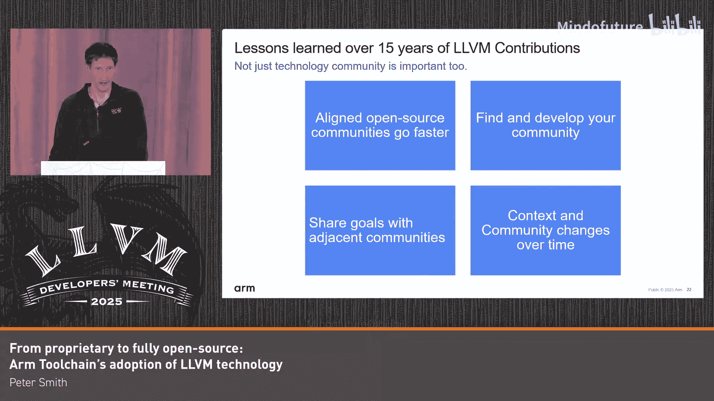

# LLVM开发者大会-US-｜-2025-Llvm-Developers-Meeting-p38-P37_从专有到完全开源_Arm工具链的采用--BV1ejr5BAEja_p38-

Hello everyone Good morning。 My name's Peter。 I've worked at ArMm for about 25 years now。

 When I first started， we were working with NAM's only compiler team and that was working on a fully proprietary tool chain 25 years later and now one of many compiler teams within arm many of whom using LLVN and we're now maintaining a fully open source tool chain。

 most of which provided by LLVM， hopefully all of which will be divided by LLVN in the future Now to start with I'd dislike to explain a little bit about Ars history So you can just so you know where our proprietary tool chain came from you know what it was aiming at because the business context that Ar has been has chained quite a lot in the sort of past 40 years it's it's been around。

 So without any further ado， I'll go on to the next slide。So set the way back machine to 1985。

 And there was a company that。You probably only have heard of if you were around about 50 and British called Acorn。

 I probably somebody like me。 anyway that。There's a computer called the Acorn Archimedes。

 This was released in 1987， and。This is sort of， I guess。

 a contemporary of the S T and E and probably early IBM PCs and。

Acorn needed a compiler for this computer and they went to a couple of Cambridge University academics。

 Arthur Norman and Alan Microft of which the contraction becomes Norcroft so you might see this scene online as the Norcroft compiler and this was a toolcha that was on the Archimedes that developed software for the Archimedes。

So moving the clock forward a bit。 and what was arm at the time was acorn Ri machine became advanced risk machine and arm is spun out of acorn so that it can be used in other devices than the Archimedes。

 And of course， that tool chain has to evolve too。 So just for a thing that for now。

 I'm going to call the old tool chain armCC。 It kind of had a brand name that changed multiple times over its lifetimes。

 but I'll stick to just armCC for now。 So arm got it sort of early success in in mobile phones and embedded So obviously。

 the tool chain has to be ported to Windows and。The various unixes of the day to be able to support that Now software development at that time was pretty much custom hardware。

 custom software， there wasn't really anything open source to write about the Norcroft compiler was kind of like an early contemporary of GCC back in the 80s so。

hadd to concentrate on what the demands of this market were， which were principally code size。

 if you could save a bit of money on flash multiplied by millions of devices。

 you could save quite a lot of money。 you'll also notice that there is a printed manual and C that these things came on。

 these were pretty much commercial products and tool chains at the time。

 So you were pretty much selling to companies rather than large user bases here。So as time went on。

 devices became more sophisticated。 C plus plus became more of a thing。

 An arm definitely didn't want to be in the C plus plus front 10 business。

 That's quite a difficult challenge。 And arm strength is very much in code generation at this particular point。

 So licensed in the E DG frontron end。 And if any of you had the fortune or misfortune to develop on Sian。

 We were the platform compiler for Sinian。 And that was pretty much all in sort of C plus plus at the time。

Okay， so this。Tall chain work quite well for this particular market。

 You noticed everything is pretty much fragmented。 So there wasn't really any cost of common embedded platform to to drive convergence。

 In fact， we only really had an A BI from 2004。 But going through to the the sort of late 200s。

 everything was starting to change。 So cost of producing。

Custom hardware and custom software is going up。 So what we saw at the high end。

 you were moving away from custom software towards an open platform。

 say something like Linux and with that platform you get a platform compiler like GCC and it's very difficult to get anyone to change from that compiler So you're stuck with a proprietary compiler that doesn't compile anything on Linux it's not particularly useful in that particular context it's still useful and embedded but there are also other things changing here as well RCC had a kind of weak midend but very strong codegeneration but with the sort of more sophisticated process that would come along that sort of codegeneration advantage was not being as relevant as performance and that's where the sort of midend higher midend optimizations of compilers like GCCs were getting strong。

なけ。So。We found ourselves at a point where we were behind sort of in cogeneration。

 the market was going towards open platforms。 Arms were also getting more powerful and starting to compete with other architectures in that area。

 and we felt we were a bit behind in cogeneration。 What we really wanted to do was not do it all ourselves。

 Arm has a much wider partnership of companies that were using it。

 A lot of them had compiler engineers， too， and it would be much better if we could work with them at the same time。

 Now， the Gnew community was one area where we could do that。

 but the GL was not a license that could work for all of the partners。

 So we had to have something else as well。And in about 2009 was the first mention of LLVM that I could find。

 and it was sort of them。Looked at as something that could solve a lot of the problems within RCC。

 So I'd just like to now move on to what did R C in L LVM in 2009。

 which was quite early days at this particular point。

So I'd like to break this down into technology and community， so on the technology side。

 LLVM had a modern C plus plus code base as opposed to a 25 plus year old C code based。

 much much easier to work with and could sort of certainly help solve some of the technical debt problems that we had。

It was also strong where R C， was weak in the mid end of optimizations。 And it also。

 although it was early days in 2009， it did have some arm support。

 So it was something that we could test out。On the community side， the license was favorable。

 So that meant that we could collaborate with with other partners on Co generation much more easily。

 And the modular design。Gave us the idea that， hey， could we plug in LO VM to our existing compiler。

 So I'll let you know in a few slides how that worked out， but。

It was certainly something that was attractive at the time on the on the weakness side。

 the technical bits were things that we thought， okay， these can get resolved。

 These are not critical。 The community side was perhaps where the biggest risk was。

 because what we really wanted was a self-sustaining armed community in L of VN。

 which it all that may sound obvious now with hindsight that this was always going to happen in 2009。

 This was something that might happen in the future。 So it was。

 it was certainly not given at the time。Luckily， it all worked out Anyway。

 next slide I'd like to look at。😊，The LVM design that we had。 This is not what art implemented。

 This is just kind of what the actual designs were。 And we thought with the modular nature of LVM。

 we thought， well， we're strong in cogen where we can the mid end。

 we have all our proprietary extensions at the front and customers that are using us So what if we just swap out the middle end。

 And then we sort of know go in at the top which with our customer source code， convert to LVmiR。

 and then at the end， convert back and then go from the Rcc cogen。

 that will give us the best of all worlds。 yeah， although then you've got the niggling bit about how do you write these bridges The second bit which we did implement as a prototype was how do we compare LVM to RCC。

 Now， back in 2009 Kang wasn't finished yet。 So that was one of the other reasons that we sort of started with the E DG bridge。

 this was where you start。Going in with RCC and then convert to L L VM and then just use LVM all the way。

 And that would give us a chance to compare the two。 And the final thing where we thought， well。

 if arms CC's code generation really is that good， then you know， L L VM might have more front1s。

 So we could， in theory， have C plus plus code coming in that clang。

 And then you can then convert it out to RCC's code generation。 So this all sounded really good。

 although it ended up being a bit more difficult in practice。

So next slide I just want to show you what things were happening in the community at the time。

 just sort of。You know， the amount of time it took us to produce。

The prototype versus what was happening。 So I took these from the LL VM community blog。

 which started in about sort of 2009。 So moving this forward， we started in， you know。

 January of 2010。And then Kang self hosted straight after that， MC， which is what we rely on now。

 was only really， really just started， only sort of embryonic in arm support at that time。

Lips C+ plus was announced， which was a really interesting thing for us。

 given that we didn't have a C++ 11 compatible C++ library at the time。

 lot of improvements got made to the arm back end， which where we learnt the joy of merging from upstream to get those things here and our prototype finished on about April of 2011。

 it was able to compile the various benchmarks that we needed to do to compare it to the original compiler and pass the Plum Hall conformformance suiteeds。

 which was important to us in terms of quality。Moving on there， LOVM got the register allocator。

 and then finally final thing to mention is that we had the first European user group meeting。

 which was kind of like a proto Euro L LVN that happened in London。Okay。

 so what did we learn during this time Well first thing was I'd just like to refer back to a quote that well this is really a quote of a paraphrase that someone wrote in our internal sort of wiki page of their trip report to the 2009 Iovium developer meetings Mainers round table so I its a round table so I haven't found any video of this。

😊，And I'll just read it out to you。 volatilityity of the C plus plus API's intentional。

 It allows for faster evolution of the design is is a strong encouragement for all ofium users to contribute their improvements to the project。

 any change enough contributors like to break at the next release and increased maintenance costs。

 And boy， did we find that out with E DG Bridge。 So in a so effectively。

 what we had was two components， neither of which we owned or revo independently。

 and then us having to sort of do the impedance mismatch in the middle。

 And this was obviously not going to work。 at that particular point。

 So we also found that the cogeneration for was quite a bit far behind RCC at the time。

 This was not surprising but it was something that we couldn't immediately act on at the time。

 But we also saw just how fast the community were moving。

 and that the points where the benchmark that were more midend dominant were also much， much closer。

 So we could see where things were going。So that's where we had the sort of lessons that we had there。

 So one of the definitely things that we came there that if we ever did move to L L VM。

 it would be paid to stay as close to the community as possible and not needlessly differentiate because that would sort of help us in the maintenance costs going on。

Okay， so one of the things we also found out during that time was just how。

How quickly the LLVM community was growing and like the Canoe community was becoming important to Ar for Linux。

 it was also important that the LLVM community was going to be important regardless of whatever we did with our proprietaryriety tool chain so we joined the open source community So this point here we weren't working on our propriety tool chain the people who were doing this werere entirely just working on upstream LLVM but that gave us a good start because it meant that we could increase our experience with LLVM potentially build some influence in the community or just learn how the community works we sort of thought well what can we do most to help where we already had a good well-known asmbler and disassembler。

 so there was we built a talk called EmC Ham to sort of essentially do some round trip sort of assembly disassembly to make sure that we could make all of the encodings correct in the backside with that that really helps us for that and we also wanted to help build a community。

round D， one of the steps we did that because arm is based in the UK。

 which was in E at least what one points back then。

 So we started the European developer meeting now that's sort of run on itself。

 but I'm certainly helping with sponsoring that at the early time。Okay， so after a few years。😊。

We basically found it。We had to support L L VM。 We have to support Canoe。

We also have to support this old proprietary thing。But things were starting to fray at this time。

Essentially， we are finding that。There's just no way we could support three compiler tool chains to the level that we needed。

 One of them had to give。 And it was always going to be the proprietary one at this particular point。

 That was the one with the most problems， so。For embedded systems。

 we could go the canoe route or the L L VM route。 The license meant that there wasn't really much of a choice in there。

 We also thought， thought that L L VM was a sort of better base for an embedded compiler than。

And the canoe one。 So we decided to essentially try and swap out RCC。

 which is the individual compiler in the tool chain with clang。

 And I just want to go through some of the design decisions that we that we made back in。

 back in the time。 So this is about 2014。So first thing was， and this is really a migration issue。

 So I don't if if any of you have tried to get anyone to migrate to a tool chain。

 it's like pulling teeth。 It's very difficult。 There's just almost always risk。

 And unless you're going to offer something， they can't do with the original one。

 Then you pretty much have you you。It's like， why am I going to bother doing this。

 So one of the things that we wanted to do here was， well， you don't need to be better everywhere。

 But if you're better in a niche， then we can start with that niche。

 and then we can start developing that。 And then maybe move everyone else over later when we've got more experience。

 So what we chose here was to arm V 8 and in particular， out 64。

 and C plus plus 11 library support were only going to be in the new tool chain。

 So that meant that if you were going to， if you were going to migrate to either of those。

 you were going to have supportinging work to do anyway。 So at that point。

 it was basically saying new projects go to the new tool chain。

 everyone else can still keep to the old one until the new one is better。

 And we were expecting that process to take between two to five years。

 maybe two years to get to be better in one area， maybe five years to catch up。

So we also chose the Lithead model rather than sort of taking it sort of huge sort of downstream fork that was updated regularly。

 Now， one of the main reasons for this was that we would as we have constantly developing new architecture and new instructions and those need to be upstream to LVN。

 And if we're close to upstream that process is much， much easier。

 It also means that you can do upstream first development where if you want something in open source LovvN and the proprietary compiler。

 you just implement it upstream， it gets merged and you pull it down the next day and you don't have to do things twice at that particular point。

 it also meant we did get the benefits of the upstream features。

 The downside of this is that we would have to continually pay the sort of the The maintenance cost of any downstream patch。

Okay。So we wanted to minimize the number of RCC specific extensions that were going to be in Kang。

 We tried to emulate as much of these as possible with Macs and inline assembly， that type of thing。

 essentially just trying to keep the downstream patch down。However， benchmarks are important。

 particularly for processor companies， and in our case it was embassy and Drstone coremark。

 that type of thing。 And there was kind of a mini benchmark war going on in coremark at that particular time。

 And it was very important to get good scores on that。

 but that's the sort of thing where it's not always easy to upstream those changes。

 So we needed to focus on that。And we also made the decision， well。

 it wasn't really a decision because it wasn't really an option at the time that we were gonna have to share our original binnu Ti and libraries with the proprietary tool chain。

 And this is primarily because LLD， I think was only at this very， very early stages at that point。

 And it was certainly before the Elfk split。 and L LVMlibpsy didn't exist。

 And the binnu Ti that we use now were they were really developer tools rather than anything that you put them in front of a user。

 They were when I say developer。 They were LLVM developer tools。

 not real developer tools at that particular point。Okay。

 so here's just like a little picture of how things ended up where you have the on the left hand side。

 RCC， we had the rogue wave C plus plus library that we' licensed in。

 but that wasn't going to get C plus plus 11 support。

 And then you have the various binnu tools and libraries。

 They would get transplanted across because we were essentially sharing these between two2。

2 tool chains。Now， this had some。Negative aspects in that we always kept these things free of LL VM technology。

 which meant that we'dcent essentially had two separate technology bases。

 which I guess protected you from some upstream dis， but it also meant that。If。

 if anything upstream changed， you would have to。Sort of make。

 make corresponding changes in your downstream， which cost us a lot of lot in in in the， in the end。

Now， for example， for link time optimization， we were probably one of the few people who were actually used Lib L of V MLLTO dot So rather than just importing the code generator directly。

Okay， so next thing I just want to take make a little bit of a an aside about upstreaming and proprietary and changes because。

Well， you can say， well， yeah， the binutils weren't there。 LLD wasn't there。Well。

 could we have helped there， Could we have tried to develop at that particular point。

 Could we have tried to upstream some of the downstream patches that we've done for things like Embassy Cor up。

So one of the things to just put out the quote that I pulled out before。

 any change not contribute is likely to break or the next release will increase maintenance costs。

 but if you're in a niche，The community doesn't always want your changes。Upstreaming is not a gift。

 It's really asking the community to take on the maintenance burden of that change forever。

 So the upstreams got to be able to understand that change and have got and the additional complexity has to be justified。

And if it's a niche area like say， for example， at the time。

 embedded systems and most of your upstream developers are on， say desktops or servers。

 then they've got to work extra hard because they've got to understand the change。

 which is a different technology area that they're in and they may not even know why it's important in the first place。

 so it can be quite difficult in this particular time。

And so this is my sort of observation of embedded tool chains at the time。

 because we found out we weren't the only company doing this。

 But if you look at the sort of typical model of an embedded tool chain is。

 you have a clanbased compiler that people have bolted on。

 and then it's got its own proprietary linker， It's got its own proprietary C libraries。

 They've all got their own code size focused optimizations。

 They've got their own sort of C extensions for embedded things。 And there's no standard for this。

 everyone's done things on their own， often not in a not very principled way。

 And there's not really a common software platform， a driving force to。

Forcce people to do the same thing。 And there's one of the things where if you were going to upstream this。

 you'd have to account for everyone's different way of doing it。

 So it would probably cost you about 10 times worth the effort of just making a small downstream change。

 So I think in the end， people made the pragmatic choice and stayed downstream。 Now。

 when I say there's no software platform driving conversion。 that for us， that was just not yet。

 So move the clock forward， probably around about 2018， something like that。

 we started to see a resurgence of what I would call embedded software platforms。

 So whilst you might have something like Linux， sort of driving things forward on the desktop side。

 you have things like Zeer， free arts， trusted firmware。

 all these sort of open source embedded projects that people can use。 And of course。

 being open source。 These naturally need an open source compiler。

 and that's what they base all of their infrastructure on。And at this time， it was the Ganu compiler。

 And if you don't support the Ganew compiler interface or。

 you know the can new linker scripts and the binnu Tis， then you tried compiling some of this stuff。

 and it's just going to break or at least someone has to it。

 and we were seeing increasing support comment saying， hey。

 I tried to build this thing from this open source project and your compiler didn't work at that particular point。

 So it was it was clear that open source was in embedded software was。Becoming more important。

 And we needed to do something about that。We also found that。

Because we'd invested in the LOVM proprietary tool chain too。You。

 get the best out of co generation for embedded systems。

 L L V M had ended up with better co generation than Gcc for some of our newer microcontrollers。

 So we were facing a demand of how do we get that out to customers。

 And we needed L L V M open source rather than proprietary because we needed something that was going to work for all of these。

 Now， at this particular time。YouTo do that， you， you kind of had to try and hack it together with an existing canoe tool chain to fill in all of the linker and binut tools and libraries。

 But in a sort of serendipitous act， the community had ended up fixing a lot of the things that。

made it possible for an embedded tool chain fully LVM to come through。 So on the next slide。

 I just want to perhaps thank the community for a lot of the work that they did on the Lier and binnu Tis。

 So this is really not the embedded community doing this。 This was companies like Sony， Google。

 that probably forgot some some more that worked on this to really make the binnu Tis to be know actual production ready that you can put in front of people in particular。

 LLD got great support for Li scripts during this time。

 I particularly want to call out planbu Linux here。

 because really the Linux kernel is just a giant embedded system。

 it's also a very demanding embedded system that makes high demands of tools。

 And if you can reach the bar of being able to build the Linux kernel。

 The chances are you can build pretty much any embedded system with a small amount of change。

 So I think that was one of the key enabling factors to getting an embedded tool chain done was the work that was done for the Linux kernel。

So to make this work we were're able to produce this thing called the LOVM embedded toolcha for Ar。

 So this is really just set of build scripts that would check out LOVM。

 check out a open source C library called peakcoipy LLVM Liy at this time didn't really have any plans for embedded support。

 This was kind kind of in its early days and。😊，We ended up putting this together。

 Main weakness was the lack of multilib support。 So multilib is kind of where for those of you who aren't familiar is where the linker driver on the compiler will look at your command line options and say。

 oh， I see this person is used this hardware with this call in convention。

 I'm going to use this particular directory to pick up the libraries。

 So if you on say a X 86 machine， you might compile the 38，6 and get the 32 bit libraries of the 64。

 you have two multilib variants。 So， if you're a tool chain for the whole of the arm architecture。

 you might have hundreds of multilibs， because a lot of these combinations just geometrically multiply where you end up with things like。

 an architecture choice multiplied by faulty floating point choice multiplied by C plus plus exceptions choice。

 that type of thing。 because we didn't have multilib， we have to use config files。

 So we ended up with like you our initial release had 33 confi files that you would。

Ha to use to target the right thing， which is obviously a little bit too clunky for production。

 But it' kind of just about God enough here。Now， one of the advantages that producing that tool chain gave was it helped us find some other people in the community who were also working on similar things。

 It also meant that we could advertise this at conferences， things like Fosd， embo2023。

 where we could go out and say， hey， we've got this open source tool chain， you can build it。

 And when people asked on discourse or the mailing list。 How do I build this thing， You can say， oh。

 just go to that project， There's a see make， you could probably adapt it to make it do what you want。

 So I think that was a good first step。 on the way here。 We also started the community call。

 This was sort of。I think in about 2022， where we sort of coordinate reviews in RFCs。

 where we found many other members of the community all working towards a simple goal。

 And I think when I go back a few slides to where I said that themed community was a bit fragmented and we didn't think that we had enough sort of upstream support to get patches in。

 well， we think things were about to change at this point because we we've now found other companies or working for the same sort of thing。

 And who are willing to review the patches and drive some things view through。

 So I think this was a really， really good start。 And I noted that many other similar sort of communities have now started calls and certainly for any of you who are in a particular niche。

 I encourage you to look at the developer diary and try and figure out。

 has anyone started the community call in your area do join that。 It's a really。

 really good place to get started。Okay。So the final sort of slide on the on the sort of proprietary tool chamber was。

 well， we've been working。Towards this。L of the embedded tool chain for arm。

 We still get our proprietaryty tool chain。And yet， we're in the such situation again。

 where we've got three tool chains。 We've got canoe。 We've got L L V M。

 and we've got this proprietary L L V N embedded tool chain all again and。

With sort of getting to the situation where we can't put enough resource into it to do all of these well。

 So one of them is going to have to give and。We're essentially here making a bet that。

These open source platforms are going to become more important as time goes on。

Versus the sort of proprietary interface that we had before。

 So even though we're probably losing a bit of code size and losing some of the embedded specific features we had in our proprietary tool chain。

 we think the sort of key selling point for the new tool chain is， hey。

 you can go to these existing open source software platforms and build them with L VN。

 And we're hoping that in the future， we'll be able to bring in some of the features that the LVM tool chain has for。

 you know， other developers like sanitizers to embedded。

 and that will become a sort of key feature for the platform to moving forward。

And then one of the later things we want to do is adopt LLVM and LibC as the C library。

 because at that point we can just build the whole tool chain from one particular point。Okay。

So here's my sort of last term sort of slide for where things went from Ar compiler 6。

 which was the proprietary tool chain。 So here we had， yeah。

The the Klan compiler and LVMps C plus plus with the proprietary binut tools。 Now it's all L LVM。

 apart from peak Olepsy at the bottom， we do have L LVMlepsy as an option right now。

 It's kind of like a hey， you can use LVpsy if you want。

 Idely we want to reverse those positions so that L LVM Lipsy is the default And then it's hey。

 you can use peak Olepsy if you want。 So we're excited to you know to work on that and then make that something real in the near future。

 okay。So to conclude one of the main things that we've learned in about sort of 15 years of contributions。

 So first thing I'd say is that if you can find an open source community that's aligned in the same direction that you want to go。

 they're going to go a lot faster than you。 So downstream development is probably by I say， is。

Is low latency。 You can make decisions fast。 but upstream is much。

 much higher bandwidth because there's a lot more developers there than there are than you have。 Now。

 one of the things that you might have to do is what if the communitys not going in the same direction that you want。

 And that's where you have， I guess， have to resort to community building。

 And that's where you need to find the community。 Certainly it's one of the things you could do there is look at discourse。

 come along to conferences like this， You've all made a good start here。

 Try and find people who are working in the same sort of niche as you。

 Are you able to say start start a regular meet up group， Are you able to coordinate reviews。

 that type of thing。 Are there any sort of shared areas you can do。

And if you can't find an exact match for your community。

 can you find an adjacent one with similar goals As I mentioned before。

 all of the L M binutil's work and the LLD Liscript work was not done by the embedded community。

 at least not at first。 It was done by other other communities with other goals primarily Cl builtt Linux and and that type of thing。

 So if you can find common goals with adjacent communities。

 you can still achieve what you want to do that one。 And finally。

 when you when we first started in like 2014， we felt we were one of the only ones doing embedded development now 2025。

 you know， a whole community around L embedded development。 So communities can change over time。

 So even if you are alone right now， you might not be in the future。

 So it's still worth keeping up with the community。

 try and nudge it in the direction that you want to go。 sometimes it just takes know， one company to。

To put， put its head over the over the parapets and say， hey， we've developed this。

 and then others can jump on from， from， from that point。Anyway， that's been our， our journey。

 It's probably not universally applicable to everyone。

 There's sort of plenty more other stories that can be told in this area。

 We'd certainly love to hear other people's stories of how they've migrated away from prop toing。 So。

 Okay， thank you very much。😊。

If there's questions， there's a mic front here and in the back。

 and I have a handheld  one I can bring to you as well。So。Any questions？I know this。

 She said a lot of Jo James had proprietary linkers。 and in general。

 it feels like it's a lot more common to see proprietary linkers than proprietary compilers Even now。

 Do you think there's any fundamental reason for that， besides just linkers being。

Simpler in some senses than the whole compiler。 So like。

 it's easy for people to have their own or maintain their own。

 I think that's certainly true in that term。Almost any tool chain team can。

Build a linker if they need to， probably with maybe one or two people。 And to maintain that。

 I think linkers are also the point where。They're the confluence point of。

All sorts of things coming together。 So if you do want to do something that's across the whole tool chain。

 you're probably gonna need to do something in the linker at that point。 I mean。

 I think linkers are also。They seem to accumulate all of the craft of all of the architecture and all of the compiler。

 You just as a fix fixed things up in the link。 So I guess that's probably why they often end up being proprietary。

 I think also。If you've got a tool chain that's got its own C libraries， if you。

 if all of the components are aware of each other， you can do optimizations for。

 you know that that are sort of hidden or needling time stuff at that point。He， Peter。

 not so much a question， but I just want to emphasize that you could probably。

File off arm and put Sony on most of this talk， and our experience will be nearly identical。

We were starting from the proprietary tool chain。EDG based。We tried to glue EDG onto LLVM。

 I think we had much of the same experience you guys did。嗯。But finding the O community。

 the licensing the。Just the trajectory that it was on。嗯。It all all feels very familiar。

 And so it's not just embedded。Embbedded developer embedded。Environment where this。Where this works。

I mean， this is great， everybody。Any other， other platform vendors out there。

Same story with the VMSS， yeah so。Take this lesson， people， okay， thank you。

Thanks Peterer for the great talk， have a question which is a lot of projects have gone from GCC to like cl boarding。

One of the common problems that I was also discussing with some people in the community here was just to like switch the compiler front end。

 It'll be nice to have a bunch of tools upstream that could。Identify common patterns， you know。

 deal with warnings and。So on and so forth。Have you kind of like one of your slides mentioned about like building tools for like。

Moving people to like the open source tool chains。Have you built any tools。

From your side help with such things。 like migration tools or whatever have they。 Yeah， Yes。

 So I think we started。We started with an asemble。 Can you move your asmbler across。

 I think we kind of。We focused on documentation， rather than。Automatic tools。 So we had。

 because it one of the advantages of commercial tool chain is you have commercial documentation。

 So we had a sort of migration guide put together with a support department for if you're using this flag。

 then this is the closest equivalent。 that type of thing。

 So I think we chose the documentation route rather than the the source code。

 I think we found that a lot of these extensions weren' they were kind of concentrated in certain areas。

 So for the most part， it wasn't really needed。 It was kind of we kind of relied on the human thing rather than the tools。

I I think there may it may also be a degree of were we sophisticated enough to build those tools at the time。

 I think now with， with Klang。You might be able to use kind tooling to just automatically do those sort of things。

 We probably did weren't。Weren't good enough with clang at the time to think of that approach at the time。

 But I think that might be something that could be done。

 The linkers are a bit harder because the often the proprietary links have got very。

 very different formats for their linker scripts。 And they're not， they're not identical。

 that you can't just do a one to one translation with at all。 at that point。

 I think that's just going have to be human help at that type。Thank you。

Hi Peter thank you for the great talk so you mentioned that you are still working on maintaining not just the Lium compiler。

 but also the new compiler and you've been doing that for quite a while like more over a decade。

 I was curious on the new side， are there any things that perhaps worked out better not just on the technical side but perhaps the community like anything that we could improve on like you know could you like contrast the to like what was your experience？

Or in terms of the canoe community in the LVM community， I'm trying to sink here。And I think the。

That's really stumped me there。 I haven't actually got a good。

 good good answer for that one at that that point。 I mean， I think the LLM just well。

 I'll just say at the moment， I've always found the LL VM community very welcoming。

 And it's been a pleasure being able to sort of try and connect to people。 I guess the。😊。

Thing that we found。The most difficult is。I got the impression。

 I know I knew when you post up on something and say， hey， RF should we do this。

 The hardest bit is when you don't get anything back or whatever I guess it's silence or whatever often better if someone says no rather than rather than rather than doesn't say anything。

 So I think a lot of if this could do anything better， I would say is。Please do。

 if you see an RF that's right in the area。 It's so easy for that to just fall off the discourse thing。

 Please do leave a comment， subscribe， keep reading， keep pushing it forward。

 And I guess comment on reviews。 I guess it's more。 please come out of the woodwork。

 If you think this might be useful。 don't just let it happen。 that will probably be my。

 my best best guess of that。 Thank you。I think I've got 15 seconds left， so I probably。

Any final questions？All right， thank you so much， Peter。

