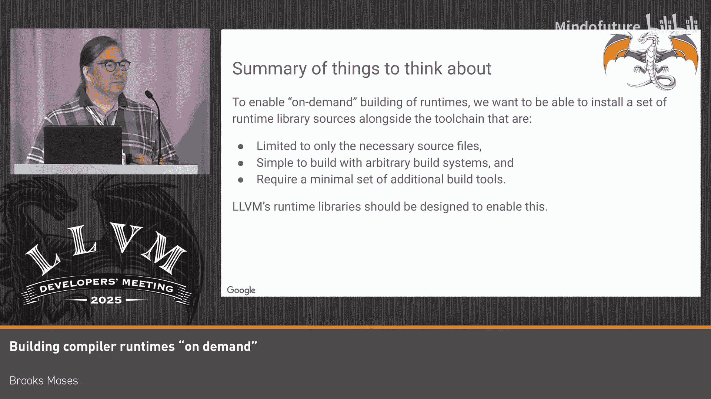

# LLVM开发者大会-US-｜-2025-Llvm-Developers-Meeting-p39-P38_按需构建C++编译器运行时_原因与方法--BV1ejr5BAEja_p39-

Okay。Yes， so I'm Brooke Moses from Google。 I'm talking about building the CNC plus plus compiler runtime's own demand。

 and I figured the first question I should answer is what do I mean by this own demand？So。

In your typical C C++ tool chain installation。You're going to have your runtime libraries。

 things like Li Kang RT， Lips C++， et cetera， Lib compiler RT are prebut when the tool chain is built。

 and then you've got these built files， your dot SO files。

 your dot A files installed alongside the tool chain。In this own demand model。

 the idea is that your tool chain installation includes the runtime library sources installed alongside the tool chain。

 and then the tool chain will build those runtime libraries。

As part of the process when the user builds their target code and， of course。

 there's going to be caching and so forth。 So this doesn't make your building hello world take five minutes。

But that's the general idea。And so this is sort of a two part talk。

 The first part of the talk is why this is a model that matters and a little bit about how we do it at the moment with Google's production tool chain。

And then the second part of this is how this usage model affects the things that we would like to see from the development of the Alium runtime libraries。

So let's see。Part 1， kind of why this building model matters and how we do it。

And so there are several reasons why we would do this。 One of them， kind of as a general idea。

Cang LVium as a tool chain， the compiler， the linker or so forth。Ourre。

Very support a very wide range of targets。 You've got the ability to support different architectures within those architectures。

 You've got a whole bunch of different instructions at variances。 You've got within those。

 you can do end up with different A Bs due to。Using different sanitizers due to configuring Liy plus plus for your stable or unstable AI。

 et cetera and so forth。Kind of this very wide range of possibilities。

But your pre compileiled libraries， each one of those only supports effectively one architecture and one A BI。

 Or maybe you can do complex tricks like Glibpsy does with their Ihen mechanism to support multiples。

But it's still basically， you've got this very limited set of targets。

From those precomplied libraries。And so if you have a tool chain that is intended as a whole tool chain to support a range of targets。

 it's going to need to have a large set of precomplid libraries and some sort of logic to decide which one do you use。

 depending on what compilation options the user supplied。And。For instance。

 when I say a large set in our production tool chain at last check， because we've got。

A few architectures， bunch of sanitizers。 you get a Cartesian product。

 We had 29 different copies of Lipsy plus plus do A in our tool chain。With doing this on demand。

 we you that， you only need the one copy of the sources。

And the tool chain can generate whatever it needs from that。 So that's a substantial simplification。

 And also means that the cost for adding another sanitizer isn't。

Adding another set of libraries for all your architectures， it's just， oh， we just add a flag。

And then if we start looking at embedded platforms， the situation gets even worse because。

Embbedded flat platforms is sort of notorious for having lots of micro architecture variants that matter。

Also， we can consider in a lot of these platforms， cases like。

We have talked in the past about maybe having like Lipsy plus plus today actually has configuration options where you can say。

Lipsy plus+ has file system。 Yes， no。And so you might want to build for some target。

A version of Lipsy plus plus that doesn't have the file system。 so you get smaller code。

But you different a different target than me。Look the same。 You say， O， for this one。

 because I'm building in in something that's got a file system attached。 I need that extra code。

Or kind of more fine grain things within the individual functions。A common one is。

 does your printf include floating point support？A lot of systems don't actually need that。

 And that code is quite large。So that may be something that you want to configure in or out。Also。

 you may have compilation choices。 Do we want aipy plus plus optimized for speed。

 Do we want one optimized for code size。Do we want to take one where we take some profile data and say。

 okay， we want to optimize these five functions for speed and everything else for size。

So those are more reasons why the。Variation is useful。

Another thing that we can get from building these runtime libraries at the build time is that they can participate in the link time optimization and li process。

That we can do to optimize the application itself。Cang's LTO mechanism requires IR bit code inputs rather than fully compiled objects。

And so。This doesn't really work with those pre compileiled libraries。And also。

 one thing that we found is that。A lot of runtime functions are fairly small， called in a loop。

Inlining those is really useful。 So we've seen measurable， performance improvements。

By using this specifically for Lipsy++。Another thing that's relevant here is when you're doing profile guided optimization。

 either guiding the endlining or guiding other optimization。Choices。

Building the runtimes on demand means you can build them specific for your application with application specific profile information。

And finally， one of the benefits that we've also seen from this is it's much nicer just as a development environment when you're developing the runtime library。

You want to。Test a change and say， run that change in a benchmark or run it through the test suite。

You just go to where the sources are installed， make your change， rebuild the target program， run it。

 Everything is happy。 I guess maybe with the benchmarks。

 this is less relevant because they're set up as LOVM tests。

 but for kind of external to LOVM programs， this is much easier。

You avoid the need to kind of rebuild all 29 of your copies of Lipsy plus+ do a and reinstall them in your tool chain installation in order to do this。

And kind of a particularly useful thing is。So I ran my change。 It looked like it didn't do anything。

Does it actually do nothing or did I just forget to recompile。So。I don't know about y'all。

 but I've had that happen a few times， and it takes me a while to kind of realize， oh。

 and then so this avoids that。So that's kind of an overview of a lot of the reasons why I think this is useful。

Looking a little bit into how we do this。 And right now， we're doing this in a way that's kind of。

Added on top of the standard tool chain installation。

 It's kind of specific to our basil based build system at Google。 But the way we're doing this here。

 all of our code is in this big Monte repo where the build system。

 when you're building an application， it knows how to go and build the dependencies already。

 that's kind of。Part of how our thing works。 So we added some built logic that just adds the Lium runtime libraries。

 as implied。Dependencies to any C++ application。Then do the C plus plus compile with。No built ins。

 no。嗯。No road time libraries options。 So it gets the kind of implicitly included ones instead。

We're building these runtimes using a combination of some custom build files of our own and the ones that are part of the upstream LM repository as the。

Basil overlay files。And currently， what we're using this for is Lipsy plus plus and LVM Libpsy。

 where we have some of those as in overlay mode that is deployed， working well。

 We're looking at future work， doing compiler RT， doing sanitizers。This sort of thing。And so。

 that's kind of。This is what it looks like today。 There is certainly。Opportunities that。

Where this could become more integrated with the LVM clang tool chain as a whole。

So I'll kind of get into part 2 of。Now that we have this。

How does this interact with what these runtime look like in the upstream repository。

 things that we would like。Developers of these run times to be aware of ways that can help us with that and so forth。

And this is kind of， you know。This is a different way of deploying the runtime libraries that in a lot of ways。

 is very different from this， at least for CNC plus plus traditional way of。Pre buildinging。

 installing built objects。And。So the requirements are kind of new and different。 And like I said。

 this is what I'm hoping the developers at these libraries。

Can be aware of as going forward in development。So one of the things here is。

Having simple build rules。Really matters here。And part of that is that right now。Like I said。

 the runtime libraries， we have to kind of incorporate the build rules for those libraries into our build system in this ad hoc way that's not just using immediately the way they're built as part of the tool chain。

And an observation is that tools like CMake and Bal and whatever you're using for your build system。

 they're very powerful。 You can do clever things with them。

 and then that cleverness makes trying to translate them。

 incorporate them into another build system can be very difficult。

And I'm sure we can all think of examples of these。 I didn't want to call anybody out。

 So I left that blank， but much better than the clever options is just having like。

 here's a straightforward， Here's a list of files， Here's a list of build options。

 a couple of rules that。Build the files with the build options。 linknk it into a library。

That's very easy to take and put into some other build system and make it work。

A similar thought is preferring fewer build rules。 And this one was something that surprised us until we ran across it。

And then seems obvious， but。Harsing， when your build tool needs to look at a big make file and read through the whole thing。

 that takes some time。When you're。Doing a one off build。 You're building the tool chain。

That doesn't matter。When your build system has to do all of that parsing for every single user build。

 because it's looking at does the。Does the runtime library need to be rebuilt each time？

That starts to become painful。And one of the things we noticed。

We have in LVM Libpsey right now in the at least the basil version of the build files。

They're kind of set up so that each library function gets its own separate build rule。

And that ends up taking a measurable amount of time longer than if we just had。

Say a couple of build rules for the whole library。Another thing that we ran across is it turns out if you've got your tests in the same the rules for tests or rules for test specific dependencies in the same location as your rules for the library。

That's doing means you're doing a lot of parsing that isn't even relevant to building the runtime library。

 but it's still there。So having your tests， and I guess I should have also called out depend test specific dependencies。

If those can be in a separate directory， that helps a lot。

Another piece here is what we want to limit the tools used at build time runtime libraries。

 of course these are being built in the user' machine if you add an extra tool to your library build process that becomes another dependency that users need to install。

We've looked at some things where okay。Is come up in conversation。

 maybe we should use tableG to generate these headers。If we do that。

When you're pre building those header files， Sure， fine。 We have table gym。 That's great。

In the own demand case， that means every L V user that's doing own demand building needs to install table G。

 needs to have that ready。It's much easier to incorporate this when the headers are using something like if def。

 and the only tool you need is client。Another thing that。Came up。 And this is。

One that's kind of more relevant for profiling libraries， this kind of thing。

 more specialized runtime rather than just Liy and Liy less plus。Is。

We really want the runtime libraries to be kind of self contained extractable。

 small sets of the source files。I checked。嗯。A couple of days ago， and the LVM repositories had。

 at least by my count， had slightly more than 50000 C plus plus headers and source files。

We don't want to have a 50000 file。Tool chain installation。So like I said， Liipy eippsy plus plus。

 those are self contained。 There's not much aside from some sharing with between them。

That would need to be pulled in。 But with profiling libraries。

 a coworker worker of mine was talking about wanting a profiling library that。Has some。AsT。

 like data in it。And it would be very easy to write that just saying， okay， well。

 we'll just depend on。LLVM is a library pulled in the entire LVM sources。

And that becomes something that's now very difficult to do on demand because it。

You have to install all those LVM sources as part of your tool chainin。

So we're hoping that for things like that， we can say， okay， yeah。

 there's this small piece of the AS T definitions。 We can hopefully extract that into here is a self contained little。

Base library and depends specifically on that。 Put that in a directory where it can be extracted。

And where it's not going to grow。Surprising dependencies later。And kind of this is also something。

 This one。This one is a personal opinion。 People may disagree with me。

I find that having generated header files。Is。A pain。 When your libraries are prebuilt， you can say。

 okay， here， I will generate a header file from a template for this。

Target installed that as part of the tool chain。And then when people are using it。

 that's a real file。 It's there。 it's installed， it's fine。But for these on demand builds。

 when your headers are a generated artifact， that's kind of this ephemeral build artifact that your debug info。

 all of your assert failures， your error message is aing to。

 so the user has to go in and find that build artifact to understand what the messages mean rather than just looking at the sources that they have in their tool chain installation。

So personally， I find using if Daf instead of template based generation to be a better option。

However。I've been kind of talking about this。With the。

Thought that what's going on in the tool chain as the on demand sources。

Has to match what's in the source repository。 And that's not really true。

We can absolutely do things in that installation of sources that modify that。For instance。

We can generate those headers with table gen just fine。 So long as we do that。

At your tool chain build time and generate something that's target agnostic and then just take that and install that and call it a installed source。

Similar similarly with the make files。It's looking like a good way to set up nice。

 really clean make files for the installed sources。Maybe to kind of process the whole。

Project make file kind of extract just the relevant pieces。And install those， and。

One thing that comes up where this is particularly useful， of course。

 is your repository make files are going to have a rule that says install sources。

You certainly don't need that in those installed sources。

And then there's some interesting future work possibilities here。As I said， this is， you know。

 something that we've kind of pasted on top of a standard tool chain installation kind of。

Nothing in this is。Included， really in the。Standardelium clang tool chain itself。

But there's an interesting design question。 Is this something that we would want to teach the tool chain to build automatically。

And， or kind of build into this thing。I see some head shakes。

 this is definitely an interesting question。I knew that it not would not be unique to clang。 Rust。

 for instance， already has this option where it can， you can tell it。

 build your runtime for this target from source rather than using the installed ones。

And so you have this kind of question of， would you invoke CMake。

 Would you kind of implement it in claimang。These， these become interesting discussions where they answer。

 maybe， yeah， that's complicated。 We don't want to do it， or maybe， okay， we want to add a。

Possible additional tools specifically for your runtimes to do that。And so that's kind of。

 I'll quickly go through my summary of。The general idea is， we want to be able to， from the。Sources。

That are in the repository for the runtimes， extract a limited。

 simple set of sources and build rules that we can install alongside the tool chain。

We hope the libraries will be designed to enable this。And kind of finally。

 I want to give a quick pointer to some relevant talks。

 One of the particularly interesting ones is this afternoon in this room。

 Paul Kith and Daniel Thorba Thornburg are doing aO。

 Basically turns out that when you're putting your Libpsy into your LTO。

 you've got some interesting considerations that aren't obvious。 they had to talk about those。

 And then there are a couple of other LVM Liby related talks。

 one from yesterday and one from last year that are also relevant。So I think that pretty much。

Please me end the talk。 and I'd be glad to take any questions。

👏Thank you。Go ahead。Thanks for the talk， yes。Have you thought about updating Lips C plus plus and Lips C independently of your tool chain now that you can like build them independently。

 We， we did think about that。 That was actually one of the things that drove this was the combination of when we were originally starting this。

 we were thinking about updating Lips C plus but independently。

And how that interacts with sanitizers。Is that because the sanitizer A BI is closely tied to the compiler。

We had this problem where you update Li C plus plus。

 you now need to build your sanitized Lips C+ dot A's。Well， the issue is that if you。

C the same Lips C plus plus installation。 You update your compiler。

 Then you need to also update all of the Li C plus plus dot a。Sanitized copies。

And when we had a separate team doing the Lips C plus plus。

Updates and the tool chain updates that becomes a messy mix。

We haven't actually gone down that path ultimately。

 but that was one of the considerations that started this。Thank you。好。

So you talked about one of the motivations here being to enable。

Enable more different configurations without actually experiencing the geometric explosion and building。

 And I'm wondering how you deal with testing of those configurations without actually building them in the first place。

That is， that is an interesting question。 We do have to。We definitely have to。

Build them for the test process。 It's more a。Matter of not needing to install them。 It's also。

 to some extent。We find that。WeYou don't need to test the entire。

Cartesian product space to feel reasonably confident。 You test your architectural variance you with。

A basic optimized build or the things that you're likely to release。

 You test your sanitizers and a few architectural variants。 And you。

 you can feel reasonably confident that adding M A V X 512 isn't going to。Make your as sound break。

And then you kind of find out and sometimes that in your actual stuff， that， yes， it does。

 and you modify here。Sad， but yeah。Yeah， hey， first of all。

 thanks for bringing this really important problem to the attention of the community。

 I have two questions for you， One on your side。 I'm guessing you have a translation script that takes in this runtime bill files like Cic and then translates it into some basil to stuff。

 What is the shape of it。 Is it something that's in a shape to be shared with the upstream community。

 Yeah， mostly。😊，Most of the translation， really， at this point， is。We have our own。

Make file for Lipsy plus plus。That。Is kind of different from the upstream one for internal reasons。

 And we kind of it becomes a manual translation each time we update the C plus the Li C one is at this point。

 pretty closely following what's upstream。With， again， some kind of local changes。

 But certainly as we start making these translation things more interesting。

 actually doing some of this extraction， we'll definitely want to put those upstream。Thank you。

 And the part two of your talk。Have you already turned that into some sort of a proposal in thecourse or do you plan to。

 because it seems like it should be out there because there's going to be a lot of questions that's going to come up with because some of the proposals are like really far reaching。

 like how upstream build system should look like and how it's gonna stay in that shape as we。

If we want to accept these use cases。Yeah， that's that that that is still future work。 And it's。

 it's definitely a， a good point that following this up with。

Those proposals will be a important thing。 So thank you for。Reinforcing that。 And yes。

 definitely that would love to work with you on that。 Yeah gladla to hear that。 Yes， thank you。😊。

Can you share some thoughts on。Yes， yes。 Can you share your thoughts on how were you planning to。

To ship these packages out onto the developer SDks。

 especially because this probably is code that never actually needed to go out to the world。

 And now you have to sanitize， clean it up so that it can actually be seen by the rest of the world。

That's， that's an interesting question right now。Right now。

 we're just doing this as part of our internal build system。

So we haven't really faced that very much。But yeah。

 that's definitely going to be an interesting question for the future。

And something in addition to think about。Yeah， so a lot of this stuff。

I guess I'll say this on the tin0。 It， It bucks directly against things that I've heard from other people。

 like where they have been announcing， did intent to move the build system in exactly the opposite direction of like a lot of these slides。

 so。I'm glad that these conversations will start because they are sure to be interesting。

 sent to threads to reading them with popcorn and the like your popcorn features now。

 Yeah so my actual question along those lines is it seems like there's kind of two broad ways to go about allowing people to build their own runtime。

 One is to make it very， very simple for them to incorporate the build like simplify the build to the point where it's not onerous to incorporate it into whatever。

 Yeah Another way to do it is to let it be as complicated as and then find ways to containerize or package the complications so that you could have something that you could ship to people that they could run on the platforms that we care about that generates you like a multili directory on demand。

 And I was curious like whether that alternative has been explored or。😊，It's。I've thought about it。

 I wouldn't say that I've specifically explored it really。I think that becomes。

 there's an interesting kind of tension between two kinds of users。Because。For the kind of。

Relatively independent user who's doing all of this out on their own machine。In a lot of ways。

 that containerized thing is better。It can include fancy caching。

 It can include all the pieces that the developers want。

 and it just sits there in this box and works。And then you have the class of users who are doing things like we are at Google with our pro tool chain。

 where it's like， okay， we're not running it on an independent box。 We're running it on this。

Big farm that is doing each build independently as a separate action has this parallellyzed caching。

Mechanism that is completely custommed to us。And。From my experience where basically build rules for a lot of third party libraries。

 which I also do a fair bit of work with。All of the times when they're doing things that are nice and convenient for those independent individual users。

If they don't fit into our。If they aren't something that we can easily translate to our system。

 we end up with this kind of lump that just sits there and is very hard to see what's going on with and takes a long time in the build system。

 It is parazable across the many machines。And so there's this kind of tension between。Which set。

 how do you serve both set of users Well， Yeah， I think there's also a tension with。

And a reasonable tension with how much does the open source care。

How much does the open source community care about me。 I'm a weird special snowflake with this。

Big system that I don't share。I think it's， it's an interesting question how much that's something the open source community should care about。

 so。Yeah， thanks。 Thank you。 right， Thank you。