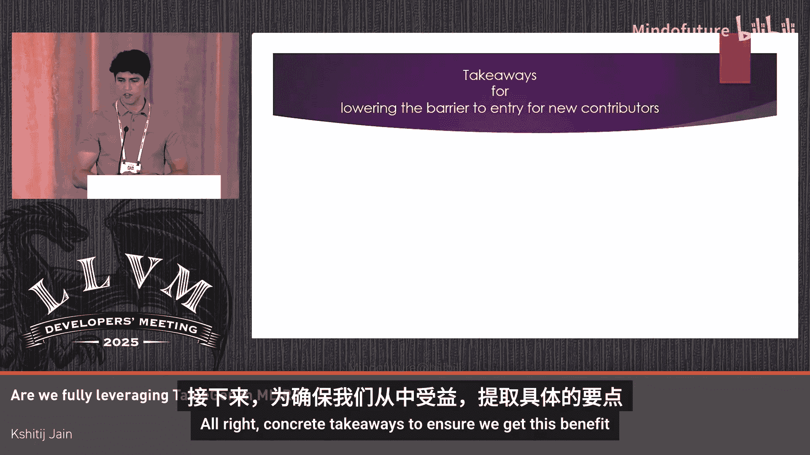

# LLVM开发者大会-US-｜-2025-Llvm-Developers-Meeting-p41-P40_我们是否充分利用了MLIR中的TableGen--BV1ejr5BAEja_p41-

Good evening， everyone。 Once again， My name is Shita Jen。

 and I'm a compiler engineer at D matrixtrix。 And the topic of my talk is perhaps a controversial question。

 Are briefly leveraging table Gen and M I R。 And I asked this question because you guessed it。

 I don't think we are。😊，Tablegen， in my opinion， is underutilized in MLR。

 It's often reduced to a means to avoid our creation boilerplate。 But through this talk。

 I want to demonstrate that richer tablegen code can have the following benefits。 One。

 it can reduce the mental overhead on compiler developers。2。

 it can make a compiler's behavior more apparent and robust and three。

 it can lower the barrier to entry for new contributors via concrete examples。

 I also want to show how these above mentionedion benefits can be realized using existing upstream tablegen utilities and some common but often overlook software engineering pragmatisms。

So with that， let's move on to our first benefit， richer Tgen code can reduce the mental overhead on compiler developers。

Imagine you worked on a machine learning compiler and were tasked with creating a Pado with the following requirements。

 The Op performs edge padding and the op pads only the two in the most dimensions of any input tensor。

And this is the code that you come up with。Now， it works， but theres a few issues。

Given the op requirements， what are the up invaris that we can reduceuce？One。

 the input and output tensor ranks must be the same。2。

 the input output and pad value element types must be the same。 And three。

 the input and output dimension sizes must be the same。

But the current op definition doesn't actually provide us any guarantees on those invaris because of which we have a few issues。

 One， the gap between the ops syntax and its semantics widens。

 which means that the number of possible invalid op states increases。

We also lose some other nice benefits， a properly constrained pad up would have indirectly constrained where the padding pass could occur in your pipeline and would have guided any future changes to preserve that pipeline structure。

Two， the lowering process gets more complicated。Because there may now be a number of possible up states that are invalid。

 we have to defensively program against them to ensure that encounters would then lead to errors or crashes。

 It often leads to assertions over an op intrinsic properties scattered all over the code base。

And three， handwriting IR becomes even more error prone。

Because our op definition is not properly constrained。

 we're not able to leverage support from development tools such as the MLR LSP server。

Let's now look at the good version of the table gen code for our padock。

Comparing the op definition against the op in variance。

 we can see that the input and output potential tendor ranks will be the same。

The input output and pad value element types will be the same。

And their input and output dimension sizes will be the same。Barring the two of most dimensions again。

 which might get pad one thing of note here is that there's no upstream tablegen constraint to do that does what I needed。

 and I could have defined it within tableG but does op constraints get more complicated and may make it makes more sense to define them using CPP off verifiers instead。

These do provide the exact same benefits， but you do lose a lot of the information locality from your tables gen definition。

Allright， so with guarantees on those invaris， we get a few nice effects。 One。

 we get correctness by construction。 If we can obtain an instance of the op。

 we can rest assured that all its invaris are uphel。Two。

 the lowering process stay mechanical because we've now reduced the number of possible invalid out states that we need to deal with。

 And three， handwriting IR becomes less error prone。

Because we now get support from developing tools such as the MLI SP server。All right。

 concrete takeaways to ensure we get this benefit， specify up in variance up front as much as possible to one。

 get correctness by construction guarantees and reduce the gap between the syntax and the semantics of your op。

2， make the lowering process as mechanical as possible。 and three。

 get better integration with development tools such as the MlR LSP server。

And everything that I mentioned here applies to attributes and types as well。

I also wanted to highlight some quick links to available upstream op attribute and type constraints that should come in handy for writing richer tablegen code。

Allright， with that， let's move on to our second benefit。

 richer tablegenin code can make a compiler's behavior more apparent and robust。

Imagine you worked on a machine learning compiler and we're task with creating a reshape app with the following requirements。

 the op reshapes an input tensor based on the specified shape and the op does not change the input Tensor's data and the number of elements。

And again， this is the code that you come up with。It works。 But again， there's a few issues。

 Let's look， let's look at the op and variance。 The input and outputor input and output element types must be the same。

The input and output element counts must be the same。

And the value of the new shape attribute must be the same as the outputward shape。Again。

 the op definition doesn't provide us any guarantees on the invariance because of which we either get nonsensical ops because the reshape will not change in in pretender's element type or count whatsoever。

 or we might get confusing error cascades。Let's focus in on this one， a little bit。

We might have a reshape up like this where we have a 4 by 128 tensor that we're reshaping into a 2 by 4 by 64 tensor。

 and our output type might be 2 by 4 by 32， which is supposed to match the new shape attribute。

 but it doesn't because there's nothing constraining it。

So our compiler might be lowering this reshape as a copy。 So we have this 4 by128 tensor。

 We divide it into two along the column dimension， and then we store each slice into a 4 by 64 chunk in the output buffer。

A 4 by 64 chunk in the outward buffer because that's what the new shape attribute tells us。

 but we may have allocated the outputward buffer based on the output type now because of that at some point we'll end up performing an out of bounds buffer access and we'll get a confusing error cascade related to extract fly off。

Let's look at the good version of the table gen code for a reshape all。

Comparing the op definition against the up and variance。

 we can see that the input and output element types will be the same。

 The input and output element counts will be the same。

And the new shape attribute will be the same as the output shape。

And with guarantees on the open variance， we get sensible op that are correct by construction。

And no confusing error cascades。Another important thing to mention here is that the new shape out of is actually redundant and its value could be derived from the output。

All right， concrete takeaways to ensure we get this benefit。

 specify up in variants upfront as much as possible and deuplicate information from Europe app as much as possible to one。

 avoid getting confusing error cascades and enable early failures where context is apparent， and two。

 avoid having multiple data sources for the same information。With that。

 let's move on to our third and final benefit， richer Tablegenin code can lower the barrier to entry for new contributors。

Imagine you're starting out as a compiler engineer at a company that owns a machine learning compiler。

 and your first task is to add 2D convolution opt to your compiler front end。

Now you start out and you find this table gen code in your code base。

And it leaves you with a few questions。If you don't have an ML background。

 then you might not even know what a convolution is。

You might wonder if you have a real task or if someone's already done it for you。

If you do have an ML background， then you might perhaps wonder if this is a 1D convolution。

Then you might wonder if you can reuse this for 2D convolution。But what if instead in your code base。

 you found this table join code instead？The name clearly indicates what the op is and what it does。

The description gives a general explanation of convolution。

 as well as more specific information about the app in the context of the compiler。

And the op invaris have been clearly specified。Now， equipped with this information。

 you may be able to answer the questions that you previously had。

You have a general and a compiler specific understanding of the convolution op。

You do indeed note that you have a real task because this is a 1D convolution art and given the open variance。

 you will be able to deduce that you cannot and probably should not reuse this for 2D convolution because 2D convolution is going to have its own set of open variants。

So all in all， this table Gen code clearly indicates the feature that's supported by the compiler。

 and equipped with that information， you can navigate your task more independently as a new contributor。

All right， concrete takeaways to ensure we get this benefit。

Specify open variant upfront as much as possible and write elaborate off descriptions to one。

 localize all the information new contributors might need to work with your app。

And clearly indicate the feature set that's actually supported by the compiler。And again。

 both of these things should help new contributors to work with your code base and navigate it more productively and independently。

With that。We're also having a similar discussion on the LLVM Disccourse。

 so please feel free to chime in there with your opinions and thank you and have a great evening。

