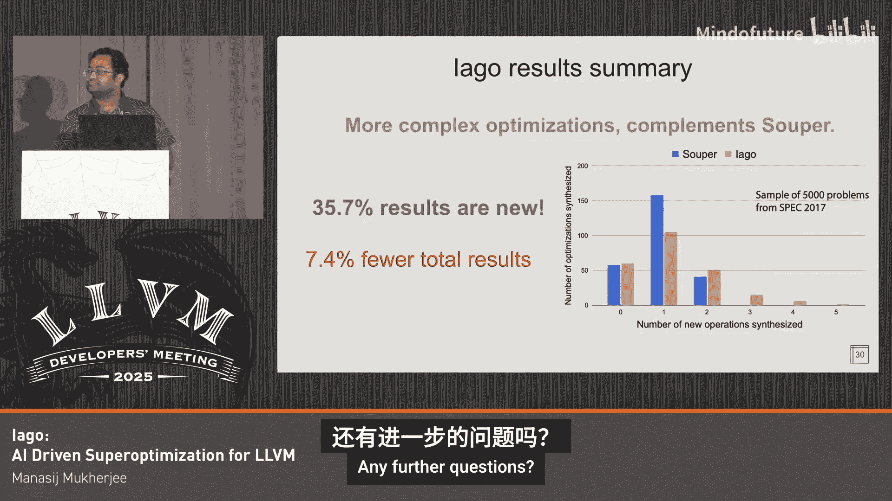

# LLVM开发者大会-US-｜-2025-Llvm-Developers-Meeting-p42-P41_Iago_面向LLVM的AI驱动的超级优化--BV1ejr5BAEja_p42-

Hi， everyone。Welcome to my talk on AI driven super optimization this is the talk where we find out where if AI is replacing our jobs probably not but still let us look into how this works。

😊，嗯。I will start with the motivation and background for this like what about optimization is and why we might want to use AI for it then then go into the meat of this talk the design of Iago。

😊，How it works and then how well it works。 I'll try to present some insights from this that will be helpful for compiler development in general and not necessarily for super optimization。

Getting into the background， what is super optization。

 This is perhaps the most frequent question I have heard about this topic for forever。

 So lets try to explain this。😊，A superuper optimizer asks a simple question。

 can a piece of code be improved？😊，嗯。What improved means is up to you。

 you can choose any metric you you want like performance， code size， even energy consumption。😊，Now。

 it's fairly flexible。But you might be thinking hold on a compiler does the same thing。

 it improves code。😊，There is a nuanced difference The difference is a compiler has to work well for a vast number of programs written by users and it has a limited amount of time to do this super optimizer on the other hand is not contrained by this it can take fairly long to do all this and the way it works unlike a compiler which goes through a pipeline of passes and matches fixed pattern of fixed number of patterns a super optimizer works by search。

😊，It searches a large number of candidate programs and finds a refinement， a valid refinement。

 which is an improvement by your metric。😊，So， lets look at how this search works I will not go into the details of how it works。

 but given a program fragment like the one you see here the super optimizer is going to enumerate a large number of alternatives for this。

😊，And then eventually it will find hopefully it finds a good candidate。

 but we have a large number of candidates to enumerate and for each of these for the super optimizer to be correct it has to go to a verification phase with a SM solver or a tool like alive2。

😊，And both of these being expensive things， the multiplication blows up very quickly。For example。

 super optimizing SQ light 3， a very useful and popular piece of technology takes 24 hours just to enumerate our programs of size1 and 2。

😊，With a really large machine with 1。8 core。😊，嗯。But fundamentally it produces given a pattern it produces a replacement so why do this when in combine already exists and of course other compilers also have peoplehole passes。

😊，What we can usually put into in combined right now our Gcc is matched at PDD or anything equivalent is our patterns where we where we match one to five instructions and replace them with a shorter sequence of instructions。

😊，This works really well in general but。You might have it it cannot possibly work for all possible programs and you might have one specific pattern in a in a piece of code that is very important to you。

 which which it does not cover at all。😊，Also。If you have if you want to match larger sequences。

 it's impractical to do it in a compiler。 You would not want to match three of hundred instructions in incom。

Not surprisingly， these two things are often often related。

 specific patterns are longer and longer patterns are more specific。😊，And it。

 and there is some value in trying to optimize it。 Let's look at it。

 Let's look at careful ex a specific example of why。Here is a large piece of code。😊。

Do we have to bother optimizing it？😊，And I chose this specific example because in the 40 year history of super optimizeimrs every super optimizer project and paper has included a similar example let me show you why this whole thing simplifies to a pop count instruction。

😊，And there are innumerable ways to write pop count。 And this is。

 this is maybe one of the faster ways。 if you recognize this these numbers there from hackers's delight。

 it' is one of the blocked ways of doing pop count。😊。

So a super optimizer can simplify this thing to a single instruction。Another example。

 which we recently found in one of our Nvidia Kuda benchmarks， we have a lot of sllse。😊。

It simplifies down to one s and this is something that was missing in Eium。

 which I which I am going to implement fairly soon。Interestingly。

 the second one here is not a single optimization。 It is two different patterns in disguise that the incom work list has to work through multiple times to achieve after you implement it。

😊，But both of these examples I have shown you are going where possible to find with the traditional enumeration based super optimizer because the output was fairly limited。

😊，So I use AI for this。So if you have， if you want to。

 if you are fine with enumerating one and two instructions。

Its completely fine not to use AI it it scales very well each try takes 30 seconds。

 maybe maybe one minute。If you want to enumerate larger programs， say 3， four。

 five or even larger instructions， it is not going to work enumerating three instructions takes close to bill somewhere between 12 to 24 hours for me。

So what we want to use AI here is instead of going through this large search space。

 we want it to generate a few options and then we evaluate them。😊。

So the end result is still verified。 You still get the correct thing。

 and this allows us to reach far deeper into the third space， finding larger patterns we can。😊。

Optimize an existing pattern， too。Here is one example。

 a very important example where this finding a larger pattern helps you see the left hand side here has a X and trunk shift right and the right hand side is a little bit simpler Now this is an operation that appears very。

 very common is is very common in almost all code we have written this this checks if a floating point number is a Drgon value and the one on the right that a super optimizeimr found is a slightly more efficient way of doing it assuming you can efficiently load large constants and things like that。

 So this is the kind of things you might expect to get out of a super optimizer。😊。

That is enough motivation I hope so I'll move on to the design of Iago so what works what doesnt some tips and tricks you might want to use when building AI based tools for compiler work。

😊，The baseline here you just ask an LLM find given this piece of code， please optimize it。😊。

If you do that， unfortunately， it starts rambling。You get a you get a sentence will and if you tell it anything else。

 you'll get a reply with youre absolutely right。😊，And this has improved a little bit in the last few years。

 but it is still not too good if you just want to use a vanlum LLM for this。 So how do you fix this。

😊，There are two issues here。The first thing is that we want the output in the correct format。

 so we want the right syntax and of course it has to be a correct optimization。

 it has to have the right semantics。 So let's see how we approach these things。

 The first thing is you want a good system prompt you explain the idea for people optimization you describe available operations like whatever you want to generate。

😊，A I things you don't want it to do that doesn't work too well。 and you give it examples。

 and the last part is very important giving it a number of examples makes it work significantly better from my empiricalical tests around 10 to 15 instructions is the sweet spot if you give it more than that it doesn't help that much。

 but less than that definitely not。😊，This makes it work better than what I had in the last slide。

 but you still don't get a correctness guarantee。😊，So what do we do？So。We have the plant。

You send the result to a person。We all have par for LGM or any other format you want to generate。

You get the error message back if it is not in the correct format。😊。

The LLM magically generates the output in the correct format the next time。

 and this works pretty well。 So if you have any way to validate syntax。

 give it the parel error messages， it will work。😊，Sometimes it does not。

Ill you some'll show you two examples for LLVM。😊，I noticed in a bunch of results it kept redefining values。

😊，I tried I tried my best to explain what SSA is in the prompt， but no。

So sometimes it would work after a few tries， but it is much better to just add a password where you manually fix this and and this immediately helped boost our results quite a bit。

😊，The other one is I had a bit of a trouble getting it to understand the type system so for example that idea that selects produced one bit result and not a 32 bit result the select had a 32 bit one bit condition and not a 32 bit condition but you can also fix this by inserting the appropriate fixes in the middle of the code with these two。

😊，And these two were the major things I had to do。 We get the correct syntax well formed allerium IR。

😊，But it's still not correct。We can try to validate with it with alive， too。

And if the result is valid， we are done， we have we have found a correct transformation。😊。

If it's not。Similar to par par error messages， a life too can produce a counter example。

 you give it back to the NLM。😊，And let's see what happens， It doesn't work。😊，U。

The the transformer technology， Nlms。Are not very well suited to understand negative examples counter examples。

 So when I tried this， it kept repeating the same repeating results which produce。

 which would produce the same counter example。 And there was no easy way around this。😊。

So one of the options is we just keep keep trying again that works it doesn't work too well。

 but this is a solution that really got we started with Iago and if you if you cannot do better this is good in us。

😊，But what can we do to make it better？The first thing we I mentioned is that。

These transforms have to be correct。 We cannot have。

 we cannot implement an incorrect transform in a compiler or from any tool like this。

 And we have used alive2 to verify the results。 So why not also try to use this here。So。

Given given a wrong answer， we want to fix it to produce the correct answer。

 the insight that led me to this is that even if the result from Igo was wrong。

 the structure of it was kind of right if you squint at it。😊，So it had the right structure。

 Some of it was done。So let's see what we can do about that。So here is an example。

 suppose you have x multiplied by 42 plus1。😊，Maybe the constants 42 and1 here are wrong。So。

 you extract a sketch from this， this is program synthesis jargon。😊。

Which means you delete some parts of it here it is the constants。

And then you use the SM solver to fill in the blanks maybe the and that guarantees you the cardiac constants in those places。

😊，And this was a very helpful trick to get around the fact that counter examples didn't really work。

😊，Getting into the weeds of how this is done with not too much detail the the logical formula the S solver is solving here is this。

 If you don't want to read this， it is best I am asking the solver to give me a constant。😊。

Which produces a valid refinement。But you see that the first two items in this formula are two quantifiers and re dissolve solves dont work very well if you have alternating quantifiers So if have if you have an exist here and a farral。

😊，The way around that is an algorithm called counterex guided inductive synthesis it basically splits it out into two separate loops and the ya assembly solver is one of the early good examples of this algorithm implemented。

😊，to recap。We have to。Beutly overlapping loop since Igo you have you get a result from the LLM。😊。

You fix it if you have to fix it。 and after that， it is verified fine。

You might think from this loops that it might it takes a large number of tries。

 but no with the modern LLM。😊，Like GP 5 or cloud 4。52 tries gets you most of the good results。

 And after that， it's a long tail of maybe if you do00 tries， you get one extra result。

 So two tries was effectively enough for for this。😊，So so far。

 we have guaranteed that the solve that Igo produces sound correct results。

 But what about completeness， We don't want it to miss optimization。 So given a piece of code。

 we don't want to if there is a valid optimization to be found from there。We don't want to miss it。

So can we guarantee this The answer is no there is no real way to do this So let me show you how large the gap is here。

😊，The blue barss here are the number of results superfo。😊，So。

 each column represents the number of instructions it tried to synthesize。😊。

You have the gap between the blue and the red bars are the gap between super and Iago。

 So if so if it had， if I had to， if Iago had to produce all the results。

 it it would have to fill that much of a gap。 That is very difficult。

 And there is no easy way to do this。But on the other hand。

 if you see the long tail of results which super or any other super optimizer has difficulty getting getting to that works pretty well for this so so so it is not that good for0 to two instructions but it works very well after that。

😊，So one trick I figured out that works very well for this is if you give it if you if you add the pruned result the the pruned candidates during the search produced by enumeration for the first level of enumeration。

😊，It improves the results slightly， but there there is no but again there is no real way to solve this solve completeness here and that is why solver based enumeration still wins out if you if the enum is within your within your reach if it tractable。

😊，And the best part is all this fits in the LLM context window。 Now it is for， for modern LL Ms。😊。

So now we have a tool which is sound but not complete。 Hopefully everything is pretty good。😊。

Let me show you a funny example where it is not。😊，And this really shows you the gaps where compiled bugs and issues kind of filtered through。

 and I hope all of you find this entertaining。 So so far we have wished for correct syntax and it must be a very valid refinement。

😊，So imagine my surprise where I say it produced this。😊。

This is just to be clear this is completely wrong。 it does look correct kind of。

 but it is completely wrong。😊，So what happened here？

This is the raw result it produced Dont try to understand this。

 I will show you what is wrong immediately here。😊，It sneak in a precondition in the result。

 it produced it its own precondition。😊，And of course， if you。

 if you allow it to produce its own precondition， it is correct， this is what it does。😊，呃。

So this slipped through because the part the the the parel that we were using to validate this did not even account for the fact that there could be preconditions in the result。

😊，Preconditions are something you have in the input， not the result。😊。

And this slipped through like this。 So this is this is the only entertaining example of this that I had。

😊，So now I'll quickly go through the the results here。

 Igo produces a lot more a little bit fewer results than than super。

 but a bunch of the results are new and these are important because these results are out of scope for bunch of for all traditional super optimizeiss。

😊，So taking the new results， looking at them would would presumably lead you to implement new interesting optimizations in LLVM。

😊，These are the similar results run more recently on the LLVMs test suit。

 This suit is used for tracking performance on LLVM comets。

 It has a bunch of multi source programs and。😊，Even after L L VM using this for a while for tracking compiler performance。

 we still found decent number of new optimizations here。😊，Similarly for Gy。

 we also found some some similar number of slightly lower number of transforms because it's a 30 year old match code base。

😊，Notably for this G Z results， it matched supers code size performance over L V O S。

 which is the size over clangs O S， which is the size which is optimizing for code size。😊。

One of the reasons we might want to do all this is because it's faster than super。

 So let's look at how that works。 If you ask super to enumerate one instructions， it is faster， but。

Iago is faster than if you try to do two instructions。

 and if you try to get super to enumerate three instructions。

 it basically times out most of the time because enumating three instructions is a very difficult and time consuming thing to do。

Another point here， which most people here will found find interesting is whether the optimizations found by Igo。

😊，Work for all backends。 It doesn't。 It's so。And one of the interesting things I want to point out here is that x 86 and arm 64 agree on whether an optimization is profitable more often than either of them do with risk file so。

😊，I'll give you an example why this is a fairly simple example this XR in the right hand side here produces two lines of code in x 36 and one line in risk5 because there is an immediate XR。

😊，There there are other reasons for this to disagree。

 but this is a good thing to keep in mind that this does happen。😊。

The other so this is a breakdown of this between between x 86 with risk 5 and arm 64。

 The thing to note the the two diagonal squares have pointed out here at the are the ones where the architectures disagree on the optimizations。

 you see that the lighter means there there is less disagreement。

 So x 86 and arm disagrees less than risk here risk 5 here。😊，I'll。

 I'll invite talk with some takes from this from implementing this。

 Often the things you find here are multiple transforms in disguise。 It is this example。

 This is two transforms in disguise，1 combining two selects and the other combining two one select and one or to a single select。

😊，The other one is if we want to actually go and implement this in Elviium right now。😊。

It conflicts with what L M expects things to be canonicalized as this leads to termination issue。😊。

And that is a little bit tricky to debug some most of the time。

The other one is picking the right subset of these to implement for。

 for the end end result to be more performant than what you had。

 This is a really problematic thing to get right。 And we really need good tooling to make this easier to work with given thousand optimization。

 How do you find the。😊，20 to implement from that。 That will make your code 10 times or 10% faster。

So with that I will end my talk with this Dcap that Ya present the symbiis between AI and formal methods AI is great at generating test text。

 formal methods not so much but it ensures that things are correct。😊，That's all for my talk。

 So I guess we have enough time for questions， questions。😊，So really fascinating。What's the longest。

Sort of sequences that you can generate with this approach。

 because I think if you look at traditional ahar or GSO， they'll do up to about 7 instructions。

 stochastic super opt of up to about 15。 What's the biggest you can get with this approach。

37 from this thing here。Yes， yeah， 37 all right， okay got it， thank you this sorry。

So when you were doing your profitability analysis were you just like counting instructions after the like IR got lowered through the back end。

 Yeah so so for this work， I had two approaches， but the graph they presented are for the number of assembly instructions。

 I also have a pipeline where I use MC for counting the machine cost as reported byM but you can also run figure out a way to run it and measure performance。

 It's a kind of like a microbech work。 Yeah， I think would be reasonable。

 like you could run it through exegesis， but that's gonna be hard I mean。

 you run into context problems。 So it's probably a good first proxy like the example you had where you just had a move like if you're not front end if you're not front end bound like you'll just register to rename it。

 So yeah， thank you。For the NviDdia people here， we it would be really helpful if we got MCF or Nvidia。

😊，So。You talked about correctness。Did you。Analyze anything about consistency of the results。

What do you mean。Keep generating the same I mean， with the same input you get the same output a change good question。

Open AI is LLMs had this temperature parameter， which they recently removed。With that。

 you could control the consistency， but now you cannot So you are at the mercy of whoever is providing you this technology to to determine how consistent you want it to be。

But you can just keep trying one。 And once you get a good result， you stick with the good result。

Okay， so a live two is fundamentally limited when it comes to larger functions or loops。

So are we just missing some cool optimizations that it could be finding with loops or what are you doing about that？

 Yes， you're right。 So this is so far right now limited to what a life2 can verify。

 I know that you are going to be on making a live two scale to loops。

 You or some others in this room。 So please do a good job。嗯。Okay， thanks for the grand talk。

 on slide 30， Yago found O Lago found more example where you have zero operation that I synthesized。

 How come。那。Synthesizing a constant uses that Cg loop that I briefly talked about and。It is a loop。

 so you can't let it go on forever。And you have to choose a maximum bound to that loop。

So so whenever you pass that bound， super just gives up。Any further questions？

嗯。And as far as I understand， you use open air。 So it is GT scing G5 right in caseium。

 Well so sort of so there is an Azure API which allows you to access other LLium to the same API as open A have you experimented with differentium Yes。

 yes and how different results。 Yeah good question。

 So So right now from my empiricalical experience Cloud 4。5 is pretty good。 G5 was slightly worse。

 but still pretty good。 And all of these are significantly better from what we had1 or two years ago。

 The first time I tried this first 2023。And things were 10 times better right now。はどいう要ずに。嗯。Again。

 good question。 Yeah， yes， I have tried tried reasoning models。

 It does not improve the results that much， but it takes significantly more。 Yeah， yeah。

 it it takes much longer。😊，Have you ever considered maybe like instead of using something like GPT。

 like making your own AI or like training it so that it's more tuned for this type of stuff so maybe collaborating with some AI researchers on that or something。

From what I understand talking to experts， this made a lot of sense two years ago。Where。

 where fine tuning really made a huge difference。 It seems nowadays that has fallen。

 that is falling out of fashion。 And Ive been told that just give it enough examples。

 It'll do a good job。I don't know how correct that is。

 but that seems to be the sentiment in the AI community。😊，Any final questions？Now。

 let's thank the speaker again。行。Thanks。