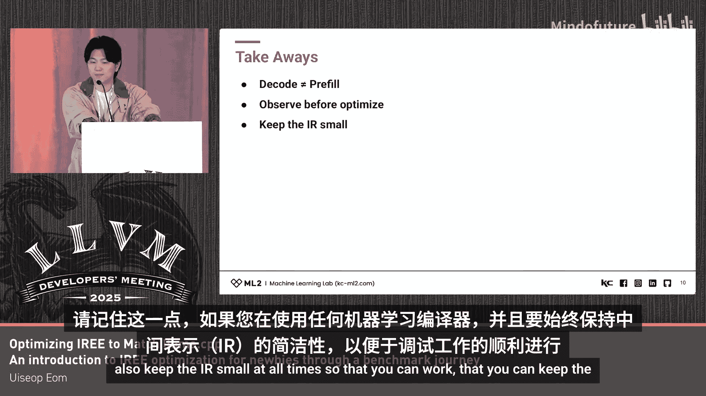

# LLVM开发者大会-US-｜-2025-Llvm-Developers-Meeting-p43-P42_优化IREE以匹配llama.cpp--BV1ejr5BAEja_p43-

Okay， so hi everyone， My name is Am， a research engineer from a research group called ML2 in a semiconductor company in South Korea called KC today I'm going to be talking about optimizing Erie to match Lama C++ an introduction to an optimize journey for newbiees through the benchmark journey。

 so hopefully this might help to newbiees like me who are just getting into all Lvian projects such as MLIR。

So first of all， what is Eri Eri is a project that is a retardgetable MLIR based compiler for ML programs。

 they take various frontends front end inputs such as Pi。

 shas on X and so on and also they execute on different backends such as X 86 CPUs。

 arm CPUs and GPs and so on。 So basically there are like they provide a runtime and a compile systems that builds bytecodes that runs on those runtime。

 So basically they're helpful for running various various ML programs on edge devices and on heterogeneous device environments。

So the reason why our team kind of looked into E Erie first as a test bit for studying and understanding MLIR and LLVM in general was that EE is basically MLIR native and it's an end end to end compiler stack and also we thought that it would be a right scale for newcomers and that includes lots of abstracts for hardwares as well。

 so basically it's an end to end stack that can get your has E on the on the MLIR compiler stacks in general。

And so we started benchmarking E this E project， which is based on MLIR on tiny Lama first of all。

 at first we started out with Lama 3。18 B instruct。

 but later on we decided on to using tiny Lama So well this case was for faster iterations because our min goal was to work on target targeting on edge devices because our research group is more focused on robotics and also edge devices as well So yeah so if there's anyone who's trying to benchmark on large models。

 large chunk models and edge devices always use tiny Lama instead of Lama 3。1 instance。

It's very for the fast situation。So the basic benchmark results that we got from the Eri Erie project was that per token。

 it took 23 seconds per token and compared to Lama C plus plus it took 84 million which took 84 milliseconds。

 It had like 200 more than 200 dip speed differences。 And so this kind of started out as。

Started a benchmarkmark journey which included lots of MLIR and handling。

 getting your hands dirty on MLIR optimizations。Well， so before that。

 you realized it took a lot of debugging into the MLIR stack inside Eri。

 and I realized that the CPU and kernel profiling didn't help much。 Well， first of all。

 basically it was because the EV project itself is bindinged uses Python binding and the C+ plus code stack is hidden behind the the binding。

 So like the CPU profiling and the kernel profiling were weren't much helping do to the。Because the。

 the C plus plus stack was kind of hidden behind the bindings。 And instead， like the using crazy。

 a C plus plus frame framework and， a frame profiler kind of helped a lot。

 So using that using crazy to debug the the slowest frame and then using the MLIR print IR after all。

 option， which is basically an MLIR optimization option， but which is also。

W which Google also has kind of helped to to， to finding the ML IRs that。

And the basic blocks that kind of hindered the slow starts， the slow。Pro。Yeah。

 the slowing parts and using actually the diffing the intermediate MLI for IR files was the only way to actually see what happened onto the MLIR between the optimizations。

 which was kind of hard because you have to see all the text messages。But yeah。

 so I guess that's what you can do as a U B for looking into ML IR debuggings。

And one thing is that especially MMA programs huge MLIR constants in tensor operations always deteriorates debugging experience because of yeah it basically is bs up the MLI IR file of the  four GBtes。

 8 gigs and more on so one tip for anyone who's new to MLIR is to always use dense resource elements attribute to reduce the IR size which is basically sorturcing out the tensor constants outside the MLI files and the area project also had its own attribute inside their own flow dialect。

 which is called named the parameter attribute so I'm pretty sure that if you're looking into MLIR optimizations or MLIR files。

 they'll probably have an attribute a function that you can use to source out the tensors。Well。

 its well like a conclusion。 but well at the end， none of the MLI optimizations that I worked on really kind of helped to reduce the the the inference time except the actually working on the inference code instead of working on the MLIR compilation。

 So the KV cache with page extension really helped。 and it kind it managed us to， to reduce the。

Token time， which was。Two 23 seconds per token at millisecond per token to 421 millisecond per token。

嗯。So this is one of the tricky results that I got。 and you， the left one was before adding the。

 the inference optimizations。 and the right one is after adding the optimizations。

 you can actually actually really see that the， the the。

The most function that uses up the most time is always a waiting function。

 So you can probably see that if I had cat got my hands on Tra first。

 I would have found out that they。That there was a bottleneck on the memory instead of a compilation optimization error。

So some takeaways from my journey U wast。First of all， like observe before optimize。

 so which if I had done， I would have saved up much more time。

And thecode and pre time is always different when using ML programs and compilers。

 which because the Decode always works up with GM metrics modificationification while well pre works on gem metrics modificationification while decode works more on GMMV metrics modificationification so use that always keep that in mind if you're working with any MLl compilers MLl compilers and also keep the IR small at all times so that you can work that you can keep the debugging going on Allright。

Alright， so that's it for the talk。 I have much more。Details on a poster session that I have after。

 yeah， after， after this talk。 so I hope to see you there as well。 think that's all。

