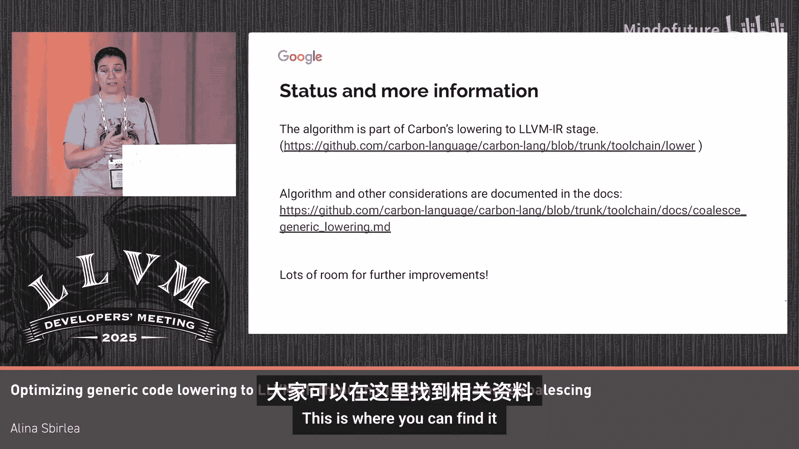

# LLVM开发者大会-US-｜-2025-Llvm-Developers-Meeting-p44-P43_将泛型代码优化到LLVM-IR--BV1ejr5BAEja_p44-

All right， hello everyone。So my talk is going to be on optimizing genetic code logging to LVMIR。

s function equivalence cho。And I was jokingly told that title is2 academicmic。

 so let's call it emerging equivalent functions in the Fja。What does that mean， Well。

 the TLDR is we have templates or genetics that generate many functions and equivalent ones could be merged。

And the frontland can do a pretty good job with that。Okay。

 so I'm going to fly through through the background on this one is C plus+ has templates gasing carbon have genetics broadly it's can we parameterize things at compile time So the focus of this talk is going to be specifically on check genetics。

So for guesting I， the purpose of that is well， performance and safety。

 very important you can do type checking at compile time。

 The cause of that is you do increase code size and compile time， so this talk is going to be。

 can we address that。So a fairly simple example for C++， these are called functional stas in carbon。

 we call them function specifics， similar concept。嗯。

II'm going to take exactly the previous example and add pointers to it。

 So before we had in and double， what if I have pointer to it and pointer to double。

 I want my front end to still do type checking。 I am not allowed to call this function with one pointer of type and one pointer of type type double。

 that's gonna give me a compile time error。 But when I lower this 12 of VM。

 I'm going to get PR in both cases。 Do I actually need two functions to do the same thing。Okay。

 so the problem to solve is what happens when we have such function instance or specifics and the arguments are different interent。

 but they end up being the same function when you go to LVMIR， so same LVM IR type。All right。

 so this is， can we then deuplicate or call us such functions into fewers？Why is it important， Again。

 The two metrics that I'm going to show today are code size and compa。A brief overview。

 the current implementation is done in the carbon content， which has the grangular parsing Alexa。

 it has a check stage that generates the front end IR and then we have what's called the lower stage which queries this front end IR and generates LVMIR I've seen in a previous stock folks call it called this stage cogent。

 this is called lower when I'm going to talk about cogent I mean going from a LVMIR to object file。

right， so this is the part that's going to be the focus of today's talk and there' a side note having an IR in the front end such a awesome idea thought of thatright so because we have that we can do something very interesting such as a representation of a genetic function as a single function body and we can parameterize that by some sort of Is so in the case of carbon these are called specific I。

 what I can query in my front end IR is give me more information about this specific instruction or this specific type in this context。

😊，With that， how hard can it be to compare these two。

 I just take each pair of instructions and query IR， give me， tell me more about this。

 compare them are the same。 I'm done。Well， not really。 first consideration。

 what happens if that instruction is a call， Well， I need to know if those two functions are also equivalent。

 I need to have the full information of the body of those functions。

 that means if I take into account sensitive callss， I need a full call ga。

Second configuration recursion。 I need to be able to look at this and figure out am I in a recursion。

 Do I have some prior information If we put this together together。

 what I'm going to need is the full call graphes。So I need to be able to get to that information。

 Next， so far， I， I can get away with just checking allium types。But that's not enough。

 So third consideration is what happens if I have an interface with a function and I have at the bottom a function that's a generic G that calls the same function。

 The type is the same。 It the type of the inference。 In practice。

 That's calls two different functions with two different function bodies。

 I need to take that into account。Next consideration is there might be other front and specific things that you need to look at。

 For example， in carbon， an in phase can have what's called an associate constant。

 So I can have a checkgene function G where I declare a variable of that type of constant。

 So I have to be able to look at other things such as a locus。So putting all that together。

 all the correctness considerations are going to revolve around。

 I need to do the full call graph HCCs。 I need to engineer everything that's an LO VM type。

 and I need to take into account everything that's specific to the front end I'm implementing this for。

Final consideration performance。 I want to do that with the minimum amount of compile time added so that I can save a lot of compile time by doing this。

😊，So for that， we opt for hashing all the aggregated information for each function into what we call a function fingerprint and for that LDMs Blake3 does a really good job。

Okay， so with that， let me go over the high level definition of the algorithm。

 It's as simple as we generate all the function definitions and collect all the data。

 we hash the data， we keep that in the most optimal possible。

 and second step is we perform aquescing logic and eliminate all the duplicates。So the first step。

 the kind of data we collected is function types， any instruction or type that is dependent on the specific organitation in this case。

 and we look very closely at calls because that's the part that will give us the call graph information。

So after that we perform from the the list logic and it's as simple as for any two specifics。

 check the fingerprint equivalents if the answer is yes they are equivalent。

 what I'm going to get back in a return is the full equivalent functions in the full call graph S。

 so I'm going to get pairs of equivalents and I can do all replacements in one go。😊。

How do we check fingerprint equivals， we check the two fingerprints we created in the prior step。

 and we also do the we have two curves to do the SEC resolution。Okay， so with that， again。

 why is this important and I want to show metrics and compile time and code size。

 and I included some of the alternatives we considered that I won't have time to go into the details today。

Okayright， so I'm going to show some very preliminary performances results that I've got and really important I want to mention that the methodology for this one。

 this is intended to stress test to this kind of use case， I am autogene carbon code。

 so it looks like this， it's very messy because it's a random generation of unique names and a number of variables and a number of function calls where any function can call any other function with a randomly chosen type which means that a resulting call graph is arbitrary and a really complex。

Again， this kind of performance metric may not be representative for your regularular workloads。

 This is meant to stress test what happens in such a scenario。Okay right， so what did I so far。

 f code size？When I did codegen of balance types， both pegmitive and pointer times。

 I saw 45 to 50% reduction in the L VMIR size before and after optimization。

 assembly size and the number of functions generated。If most of my pointers were typed。

 I'd get a 98% reduction。In all of those metrics， I've also tried the merge functions pass。

 and it does make a difference in about 128% of the tests for the other 88%。

 it makes absolutely no difference。But the maximum reduction in number of functions I've been managed to obtain is4 percent。

On average is about 1%。So it's very low。 The amount of reduction that can can be retrieved from front end analysis is。

 is so much higher。 And the next question is， but does that have a cost Because I have to do that analysis in the front end。

 right？ Well， let's see about compound time impact。For balance type， I saw between a 0。

9% increase for doing the logic，2 or 2% reduction in the in the carbon's lowering stage。 Again。

 lowering means generating theium I here。I also saw a 25 to 51% reduction in carbon's opt and cogen stages。

 that's the optimization pipeline and generating binary code stages。The improvement， again。

 really high。 I， I I'm not sure I should even mention for if most of the things are pointer types。

 you spend less time doing this。In lowering， and you spend a lot less time optimizing the code due to the sheer reduction in code size。

Alright， and with all that information。This is the status。 The algorithm is open source。

 This is where you can find it。 First link is the algorithm， the code。

 Second link is the documentation。 And if you have questions and you'd like to know more。

 please contact me。

