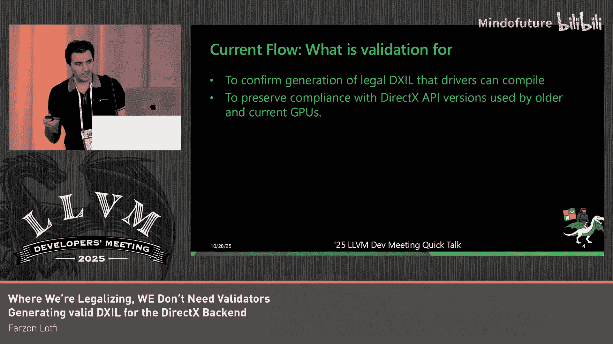

# LLVM开发者大会-US-｜-2025-Llvm-Developers-Meeting-p45-P44_规范化中的位置_我们不需要验证器吗？生成有效的DXIL--BV1ejr5BAEja_p45-

Good morning， Hi， I'm Faron， I'm an engineer working on the HLO modernization effort and this talk is title is lie。

 but one day it won't be， it's about how we're going about turning validation rules in the transformation closer to themic Oh sorry。

 okay， In the transformation to generate validicel。Here's the plan。 First， I'll define a few terms。

 then we'll walk through the current Dixel pipeline and the problem with it。

 then I'll introduce the new legalization approach and show how we're encoding validation rules directly as transformations。

So Dixel is the directX intermediary language it's just LVM3。7。

 DXC is the current production compiler that outputs Dixel。

 DxV is the validator that checks Dixel modules for correctness and compatibility。Okay。

What is validation for， So validation ensures that Dixel we generate is legal and compatible with the hardware and driver stack。

 It required to make sure shaders run correctly across GPs and API versions， both old and current。

What when do we validate today， Valid happens after codegen at the end of the pipeline。

 That means validation rules have to influence earlier optimization passes。 which is not ideal。

 We don't see codegen problems when D X C and the validator match the releases。

 but this can be problem with older releases。Because validation happens late。

 we only see errors at the very end。 maintaining compatibility becomes reactive。

 and the rules have to be manually synchronized with the compiler changes that forces legalization rules to live in the front end and optimization layers。

 which means for each release， we have the possibility of supporting a direct X target。

 could impact code generation for our Sp V backend， which is an ideal。 Further。

 we have the requirement that the new compiler be able to generate valid diixel across direct X API versions。

 The validator is our promise to hardware partners that the new compiler won't break current and older GP drivers。

 when。😊，New compilers do break older validators that can delay releases。

 making this a fragile and error prone process。We don't want to carry forward in modernization。

So what does a validator， What does the current validator do。

 It just checks structure of semantics and resource uses and cheater model rules。

 If everything is legal， it stamps this validator hash of approval on it。

 And then the driver knows it's good。What it doesn't do， The validator doesn't fix anything。

 If the Dixel is wrong， it simply fails。 No repair is just errors。

 So instead of relying on D XV as a safety net， we want the IR itself to already be Dixel legal。

So how we're reimagaginaging the pipeline。 It's a three step plan。 One。

 don't generate a legal Dixel in the first place。 We'll get into that more later。2。

 we're gonna encode validator rules as transformations inside the direct X backend and three。

 we're gonna to use the direct X validator just as a final check some step。

 not as a correctness gate。 This will let us support validator rules across validator releases to address the evolving LV LVM IR we receive from frontend and optimizes。

 So instead of LVM IR Dixel validator fail， we're going to do LVM IR legalize Dixel。

 and then just use a validator for the hash。 that makes the output predictable and removes hidden rules for the interactions。

So。One of these changes that we're gonna have to do is data transformations。

 The key message I want you to take away from here is that we're gonna to mechanically reconstruct the LVM data types and to layout Dixel can handle。

 So one thing we're using is the existing scalarization path to convert vector ops in the scalar ops that Dixel supports。

 This is up to shader model 6 at 8 6，9 will obviously have vectors， but we don't have it before then。

 we also have to build out our own data scalarization to handle things like alicas and globals。

 And you can see we have a transformation here like that。

 Dixel also have a requirement that arrays are flattened。 So we linearize multidimensional arrays。

 This is actually a path that has to happen after scalarization because when you run scalarization。

 essentially that vector is going turn into a 2D array。

And you can see we have a how that transformation works there。嗯。

The next set of changes we have to do were I R transformations。

We introduced a custom legalization pass， we couldn't use global ISCEL for this because we had a requirement that we could still do bit code serialization。

 there was no way to go from MEr to back to LMIR bitcode。

 but this was very much inspired by Global ISEL's legalizer。So。

The Pa rewrites any remaining constructs that don't map a legal Dxel。

 This is effectively an incompr validator that transforms， instead of rejecting。

So how does that look， We have instruction transformations。 LV M 3 do 7 didn't support。

 didn't have a Fg a eggg instruction。 It didn't have freeze。

 So we have to replace these with legally equivalent constructs or remove them all。

Dixel also has restrictions on types。 One example is our restriction on integer widths。

 so we don't support any IHs at all for indexing and inserts and extracts， they can only be 32 bit。

So' that' simple for if you're doing just the index type。 we can remove。

 We can replace those 64 bit with 32 B types。 It can get a bit more complicated when we're trying to legalize the I A when we want this will actually require us to like walk the use chain and find casts。

 After finding the cast， we essentially have to choose the smallest cast。

And make the transformation so that we don't have to modify any of the larger cast later。

 And You can see an example here where we have two conflicting， which one we pick。

 we pick the smaller cast。To propagate up to the alaca。We also have to。 We have to。

handlele intrinsics。 So we typically do this with intrinsic Spanish。

 So Dixel does not support any memory intrinsics。 That means these operations like Mem copypy and Meps that need to be expanded in legal scized forms that match the Del memory model。

And then we have special types that we use via the target extension type。

And these can't be modified by passes like Simpl C FG or the GBM password we'll talk about later， so。

These resource types can't flow through Psizer selects。

 We need a way of marking them so the optimization passes。

 leave them alone and prevent the optimization altogether。

 And so we came up with this term of tokenlike， which takes advantage of some of the rules that already exist in for tokens in the optimization passes。

And here we can see we don't propagate it to the different。 We。

 we keep it within the different basic blocks。 We don't try and。

Put it down to the one Phi inspection。Similar， we had to do the same thing with the G VN pass。

 We have to teach it what what a target like。Instruction was or sorry。

 a target like type was so that we wouldn't generate files for it。嗯。So， yeah。

 we just were the idea here is we're just trying to prevent it from reconstructing incorrectly。Okay。

 so this doesn't replace the validator overnight， but it's a forms a path where every validator rule can become a transformation rule and ensures future correct and older Dxel versions stay supported。

That's。Yeah， thank you very much。