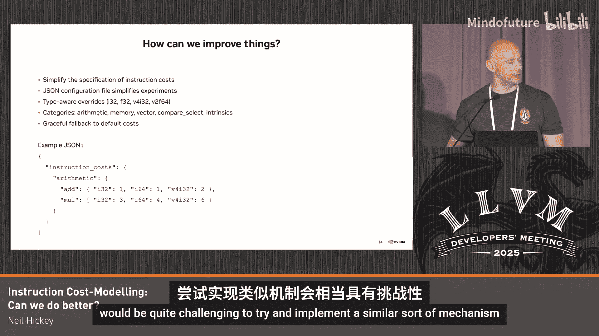

# LLVM开发者大会-US-｜-2025-Llvm-Developers-Meeting-p46-P45_指令成本建模_我们能做得更好吗--BV1ejr5BAEja_p46-

O。Thank you。 Yes， and my name is Neil Hickey。 I'm giving this presentation on behalf of two of my colleagues。

 Suant and Muor， who unfortunately couldn't be here today。And I want to talk a little bit about the。

 the instructions of the LDM cost model in LDM， so。

We started doing some work looking into the SLP vectorizer and one of the first tasks that we took on as part of that work was to put some of the tests in the SLP vectorizer to from that were tests for the Intel back end to AOT 64 and often what we found when we started doing that was that the code generated wouldn't exactly match what the test was expecting。

And often when we started looking into the why， why was the code not generating the right way？

Almost sort 90% of the time， it ended up coming down to a cost modeling issue where the optimizes of the SLP vectorizer was choosing a different code gen or wasn't optimizing in a certain way。

 and it often resulted to kind of tuning the cost model。

 tuning the heuristics that we have for the cost model one way or another。And we。

 we started to kind of discover that this was， you know。

 quite intellectually unsatisfying to just be tweaking a heuristic one way or another when we started to investigate。

 is there a better way to do cost modelling in LVM。

 which which can kind of solve these problems in a better way for us。

So in my talk I want to quickly go through kind of a very brief introduction to the cost model。

 talk about what it currently does well， what it's good at and what challenges that we see in the implementation and then the main purpose of this presentation is not really to propose or to suggest what we should do。

 but to open up a dialogue with well the community， unfortunately it's the last talk the conference。

 but to open up a dialogue with the rest of the community like many people who think either the cost model is fine。

 leave it alone， don't change it， or yeah we agree that we could look at a different way of doing things。

So as a very brief introduction to the cost model， it's a very simple and quick approximation of it takes an LVMIR input and gives you the instruction cost for a given back end。

It's it's quite a high level and very tuable heuristic。

 So it's a relative largely it's treated as a relative instruction cost。

 It tried to maybe at the beginning to represent kind of the reciprocal throughput。

 now it becomes more of a proxy of the general cost or general general cost of an instruction on a particular backend and it's used as a guide。

 So one of the first questions we often get is well does the cost model have to be exact really' it's。

All you really want out of the cost model is it。It encourage you to take the right optimization decision。

 So as long as it's close enough， it's probably good enough。So that's often， you know。

 a topic that we discuss is is the current cost model model done。SoAnd here's a quick example。

 so it's implemented as a TTI hook。You have an instruction。

 you pass it to the T TI for a particular backend， and it gives you a cost。

 and then you will sum those costs up for， for whatever it is that you're you're doing the cost modeling for。

 and it will give you an overall figure。So as mentioned， it's implemented in the back end。

 so back end will override the target transform info class。

And for a given instruction for a given LVM instruction。

 it will calculate for this particular back end。 This is the cost。

 this is the cost when you execute this， this instruction on this particular back end。

AndSo as an example， so many of the optimizes within LVM use this。 And， and as I mentioned。

 to begin with the the， they're trying to make a decision。

 So they're trying to an optimizer may have come up with two or or three or multiple different ways of。

Of optimizing a piece of code。 And it's querying the cost model to say， okay。

 out of all of these variants， Which one's the best and which one should we go ahead and， and。

Turn into the， the generated cold。So a simple pictorial depiction of a cost calculation。

 so I mentioned， an optr is trying to make a decision。

 it's then going to generate an example IR that it could generate as part of this optimization will query the TTI will get a cost back and then from that it will make a final decision of which route it would like to go for。

So what is the cost model good at， I mean， it's it's obviously you know。

 it's it's a workable heuristic has been for a very long time。 It's quick。 So it's you know。

 order one queries， it's not reliant on like do any Colgen。 you give it some of the MR。

 and it gives you an answer。It it's composable as in you can adopt costs。

 for different instructions and make a higher level cost for a higher level object。

 It's overriable by the different back ends， and it's a common infrastructure that's shared across all the backends within LVM。

And as I mentioned， it's used mainly as a decision tool。 It doesn't have to be 100% accurate。

 but obviously if you're making complicated decisions。

 the more accurate you can get your cost model the better。

So as we've been looking into this we've seen maybe five overall challenges that we see。

 one is maintainability， as I mentioned it's heuristic based。

 so often you're tuning heuristic one way and you'll find that it may produce the code that you wanted in that case。

 but 15 other pieces of code suddenly regress and you're pulling your hair out trying to work out well why did that happen and then you have to start tweaking things back and you're trying to minimize the changes and overall try to improve things in this heuristic way。

And many of the， many of the backends have quite a low level of granularity。

 So what I mean by that is an ad is one。 and， and you may have another instruction， which is， well。

 it's a little bit more expensive than an ad， but it's not twice as expensive as an ad。 So。

 but your only option is either one or two。And and as mentioned， lots of places within the cold。

 they just sum the IR costs， which is quite a simplistic way of looking at the IR and there are some thoughts we've had on on how to make that a bit more sophisticated。

 but it simply sums up a bunch of costs and tells you for this block。

This is how long it will take to run， and it is just a simple summing of all the instructions within that plug。

And then obviously， as well， with it being at the IR level。

 it's not necessarily matching exactly what the hardware may produce and what the hardware may execute。

So briefly discussing the problems of maintainability。

 So the cost model model spans around 100000 lines across LVM。

And each each of the optimizers that use the cost model may use it in a slightly different way。

 They implement their own summation logics or the loop vectorizer makes heavy use of it。

 It has lots of different uses and ways of summing up different instructions， as mentioned。

 the SLP vectorizer has has the same case。And some optimizes such as loop vectorizer。

 even have two cost models。 So there's a legacy cost model and the V plan based cost model。

Then every time you're making changes， obviously， you need to keep all of these optimizes in sync in some way。

And often for AR 64， there's a single back end cost model。

 but it could be different for different cause。 So there's no。

 there's no real easy way of tuning it based on which core you're executing。

And quite a few of the optimizers obviously as mentioned， you know。

 they have their own summation logic， so they're all doing the same thing。

 They're doing it in subtly different ways， and it makes it quite difficult to maintain。

It's also heuristic based so initially it was maybe to represent reciprocal throughput of the instruction and over time it's evolved to be this pure heuristic and often this means that the cost model changes are retroactively applied and lag behind code Gen improvements So here are a few patches that I pulled out where obviously after a code Gen change has been made or some hardware change has been made many weeks or months later someone comes in and says oh we've noticed that this cost is incorrect so we're going change this heuristic number to something else but that is a lot lagging the you know the code Gen improvements that are being made。

As mentioned， you know， add is one。 so so these these are quite a low numbers but not an awful lot of granularity。

 And here's another example for for riskk 5 where they decided they wanted to implement a percentage cost based system。

 So they multiplied all the figures by 100。 and then they had greater granularity。

 but each target essentially invents its own way of scaling these integers and how what do they represent ultimately。

And my final point really is that it is just a sum of IR costs。

 and often this can result in capturing a cost that may not truly represent the the true cost of the generated instruction。

So here we have an example of a situation where the IR may come back with multiple different costs for the mole ads and various other instructions。

 but the final generated assembly is quite simple。But the cost model has said， well， you know。

 the ad is going to take one。 The model is going to take one， and you add them all up together。

 and it might not be a true representation of exactly what your back end is able to do。

So how can we improve things， We've had a few thoughts， but as I mentioned in the beginning。

 really this is more of an opportunity to talk to the community and see if anybody else has any ideas of whether this is a genuine problem and whether they agree with those and whether there are some ways that we can improve things。

One of the first things that we thought about doing was extracting a simple Json configuration file。

 which allows you to override the past for a back end in a much more simple way。

So this is a type ofware overrides for an IR instruction。

 You specify the IR instruction and what types it takes， and you can specify a simple cost。

 This is the purpose of this was more around， is there is there a more efficient way we can find to tune a whole bunch of different costs for different cause So this could be something you could expose to some kind of ML auto tuning like framework。

Another way we thought we we could maybe change this is rather than just simply summing up the costs within a basic block。

 use the scheduling model that exists for some cause in LVM and try and work out the critical path for a given block。

 So if you're thinking about vectorizing the loop， it could be that you don't want to add up all the costs for all the individual LVMIR instructions。

 you just want to take that critical path using the analysis using the scheduling model as it exists and just sum up the costs of。

Of whatever is on the critical path to give you that that full cost of the end。And then ultimately。

 you can， you can return that， that final full path， critical path length as as your。

 your final cost。The final way， although we appreciate that this this is quite problematic is。

 you know， you could potentially actually go much further through code Gen。

 understand what the back end will generate at the end and then use that to derive your costs more precisely on what the code may may generate。

Obviously， you know， there are issues with this。 One of them being compilation time。嗯。

But it does give you some advantages。 So when it comes to fusion or various different features of the back end。

 you can more closely map， you know， the real hardware effects of various L VMIR instructions。Okay。

 so as I mentioned， we， we'd like we're interested in in if anybody else has other ideas of how we could improve things with。

 with the cost model。 please come and speak to us。 But that's all I had today。 So yeah。

 we can finish a little bit early。 Thank you。Thank you。Yeah。

 so have you seen Simon Pilgrim put up a patch like a couple of years back where he essentially like he was lowering stuff through the back end。

 but doing it like as a table gen driven approach。 So you would like when you were building your compiler。

 you would generate all these tables by lowering it and like running running the lowerings through L VMM and then you could generate your。

Tables from that like have you looked into using like trying to get that sort of approach into upstream we haven't looked into that。

 but I think that is a very interesting way of doing it。

 And yeah we kind of keep that patch to the side and I' always look at it again and go oh maybe we should look into doing something with this。

 so yeah， it is something that we we're interested in doing and I think that will probably the first step that we take。

Yeah because I think that would be a reasonably feasible way to do it and then you can just do everything with the scheduling model。

 I mean you have to trust the scheduling model and hope that it's actually good which I think was the major problem with actually landing that patch。

 but yeah I think that would be it seems like it solves most of the problems。So。

Kind of following up what Aden said。When you talk about using the critical path slides。

 I was thinking since you already do the code and do the heavy lifting。

 you can just use the MC A to estimate it something。 also in the same slides。

 I think it makes sense to estimate the critical path。

 but that is assume the scheduler do a good job to make sure the ILP is shorter than the critical path。

 that is one of the job schedule scheduler was designed to do that。

 But sometimes it might not it will just fail to do that。 So in that case。

 IOP will be terrible and it will be slightly longer than critical path。 yeah Yeah， but yeah I mean。

 hopefully itll be a bit more accurate than just adding up。 yeah obviously re on the schedule。ing。

 and also like regarding the colgen being too heavy。

 we actually have been circling an idea to approximate this approach saying that you give a static mapping from an Elvin IR instruction to certain potential machine instruction and you just cost these machine instruction using that's a scheduling model so that you know。

 it's like a middle ground between the heavy hammer。

 which literally call it backend to do the I cell。 and the other end is we don't。 And we just。

 there's a huge semantic gap between Elvin IR instruction and machine instructions。

 So that might be a potential way a compromise。 good should we should talk about it Thank you。

Any further questions？So as you sort of mentioned， sort of the initial idea behind the cost model is like the costs are mostly reciprocal through pit based。

 but we do have other kinds of cost kinds and perhaps it's just my inability to find them。

 but it seems like we really only use like reciprocal through and code size maybe in some paths。

 but other kinds of metrics like latency， don't really get used I mean is this just my own misunderstanding or is is this something that we would like to use more of in the future or I mean I guess you know if we were to tie it more closely to the suling model。

 then we would be using more things like latency and through metrics to guide the costing。

 but yeah you're right。 I mean， currently it is just that one number has to represent everything in some kind of heuristic but right way。

And is there any interest in making those like actually cycle accurate or we're still kind of just looking at these as like numbers that we use to get the right result rather than actually representing like hardware behavior？

Yeah， I mean， like I said， I think in the talks it's there to guide a decision。

 so it doesn't have to be 100% accurate。 It needs to be good enough。

 but what is good enough depends on you know obviously the situation you're in so it could be if the scheduling model is close enough then then we can we can use that and it it does the job that we're looking for。

Thank you。Any more questions。So first， I think you've just destroyed my child like faith in the cost model so。

this is hard work to my harder works at all。 Like， why are we doing that anyway。

So thank you for for sort of stepping on my puppy。 That was good。

 my mind has been liberated from its constraints。It seems like a lot could be done to more closely model hardware。

 but yeah， I guess like。嗯。Like I was curious with you like well we could kind of empirically learn it。

 but then I was like what happens with you when you iterate that like does it even converge like I think you kind like you't like walking through this like state space so yeah I mean it seems like a lot could be done we think so we think so too was just tweaking this number just felt so intellectually unsatisfying when you want to know why is this sequence you know this value and this or the sequence is this sort the value So yeah that's why we wanted to take on this work。

Do you have some ideas in terms of like nailing down like particular microarchitectural effects that？

It would be better to model， sorry。So I think using the scheduling model is probably like we said。

 the first step。 So if weve actually impacted based on the latency and throughput of the code。

 maybe that's the first step we can take to get something more accurate。 But yeah， there are other。

 I mean， the heuristic is is a proxy for all of the hardware things that could you know impact why you'd want to generate one instruction above another。

 So maybe there are more things that we need to think about as well。 but yeah。

 we can iterate on that as as we improve it。I mean， is this something that you could like throw？

It feels like one of those things you could throw ML at and it might produce some interesting stuff。

 Yeah exactly yeah I mean I think that's why one of the comments was first expose all of these heuristics to something that can iterate it over。

 maybe we want to do something a bit more complicated than just one number but multiple features that we want to then tune could be a different way。

 but then obviously extending that JasonO interpretation would be quite easy so we could look at that as well because actually to change it in the code given how spread out it is would be quite challenging to try and implement a simple sort of mechanism。

Okay。Any further questions？Okay， the let's thank the speaker again。 Thank you。

