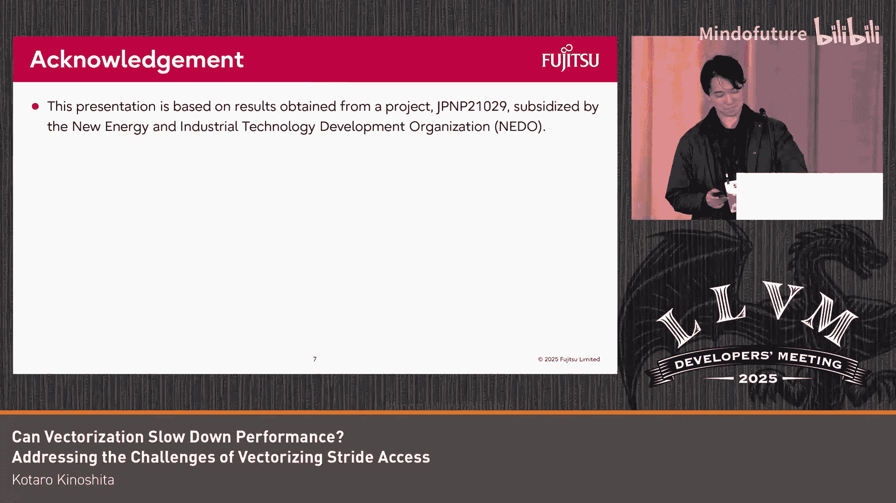

# LLVM开发者大会-US-｜-2025-Llvm-Developers-Meeting-p47-P46_向量化会降低性能吗--BV1ejr5BAEja_p47-

アムコト木下アイォフ士通グトダチャジグアク。Vexurization is generally expected to improve performance。 However， we found。

That the performances degradation， in some cases of vectorizing straight taxes。あ、ジストクフォーカシゾンワンサチケー。

For example， in the test case on。S on this slide。As we Victoria the version actually performs worse than the scholar version。

We found。This performance degradation is caused by inefficient cogen for st taxes。

 and weve opened an issue for this。In this talk， we。

 we discuss this issue and its improvement status。While this talk focuses on A A 6 for S V E。

 we believe this， we believe this issue may be relevant to other architectures as well。呃。

 so one of the problem with the code generated by the current equilibrium vectorization is its ineffient address calculation。

With SVE。Strateged access requires the use of gather instructions。啊。In the current vectorized code。

 the addresses for the operation are updated inside a loop using vector instructions。

 as you can see that。In the example of this slide， the vector register Z1 is updated in every duration。

But if we identify the patterns as a storage axis， we can generate called efficient instructions like these。

The value of vector vector register is initialized outside the loop。And then inside a loop。

 the base is updated using sc instructions。In the example on the slide。

 you can see that the base X 1 is updated。In every， this code is more。

 more efficient because it requires fewer resources for。Other this calculation。Next I。

 Ill explain that。Irov status for this issue。Fortunately。

 A patch had already been contributed for Rik5， which has dedicated strategy load straw instructions。

Thispat detects the stride access patterns in little picturesize。

And assign it straight to log recipeP。However， A X 64 doesn't have these dedicated strategy load to instructions。

So we couldn't use the recipe directory。So our contribution was to create a patch that legalizeized the risk before A A x 64。

 this patch replace the risk before replace the recipe with the exchange sequence of instructions we saw on previous slide。

In fact。呃。For the test case from the。Introduction， our approach improves performance by 37% compared to current vectorization。

Finally， I'd like to briefly briefly touch on some other issues of vectorizing straight axis。呃。

First one is loops with a variable strategies width are not being vectorized effectively。

 This is related to。Roup march versioning， only the version where strategy is one gets characterizedized。

while the other case remainsすから。Second one is another one is the in the bus simplifier when widening the index of strand access to6 for bit can potentially double。

 double the number of memory access instructions。啊。We resisted the。

Reated the issue number on this slide。That's all。 Thank you very much。

