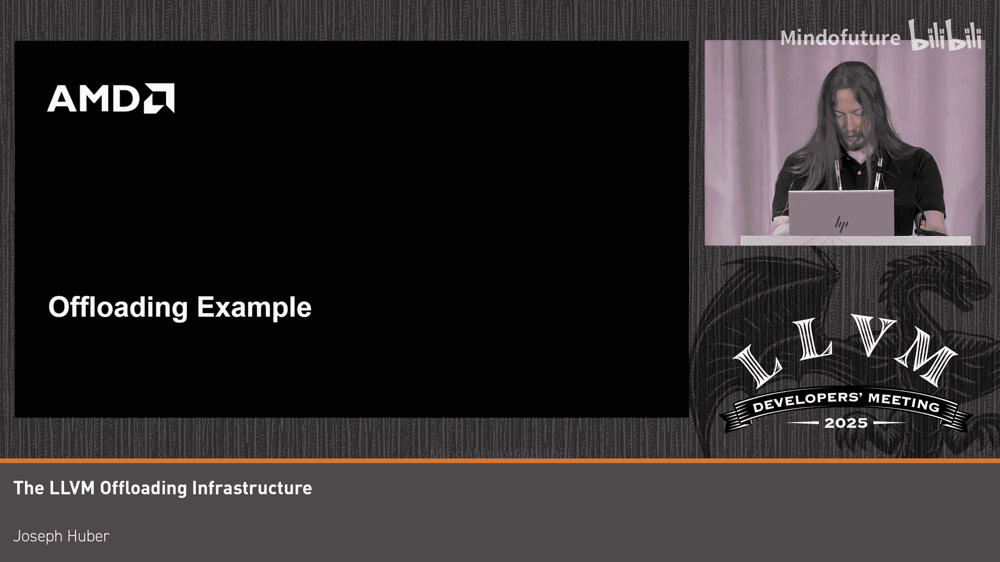
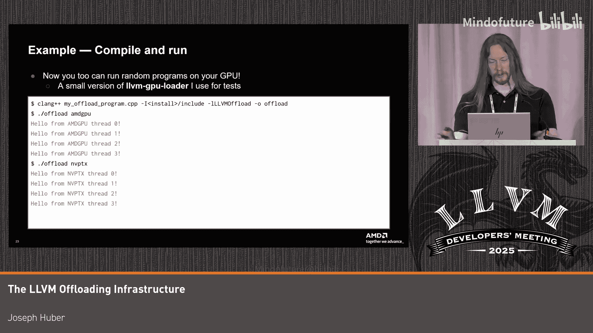
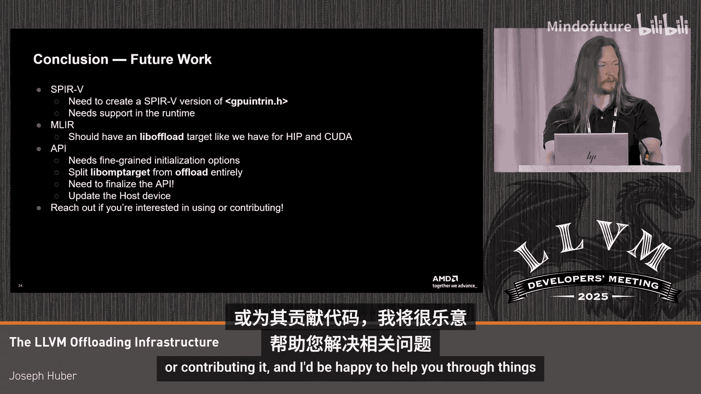
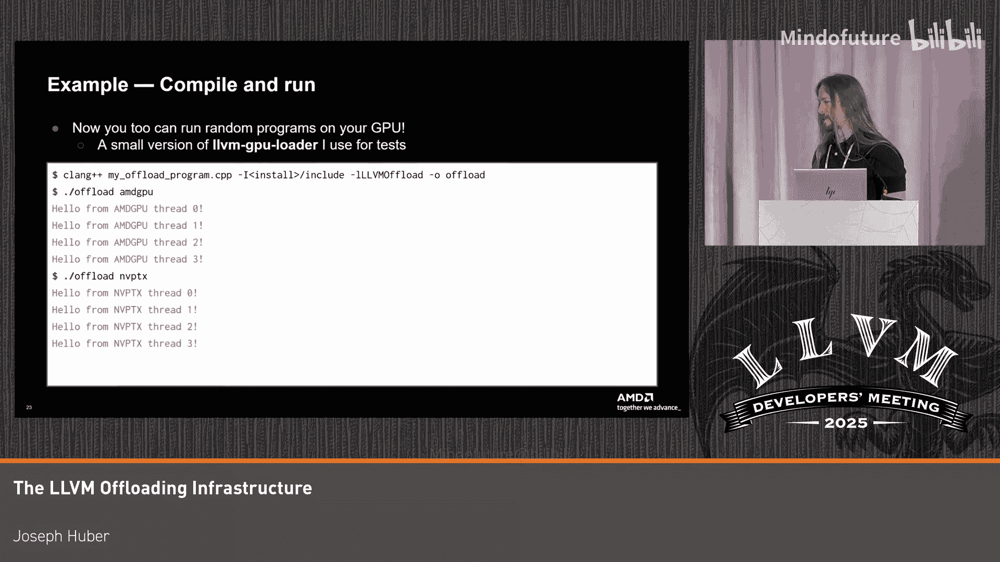

# LLVM开发者大会-US-｜-2025-Llvm-Developers-Meeting-p48-P47_LLVM卸载基础设施--BV1ejr5BAEja_p48-

Thank you。As he said， I'm Joseph Huber and I work at AMD。

 and today I'm going to be talking about the LVM offloading infrastructure。So what is that broadly。

 well， it's kind of just this。Large assortment of LM utilities that we use to run programs on external accelerators。

 We try to say it's more generic than that。 But these days。

 it's pretty much always a GPU and the domain。Iea behind these tools is that we want them to be very generic and reusable between all of the like language front ends and vendor compilers because you know this is open source and it's better we don't have competing implementations and when one person improves something everybody benefits。

 Now there's like a ton of spaces this applies to I can't really go over all of them and a reasonable amount of time。

 but this talk is essentially going to be a whirlwind tour of what like GPU compilation looks like in playingang and LV on these days。

So it just first is a motivating example， this is something I did last year and it's kind of just to show how effective GPU compute is these days in that you can pretty much just take any CNncC+ plus source you can think of within reason and run it on a GPU and it's kind of an exercise to the viewer if that's a good idea or not。

 so last year I just talked to Doom C source。It's compiled it for the GPU and ran it and hey。

 it actually works， so keep that in mind while I talk about how to do that for yourself。All right。

 so before we get started， I'm just going to go， like I said。

 cover this stuff really quick of how alpha and compilation actually works。

So I've recently been trying to tell people to think of GPUs more as like any other。

Embbedded target right so this is just a tool chain that has a compiler called Kang and when you take that compiler for the tool chain。

 you give it some source files and it does whatever step is necessary to give you a usable executable。

That compilation mode makes things really easy for integrating this stuff into all of the existing tooling we have。

So down here， I have an example， just like an ax p， like I think exists in every GPU slide deck。

you can use this generic GP and trend header that I have to make this mostly generic between all of the targets we support。

You can just use the claim tool chain for each one of your GPUs to compile it so you can do it for AndDGCN or NVPTX and get a functioning executable for whatever hardware you desire Now it kind of works for Spv64 but not really there's still some like missing pieces for like non-unform Wayings and the reason I'm bringing this up is because this is currently how I've been moving the elegant infrastructure to start building the GPU runtime So GPUs do actually have runtime libraries most people are familiar with the like math livess。

 but you know there's some more things like that even in like Kin hit you have things like Maoc and Prif if you really want it。

嗯。And Openmp has a rather intense run time for certain things。

But the way that I build these things is just by using that idea of direct compilation rents is just a cross and pyling tool chain。

 like any other embedded system you're familiar with。

You might have also heard like some other talks today talk about the。

The target tool chain library is like multi lit。Essentially what that does is takes your target and puts it in a qualified directory so you can install all of your nice libraries there without worrying about them conflicting with anything else and I've been slowly parting over like every single runtime to work this way for the GPU I think the only one I'm missing is lid CLC。

Now， I don't really have time to go into depth about how to build this in the CMake。

 but we have this cache in the offload project called Offloadt SeeMake。

 which is supposed to be like the living documentation for how that works。

 so to check it out if you want to know what it's actually doing。All right。

 so once we've built like one time libraries now we can actually use them for compiling the offloading languages that most people who program GPUs are more familiar with as is stuff like Open&P。

 H and SickL and CUDa and whatever SQL has an asterisk because it's not really functional upstream it。

But the main difference here is that these are heterogeneous where they combine like one host compilation with any device compilations。

That introduces a lot of complexity in the tool chain。

 which we have a lot of offloading tools to help manage。So you can see some example here， you know。

 say the X P thing except hip flavored and if you put a dash be on it。

 you'll see a lot of stuff going on so I'll try to do a very quick overview of what that's doing。

So you take your source files。 And if you do that， you'll see it generates many clang jobs to the front end where you will get a host object and many device objects。

 Now， every single like clang。Compilary tool chain。

 not just playing compiler tool chain expects one output so because we generated multiple device objects here what we need to do is combine them down into one with this LV and offlu binary utility and this is just a binary format that contains someadata to recreate the original like clang jobs so we know what we're using it with when we actually do the linking and then we embed that into the host object and get a fat binary that contains both the host and the device code we then stick this through this clang linker wrapper tool which has a lot of magic in it。

 but on a broad level all it's doing is extracting those。Fat binary objects。

 calling that direct target I talked about earlier to get a functioning executable。

 wrapping it in registration code， and then committing it into the final A。 out executable。

 so when you run it， it initializes it that one time。😡，So real quick。

 if you actually look at what that embeending looks like。

 it's just a name section and if you look at that name section it's just like some metadata and a binary object。

 so there's nothing too complicated。And if you want to link that， like I said before。

 we have the claim linker wrapper， which is just the magic step that does everything for you But if you were so inclined。

 you could do this yourself and pretend you're a compiler driver and do LVM offload binary to extract the files instead。

 you can see in this example you do that。 and then we use the。

S chainin compiler to get the executable， and then we use the Lium Olo wrapper to wrap that in a module that has like your call to hip register module or whatever it's called I forget that will then be put into a constructor that when the user launches their program。

 it calls that and then boom you have access to your GPU executable。

And if you don't already know the architectures of the things you put in there。

 you can use LVM Obs jump with the offloading flag to figure out what that is。Okay。

 so hopefully you caught some of that so it was really fast， but that was the compilation phase。

 so I'm going to be talking about now once you have something compiled。

 how do you actually run that on the GPU， right？So。Recently。

 the LM project had an addition of the offloading runtime， which is an offloading project。

 and this was originally forked off of the open andP support。

So this is supposed to be a generic interface over all of the like vendor GPU runtimes that we intend to support。

 and I said generic with an asterisk because I always want to warn people against making like truly generic things because you usually just end up with like a minimally useful subset of all GPU features so you need to have extensions where you need them right now we support AndD and NviIDdia offloading and there are patches up to start supporting Intel GPUs as well and these are mostly just dynamic wrappers over like the actual vendor runtime but it's a unified interface so you just need to permit one thing and figures out what to do with it。

All right， so that was originally used for Openmp， but we figured out that。

 you know most of it is very generic and we can actually start exporting it and there are other targets like Sickle that wanted to start using the same interface。

 So recently there is a push to start making a new library and start splitting openmp like into its own little section and pulling the generic stuff into a API and that API is called the offalload。

So what is live offload， it is a St C API for offloading two GPU programs and I know some of you in here are thinking that don't we have enough of these and the answer is probably yes。

 but it's very nice to have APIs we can control when we're working inside of LVM。

It's still work in progress， but I'd say it's past the MVP stage， so you can definitely use it。

 but there are some things that might change。And like any good GPU runtime。

 it starts with a two character prefix for every API function like your VK in your CL in your CU。

 there were some talks about making it the LVM offload library。

 but I vetoed that because I did not want to be callingL in it in my runtime code。All right。

 so like so many people have done before， we have headers that are done through tableG。

 so you put your API function in there， you give it a description so that generates documentation and then it will also automatically generate things like function verification of like the arguments to make sure they're not nu or whatever and tracing so when you run your program you can optionally get a print out of like oh executed this on this thread with this error value stuff like that automatically is' very useful before checking things out。

This is pretty welltrodden ground for LhiM people， but we install this stuff in like this offload API。

 H and then you just use newtableable gen executable that we created to then get this in implementation。

 so this will reduce it down to this as you can see it does this tracing check and if it is。

 we just emit the name of the function， we call an implementation which lives in the actual runtime。

 and then we return whatever error and print them out。So。From a very high level。

 a lot of these GPU runtimes look the same， objects are all exposed as just opaque。

So if you have a device， that's just some weird pointer that you don't know about that you give to the runtime。

 it does things for you。We really want to provide this as something that people can use for their compilers to emit like offloading code。

 right？To make that much easier， we did rich error messages that have custom error strings instead of like most run times we'll just say some generic error and a lookup table。

 we actually generate a custom one for like whatever the incorrect argument actually was。

And another thing we do is have a variance of each function that takes a code location。

 so if you are a GPU compiler， you can say that the error happened on line 52 instead of whatever on a 10。

000 line file。At a high level we pretty much just expose everything as just a device with a platform that influence it basically as a property of that device。

 so if you have some weird heterogeneous machine that has like Nvidia named DGPUs or even seekU on it。

 you'll just see that as a big list of devices and it's up to you to pull out the one that you're interested in。

So another very high level overview of that。So now we will go briefly through an example to hopefully qualify with you what this can do。

So first off， we need to get a GPU program that we can execute on our fancy GPU。

I just want to use the direct approach from before where this is just strict C code and to make it a little fancier。

 I'm going to use the LiC library runtime that I've written。

 So you can see here I call the GP and trend include this works on pretty much any C flavored language you have。

 and I'm just checking which one we're actually compiling for with if de。Pretty standard stuff。

I'm declaring this thing called kernel with a GPU kernel， which will call it be which will cause it。

 excuse me to be emitted into the object with the kernel calling convention so you can actually look it up and call it at run time。

 and we just print that platform with like the thread ID。

Now I can use the same flags from before with the targetrget MDDCN。

 MDHSA set for my GPU with the C library LinkedIn and then get an executable that will run on my AMD GPU and then do the same for an NVIA GPU and get an executable like A SAS or Qn or whatever that will run on an NVDIA GPU。

So now that we have that image， the first thing to do is write a program that can load it。

 so obviously we just read that image in from the command line and then we just want to initialize the runtime So you see we call this OL in it function。

We have this nice little helper macro that checks for errors and this will just say， oh。

 if there's an error， just print it out and die。Because everything emits an error in this。

 like a lot of other runtimes， you should be able to do this pre mechanic。

So assuming that your initialization succeeded， then the next step is to discover a device that you can run that image on。

And since this is all exposed， is just a big list of devices。

 What you can do is iterate those devices and then find one that can load the binary you were provided。

 And you do this with this OL is valid binary function， and this OL iterate devices function。

 So this just takes a callback and a pointer to some user data that you can use in the callback that we then use to basically try to load。

This image onto this device， if it succeeds， we just return false and exit the loop and return our device。

 if it fails， we just continue on to the next one until we find one and this is pretty cheap to do。

So。Once we know our device and we know it will work， all we need to do is get a program and a queue。

 So you can see we get our device and we want to basically load。That image onto our device。

Which is called this OL program handle， So we call OL create program with our discovered device that we know willll be able to load this GPU image with the image and create the program。

 and this is what physically moves that binary that we compiled onto the device and so that we can execute on it。

And in order to do pretty much any work on a GPU， you need to have a queue that you can push things on like FIO styleyle。

 so we just go ahead and create a queue to do that。So finally。

 all that's really left to do is launch the kernelnal。

 So because we know the name of this kernelnal was just kernelnal， because I called it that。

 What we need to do is create this symbol handle。And look up that string name in the program we created。

😡，So that will go through the loaded binary and find the literal address of this kernel symbol and return it to us so that we can then call it basically。

Once we have that， all we need to do is set up our arguments。Set of our launch parameters。

 So in this case， I'm just going to launch it on for I did have enough space for more eible commons。

 but this is just going to launch this on tour threads。

And we call this OL launch kernel to push it onto this cu with this device on this kernel with these arguments。

 and the arguments are passed as just astruct basically with a size。And once we do that。

 all we need to do is synchronize on the queue to wait until that work is done and then just clean up all of the programs that we had previously。

 so we destroy the queue， we clean up the program and then we shut down the device。

So now that that's done， all we need to do is compile it and hand it the images we compiled。

 so this is just a standard compilation， so like my offload program and pointing it to the install location。

 which is where we currently put the offload headers if you enable this project and link in theL LVM offload library。

So then we create this offload binary and we just pass it our AmD GPU image and it successfully finds my AMD GPU that can then launch this program for me。

 and because this is made to be generic， I actually have a machine that has an NviDdia GPU on it as well。

 and I can just use the same program and pass it my NviIDdia binary and it finds that NviIDdia GPU on my machine and then executes the same thing with the same implementation printf basically。

I think that this is really a compelling example to show how simple it is these days。

 You just take like some source code and compile it down to something that you can run。 You know。

 this was like。This is only a few lines of C and less than 50 lines。C++ using this library。

 and I can pretty much already execute any kernel I want。Push things onto that cue。

 and I didt need to worry， you know， all this was generic。

 I only had one if de that I just put there to have a different string。

嗯。So yeah， that's pretty much all I had to show you。 I could go on in much more detail。

 but I obviously have limited time。 So I'll just briefly talk about some future work I think we can do here。

 Spearv is up and coming， but there's definitely a lot of work that needs to be done in it。

 I would really like to have a Spearv version of my GPU intrinsic header because then I could trivially port all of my runtime so you could theoretically get things like my printf and all the Liy stuff that I have as well as well as open and P because。

If you don't see stuff like that， they'll pretty much happen automatically because I've already ported those to be generic with that。

Serview also needs support in at one time， we don't actually Jit compile it yet。

 but I don't think it will be that difficult to just need some fine handling if to call into some external utilities so I'm not an MLIR person。

 but I do know that we have a like GPU dialect that does like launch stuff and that has backend implementations that will  emit calls to H and coUa and I think it would be really cool if we had one that offloaded to this so maybe someone from MLR can reach out if they're interested in pursuing that but like I said。

 I'm not an MLIR person so。And there's obviously a lot of work left to do for the actual API in this library that we're writing。

You know， we need like more fine grannuular initialization or like selection of features and then something I really want to do is pull more Libmp target things out of the offload interface we've already done a lot。

 but if you look inside of the source there's still a lot of things that safe openmp on them and I would prefer those all to be gone also you know obviously you want this to be 1。

0 and finalize it。We need to like update our offload CPUs that you can actually use it。

 but that's pretty much everything I had to say， so reach out if you are interested in using this or contributing it and I'd be happy to help you through things。

So this is here because it needs to be。questionest is。系。Quite interesting。

 Do you think it would be possible to have a。Safety， critical version of these for。

Autology or something like that。So you mean like have much more verification of the inputbox itself。

 or can you avoid to have。Dynamic allocation in the middle at some places and seem like that all avoid exceptions。

 And yeah， I think that would mostly come down to the underlying implementation because of course。

 we need to rely on the vendor's implementation because unless someone wants to like start writing stuff with like Iocal and start interfacing with the driver directly We still have that dependency。

嗯。I definitely think it's possible you just need to write like a custom internally。

 this is all done through a plugin。And that interface。

 we already do most of our allocation through like a bump allocator。

Because we usually have static knowledge of what's needed to initialize it。

 you could probably just codify that， make sure the plugin that you're calling also has stuff like that inside of it。

 it's doable， but I don't think there's anything there right now。はい、あ、何した。诶。You didnt go with the。

Malos on the device。You mean the implementation of Maoc on the device， No。

 just a cause to Maoc and then。Is it possibly the properties spot Oh yes， that's obviously， I mean。

 I wanted to have this example like really， really small to make it fit because I didn't have enough time。

 But yes， obviously， you can allocate on the GPU and do me copy to and from and stuff like that。

 It's pretty much the same as you would if you're in Kuta。 You know。

 you just pass it Eom value for what type of memory you want to allocate。

 And there's all sorts of implementation details I could get on about。 But yes， you can do it。

 it's not that minimum viable product。Thank you。Thank you for the talk。 Really quick question。

 I did see on the slide that。I guess it's a kind of double question， so。

Do you need Rocom installed to run the binary and kind of a follow up。

 I did see that you were running it on Gfx 1030， which is or didn they do And I was curious like what you be also supported。

 It seems like it's out of the support range for Rocom。 Yeah。

 so theoretically it just uses if you really want the details。

 it is running off of the HSA run time if you can actually get it like separate from rocking them if you really in that's the underlying implementation。

 you could theoretically get that in statically link it。 it's not a dynamic dependency。

 if that's just the easiest way to provide it right now。

 And so we pretty much support every GPU that HSA supports， which is most of them these days。

 So Gx 1030' because it's my home GPU。

All right。 That's it for talks in this room。 Let's all go to the California ballroom for a closing remarks。

 and let's thank Josephph again。 Thank。