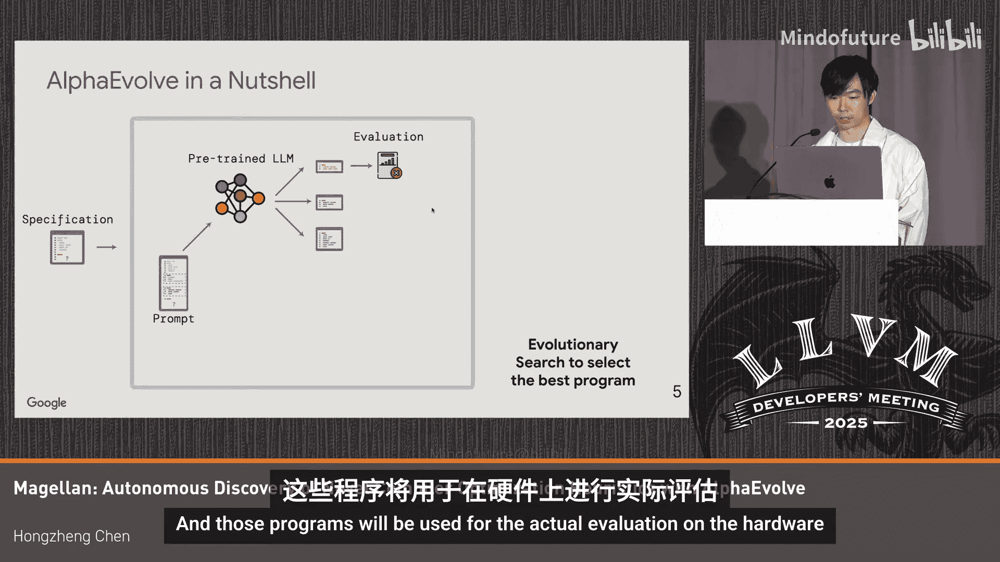

# LLVM开发者大会-US-｜-2025-Llvm-Developers-Meeting-p49-P48_Magellan_新型编译器优化的自主发现优化--BV1ejr5BAEja_p49-

Okay， hellello， everyone。 I'm Hongzhen， a final year PhD candidate from Coran University。

 and I'm also a student researcher at Google hosted by Mesha and A。

 today I'm going to talk about Michel。 So this is the new presentation title。

 So its about autonomous discovery of novel Comp optimization here this with Al。

 And this is also in collaboration with Alice and Mvy from Google De。😊，So we。

 as a performance and compileum。Engineers， every day， we may meet lots of optimization problems。

 and most of them are MP hub problems。 And normally， we will just write heuristic to tackle them。

 But this process is solve labor intensive。 and the programs are always hard to write。对。

But now it's already 2025。 So why not we just use OM to s the dragon。So actually， in our team。

 we have already tried to use the M to optimize the。Compilr passes。

 So this is the efforts called M L G compiler optimizationization， also known as the M L Go project。

Since compile optimization is a big money lever for feed efficiency。

 So companies like Google are very。呃。Paid lots of attention on the compiler efficiency。

 and machine learning can help with some of the compiler optimization problems。

 And that's why we have this Mgo project。And back in 2021。

 we have already successfully used neural networks for function learning for size registered allocation problems in our of M。

 and the neural network has been successfully deployed and using many Google production applications。

So， traditionally。If people want to optimize compiler passes。

 they may first deep dive into the code and make some hypothesises and try to change the code and run the new compile compilation passes and run it on the actual hardware to get some feedback。

 but this loop is very slow iterative and labor intensive。So in this project。

 we try to leverage LM to accelerate this heuristic optimization discovery。

 So we put L M in the loop and each time。IM propose a new program for the compiler and then compiler incorporate these new compiler passes and generate a new compiler for those applications。

And then those applications can run on an actual hard and get the feedback back to the O M。

 So this enables a faster discovery and better better sample efficiency throughout the process。

And specifically in this project， we leverage Alpha evolve as our framework。

 So Alpha evolve is a general powered coding agent proposed by Google Dingma。

 And here I would just briefly talk about how alpha evolved was。 So firstly。

 it would text in a specification of the problem。And then this specification will be used as the pump and feed into the pretend O M。

And then the pretend RM will generate some programs。

 and those programs will be used for the actual evaluation on the hardware。

And then those evaluation results and also the programs will be put into the program database。

And for the next generation， Alpha evolved will use evolutionary research to select the best programs from this program database and then append it to back to the pump。

So this is an iterative process。 So after several round of iterations， we can finally get。😊。

A new program that achieved the best performance。And when we try to leverage alpha evolved in L VM。

 we incorporate it in this pipeline。Yeah， sorry about that accident， yeah。Okay， let's continue。

 So when we try to incorporate alpha evolved in L BM。We utilize this iterated process。

 So for each iteration， Alpha E will propose a new policy。

 And then we put this new policy in the our VM lip folder， which is basically compile pass in our VM。

And then after we have build this。New L VM with new passes。

 we use beel to build a new column compiler。 And then we used this new compiler to compile some benchmarks and generate the executable。

And after we have the excecutable， we can use it for performance evaluation of profiling evaluations。

 And finally， we get the score of the program。😊，After that。

 the score will be used as the reward with other compilation laws and also the profiling results together as the feedback and feedback back to alpha evolve and alpha evolve will leverage this feedback and also the program sampled from the program database and propose a new policy for the next situation。

So at the very beginning， we only tried to leverage alpha evolved for this function in learning for binary size reduction problem。

 Since this one is the pilot problem， which we previously used in MLgo。

And we thought that it is a very good candidate for the first milestone with Al evolve。 So we。

 we just use it as the baseline problem。But later on。

 we figured out that Al E can perform very well for these problems。

 So we then are extended to support other L V M and SLA problems。Similarly。

And I will also talk about those problems later。And firstly。

 let's look at the function in function in learningning for size problem。

So here we are evaluated with two different settings。

The first one is that we only let alpha E propose a partial heuristic based on the pre defined official size。

So the input for this setting is the same as the neural network using MLgo and what the policy returns is just bullying value designing。

 determining whether the function should be in line or not。And for the second setting。

 we let Al E propose the entire heity based on arbitrary R VM API calls。

 So the input to the policy is just the IR。 and alpha E need to implement the whole function。

To to determine whether this this IR and also the the function should be in line or not。

And most importantly， we separate the correctness check with the actual implementation， so。

No matter what Al evolved in implement in this program。

 we can always guarantee that the geneative program is always correct。And for this first setting。

 we evaluated on the internal search engine， and then we started it from a very naive policy。

 which are directly returning。F basically meaning all the functions should not be in。

 and we iterate it for two days， and we can see the score basically the score means the boundary size reduction。

 The score consistently improved。 And finally， we achieve more than 4% better than the Austriastream our VM here。

And for the second setting， we let alpha evolved generate the whole heuristic based on arbitrary R VMA。

And we also evaluated on the， the internal charging engine。

And the the setting the initial program is the same S the previous。And from this figure。

 we can see it actually requires more trials and errors compared to giving the predefined features。

But in the end， you can achieve better results than the previous setting with only 1。5 days。

And importantly， the generated code is already production ready since the generated is already in super。

 so it can be easily modified by， by human and and offstream。Furthermore。

 we also evaluate the generalization of the general related policy。

So so we firstly evaluate the temporal generalization。

 So we take a different time stamp in our internal ripple and then compile the policy and evaluate。

Yet on a different times stamps。And we also compared it with the neural network model。

 although we didn't retain this neural network model for functioning in learning for size。

 but still we can see that the generated policy can achieve very good results compared to the baseline。

And then we also evaluate the generalizability called different applications。

So we enable the same compilation facts for those internal boundaries。 and on average。

 we can achieve more than 8% of size reduction on average。

 which is at the same level with the previous neural level model。

And then we can also take a closer look at the generated code from alpha evolve。 So as I mentioned。

 its already a human readable simple fast code。 and it also include some reasonable comments that explains why it wants to make these changes。

And actually， the generated policy is about 15 times shorter compared to the upstreaming R of M he。

And you can also achieve a similar。Size reduction with the offstream one。

And then we also found that alpha evolve not only。Re you some。

Some ideas from human discovered features。 it also discovered some new features or actually should say simplifies features throughout this process。

 So， for example， you may use some weighted instruction count based on the instruction capacity in its heuris and also do some penalty for this type pointed type casting for the function interface。

And further， we we let alpha evoke tackle some more challenging problems。

 This is the performance optimization results。 So we take two problems in LOBM。

 The first one is in for N to end performance。And for this problem， we use clientant as the。

As the benchmarks and。other E can automatically figure out an heuristic that start from an initial very bad regression heuristic and finally figure out that you can achieve a similar performance result with the menu one。

And the other problem is the register allocation。 So we left alpha evolve generate the heistic for the priority queue for this regular log problem。

 And we also evaluate the end to end performance on the search application。And finally。

 it discovered a simple heuristic that is also on par with the manual。So throughout this process。

 we figure out that alpha evolve a piece to have a higher sampling efficiency compared with the neural network candidates。

 and we hope to。Li this reward sha problem in machine learning for compile optimization。

And apart from the LVM optimization problems， we also extend the results from SLA optimizations。

And we evaluated it on two representative of problems in SOA。

 including the these graph ride problems and auto shing problems。

And notice that they are currently not yet fully integrated into the SI pipeline。

 So we just extract the problem。And weulate the problem using different techniques and let alpha evolve to resolve。

And for the graph right， we。ど。We let Alpha Dev propose some Y instruction heuresis based on this in Jack's work that Google published in Muslim this year。

So EGp is a data structure that widely using compile optimizations that can use a very sustained data structure to represent different rival。

And finally， you figure out a many efficiency that can be much better than anyone。

And for auto shuting， we invited on the Spo 25 contest also held by Google。And finally。

 we can achieve about four place out of 20 teams compared to the participants solutions so far。嗯。

And for this process， we can figure out some trade off。 So firstly。

 we can confirm is that alpha evolved indeed improved the compile engineers Productivities。

 So we don't need to manually channel new model， and we can directly use our Mac benchmark for evaluation。

And normally， we only need hundreds of samples to approximate the sta he。And most importantly。

 it directly generates the super bus code so human can easily integrate it into the production and further modify it and debu it if needed。

However， we haven't figured out the convergence of the performance selling issues。

So we haven't had an good answer on whether Alpha evolve can finally converge to a very good solution or whether we can really beat human in those kind of compile optimization hees。

So finally， there are some takeaways。And as I mentioned。

 Alpha evolved indeed boosts productivity by automating the labor intensive process of design。

 and it can achieve human competitive results。And for the next step。

 we try to leverage some more techniques to push the performance boundary。

 and we also try to tackle some greenfield problems that maybe Alpha evolved and IM haven't seen in the training dataset。

And we're also trying to implement an open source implementation based on open evolve and some open source large language models。

And that's all of my presentation today。 And I'm happy to take any questions。 Thank you。😊。

Which type of LLM do you use during experiments？Which types of language models do you use？

Oh so currently we are used in Germani， Germany， Okay， have you tried any others？嗯。Yeah。

 we we haven't tried other language models， but yeah。

 we believe other language model can achieve a similar performance for those power。 Okay， thank you。

You pass。Do you see this as a risk that LLM generated code will be more specific for the training set and are you like the results that you're showing are those like only on the training set or do you have like test set that is independent from the training data how do you approach this Yes。

 so just like what I showed in this slide so our training set for this function in learning for size problem is just the search engine application but we evaluated on other applications they are not the search engine itself and it shows that the generated policy indeed can generateize well for different applications。

Thank you， That's great。So follow up question， curious about the insights that you might have had looking at generated policies。

 particularly around the Reg allocation， you had mentioned that there was a trivial heuristic that fell out。

 I'm really curious if there's any insights that you could share that might influence the manual of written。

Yeah， so basically， it also depends on what kind of benchmarks you fit into。These systems。 So。

 for example， there are some applications or benchmarks that are are easily for the R M to propose some he。

That achieve a very good results， but they are not able to general as well。

 So it really depends on what kind of。Problems you you fit into the R M。 But if you so basically。

 you can change the pump and try other techniques to let R M generate a more generalized policy。

 and probably in that way， you can get more insights or more interesting features throughout the process。

Yeah， I was wondering about the feedback loop when you're closing the cycle and trying to give feedback back to the LLM。

With a neural network， I conceptually understand you want to shift some weights， some math changes。

 but with an LLM， you have to reinforce it with natural language。

Have you invented a currency that it wants to maximize or what does the prompt engineering look like。

 how do you punish the LLM for doing the wrong thing？Like。

 what does the natural language look like there？Yes， so this is a very good question。

 So for the actual pump using these process， maybe you can take a look at the alpha default paper。

 So they they have more details on the pump engineering。 but for this project。

 we we just basically fit in the problem descriptions and also some useful head the files and and also with the our repository to the our。

Thanks for the great talk， one question I had was can you share insights on how you could give more knowledge to the alpha will I think it's a kind of a follow up question。

 just giving it more knowledge from you know papers and publications。Yes。

 this is also a very good question。 So basically I think the。

 the most important information for alpha level to generate a correct and performance here is just the header files in the ROBM repository。

And also you can also feed in some external documentations and also the， the papers to LMs。

 And actually， nowadays， those L Ms has a very long context lab。

 so you can easily fit in those external informations for them to for them for reference。

Yeah so it sounds like you we're trying to push the a stick to be generalized。

 I wonder if you tried like the opposite direction and trying to like very much overfit to like some kind of use cases to see if you could get better performance that way。

Yes， thanks for your question。 So right。 So we also tried this on different problems。 So in this。

 for some optimization problems Al evolve， we will just overfi the the benchmarks。 So right。

 So that's possible。 And it really depends on what the problem is and what kind of pump you fit into the。

That's all the time we have for questions， thank you so much， thanks。

