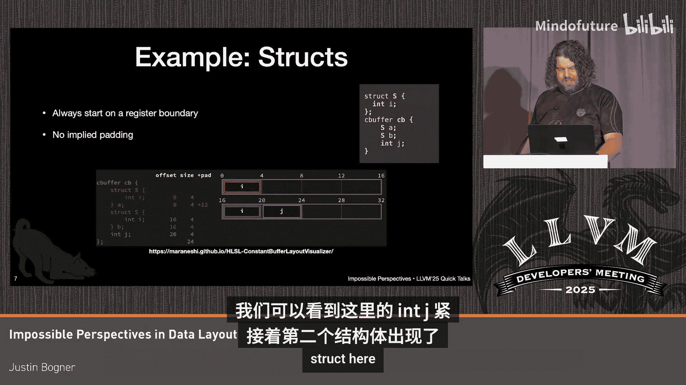

# LLVM开发者大会-US-｜-2025-Llvm-Developers-Meeting-p50-P49_数据布局中的不可能视角--BV1ejr5BAEja_p50-

Hey everyone， I'm Justin Bogner， I work at Microsoft。

 we're currently working on bringing HLL the HLL language into clang and LLVM and so today we're going to talk about data layouts and by that I mean like how we describe where data is laid out in memory So the main thing that LLVM has for a tool for this is a thing called data layout string or spec and these basically describe where like like how how large objects are and the alignment of various different types。

You know， like and you know pointer sizes and things like that。

 And between alignment constraints described this way and the kind of implicit or explicit rules about object sizes。

 you can more or less work out how things will be laid out There are some cases that that doesn't really fall through for So we have to use explicit paddding in those So for example。

 say you have like an align as keyword here and the second int in the structure is aligned in some strange way And so how that will lower is do we just have these kind of arrays of I8。

Padding that go between the elements。 We also end up with the padding at the end。

 which will make these behave well in containers and things like that。 Now。

 let's take a little digression and talk about。I'll construct in HLSL for a second。

 and this is kind of the motivation for what we're doing here。

So HLSL has this thing called a C buffer， it's kind of it comes out of a whole bunch of old。

Legacy idea things， kind of some stuff around early GPUs。

 but you can kind of think of a CB buffer as like a set of 16 byte registers with a bunch of packing rules so for kind of integers and small vectors and floats like scarrs and small vectors these will be kind of packed in as much as they can So like here we have like a float followed by a three element float vector and those will be packed into one row together or one register together then there's three element float here that's in another register and then you have a two element vector there and it doesn't quite fit so it goes into the next one so these will be kind of packed in as much as they can but they try to avoid crossing these kind of register boundaries。

U。Strps， on the other hand， will always start at a register boundary， so even if it's small。

 you won't actually pack another str after something even if it would fit。

 it'll always start on a register boundary， but we're free to kind of pack the scalrs afterwards in the same way as we were before so we can see this kind of J here just kind of pops in right after the secondstruct here。

Arays get a little bit weird because in arrays， it actually puts every single we want every single element to be on its own in its own register。

 so it actually splits it up， it puts padding in between all of the elements。

 but crucially and the thing that kind of makes these awkward is that we can again just pack stuff after the array into that same row so there's this flow to that's just sitting inside there。

So we kind of have padding in between elements， but not after。

 So if we think back to that kind of a line as example。

 they put the padding after so we can't do exactly the same thing。

 but we do the do the same kind of general idea with the with the。With the explicit padding。

 but we have to do some really contorted types to do that。

 I'm not going to show you what those types look like， they're really ugly。A。But now。

 let's talk a little bit about。How do we tell what that that explicit padding is So if we just have an array of I8s。

 it actually can be really ambiguous right， because you can't actually tell if this is an actual like。

 I don't know string or if it's if it's padding and so in。And most of the CPU backends。

 this doesn't really matter too much because。We just don't have any access to it and it's probably okay but in the direct X and SpearV backends。

 we actually do need to kind of we need to be able to reproduce that original type for things like metadata kind of communication with the driver and in SpearV we it actually even in the type it encodes both the logical offset like the logical index and the offset of an access so we need to be able to get both of those things and kind of skip through the padding so what we did here is we actually make a target type that's a explicit padding type so it's a target target extension type that says hey this is padding it's this big and this largely works it's a little bit awkward because you need it to be kind of a different target type for each target you support but you can largely get away with it。

嗯。But I think there's kind of a case for making an explicit padding type that's kind of more。

 more first class in L VM。 So the question is， like， should we have a pad 8 type。

 And this is essentially going to be an alias for。Like I ate。

 but explicitly this says' padding and this could be used in a few places right like in full control of layout。

 It's like if you're using a line as or if you're using something like the Vulcan attribute VK offset。

 this could put you know you could kind of have full control of where things end up。

 I think this could also be useful in transformations like in scalar replacement of aggregates when you're going and breaking up abstractstruct and pulling parts out of it。

 there's some useful information there to say， hey。

 this part doesn't matter So a mem copy of the thing is equivalent to copying each member out and you can just skip the padding one I think this could also be useful in a similar way in transformation validation。

 So in things like alive where you're trying to say， hey。

 these two pieces of Ir are they actually semantically completely equivalent having that information that hey。

 this is padding reading from it is poison So we can just skip that or you a copy of the whole thing or a copy of the individual pieces are equivalent。

Could be useful information There may also be uses in like sanitizers when we're kind of defining a shadow memory。

 things like that or just telling that an access is illegal there may be other uses I'm interested here from other people about kind of other places you think that this might be useful for you and like is this something we should pursue Should I put up a proposal that we add this type to LVM Is it kind of useful generally and we can kind of clean up the target layout thing or should we just kind of stay in our own sandbox and everything's fine as is。

And that's pretty much all I have， so thank you all very much。

