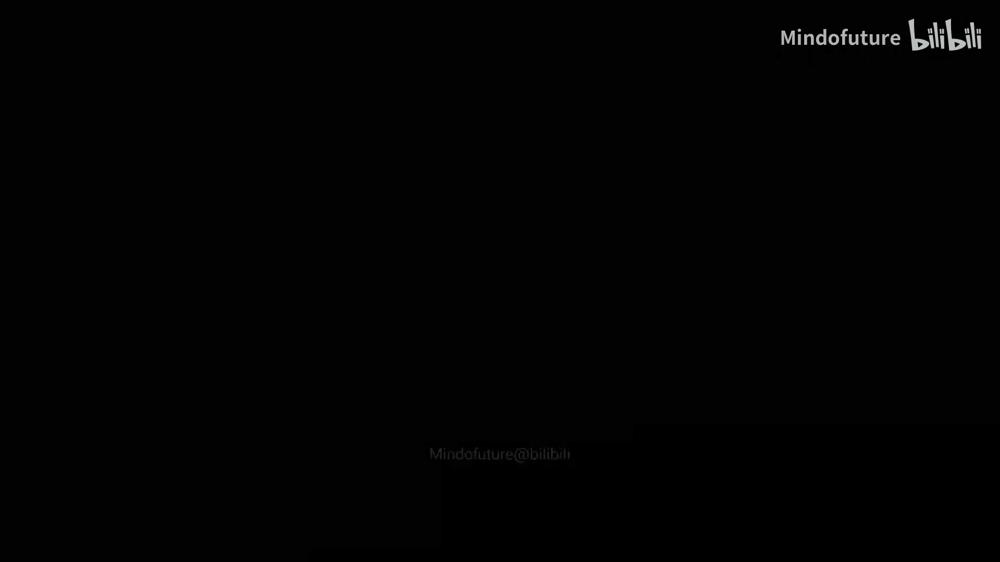

# LLVM开发者大会-US-｜-2025-Llvm-Developers-Meeting-p51-P50_PyDSL_面向Python开发者的MLIR领域特定语言--BV1ejr5BAEja_p51-

Hello， everyone。 My name is Amy， and I'm here to give an update on Pi DSL on behalf of my colleagues。

 James Ruka， Kevin and Fbiian。So background， P DSSL is a Python based DSL that generates MIR。

 you achieve so via the a compile decorator where it grabs out the Python AST for the function F。

 and it passes the AST along with the Python contact structure to the P DSL compile method。

The compile method walks the AST and generates the corresponding MLIR。

 and further it lowers the ML IR into an object file。

 The object file can be executed by passing nonPre array as inputs to it。 Currently。

 we support CPU and Huawei's NPU ascend target。We introduce a new feature just like the C++ template for kernel specialization。

 a template decorator is introduced for this purpose。

 so a template works slightly different than the compile decorator that was on the previous slide in that it only grabs out the AST。

 for example， for the CAC function， the compile is deferred to the invocation time of CalC so the AST is passed to PdSL's compile method along with the concrete template parameters in this example F3210 and 5 injected into the context structure and then passed to the compile method to generate the specialized MLIR。

We also introduce a new Alt feature with the ad autot decorator。

 It works very similar to the ad template decorator in that it injects the configuration parameters into the same context structure。

 and then it invokes the P on compile method to generate a specialized MIR and lowers that into object file and then run and then measure time as it exhaustively creates the whole cartesian product of all the configurations this can be timeconing。

 so only recommended for autotning a small configuration space。

We also introduce Triton interoperability support。 This allows PDSL to call an add TritonG method from a PdSL method This is achieved by looking at the call site which is the PDSL method in order to figure out the type signature and the count expressions for the Triton method it then grabs the Triton AST and invokes the triton Triton do compile to generate the TirR there is a typo there is the TT TTGirR anyway。

 it then invokes the Triton to L converter， the adapter to convert the Triton IR into the upstream MR Lage dialect format and it concatenates the Triton MIR into PDSL's main module and then the whole PDSL code is lowered。

We also introduced some improvements niceties to PDSL this past year， for example。

 Mm Tensor indexing notably with Python slicing syntax to implement membranem subview tensor extract slides。

 Tensor insert slices， and we also support Mm with strideer layout for bag ends that have layout requirements and we also support powerful reduce op that can do reduction along multiple dimensions with a custom combiner function。

Last but not least， since last year， we introduced call macros。

 we have used coal macros extensively in our support for NPU target。

 So the call macro is really a macro expansion of a Python AST into ML IR。

 So we call that a call macro。 and it's meant for an extensibility feature for P DSL。

Last but not least， the whole PDSO project have transitioned to an open source development model。

 We have built integrated robust C for active development。 So when you submit a PR。

 you can actually run the C to see that screen。 All the issues are track in open source and the pull request。

 and we also have a Discord group with a QR code there to welcome everyone who wishes to join PDSL development。

 And with that， that's the end。 Thank you。😊。

