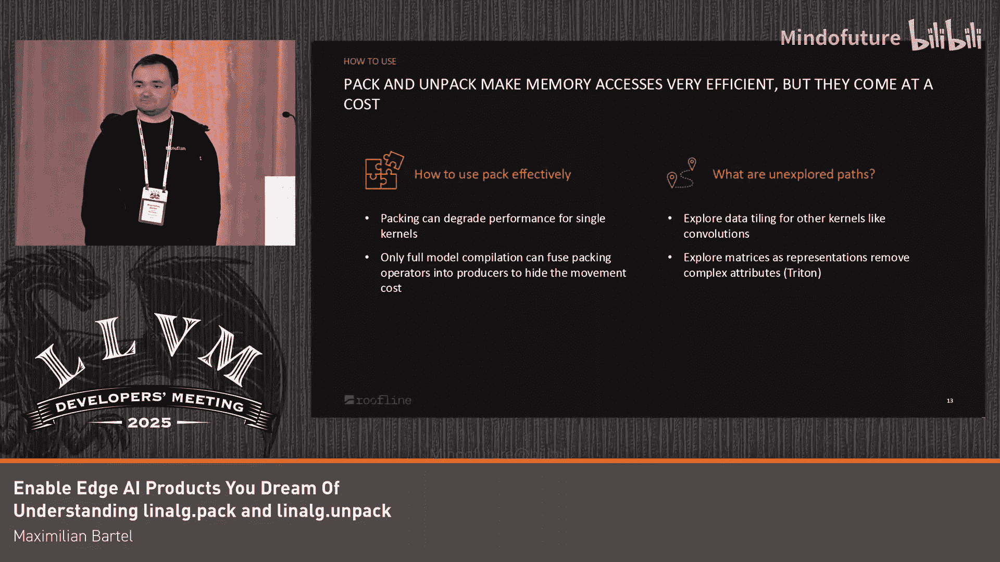

# LLVM开发者大会-US-｜-2025-Llvm-Developers-Meeting-p52-P51_理解linalg.pack和linalg.unpack--BV1ejr5BAEja_p52-

So I'm going to talk about Linux pack and un operations。

To give you an example why those ops are useful， here's the very well known block map algorithm。

 So in the first iteration， we use the red values to to compute the partial result of the blue values。

 and in the second iteration， we use the green values to then get the full result。

If you look at the in memory layout， it actually doesn't look too bad。

 So some valuess are close to each other， and we can get some locality out of that。

 And the cashms are not bad。 And this is a very well known， well studied algorithm。

But when we look at it， there are still a few holes in it， right。

 So the red values are not all next to each other。In a packed layout。

 we actively change the values in memory。So we get consecutive loads all the time。

So this is the same mudmo now a bit reshuffled。And the red values are all next to each other memory。

 We can load them。 It's very nice， and the green values are old。😊，Close to each other again。

On the right side， theres the next iteration you seean， very consecutive floats。 And。

 we get very good cash locality with an algorithm like that。So this layout。

 if you change something to that， it's called pe layout or the algorithm to get map more to that is often called data tiling。

 like my colleague Iga told you before。However， to understand pe and unpack。

 you have to reshuffle the two dimensional tensor to four dimensional one。 And in my mental model。

 I always first apply like a view on the tensor。 So I start from logical two dimensional tensor and then apply the four dimensions onto the tensor when you see the red。

 green， blue and orange kind of orange。Ls that are created so far。

 So we didn't change any layout so far。 This is just indexing that we changed。

The packed layout then takes that indexing and actually dimizes it in memory。

 So there's this reduction tree just to show you now we have four dimensions instead of two。

 And these data movements are， of course， not free。 And I will talk later about amortizing them。

Let's go through few examples of the pack andovs。So here you have an a pack。

 And one thing it can do is actually pat the tie sizes to specific size。 to example。

 to use tensor course on your GPU。And that that by getting an argument called Pat to get the right values。

 and then the inatiles is actually bigger than the input size。

 so the input turns is3 by1 and the inatiles is5 by2 and what it then does is that actually paths in between the dimensions and you see that the red。

 green and blue values are now not next to each other but closer apart。是。

If we can create a padded tensor like that， we also have the reverse of that。

 which is unpacking a padded tensor into something that is not there anymore。

So here you see the impents of size 1 by one by2 by3。And the output is of size 1 by2。嗯。

The inner high sizes， kind of mirror again， the input sizes。

 and the packup basically checks if the number of elements and the result is smaller than the elements of the input tensor that will then do an extract slice that is not having the full dimension of it。

 but on the subset of it。嗯。Those ops also support dynamic shapes， and to end。

So here' is an unpack up。 The input is dynamic， but for D。 The output is dynamic。

 And now the inner tires have arguments for Thailand and Tiland。

 It looks like it's it's time it' part of the attribute。 It's not。 it's just pretty printing。

 It's an argument to the operation。So what happens now when you lower that is that you get a bunch of tensor dim dimensions in your code。

 First， to create the tensor that empty that you know fromlin node。You then transpose the values。

 collapse the shapes。And then because you need to be able to make the reverse of padding。

 it you actually have to get the dimensions of the output tensor and then do an extract slice of the size of the output。

And at the end you have a Linux copy to the result。

The Na pack operation also fully supports dynamic shapes。嗯。

Some interesting observation I had when I put together this slide deck is that this operation。

 as is doesn't lower。嗯。But the unpack does。 And when you look at the code。

 it's like an arrow or like notify match value from two years ago saying that the insert extracts the insert size。

 It's not powerful enough， doesn't support dynamic shapes。It does now。

 So I think just no one needed to have this lowering as is。

And one of the main pain points of the pack operations come into play when you have unit dimensions。

 So unit dimensions are dimensions of size 1。And you get them very。

 very often you AR because you generate a packed M T like a packed layout。

 And then you apply tiling to the outer dimensions。 And at the end of tiling。

 the outer dimensions are very often one for you。A。

There are a few patterns that do special handling for unit dimensions because they appear soft in the code。

 and the tricky thing is always that a dimension of one is kind of a weird case。

 It doesn't do anything， but you have to account for it。

 and there are a lot of errors happening there， but I think now most of them are done。

If you look at this operation itself， it actually doesn't do anything other than changing the view of the tensor。

 so the four elements are still there and every dimension was of size one， however。

 there was a test case or an operation that we needed to fix upstream and we had a test cases for that。

You can also have now unted non unit dimensions between unit dimensions and get special hand by that And J。

Did implement that a few weeks ago， very handy。So what do we get from that？

If we can make use of a data layout and ammatetize the cost of the memory movement， we get very。

 very good speedups。 I forgot to mention that this is tested on the Or or six port that Ega also used for his benchmarks using the neon instruction side。

So the naive blocked mud Mole is already quite fast。

 but when we can amortize the cost of the data movement。

 we can get new speeds that we didn't see before or five runs like that。 So it ranges from 7。

66% to a decrease of 92% in latency。So how do you use it effectively？

If you only have a jam kernel very often， or most of the time。

 I would say you will not see a performance increase when you move to a packed layout。

To see a performance increase， you need to move to something like an AI compiler where you can fuse the packing into the producer app so you kind of hide the latency associated with reshuffening and memory。

 If you can do something like that， like we use Erie under the hood and there support for that。

 they can get very， very good performance out of that。

And what are some unexported paths so far so if we go back to the benchmarks。

 most of them are very much heavy workloads， we also care a lot about convolutions and data selling for convolutions is something that we didn't export so far。

 we didn't have time for that。Another other thing is about the design of the Linux pack and un ops。

 It's attribute based。 If you look at other projects like Triton。

 they have a matrix to represent this reshuffling of memory。 And in my opinion。

 that one is a lot more elegant。 than our attribute based approach。

 And if we explore something like that。 we could maybe apply that automatically to something like a Linuxux generic and then create the Linux pack and unpack ops with that。

 you can then have， I don't know， a matrix that represent your data。

 like your memory hierarchy and automatically apply that non generic ops， which would be very nice。

And with that， we are off to lunch and thank you for listening。

