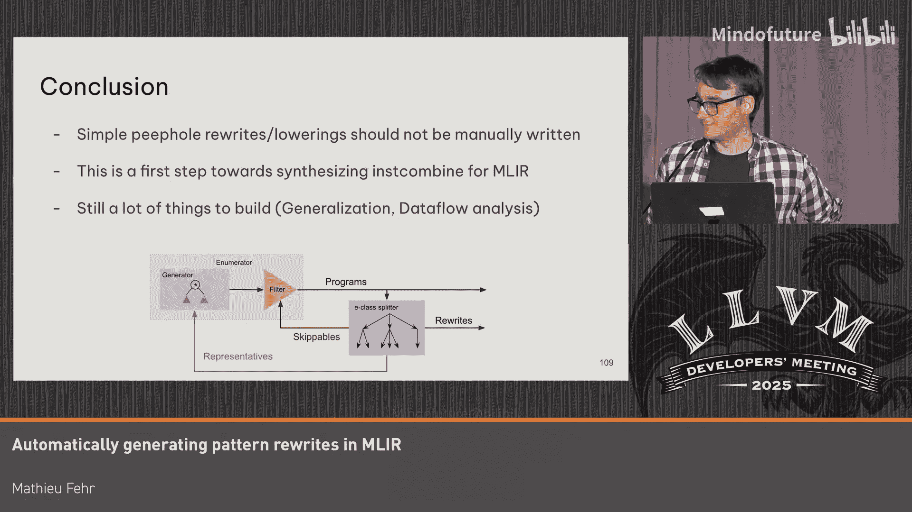

# LLVM开发者大会-US-｜-2025-Llvm-Developers-Meeting-p53-P52_--BV1ejr5BAEja_p53-

Hi， everyone。 My name is Ti Matthew and this presentation does not have an experiment in the titlepo because this is something I believe should be where continued a lot。

 So today we're going to talk about generating rewrite patterns in the Ma。So MLIR， again。

 as this promise of shared abstraction， you have a domain that you want to write a compiler in。

 and usually you have one dialect for that domain。And then you can define optimization for that domain once。

 and you can reuse on any single of your pipeline that use that domain。

So why is there so many arithmetic dialects in MIR circuit and the entire MII ecosystem？

So I'm cheating a bit because I'm including all the ones that I use to translate to something at like LLVM or web assembly。

 but if we remove those we still have like eight， seven or eight dialects that actually have vaguely the same thing which is arithmetic。

 but still have wide differences and large differences that makes them not the same。

So why do we need so many of them？So if we take kind of like this8 or9 selection of dialects。

Some of them have poison semantics， which is something that was introduced by LLVM to essentially say that a division by let's say an overflow could be anything and you might want to optimize for this。

Some of them have what's called full value logic or like even9 value logic。

 which is something that's relevant in hardware。Some of them are defined behavior for division。

 some of them are value that are defined for the division， some of them can have overflow。

 some of them cannot essentially overflow by design。

 and for some of them it's cheap to add a bit to the bit wave from an integer， let's say in hardware。

 if you have a 64 bits or a 65 bit integer for your compiler。

 it's kind of the same or an LLVM if you have 65 of 64 bits that can be essentially2 x loaddown。

So these dials are very， very different from each other， despite all talking about arithmetic。

And this means that they have also very different optimizations。 Almost all of them have associivity。

 not the case for Ar， because it might have the NSW flag， which makes this incorrect。

 Some of them can change。 I mean， most of them can change a multiplication by a power to into a shift。

 The problem in index is because we don't know the bit with。

 This might be illegal because this is poison if the shift is greater than a bit with。Some of them。

 because they essentially don't have overflows， you can， if you multiply by a value and divide by it。

 it's equal to the original kind of value you had in the first place。

 but it's not the case for everyone because some of them have overflow and then everything breaks。

So these dialects have very big differences in semantics。

 and that means they have big differences in the optimizations they have。

So that's a bit of a problem because that means that if we want to have， let's say。

 something like ins combined in any of these dialects。

 we need to implement it again and it's very easy to get things wrong because those like operation have very。

 very hardcon casess to get right and there's a lot of optimization to write there's a lot of operation in this dialect and there's a lot of these dialects。

And oncet provide optimization for you domain you don't know if you kind of missed one or not。

 you don't know really which one are going to be the one that people are actually going to use。

So the vision kind of on to present is what if we could synthesize kind of automatically generate an inscomine equivalent for each of these dialects。

 what if instead of using a lot of manpower for this， we use a lot of compute power。And for that。

 I'm presenting kind of I'm dissecting it in two different tools， which is。

 could we synthesize a base set of optimizations and lowering， which some guarantees of completeness。

 let's say you only have all the optimization that has at most two operation in the left hand side and three operation at the right hand side。

And once we have this kind of base set of optimization。

 we would let people use super optimization to kind of discover additional rewrites that are useful for their particular use case that do not fit into this kind of set of base set of optimization and lowerings。

So these three tools I want to present， three tools be built and that we're kind of trying to improve right now and trying to evaluate a bit better。

 One of them is kind of a rare synthesizer。 you take a description of your dialect。

 which is something I'm going to go about it a bit later and then for free you get a lot of P rewrites and those PD rewrites have some limitation you need to kind of set a maximum size in terms of number of operation on the left and side of right hand side otherwise it's just like an infinite amount of rewrites you can get。

And you can get kind of all of them。 We are guarantee you have all the rewrites up to a certain size that also contains either the finite set of constant。

 let's say only zero and1， or that contains no constant at all。

The second tool is a lowering synthesizer。 you give an up。

 you give a dialect you want to lower it to， and then a tool is going generate it。

 So this is something I generated this morning actually it's like a shift right in SMT gets lowered into then a shift a sign shift right in ArF。

 but first you need to actually take the minimum on the actual shift opnt because otherwise you're gonna have poison in arithmetic which is not the case in the SMT and SMT you want to have only the sign that's replicated over So this is kind of the kind of reason why you can have bugs in those kind of lowering and also the kind of reason that it's still kind of simple you still want to generate them。

 you don't necessarily want to use all the brain power to generate these things。

And a C is a super optimizeizer It's kind of something like super in some sense。

 you give an input program you give here， a description of your dialect you want as output because here it's kind of the same one you're using as your operation and then it gives you a rewrites that's kind of applied in that program。

 so here just a multiplication by two can be rewritten into a shift by one。And of course。

 this is just like on a simple example， the goal is to have this like if you have a large program。

 it's going to give you again， a large set of like these kind of PL patterns of all the rewrites that can be applied into that program。

So for that we use what's called enumerative synthesis。

 so en nuerative synthesis is something like it's pretty kind of simple to understand。

 you have a specification， let's say two times x， you enumerate all programs up to a certain size。

 and then you try all of them to see is it the same。

And by easy the same here is that do they have the same behavior， are they semanically equivalent。

And for that， you really need like three different kind of components to make this work。

You need an enumerator， which will enumerate O U MLLA program。 You need a cost model to say， oh。

 I still want to only check the one that I actually faster than my original one。

And you need an equivalence checker， something that can check others two program equivalent。

So let's look first on the equivalence checker。 So this is something I presented with you I think it was two years ago where essentially we use an ST dialect to represent that。

 So let's say we have two programs as input We use an compilation path essentially to SMT And when we just add some glue code and that we can pass this to like Z3 on ST solver and it's going to tell us yes。

 it's equivalent' going to tell us no those programs are different because of like this input they have a different result。

So that just for the checker and now for the enumerator。

 the way we built it is that we wanted to have an enumator of arbitrary MRIIR program， you just say。

 oh， I want to enumerate or arithmetic program or index program。

 but you don't want to rewrite something for every single dialect。

 you want something that's kind of generic。So for that we use what's called the guided tree search library。

 which essentially tells us that if you want to enumerate all programs or all things。

 you just give a way of generating one of them and each decision you're taking you're just using kind of the tool to do this So here if we want to generate just like two values between zero and one we're going to use the chooser to choose that is just going to tell us give me a value。

And you just put that in a loop， and the tool is going to take care of essentially looking at every single possible path you can have first you generate 0 then0。

 then 0 then1，1，0，1，1， etcter。 And it is going to give us like an enumeration。

So this is how you can generate programs or you can generate。

Enumererate all things by just saying away how to generate one thing for MLR。

 the way we do this is so then just generating one thing is like you choose ano of a given result type。

 then you choose the number of opera， then you choose the type for each operas and then you just recursse it until you have the number of operations you want。

So if you use this with the tool that just presented right before。

 you can enumerate all MIR programs of a particular site。Of course， the problem is。

 how do you choose an app with the correct result type。

 How do you choose the right number of operas such that all of these programs are going to verify Because you don't want to enumerate。

 let's say an a that addd with your operas。 It doesn't make sense。 So for that。

 we actually use the Il dialect to essentially get the information and how many operas is there in that program。

 how many what's the type of these operahs and this result do they have to be the same And also。

And yet， what's the kind of type of all of these。 And these essentially kind of guide the enumerator so then you can use it for essentially any different。

 any kind of dialect， it just works out of the box。

So then with that we can do de enerative synthesis and that actually works for like the kind of two first tool the second tool I showed you if you want to do optimization。

 you just take an input program and you ask it to find an equivalent program using this iterative synthesis following。

 you take an input program and you find what's called a refined program。

 which is essentially if you have poison and you can combine it to anything else。

 but if you have something you cannot compile to poison。

And this very simple tool thats give us kind of a super optimizer and that the example I showed you on the lowering。

 that's how it worked。So the problem is， I promised you that we could generate all rers up to a certain size。

So do we just enumerate all left and side program and then for each of them it is our rent and side program？

The problem is there's a lot of these programs， if you look at three operations。

 there like around 10 million programs， which mean technically we'd have to check 100 trillion candidates to find essentially all rewrites up to three operations。

But I'm telling me we can actually find all of these programs， so how do we do this？

So the intuition is that in our it iterative synthesis loop。

 a lot of these candidates are actually redundant。There's no need to check for x plus zero because we're already checked for x and those two programs equivalent。

Same for0 plus x。 And also one plus x is the same as x plus one。

 So we can actually remove a lot of these cases。 And that kind of drives a bit algorithm。

So to algorithm algorithm works as follows， we start by enumerating all programs of size1。

We find all the ones that are equal equivalent using what we call a classifier that I go into it。

This will give us all the rewrites to that size and will also give us two list。 a ifos skipable。

 which is essentially patterns that are always wrong that x plus 0。

 You never want to enumerate x plus 0 because， you know x is always going to be better。

 Even in a sub patternn， you always know you can replace that sub patternn with x instead of x plus 0。

And the second list it gives in the list of representatives notes that it's not called canonical forms。

It's essentially the one element per equience class。 So in， for instance。

 when you have x and x plus 0， the element is going to be x。

And those things essentially the programs you want to enumerate。

 those are the ones that kind of represent all programs that are equivalent。

And then we pass it to a numerator that's going to be a bit improved。

 and then we're going to do this for programss of size 2， then program of size 3。

And this kind of iteration makes it actually feasible because we don't have to enumerate all these00 trillion programs。

00 trillion pairs of programs。 we can just essentially。Do it bit by bit。So first。

 let's go into the classifier。 So to classify programs。

 So we have a list of programs we want to find all the ones that the equivalent。

We start his own im programs， and then we put them into buckets。 essentially， we just。

Evaluate them on random values。 all the all the programs have the same random values。

 and then we check which one seems to be equivalent。

 So it's kind of an over approximation on equivalent classes， programs that equivalent。

Once we have that， then we can use the kind of and square or and square algorithm。

 which is just check all pairs of programs in this bucket and find which one equivalent。

And these give us the E classes， which is equivalence classes。So for instance。

 we have one that has0 and 0 plus 0， we have one that has x x plus 00 plus x， and we have x plus 1。

 y plus x。So those are kind of sets of programs that are equivalent。

 we just call them like kind of behaviors， so it's like a set of we have C1 C2 and C3。

 we have three different behaviors。We select the first of this program decided by like the one that has the less number of operation。

 maybe the less number or maybe the less number of constant these kind of things。

 and those are kind of the representative sets I talked about earlier so here if you enumerate it just0 x and x plus y。

 you kind of enumerate it old behaviors that you show in this slide。Then we select all the others。

 and we say those are like the skipables。0 plus0 is never good because you can always anywhere write0。

 Sam with x plus 0 and x。We've removed the ones that are kind of redundant because0 plus0 is a sub pattern of x plus0。

And then all the kind of relations between the skips to the representatives is actually the rewrites we want。

0 x plus zero can be rewritten to x。Note that we don't have that for the x plus y and y plus X because they're just alpha renaming of each other。

 it's just the same program is just a kind of argument thats switched。So once we have this。

 we can pass these kind of skipable and representative sets to the enumerator。

 so the enumerator will first have a generator which is essentially just a way to enumerate all programs but using kind of the early behavior。

 so essentially we choose just an up that has parents and for each of these current Kop parentent taker representatives。

Because the representatives essentially encompasss all the behavior of the program of this size。

 we know we'll enumerate essentially or behavior of that size plus one。

And then we just unify the parameters， so essentially we make sure that the kind of parameters s three variables on the left on the right are just going to be unified and we have like multiple way of doing this。

And then that's it， that's a better way of enumating program that actually doesn't require us to enumating the entire set of programs。

And then we can remove the ones that we enumerated that are still bad because sometimes the right hand side the right so here on the green。

 this x could be enumated as0， and we still enumerate again this x plus zero pattern that we know is bad。

So we take these patterns， these skippable patterns。And for every program weumerate。

 we just check if there's one of these capable patterns and if there is。

 we can remove that program before doing anything else because we know this program is never going to be good because you can always replace this pattern with like just the sub tree。

 which is the a plus B。And the problem is we have many of these patterns We have like 40 thousands of these patterns that exist。

 so how do we actually make it fast Well we use the PDL dialect in MLL。

 So PDDL allows you to essentially take a large set of patterns compiling into into a very efficient automata。

 And the point of this is that the complexity of checking a pattern is actually linear in the maximum size of the pattern rather than taking the sum of the patterns that's actually a very。

 very efficient way of doing this。So that's kind of a algorithm。

 We had the classifier that finds the equivalentence program。

 and then we have our enummerator that makes sure that for the next step。

 we only we kind of preselect a nice set of programs to then use the classifier。

So what can we kind of do with this， So we're trying to take the SMT dialect in MLR。

 which has like these 30 operation。 We also have true false constant0 and1 and you'll try to see how many of these kind of breedrights exist in that dialect。

So note that the rewrites we define and not always kind of optimizing rewrites。

 we might rewrite like。We might have rewrites that don't actually improve the runtime is just like essentially a way to always get one of the representatives from the set of programs we have。

 and then we just select one the actual rewrites we want。So if we look at size 1。

 the6 program in the size 0， the6 program in the S T datalight， which is truefold1。0ero。

 the first arguments。 and then the second argument， I think， oh there's one more。

So we can generate we generate 100% of them and it's taken a second。 So okay， that's a bit slow。

 if you take the size1， which is when you have one operation and constant， you have 372 programs。

And now what we do is we still generate 100% of them。But there's only 20% that I've represented。

That means that if you have a program of size1， a random program size1 in the S&T dialect。

 there's 80%% chance that you can actually rewrite it into one of the representative and 20% says that it is the representative。

And from that， we also extract 115 skippable programs。And that means that M size 2。Actually。

 we generate only 16% of these programs and after the skipables， we only enumerate 8。

9% of this program。Meaning that this small set of like 115 patterns means that we can already kind of discard a large amount of programs in size2。

From there again， we find that only4。5% of these programs are actually representative of the behaviors of the entire set。

And we find 1000 skipables， and all of this is done in like less than a minute。

So we can find all kind of rewrites that can exist in these dialects in only half a minute。

And then we do it for p size  three as well， which。bitit longer。 This is done on my laptop。

 by the way， so it's like a MacBook M2 error。 and in 10 hours。

 we instead of enumerating the 14 million programs that exist。

 we only actually had to take care of 1。8% of them。

 which means we drastically reduced the search space that we had to find all of these rewrites。

And from there， we don't find again that only 1。3% of programs are actually important or actually the ones you want in your programs。

 and we find like 43，000 kind of spal patterns which also represent 43。

000 rewrites you would have in U IR。Again， we use this kind of skippable to kind of speed up super optimization slash or lowering synthesis。

 and essentially we kind of speed up our own super optimizer by like3 or 5 x by just essentially removing a lot of these like skippable patterns because we know always one would be better。

Note here that we don't need so for ST， Arif and Com， and Aif is much。

 much slower because its semantics are really annoying to deal with for ST solve。

 and that means it takes like almost an hour to do something that takes a minute in ST。And finally。

 we just kind of try to synthesize an SMT to every flooring。 There's like 34 patterns。

 So it is essentially 34 operations。 and plus the different types they can have。

And in less than like a minute for each of these pattern。

 we can find lowering for like one operation and in less than like between two and 10 minutes for each of this pattern。

 there's two of them that essentially has lowerings to two operations。

 meaning that for the rest of the pattern， you need at least three operation in your like a written program to lower from SMT to。

And I found like a case where you cannot do anything in three operation。

 you need full operation to lower。Unsigned division in from ST to RF。

So that's something I'm kind of working on to see how much can we scale。

 can we go up to fulloperation？So in conclusion， we have kind of。

This tool to kind of generate rewrites lowering a bit that takes a bit of time right now but I think we can improve the runtime。

I think that like simple people rewrites all lowering should not be manually written anymore because there's like so much work there is to do to implement something like incombin again and it would be much better to have like the synthesis tool to make it work。

 So this is a first step towards that and first them to being able to do this in MLR which because it has been done in LLVN before but not like at the scale for like MLIR and there's still a lot of things we need to build like a generalization algorithm so then from a rewrite example you can find a better one and also like handling dataflow analysis to then have like more powerful rewrites knowing that some data flow analysis has been built。

So that's it， and thank you。

Thank you， Alex。Questions。So this is an interesting tool I mean have you thought about using a synthesizer for test code generation like you are like okay。

 I mean we need more test programs to test everyone that talked about right I mean so this could be a useful tool for such a thing so I've been using sort of first two parts which is kind of the checker and enummerator to actually test a lot of the Ar dialects in the test suite of MLL and I found I think four or five bugs at that point that I reported。

So essentially enumating all programs up to size 2 and then just seeing is there any one of them that's like miscombined？

Justine。Any more question？Okay。Let's thank Matthew again， thank you everyone。

