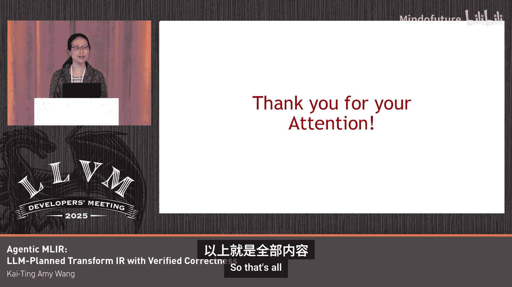

# LLVM开发者大会-US-｜-2025-Llvm-Developers-Meeting-p54-P53_基于MLIR的面向多面体引擎的LLM调度原语生成器--BV1ejr5BAEja_p54-

So this is a joint work between Robert Jin Man， Aan and Xin Yu。

So this talk builds on the prior work of an MLIR based transform driven polyhedral compiler named Pomorphous。

 the high level idea of the prior work is that an expert user， for example。

 a performance engineer supplies a computation kernel along with some transformation strategy to the polymorphous tool。

The tool validates the transformations in the context of the computation kernel to see if there are any dependency violations。

 if the transformation sequence given by the user is valid。

 the tool proceeds to apply the transformation and generate code accordingly。

 if the transformation sequence is illegal， the tool attempts to fix the violation while keeping the user's strategy as best as possible。

So here is a simple example of Pol benchch andVT kernel written using PDL。

 a front end to polymorphous， if you attended my talk yesterday you would know that PDL generates MLIR。

The transform strategy the user wishes to apply to the kernel source code is described in the MVT schedule method。

In the method， the two target nested for eye loops are first matched。

 and the user wish to apply tiling first fusion， then tiling by 32， 32。

 followed by reordering the two inner point loops and paralyzing the outermost tile loop。

This MVT schedule demonstrates the composability of the transform sequence and its separation from the kernel Co。

 This is a primary benefit of leveraging MIr's transform dialect infrastructure。 However。

 one key difference is that the suling here does not actually transform the payload IR。 Instead。

 it records the transform matrix。 According to each transform operation for the validation process later on。

 The entire cobase is open sourced through the Pds website。

So to describe the process of the validation， we give a quick review to some polyhedral concepts so that we may bring to light how polymorphous maximally leverages MLIR's existing infrastructure。

So polymorph polyhedral scheduling functions are expressed at a statement level here。

 a statement S depends on statement R， Cta S describes the execution times damp where each instance of s is run and similarly for Cta of R。

A scheduling function has the format shown over there where the coefficients in matrix C allows us to correct the illegal transformation using skew or shifts when possible。

And Farca Lama is needed to construct the constraints linearly。

 the D in that complicated equation describes the dependence polyhedron。

So to be able to find the correct value for shifts or SkuUs when we need to correct the schedule。

 we solve the system of equations to find the coefficient in matrix C by leveraging Pre burgerer Sx solver available in MLIR。

Okay， after the preliminary， let's dive into how we leverage MLIR。

 this slide demonstrates a simple kernel and using the right after read dependence between one。

 the a load of A3 to two the a store of arc3 to show how we can build dependence polyhedrons easily。

 so we leverage the a analysis infrastructure in MIR by writing a very small among the code to invoke check memory of access dependence on this pair of memoryF excesses。

We need to invoke this method three times for the Uar arc 4 loop。

 level 0 and the inner arc 5 loop level 1， and lastly， a common loop plus1， which is 2。

 So two dependence polyhedrons are built。 one at level 0 and another at level 2。

 This is done precisely and accurately。 Thank you。 M L I R。Next。

 before we invoke MLI arts simplex solver， we wrote a compute farcus right hand side method。

 which converts the dependence polyhedrons you see in the previous slide into a 2D integer matrix representation where you see on the far right hand side。

 The rows represent the loop iterators and program parameters。

 the columns are the farcus multipliers， Similarlyly， using fars leftenci compute。

 the coefficient for matrix C， which we are looking for， are the columns of the 2D inte matrix。

 and we seek lexical mean solution。So the line of code to convert the transformation matrices and dependence polyhedrons into the appropriate integer matrix layout prior to invoking the simplex solver is about 850 lines of code in summary with very minor effort we are able to build tell a polyhedral validator and again thanks to MR。

So after the initial success， we are mandated by our leadership team to see if an LLM can generate the optimization strategy for polymorphous in place of an experienced user further。

 we want to see if LLM can generate syntactically correct MIR code as a replacement for a Piyy at DSL。

Thus， this is the second part of the talk， a Gentic MIR LOM plan Transform IR generation。

This is the high level design for this part of the work。 It's comprised of a router。

 a couple cogen agents and polymorphous as the validator guarding the final door for correctness。

 fairly simple。 Again， the goal of the system is to generate transform IR for polymorphous。 Now。

 let's first dive into the router。So the router is really a retrieval augmented generation database。

 it takes an input kernel to be optimized， classifies it to be the most similar to the top K reference programs that are in its database。

 the optimization strategies for the reference program in the database are provided by expert humans。

So the classification network is a simple duo pretraining Coberg， MLP Somax architecture。

 trained using LM generated code and ground Cho。So the router or the LLM would take in deterministic knowledge from the database on how to optimize some reference program and apply that knowledge to optimize the current input code。

 and this is the non deterministic part of the LLM。

So the router produces a human readable strategy on how to optimize an input kernel shown。

 and it can also classify programs fairly well along the heated graph in the diagonal。

The outputs syntheticactically correct MRR code with collaborating coach and agents。 Here is the。

Genenerated MO IR transform dialect code。So some experimental results。Oh yes。

 I've fl by that page too quick， but anyway， the early experimental results show that all 30 Polly benchch produce code and executes correctly。

 that's an encouragement good job to LLM and 27 had run time better than equal to if you were just to compile the code with GCC13 at03 and 14 had runtime better or equal to the human written schedules that was originally published in the Poomorphous paper。

So that's all。 Thank you。

