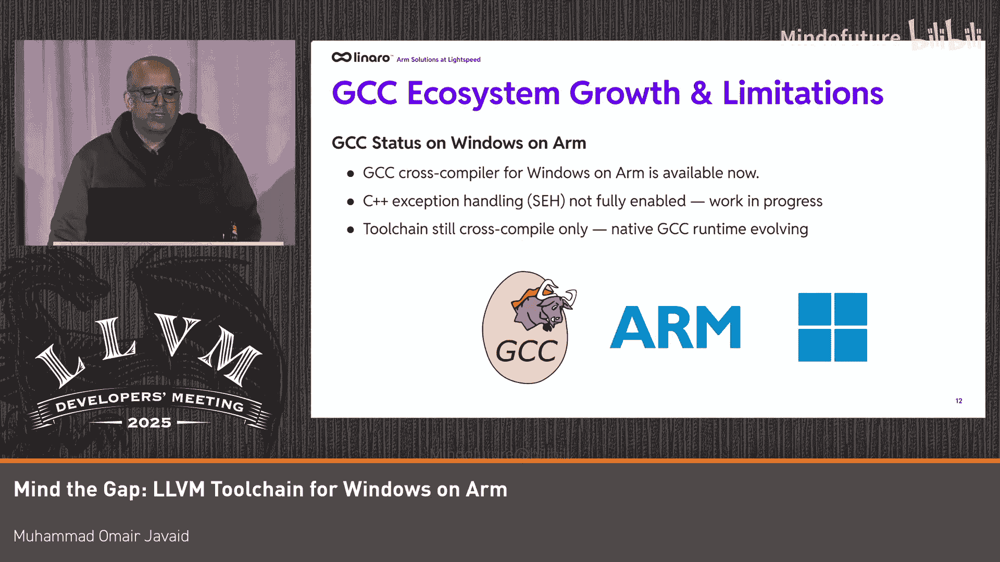

# LLVM开发者大会-US-｜-2025-Llvm-Developers-Meeting-p55-P54_小心差距_Windows平台上的LLVM工具链中缺失的关键功能--BV1ejr5BAEja_p55-

Hello and welcome， My name is O Jad and I a tool Cinte lead at Leau and this talk is called Mind the Gap today we want to check the progress of Aium tool chainin on Windows and arm and alert everyone about any gaps if there are any。

So let's get started。So let's start with the good news first。

 We have native Rium tool chain on Windows and arms since Se V M 16， its。

Working natively most of the major components are billing and running in the C as well the core generation quality runtime performance is good the adoption is strong and at this stage we are here to finally just close the final gaps and bring it in parity to AX 64 Linux featureses and also to Windows X 64 developer experience。

Moving on let me just go through what's available today。

 so we have native Kang LLD that produce native 64 P of binaries and then we also have Kang C which gives you the command line command line compatibility with MSVC and then AB compatibility Kang has with MSVC overall。

Then we have flang the native， the compiler on Windows on arm。

 that's also one of the one of the highlighting feature of AVium tool chain that it's the first forronn compiler for Windows on arm。

Then we have LLGB debugger which supports native debugging workflows under1do arm and Openmp is enabled and also we have a version of LLVM which is part of Min GW tools that provides us with the new tool chain support so GCC toolcha is not yet there yet。

 so in the Min GW tools we are currently using LLVM which is great。

So how this LVM managed to become the backbone of Windows and arm ecosystem we we used the AR 64 backend which is shared across Windows Linux Mac OS and also the the code view support or the call and structure exception handling support all of that was already implemented for x 64 and the Windows and arm had to just do a lot of a lot of ABI stuff but mostly the support was there and we just had to fix a few things and there and we were all set。

So that shared backend and shared front end meant that we have lots of performance benefits arriving everywhere and on Windows and arm it mattered the most because MSVC toolcha doesn't have certain features which the native LVM toolcha has so that's great advantage we have in that space similar to the backend on the front end side。

 the shared stuff between the C+ support than rust photon MLlaya。

 all these languages were able to come in and provide the compilers for Windows and arm some of them are in experimental stage。

 but like for example， Forron rust CC++ they are already and available on Windows and arm platform。

So moving on， that's my favorite slide because this is where we show where LLVM is being used in the Windows andarm ecosystem。

 So for example a Python a major project is using client Ber library office and similarly Chrome Edge Firefox these teams extensively used the Windows andar compiler to provide provide the arm 60 Windows arm 64 bin for these projects。

 So we at Lau have been tracking Windows andar ecosystem very closely and we've put up a website called works on Windows andar that tracks the growing native Windows andar system and if you wantna check which apps are natively available in that platform。

You can refer to that website。So。u。We would like to be may make it more performant。

 but as far as R VM is concerned， it's already beating MS SCC。 So last year， we give a。

FWe we not use elevators。Elevaators。えす。Yeah啊。反正在。我发现还。Pros a quick break。 Let's。Yeah。😊。

So let's start from where we left。 So we were talking about the performance of Lium on Windows around。

 So Aium is great in that way。 because not only that it outperforms the emlation stuff which obviously it will but it also outperforms MSVC in the spec2017 benchmarks as well as various real world workloads like for example。

 if you Lium but laangia versus C， theres a lot of difference between the bird times and then one of the projects which highlights the performance aspect is blender where we saw about 20%。

30% I'm not allowed take numbers but that roughly 2030% of performance boost just because of using laxia。

 So it's great in that way。 as far as flank performance。😊。

Con we have been we haven't been able to validate that we haven't been able to one spec 2017 with Windows and arm on fl but as it's the only forron compiler so nobody has any complaints so far。

One thing with regards to developer experience on Windows alarm。

 or generally on Windows is that it's slow compared to Linux Mac OS developer experience。

 allerum builds are like if you build allerium on Windows it slow NtFS file system overhead or Windows process creation overhead makes it a bit difficult for for any projects which have a number of object files to create go slow on Windows of。

 so we need to find novel ways to fix these issues on these platforms。

 like one of the suggestion was to use clang in a way that it serves as a server and then builds a whole lot of bindaries in that using that server but these are。

ideas haven't been able to discuss it。 So moving on to real gaps where we have to put our time on So we have identified the most number of gaps with our debug the LDB debuer and have listed like few them over here and some of them might not be known to me our partners。

 but if you you guys know you should definitely share any other problem。

 So starting with LLDB 64 E it's an AB developed by Microsoft。

 which lets you have X 64 emulated code and 64 code in the same binary and code can go back and forth and so that kind of mix more debugging is not supported then if a binary is。

using x64 emulation then that x634 em emulated binary is also not supported by the native LLDB at this stage。

 then arm V9 features we don't have laptop commercial offering that has arm V9 Windows and arm hardware but do have cloud hardware and also Qmi has support for all the arm V9 features so we don't have SV SMmeE register visibility at this stage and then hardware watchpoint so hardware watch points are supported。

 but you can only set one hardware watchpoint that is a Windows limitation that we have reported to Microsoft and they are trying to fix that and then there are no hardware sequence as well that we also have limitations from Windows kernel side and we need to fix that on end and then we will implement this on the LLDB side so。

LLDB Db， that is a component of LLDB that lets it talk to the to the。

Things like we scored or other any of the IDs that want to use LLDB as a debuer and that has a very flaky experience at best maybe there are some downstream patches with the companies which ship the commercial offerings but as far as the LLDB in upstream LLDB is concerned I think we've been sort of disabling a lot of tests around LLDB just because they are flaky and then when we compare features which are available for Linux versus Windows there are also many features in LLDB D which are missing and Windows versuss Linux or Mac then the PD debug experience So LDB has to set off PDDB reader plugins one is the Microsoft PDDB reader and then there is a native PDB reader。

Test failing using the native PDB reader， but just before the talk I just saw saw a PR which fixes all these tests and so that's when we just hard that native PDB reader has no issues anymore that are failing but overall the debug experience like you can do the edit and continue on on MSBC but you can't do that on using LLDB even with VS code and everything together similarly the PDDB debug info generated by clang sometimes Ss variables and mark them as optimized when debugging with either LLDB or MSVC debug so that's something that the PDDB debug experience we need to。

Heavily test and check on Windows in general and specifically on Windows and arm platform。呃。

Moving on to other tools。 So we have LLD similar to L L D B。

 it also doesn't have the linking support for arm 64 EC。

 That means that you can compile your code for arm 64 EC using Kang， but you cannot actually。Lnk it。

 so for that you have to use Microsoft linker the reason for that is some information about linking arm 64 EC bin is not available to in the documentation and that has actually restricted us from implementing the LLD support I'm not sure we've been talking to Microsoft to share that information。

 but I'm not sure if that is going to happen any time soon and if there is a need somewhere then probably like more many other features this might also have to be some one can just figure that out by reverse engineering and fix that。

Then talking about LTO LLD， we haven't actually been able to validate the capability of LLD when you use the link time optimization on Windows and arm。

 so if anyone has information on that， maybe share with us and if there are any missing links。

 but this is something that has not been tested a lot on this platform。Moving on to flang。

 flang has been instrumental in providing the forn compiler on Windows and arm。 however。

 there are some hiccups， like for example， we don't support MSVC style command line driver like we support for CC plus plus in the shape of flangia。

That means that in the projects which use Fang Fang and MSVC linker or a mix of there is a problem putting in putting in Fang into those projects and there is a lot of fixing involved in the build system to get that working and this is one of the reasons that we haven't been able to successfully run spec 2017 benchmarks for flying all on Windows3 but that is not the only reason but yeah that's something that is missing and we need to figure out how to enable that IO has on Windows 6 for the command line compatibility with MSVC。

Inter forron compiler but it's still based on Lium so we should be able to get that working with fl as well then sanitizers we don't have support for sanitizers it's unfortunate that we know this for like few years now but every time we get what around starting to fix sanitizers on Windows and arm。

 the priorities moved and and at this stage we don't have them and the Windows and arm native releases and we want to have them in future releases whenever the support comes in and fixes are entered into the upstream Lium project。

Okay， so I went through the gaps a little quickly just because of the。B that we had anyways。

 for future， we need arm V9 enablement。 I know for sure that there is a whole bunch of arm V 9 enabled hardware coming Windows platform in near future like 6。

1218 months there will be more hardware that has arm we 8。

3 plus enabled or arm V9 features enabled and LVM has support for mostly all of these features apart from LLDB debugger or or the ABI stuff that we need to provide to the overall tool However。

 we have these features working like SM SME pack M B T I。

 all these features are working for arm Linux So we should be good here but we we are still waiting on Windows kind of support for the。

And also for the hardware availability and once that is available。

 then we will put up C and test things and then report issues and fix the remaining pieces of this enablement path。

So。Let's move on to testing and C and releases stuff。

 So we at Lno have been doing LVMci for like last four or five years。

 we have so we have three bots rather four four or five billboards running for Windows andum at this stage one is testing flang the other is testing fl all the single stage bos then this is LLDB board and we are testing flying open empty compiler combination that we also have a two stage bo but that is flaky we run on them on on surface。

Pro tablets and these are not well suited for that kind of testing。

 but we hope that we will get a better hardware for these and then we will migrate them to those until then we will be running these in the staging area。

So more recently we've been trying to make the test suite bots working on Windows andar。

 which we recently did LNT， which is a component of the testing infrastructure for test suite LLVM test suite was enabled for Windows and arm we have a staging bo that tests the LLVM test suite with the LNT enabled。

 and that is running the fl unit tests which are part of the LLVM test suite repository。

 other than that there are other tests as well like G4ron test and single stage multistage multiso single source tests which are currently not supported but we plan on working ourselves and with our partners to fix those。

Okay so about the releases we've been producing LVM Windows and Ar releases since LVM16 and we've been doing that using the upstream LLVM release scripts we been we have improved LLVM release scripts as well over the past few years to have it enabled for Windows and arm we recently added the PGO based LLVM releases for Windows and arm we don't have the performance improvement numbers with that one but I think as with X634 Windows that that will also have some performance gains so recently like a few months ago like for five months ago Github actions was available the native Windows and arm runners were available on GiHub and we plan on migrating the Windows and Ar release process to the Github action soon。

And then S we testing and validation， I don't know how this bullet landed here。 but yes， we've been。

Trying to get S V testing and validation。In working with Windows in arm that's also a resource restrict。

 we do have the cloud Azure Cloud arm V9 hardware which supports but the problem is that we don't have the enough resources to I think fund that so haven't been able to test whether even S weE testing well is going to work in that cloud in that cloud infrastructure。

So moving on one thing that is important to us is the ecosystem growth and recently we had GCC enabled for Windows andar which will how the overall tool chain infrastructure on Windows andar it's still in it's still in the very early stages like it's just a Gcc cross compiler and it does not support the C plus plus as yet because the structure exception handling patches are still in work in progress and also。

To to they are still missing gaps in overall tool chain。 So it， it's not native。

 It's still cross compiling。But what we've been able to unlock with GCC support is that we've been able to build gi for Windows and similar new dependent applications for Windows and arm and also with this I think we will be able to run the multi source or single source tests and also G4ron tests for Windows and arm。

Yeah， I'm all， I'm almost done。 I think yeah， I'm done。 Thank you very much。

 If you guys have any questions at this stage， you are be come to ask。There's a stand that way。

I have a mic。Any questions。Thanks for the talk。 I'm curious on the LB side。 Like。

 what are your order of priorities， Like， what would you like to get first。

 Does it patch the order on the slides or are there any particular subset you wanna get to sooner than than any other。

I think as far as the interest is we do have interest in the S we support the most from our partners as well as because we have hardware at least in the cloud available and also the QMU support is there a lot of people talk about ArM 64 EC but nobody comes up and say like we are going to fund that work and we will be able to provide enough funding to have it working so that's one thing then general I think as far as us maintaining the project are concerned。

 I think we will work towards stabilizing LLDB Dap overall test suitee the native PDB reader as the maintenance of LLDB project but we for the particular features I think we are at this stage require we require funding。

Inest from external parties to fund us to do these things till that time， I think。

 I think as soon as the hardware becomes available。

 there will be interest in all the R V9 features that's my understanding。First。Cui。是。Yeah。

 so that that that's an interesting and piece of information that in the next year。First half。

 you'll have V9 enabled hardware on Windows and arm。 So that's when we get the support。

Starting to develop， or at least we start to work on it。Let's see。嗯。I had a question。

 How do you prioritize what you wantanna fix。So we at this stage， like for example。

 we as part of Leaw has a steering committee and that steering committee has different companies contributing to that committee and they decide on our priorities we give give them what's missing like provided information and then they also have like for example。

 callcomm or or any other companies might be doing something internally like releasing new hardware and for that they might have some interest in developing certain features and then they bring that with the resources to the steering committee and then we start working on that。

Any other questions。A comment and the question。 the comment。

 I think we built Chrome for Windows arm 64 with LTO。 So I think that does work。Yeah。

 that's what my understanding is but I haven't tested that in the C overall and compared that whether the Israel gains there or not。

 I'm I'm not saying that it doesn't work。 It's just that there's not enough information about how much how much gain you can have with LTO。

 And also what's the interoperability between the MSVC compile code with plan C compile code with LTO does that is that supported or not that that I'm not sure about。

And then you said L link cannot link arm 64 EC code。

 I've seen like a whole bunch of patches by at code weavers。

 Yeah there are there were patches but at one point the information got stall which was required to get the final bedend。

 I am not exactly show what information was that but but Microsoft told me is that the P co standard is closed source So some parts of it cannot be shared with general public So that is actually blocking the arm 64 E at this stage。

I would， I would like a thankout speaker。