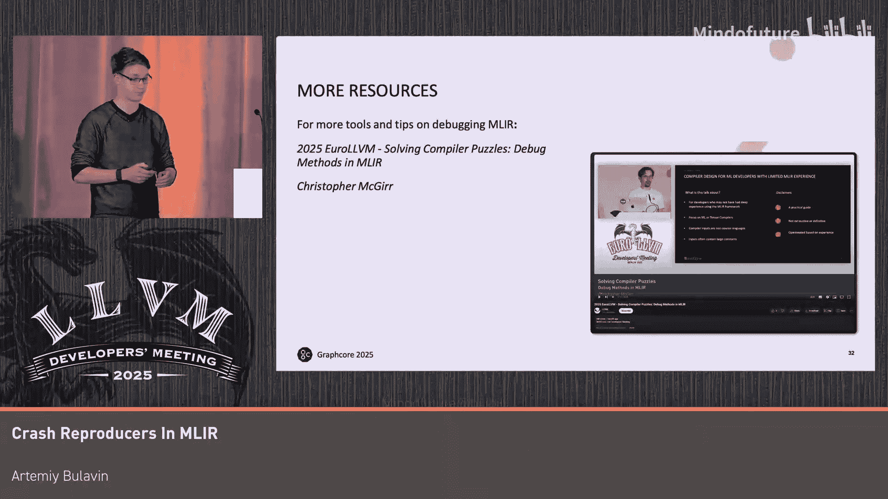

# LLVM开发者大会-US-｜-2025-Llvm-Developers-Meeting-p56-P55_理解MLIR崩溃再现器--BV1ejr5BAEja_p56-

Right， I appreciate everybody come to this talk and it was the last session of the day and we're a bit tired and I've got the reception coming on later。

 So thank you for coming and giving me your attention。 So my name is Artmy。

 I'm a software engineer at Graphcor and I work on a Triton backend for Graphports hardware acceleration platform。

😊，Today， I'm gonna tell everyone about crasher producers in M I R。So。When we write MLR compilers。

 we spend a lot of time and effort developing rather complex and really nuanced transformations and passes they use our own dialect。

And they're really kind of designed to optimize for our compilation targets。

 And then what we also do is we take the passes that we write ourselves and we mix them with。

Built in passes or save common transformations like canonlation CSE。

And what happens is we build up and compose passes。Our full compilation pipelines get really。

 really long。 And I find that the length of a past pipeline is something that nobody really understands like how long it should be。

 Like， should it be hundreds of past， It should be 500。

 It's like there is no bound really on how long we should make these things long as long as the performance is good。

So what happens is is that you've got some kind of buggy transformation that doesn't error compilation。

 but introduces something that causes an error further down the line。

 trying to track down a bug that happens。In a full pipeline is a lot harder than trying to find a bug in a single pass or in a single pattern。

And crucially， reproducing these bugs themselves become hard， so。

What I want to tell you is what MLR has in order to help us with this。Okay。

 let's go over reproducing bugs 101。 I'm sure everybody here as at some point in their life debug something。

 This is not an insult to your intelligence， but I really just wanted to go over this so that we can set the scene and really understand why reproduces are so effective。

So when you need to debug anything or reproduce any kind of bug， you need three key things。 Numb one。

 you need the output that you get from your buggy or broken program。

 essentially the wrong answer that your program gives you。

Then you need the output that you expect to see or is the correct answer。And then lastly。

 you need a way to rub show that。What you're getting isn't what you're expecting that this first point isn't the second point。

 And I don't think this is a particular new concept。 So one way debugging C the plus unit test。

 we all know how this goes。 right， If we have a broken test， let's say it's G test。

And this is just like an example test I've got as testing might is it even function。

 The test told you that something went't wrong， okay， this isn't new。😊，Yeah。

 what that we expect to see is defined in the test in terms of assertions that define what the correct output of our program should be。

Fine， and the way that we reliabilityably show that what we're getting isn't what we're expecting。

As we just run the test， yeah， okay， cool。Clicker doesn't want to behave， okay。So with late tests。

 Khan follows a similar person to a similar story。File check tells you that you did something wrong so。

That it didn't match something that got produced after you ran some transformations。

The output that you expect to see is defined terms of check lines。And。

You just run the lit test to show that the first thing isn't equal to the second thing， fine。

When it comes to a full compilation pipeline。Things aren't quite so nice。 In my experience。

 often if you've got a full compiler failure， the first thing that you hear about is the user isn't happy about something。

 The user took your compiler。 They tried to run their code， and something didn't compile。

What really want is for the users just to tell us like we're great and we're amazing that our compiler just works brilliantly。

 or even better they just say nothing because everything just works like they expect。😊，And。

In particular， this last point becomes difficult because now you're stuck this awkward back and forth where you need to be able to reproduce the user's error。

 but you can't essentially dive into what they're doing。

They might not be willing to share their code with you and even if you they are able to share their code with you。

 reproducing their environment can become difficult because they might be using a version of your compiler from two weeks ago。

 you need to check out that new version of rebuild it。😊。

And then so you have this massive communication overhead and trying to reproduce the thing that they're seeing just becomes tricky。

 annoying and is really a far cry from the workflow that we're used to when we debug tests in general。

😊，So。I'm going show you something that we can do to make this a lot easier。

So let me just go over an example。 I think understanding whats the best of just practical hands on example。

 Let's say that we've got a bug in the convert vector to LVM pass and this bug affects the vector contractor top。

 So if you have never ever used this pass or you don't know what vector to the contractors。

 don't worry you don't need to know。But what you need to know is that if I have somepa that runs on I R that contains magnetic contract。

 it's going to break。So here's a simple example。 I'm gonna run M I opt。

 I'm gonna run the convert vector to L VM person。 and I'm gonna run it on vectorex contracted dot transforms。

 Don't worry about what this file contains。 Just know it contains vector contractorness somewhere。

And we all get output that I think we're all used to seeing with MRIR。

Something happens't something wasn't quite wrong。 It's kind of a helpful error message。

 but it's not immediately obvious， Maybe way you should start looking。

What we can do in a situation like this。Is you can sell ML up to create what's sort of crash reproduce。

 So provide this additional。was the work。 I never mind。

 I can pass this additional M I pass pipeline crusher producer argument。 and I give a file name。

And then if I run， am I open now？I get the same output as before。 But now M up tells me， okay。

 something happened that went badly when you ran this convert。 like I said， of VM pass。

 Repros generated a re dot M R。Let's see what is inside this file。Okay。

 so the way you need to look at the reproducer that got generated is that it is vaguely split into two parts。

😊，The first half contains the IR that you need to reproduce the failure that you just got。

 In our case， because we were just running one pass on one test case， this is basically one for one。

 what is inside that file。The second half contains this sort of weird Json like structure。

 It's not quite like JO Ill to explain what it is in a minute， but。

Part of this is the parel that you need to reproduce the error that you just got。

So you see in pipeline built in that module， we're running convert vector to L VM。

 And then afterwards， it prints out all the options of that part。

 So this is actually exactly the pass that we provided on the command line。

 just with the default options。And then below that。

 we've got the past manager and MR context options that were present when。We ran ML wire opt。

 so these are just the defaults。Okay， so what is this weird Json like thing。

This is what's known as an external resource and an external resource is a piece of metadata that you can attach to your IR without it actually being in the IR itself。

😊，So one common use case I've heard about this from some people was。Let's say your IR contains。

 We work on an M compiler and your IR contains some model weights in this binary encoding。

 You don't want to inline those model weights every single time。

 So what you can do is you can define them in these dialect resources section and then just reference them from your IR。

And this is all just handled by A S and Parcel so。Ely lets you specify everything you need to find our producer in the 6 hour resource。

So once we've got this reproducer。You can write it。

So all you already need to do is just provide railro producer and then the path of the file that you just reproduced。

And you get exactly the same error that you got before。 Now。

 what I really want to highlight here is notice that we're not passing the parel that we ran originally。

 nor we providing the original I R that generated the failure。

 So this repro M I R crash reproducer is a totally selfcon reproduce that contains exactly everything you need to repeat a bug again。

 You can be totally away from the original source of the bug once you have this reproducer and you can iterate on this。

😊，Okay， that is just the basic idea of how pressure work。

 when it comes to understanding them a little bit deeper。

 there's two types of reproduces that you need to know about。 Theres local。

 and there's four reproduces。So our fours contains the initial IR when you're on the passes and all the passes leading up to the points of failure。

Sorry， if。That a black little document symbol is。😊，The initial I R。

 before I produced a work saying that I R then all the passes I add up to my failing， I R。

A local reproduce will contain the IR and passes that ran just before the point of failure。

 So my initial Os really has some transmissions applied to it。 And then just before it fails。

 a local reproduce gets generator that contains one， or it can be a few passes。

Before the failure happened。Okay， so I'm gonna just demonstrate the difference between these with another example。

 I appreciate this is quite a lot of。 I are on the slide。

 Don't worry about trying to pass understand it all。

 All you just need to know is that I'm gonna run a pass pipeline that's gonna contain the convert bracket to L VM pass on this。

And we know that a vector contract is going to trigger a bug， So this is going to fail。

 but I've got some other things going on there。 So I'm doing a vector transfer read of one of the memo。

 I。 I'm just doing a vector contractor。 I're telling it fine。上。I'm going to run this pipeline。

I'm going to do convert vector to Se F first， and I'm going to throw CE and the colon cl in between。

 Why not。And then I'm going to convert back to Tele VM， which we know is broken。For'pro。

Is pretty much just the same it's the IR that we started with。

And if we were look at the past pipeline in， it would could exactly this。

 So one for with what originally got run that triggered the bug。If we do a local reproduce。

This time the year will be a lot different again， don't worry about passing so much what's going on what you should notice though is that one of our passes crucially convert back to SEF actually did something that applies one is transformations。

 so the vector transfer read is now inside this SeF 4。😊。

And the past pipeline is going to reflect that， as well， so。The producer pass pipeline now says。

 just convert back to LVM because that is what calls the failure or the other passes ran fine。So yes。

 I guess the point here is with local producers， you can quite quickly narrow down which pass。

Calluses the failure。But you don't always want to do this， and I'll explain why shortly。Right。

How do you add a reproducer to your compiler。 So really straightforward has a nice， simple API。

 You need to use a past manager and you to call enable crash Re generation。

 You pass the apple file where you want to generate it。

 and you pass a Boolean flag indicating whether you want to generate a local for reproducepror。

 And this is entirely analogous to the command line options that you can pass to M opt。😊。

What you can also do is you can tell EmilyR to generate or producer for you anyway without a failure。

 But here you have to ask the parcel that you're gonna run and the operation that you're gonna run it on。

Okay， so I'm going show an example out in the world of a compiler that does this pretty well。

In terms of how it exposes this to the user in a reallyobtrusive way。

 I think Triton does it really well。 And I'm also most familiar with Triton， because I。

Work on it almost every day。So let's have a look at how they do it。Right。

 a lot of text on the screen， but I'm gonna just go through it nice and slowlying， so。

The very top you need to notice is that Triton looks for an environment mar called Triton Reive path。

If the user provides us environment variable。Its first straight away going to save of our producer to their producer path straightce away。

And then we're going enable crash reduce generation with the path that was provided in the environment variable。

 And we're gonna make sure we generate a。Local repro。

One Del is if you're generating from local producers。

 you do have to disable multitra on the MR context。

But what I quite like about this is that even if the user doesn't provide this environment variable。

Pass manager enables crusher producer generation anyway， but instead of outputpocing it to a file。

 this make console re。😊，function， it will essentially return a stream to standard error so that if a crash happens while passes are running。

 the U producer gets dumped to standard error。But it doesn't get done to a file。And then after this。

 Pass manager will actually run all the passes。 So if you're going to do this kind of setup in your own compile。

 need to make sure you do this before you're on any of your passes。

 I don't think you're able to enable crash your position generation in the middle of your past pipeline。

 You have to do it。😊，Before you run。Okay。So that's the kind of rough idea of how they work and how you should integrate them into your compilers。

 Let me show with you some the device that I have after I've been working with our producers for some time。

So the key thing to know about crash reproduces is that even though they're very self contained。

 they do contain quite of information that you don't really need to reproduce your bug。Like。

 for example， in our example here， we've been using Vex contract to trigger the failure。 but you can。

 you can imagine if your IR contains hundreds of ops and only you want a vector contract。

 You don't need those other hundreds of ops in order to reproduce your failure。

 So in order to get the most set of reproduces。 the first thing you should do is reduce the problem size。

 And I think that applies when you're。Debugging anything。So in this order。

 remove passes that you know will have no effect from the past pipeline。So， for example。

 maybe your past problem wasn't in line， but you've got nothing to un， you know。

 if you just remove it， essentially nothing happens。Secondly。

 and you should do slightly more carefully， which is remove safe passes like colonization or CSsing。

😊，So。These passes are the ones that kind of make your eye。A little bit more conciive， but more nice。

 but you shouldn't be relying on them to guarantee the correctos of the Ir。

 And I think if you're removing canization and suddenly your bug disappears。

 it might mean that your canonizer is doing a little bit too much。

 But I will say that with a caveat and I say maybe you have a past that。

It won't match to an operation if it's not being colonized beforehand。

 and that case seems to make sure you keep that particular case in。 But in general。

 these passes should be safe， so you should be。Free term move them is being able to trim down your pipeline。

And finally， start manually trim ups and values while you are still seeing the bug。So again。

 you probably don't need all the ops so。Make sure you start trimming away obstacles and values。

And just try and make your I as connections smaller。 when I say manually。

 you don't have to do it manually。 And I'll explain what else lawyer has help you with this。

But if after doing all of this， things are still unclear for you。Useer for a producer。

 as opposed to a local one。And the reason I say this is because。😊。

A local producer captures the state of the I R。Just before the failure happened and the past that essentially triggered the failure。

 But something might have been added to your IR way earlier in your past pipeline that only triggered the failure way later。

So kind of anecdotal example for me is I was working on an op that was pretty high level close to the front end of the Triton dialects and the separation was getting added to the IR。

 and I just forgot to implement some dialect conversion from it。😊，So I added this up， and then I。

Ran my test。I'll notice that way down the line， for some reason。

 like bluffization or some dialect conversion telling me that you can't realize。

 can't eliminate an unrealized conversion costs。 I like， how on earth has this happened。

 And it's really just quite a simple mistake。 But with a local reproduce。

 I only saw this last bit that happened。 I didn't saw the fact that 20 passes ago。

 my op that I forgot to imprint the lower4 got added。

So you need to use a full reprocing in order to be able to get the full picture of what's going on in your pipeline。

Okay， now I mentioned that you should be trying to reduce the problem size。

 reducing the size of yourpro by trimming the I R itself。

 And when I gave this word previously in Bristol， people could have asked me， hang on。

 There's something that already existed in my life this called M I R reduce。 Like。

 why can't you just use that。 I don't want to trim I R manually。And it's true， so。

You can use MLR reduce。 and if you don't know what MR reduces。

 is a tool for reducing the size of an input IR that contains a bug and the way it works is is you start with some initial IR and MR reduce we'll try and apply some reduction strategies to it in order to make it smaller。

😊，And each time it will check whether or not the bug still remains。In the I R。

 after it applied a kind of reduction to it。Now what you have to do in order to use MLR reduceuce is you have to give MLRR an in rest ofness script。

😊，And this tells MRI I reduce whether or not after it's applied some reduction that the reduced IR still contains the bug。

 So M I juice won't check whether the bug is still there。

 You have to give this interesting script to say， oh， okay， after trimming this I R down。

 it still contains my problem or it doesn't。And MRII reduce will just continue reducing the input until it's not interesting anymore。

So let me show an example of what a interesting scriptr looks like。

So this is a really simple example。And when MLI opt。

 Do1 is would be the argument that represents the reduced I that MLI reduced gives a script。

I'm running my past pipeline， and I'm going just grab for the particular era that I'm interested in。

 And all your internet script needs to do。Is it used to exit with one if it's interesting。

 that is your bug still remains， or it needs to exit with 0， if it's not interesting。

 So as a result of the reduction that NYR reduce has done， your bug is no longer appears。

So that's super straightforward forward。So what I would emphasize here， though。

 is because this is writing， you're writing this as a shell script。Oh， that's right。

So when you've got your， you need to put the pipeline that is generatinging your producer into where the past pipeline of MRIRrup would go。

So。While M I reduce is great for reducing the size of some input I R。

It doesn't actually trim down the power itself。 You still have to do that yourself。

And then you can invite it like this。You specify the path to your interested in the script。

 You specify the reproducer that you you want to start with。 and you specify theal traversal mode。

 I believe that's actually the。Only argument for that option。That with you one sick。All right。

So again， as I mentioned， it's totally up to you as the writer of the Internetist script to decide what interesting means for you。

 You don't actually have to grab for anything。 you can just run ML opt if your past causes an error anyway。

So let's say， for example， I've got some sequence of passes that。

Results in a failure when I want M I opt。 I don't need to gr for anything。 I just care。

 Did the parcel run successfully or not。 And I can just。Exit with one or zero。

 and I would invoke it in the same way。What's even better is you don't even have to run MLLO at all and you can just do whatever you like in terms of determining whether reduce their hours input fee or not。

Like， if I use M Y I runner， I can use it on input I R， and I can grab for whatever I like。

 So a situation where this could be useful is， if， is if you don't have a compilation failure， but。

Maybe after compiling your I R and running it， you're getting some kind of numerical issue。

 Maybe you're doing some kind of floating point calculations instead of getting the correct answer somewhere along the lines or're getting at that。

 So you can imagine here you can。Do whatever setup you need in order to。Run I La。Compli yourria。

 run it， and then you can check for the error that you want。And think again the im stay the same。

Alright， so that kind of concludes what reproduces are and how you should use them。

 Let me tell you a little bit about how they work so that as you develop and implement your own dialects。

 you can ensure that they play nicely with。Cser producers， so。

This is what the pass manager does in a very simplified way when you run passes。

 you run your passes on up and it either succeeds or fails。

And this is't without crash reproduction enabled， so this is very simple and straightforward。

 there should be no surprises here。😊，But when you enable crash reproduction。

Things happen slightly differently。 What M I will do is the pass manager will now run your passes in a separate thread。

 And this is known as the kind of crash recovery thread。

And it does it so that you can recover more gracely for any kind of failures。

 So if something really bad happens when you're running one of your passes。

 what this crasher producer， sorry crash recovery thread will do is it'll do like a long jump back to the。

😊，Thread to state just before run the parcels and it can continue without bringing down your whole application。

So this is quite nice， but it has a little bit of an implication for how you implement your dialects。

Okay， so first thing you should do whenpointing your dialects in order to avoid pain when doing things with crash reproduces is make sure that past options are principal and they are serializable to a stream。

It goes without saying that。Entities in your IR should be principled， like， of course。

But the past office themselves seems to be a principle， too。 And think this is quite easy to miss。

So one example where this has bit me before。Is if we've got again， this convert by LVM pass。

If we look at how these options are specified， what you'll notice is is these vector transfer options are specified as a。

She wasstruct。And that's nice as a programmer because you can just pack all your options in onestruct and you don't have to explicitly write every single options。

 either an int or a ball or a string inside the definition of this pass。😊。

But the schools is a problem， because。Recall that when you dump the past pipeline to the reproducer。

 it will dump all the options that the past that was run with。

 And the printer in this case doesn't know how to print your C bus bus trucks。

So you'll get a really gnarly crash that kind of confusing you'll hit like an LVM on reachables。😊。

Really something that you want to avoid。So in this situation。

 if you're finding yourself specifying pass options as structure and you have data structure。

 I insist that you unenroll them into all their individual options， because otherwise。

 when this pass gets printed， it will cause a crash。Okay。

 I appreciate if you're sat in the audience right now and you're looking at this and you're thinking。

 to me， like this is it。😊，What a terrible edge case。 I don't。 I didn't specify my options like this。

 This it really ever happen。 I can tell you it has happened。 And that's why I brought it up， so。

This is something I worked on fixing maybe a few months ago， and it's。It's quite easy to miss。

 this is one of the reasons I try and bring it up。Second thing is need to be careful with how you handle any kind of thread local state that gets created while your passes are running or inside your dialects。

So again， this is how the pass manager works when you've got crash re production enabled。

If I annotate this with the lifetime of the thread that the parels run on。

 it really is inside this box。Now， what you might want to do is I might want to create and thread local states。

During the first threads lifetime。That's fine for local state is great because now I don't have any kind of lot contention。

 I don't need to share anything amongst the。Ts what the MLL context uses。

But what happens here though is because you created this object。Inside。

 life to move this crasher produce a thread， once that thread ends。

You're gonna get a use offer free when you try and access this， this object again。So again。

 this is something that I got stung by in particular， when it came to。The distinct attributes。

 So if you don't know what the distinct attribute is。

 is attribute for giving a unique alias to attributes in your IR。

 and what the distinct attribute storage allocator did was that you use some thread local storage to be able to avoid thread contention over a shared allocator。

😊，So again， this has been fixed now。 so good。Okay。Right。

 so let's quickly summarize what I've gone over。We started with a kind of common and frustrating scenario where we've got a full end to end compiler failure。

 Our users are complaining。 We don't know what's going wrong。

And we saw how we can start using crasher producers to be able to more reliably produce these failures and start iterating in order to fix the bug。

I showed you how to integrate them into a real compiler。

 in particular what methods you need on the pass manager。

 and I use Triton as a nice example for you of how you can expose it using some levers and flags for your users。

We talked about my advice host to user producers， how you can streamline your debugging。

 So in particular， reducing your problem size， using MLR reduce。

And then we went over the internals that I think are really crucial for you to know in order to make sure that the implementation of your dialects play nicely with crash production。

Okay， so after this。What can you do next。So simply just try the reproduces and integrate them into your compilers。

😊，Use Triton as an example， if you like。 and then encourage your users to include them on bug reports once they're able to generate them very easily。

 So this is something we do a lot internally。 at Graph call。

 we have some data users that are just interested in writing kernels they don't care about。😊。

The internals of a compiler and when they ever hit a bug。

 they just attach a produce it to aji ticket and makes our life a lot easier when it comes to debugging。

And secondly， try and add some lit tests where you can to exercise reproduces。

 And particularly in the case where you might be doing something that might not interact super nicely with them like the thread local storage。

 or maybe you're specifying your options in a weird way。

 The reason I say this is because a lot of the bugs that arose from these reproduces。

Kind of slipped through， because there's。The testing on this in upperppertstream was a little bit narrow because it's quite a hard thing to test。

 you， try and test all combinations of dialects and passes。😊。

With our producers is just a little bit infuasible so。

I'm hoping that if I can teach people about reproducepros and everybody starts using them。

 then we can all make them a little bit better and more robust。😊，Kosi if you want more resources。

 shout out to Christopher。 He's SAT right there in the audience。

 If you want more tools and tips on debugging M L， really recommend this work from your L VM。

 These are just really good， like practical and tested advice for。😊，Just debugging all sorts of。

Errowas and MRIR。 I personally refer to this talk quite a lot。 And I just think is's very good。

 I recommend。

On that know。But does it finish quite a little bit early， I think it's okay。

 Thank you very much for your attention。😊，Are there questions to。Please， okay， thank you very much。

 Are there questions。 Great talk。 Thank you。😊，H on。

 can you create a local producer from food Re automatically？No， actually that's。Yeah。

 so you can't run the foot amendment。Now， I think this is possible at the minute。

 Does that a good improvement we could just look into adding here。Thanks。

Maybe a beginner question for me。 So how is it possible to detect whether the thearrow is in the trace or not isn't it always in the stack trace or how do you unwind this And you said you determine whether thearrow is in the reproduce or not。

 How how can you detect this。So， I think the。The crash recovery mechanism of the past manager saves like a snapshot of the IR before it runs every pass。

 and if it fails， then it saves that last walker iss that what you mean？

Particularly in the case of the local reproduces it all。

So you can decide whether this was correct or not。 And if there is no error in it。

 then you just don't save it。Yeah， so if you enable crash for productionion and there's no error。

 then nothing will get generated。嗯。Great talk， Thank you。

 I have a question about if producers work with assertions or LVM unreachable。

 will is the reproducer able to recover from abort？

I think it's not able to recover from a bot unfortunately。

 I think an abort will just send a signal to the process that will just take the whole process down。

 even if it's in running a separate thread， it's really for like verify failures and past failures you。

😊，Okay。But one point发。Hi， I had a question。 So you mentioned that you can use MLr reduce to reduce like instead of manually modifying the IR to。

From the reproive to a smaller scale， do you have， I mean， do you， apart from the script。

 do you need to make any of the changes。To make the basically the reproduce will give you the IR just before the past started it failed。

And if you want to generate an IR that just contains the opb。That failed。 And like。

Anything before that is like me be a dummy up or something， so does ML reduce help with that？

So now the MLR just won't insert the duming up for you。 I agree that will be really helpful。

 It's reduction strategies are more sort of like。It will try and apply like folding and then CSC and cultization。

 and it will also do it will replace any dynamic。Dimenssions。

 like and if you got tenses has got some dynamic shape。

 we'll replace them with concrete ones like one。 So I think MLise reduces reduction strategies are a little bit。

Conservative， but you should try and trim away most of the noise。

 The most manual mention you have to do is trim on the pipeline yourself。 Okay， and can you add。

 let's say custom reduction， if you know that for if you know some custom reduction。

 can you add that so the ML reduce can use it in its well reduction processing。 Yeah， you can add。

Ih they called reduction patterns for your ops and dialects。 or you can actually just。

In the way in the same way that you can create your own version of M opt。

 you can create your own version of M layer reduce then if you just register all your dialects。

 with it all pick up and then you kind of reduction patterns you have。Okay， thank you。Okay， well。

 you answered all the questions。 Thank you so much。

 So you can have an half an hour almost to either join our sessions or go earlier and receive you at the reception the evening。

 Thank you very much once again。😊。