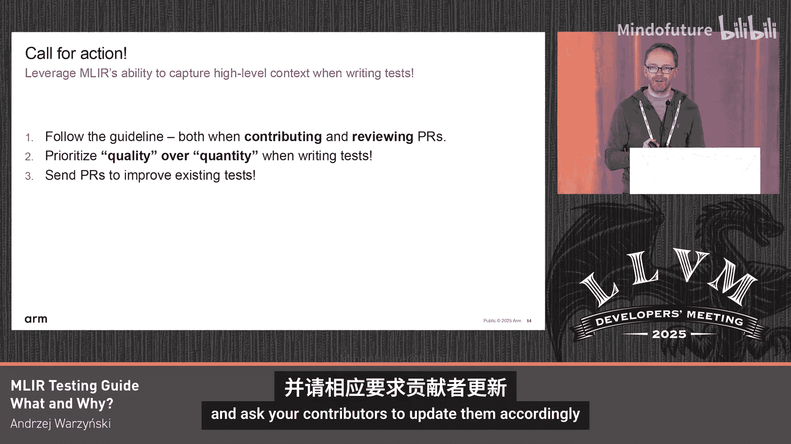

# LLVM开发者大会-US-｜-2025-Llvm-Developers-Meeting-p58-P57_MLIR测试指南_内容与目的--BV1ejr5BAEja_p58-

Hi everyone。 I'm Andre， and let's talk about MLla Art testing guide。

So let me start by contrasting testing guide and MLR with the one M LVM because we actually have two。

 The one M LVM is a bit more lower level。 It focuses on the tool that we have the infrastructure。

 how to use different flags， different options。 Please do use it。 Please do refer to it。

 The one in MR is a bit higher level and goes into detail of what constitutes a good test。

 how to write a test， how to what's a bad test and its focus around MLR and what specific MLR。

 So I'll try to this presentation focuses on the MLR testing guide。

 And I'll go through some examples。 some lit and file check examples try to。

Explain what it covers before I begin why mostly because tests are important they' part of our code base。

 they document our code base and we should treat and write them as such。

 we want to make sure that you we have a good test discoverability， because for example。

 if you are looking at that particular past transformation and you want to learn how it works。

 tests are great source of that。 and you want to be able to find them。 So that's important。

 We also want to make sure that our tests are consistent because for example。

 if you are changing a transformation and you want to write tests。

 we don't want you to waste your time trying to invent new naming scheme or new formatting or whatever。

 just follow what's there。 But for that， it needs to be consistent。

 consistency also means that if youre scanning tests and trying to understand what exactly is being tested。

 which edge cases are being exercise， it's super easy to identify。And。Now， as a first example。

 this is taken from the testing guide。 and at the top you have the same input， the same test。

 a good version and a bad version。 They look very similar。

 The test is simply the input I is simply a function that defines a constant one twice。

 it's run via CC， which eliminates one of the constants。 So it's quite simple， quite trivial。

And the inputs， the file check inputs， they also look very similar。 So what is the issue。

On closer inspection， there's a number of things。 For example， on the left hand side。

 you're checking the final curly brace at the end。 That's irrelevant。

 That's just just just unnecessary。 We are also checking data types， but for this transformation。

 they are also not relevant。 So basically the file check lines。

 they contain something that that doesn't it's not needed there。

 There's also we're not using lead variables or block substitutions on the left hand side。

 So that's fixed on the right hand side。Now， this may seem trivial and it's small because it's any example。

 but its。 it doesn't scale if if we leave stuff that's not necessary because we have thousands of tests and we should not keep things that are not necessary。

 also some of our tests are much， much bigger than this。 So these changes do make a difference。

This is another example。 This is a real example from a test file。

 So there's two different tests on left hand side， both of which go through a transformation that turns vector contract into vector outer product。

 So you look at the one on the left hand side right inside side。 They kind of look different。

 but it's not obviously what the difference。 It's not really clear what the edge cases are being exercise。

 what differentiates then。 And then I went through this exercise。 I was reviewing this file。

 and I was trying to understand that myself。 And then you see and you compared find maps that define access patterns for the vector contract operations。

 and they use different names， but actually identical。

 I don't know why we ended up with two different definitions， but we did。 So you remove one of them。

 And then there's even fewer differences between the two test cases。 In fact， they are identical。

 So I removed one of them because they look like duplicates to me。

 The only difference are the shapes of the vectors。

 But when you compare when I compare the check lines。 There was just no difference。

 And there was no comment。T me that there is that difference。

 So a point I'm making here is there are there are duplicates， and we should avoid that。

 And if there's something that makes special your test case， do leave a comment because otherwise。

 we are left guessing what's happening。And。This is another example。

 So it's also two cases taken from the same file。 This file is testing vector to vector lowering。

And you look at the test。 They also look quite saying。 you compare them。 And again。

 it's not clear what is happening and what is the difference between the two。 So what is the issue。

There's， there's a number of issues。 We are just not leveraging all the possible。

Pos all the possibilities for， for clever naming。 For example。

 we have this variable inside the function， which is a vector， and we call it V I1。

 which means we are repeating the type of the underlying variable。

 which is already encoded in the type itself。 So， so that's just wasted characters。

 the test function names also very enigmatic input to the function Also are01。

 They don't tell us what it does。 And these things。

 they they carry some semantic information that we are not encoding Also the variables could be a bit more meaningful。

 So，😊，Here's a version that's fixed。 So， for example， the vector inside the function that's defined。

 It's masking vector。 and it's key because we are testing transformation that takes vector mask load and lowers that to vector load。

 So mask is key。 Then the inputs to the functions are the base memory from which we read。

 that's important。 And then the other vector is a pass through value。 that's using the mask load。

 Now， once you have that in place， it becomes clear that what we are testing is what happens when the mask is all true。

 when the mask is all true， mask load doesn't need masking。 So it can just switch the load instead。

 Okay， excellent。 And then the difference between left hand side and right hand side becomes also very clear。

 Left hand side tests for F 32 on the right hand side。 we test for I 8。

 whether the underlying type is important for this transformation is beside the point。

 A person writing this decided that it is。 now this updated version。😊，Makes me realize， okay。

 we are missing cases。So here I'm adding two more cases。 The one at the bottom。

 case3 on the left hand side。 it's all false because on the previous slide I identified， okay。

 I'm testing what happens when I have a mask that's all true。 So now another edge case。

 natural edge case is what happens when the mask is all false。

 And now the naming of the input variables to the function is is key because when we have a mask that's all false there is no loading。

 we just use the pass value。 So， so again， renaming help understand that and convey that context。

 Now on the right hand side， there's a mixed case where I have a mask that's neither all false all true。

 And that's a negative test because in this case， the pattern should not trigger So I'm also prefixing the name of the function with with the word negative。

 So this way， I make it very clear what is happening。😊，Now， this is， again。

 the case from the previous slide with mask load。 So I already updated the function。

 the MLR function itself。 now going to generating those check liness。

 this is a bit mundane and labor intensive， So we have waste automate that we have the Python script to do that。

 most of you will know it。 please use it and at the bottom。

 you can see the check liness generated by the script。 They are fine。

 but that's just the starting point。 is this is this is where you start refining and revisiting。

 So you are expected to take that and make sure that we only test what's needed。

 and that all the context is there， right the script is not there to replace your work。 So。

 please pay attention to to that when when using the script。 Please do use it。

 but please also review what it generates。😊，And let me just conclude with a call for action。

 So please help us enforce the testing guide both by writing tests that adhere to to the guide。

 but also when reviewing， please make sure please call out your reviews。 you know。

 call tests that do not follow this and and ask your contributors to to update them accordingly。

 Thank you。

