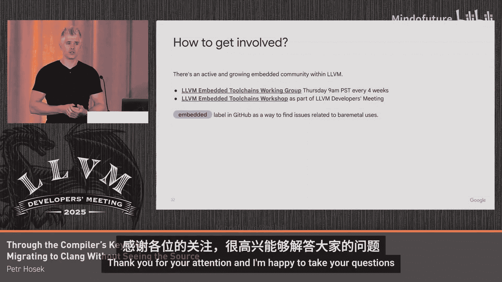

# LLVM开发者大会-US-｜-2025-Llvm-Developers-Meeting-p59-P58_通过编译器锁孔窥探_迁移至Clang--BV1ejr5BAEja_p59-

Okay， thank you。 Thank you for joining me。 My name is Peter。 I'm from Google。 Today。

 I'll be talking about our experience of moving an existing codebase over from an existing new tool chain to Kang。

 Now， if you've seen my talk last year， you might feel a little bit like a deja vu。

 This is not the first time we were talking about this topic。 It's actually not even the second time。

 So two years ago， my colleague talked about our experience of moving an existing codeb。

 it was pixelixelbus Pro the first generation over from the existing new tool chain to vanilla Kang issues we've encountered the solutions we deployed。

 And then last year， even though in my thought， I have primarily focused on our experience of moving Raspberry by Pico Sdk to Kang。

 I did also briefly mentioned that we migrated Pixel Bus Pro second generation over to Kang。

 Now that it wasn't quite true， we did successfully migrated buts。 but the charging case。😊。

Ha became much bigger challenge。 And so I decided to come back and actually specifically focused on that because I felt it might be interesting to。

 to many of you。 So what's the big difference between the first and a second generation on the charging case。

 the biggest difference is the fact that we've moved。

 we switched from an arm core to a risk5 core And that。

 as we quickly found out became an issue Does anybody want to take a guess what the problem here is。

No guesses The problem is that this risk5 core actually has vendor extensions now that's not unusual that's one of the big selling points of riskk5。

 What is unusual though is that this Sical MC actually includes custom branch instructions and those require custom relocations。

😊，Now， unfortunately， the vendor tool chain， uncond name is those。 There is no way to disable this。

 And because there is no support for handling custom locations in LVM and in LD。

 it means that we cannot take the vendor SDDK and link it against our code code。 Now。

 there is a small caveat。 There is actually an ongoing effort to support custom locations in LD。

 There is audio PR up for review， but none of this is landed yet。Why is this a problem Here。

 I have a comparison between a more traditional system。

 like an MP running a full blown operating system on the left。 And on the right。

 I have a microcontroller。 The big difference is that in a more traditional operating system。

 there is a welldefined A B boundary， typically between your application and the operating system。

 This is the Cisco Cisco layer。 on the microcontroller side， there is no such boundary。

 What typically happens is you take your SDK that typically comes from your vendor。

 This might include drivers， your free artos in case you are using one。

 and you direct link it against the application code。

 because SDK typically has a form of a static archive。

 And it is really important because you really want to get rid of all the code is's not actually being used at runtime because on these systems。

 binary size always come at a premium。But it also means that A VI between the application and the SDDK has to be compatible。

 and unfortunately， that's not a case here because of those custom branch instructions which use those custom relocations。

So what are the potential solutions and pass forward。

 The first one is we can just continue to use vendor toolchain， which is what we did initially。

 Now this product team that is working on pixelbus， they have been a great partner to us。

 they've been working with us for years， they are very eager at adopting new tool chains using new features to improve their products we use binary size and they were really eager to use the same clangk tool chain for both buts and charging case。

 So we decided to explore other options。 The next one。

 something that be briefly look into would to just rewrite the vendor SDdk and to rewrite all these custom instructions to avoid those unfortunately there is no of the shelf solution that we can use。

 And while we could build something like this using bits and pieces of LvM we've realized that this would be a pretty significant undertaking The first option is to just take the vendor SDdk and rebuild it using our own clk tool chain now。

😊，required support from the vendor， but we were very lucky。

 The vendor was very forthcoming and they decided to actually work with us and migrate their code base。

😊，From the existing new tool chain to clk with a caveat the SDK code base is their proprietaryrietor IP。

 and so we could not see the code。 So unlike our previous migrations that we did where we could just look at the code and use highto approach when we just directly made changes in case of this project。

 we never saw the code everything that we were doing was literally through the keyhole。

So the whole model looked roughly like this On our side， we would build a plank tool chain。

 Typically， it would be a vanilla stock tip of three toolcha。 Occaionally。

 we would have some custom patches for working progress changes maybe custom plank I D checks。

 And we would send this over to the vendor to get with instructions。

 They would use that tool chain to build a new version of the SD DK， Dr and link the application。

 run all the tests and then send us logs。 We would invest D K。😊。

Try to address whatever issues showed up and rinse and repeat。

So whats the general strategy that we would use when migrating code base is over from the GCC tool chain decline？

First， you gotta get it to build， then hopefully make it fit because like I said。

 sizes size is really critical for these systems and then make it run。

 Even though I made these look like a sort of sequential like series of steps。

 oftentimes when you are doing this migrations， you have to go back and forth between these different stages。

 So the first step make it compile。 you probably ought' know， like even though we try to。

 to really support most extensions， the GCC and and new LD and you has。😊，Cang， LD， LBM E C。

 they are not direct drop in replacements for their new counterparts。

 There are still major differences that you have to work around in Kk。

 One of the big issues that we often find out are just different， different warnings。

 And for some of these clk doesnt fix it。 which are helpful， but they are not always available。

For LBM LiC， we deliberately omit certain interfaces。 for example， in the baremet build。

 we don't include any plastics interfaces and so oftentimes it is necessary to change the code to avoid using certain headers we do have some working on progress calling tidy checks to aid the migration but these are you to be upstream。

 and then on the linker side， what we generally know it is is that is not very not very user friendly。

 like it diagnostic could really be improved。 just give you small example here is a concrete error that we actually hit we're working on this project and as you can see this is not a very helpful error message like the linker tells you section can't have both LMA and loaded row region but it doesn't tell you what line of the linker script this is on which section What is the LMA Like if your linker script is few hundred lines or thousands of code like good like find figuring out what the issue actually is。

We did propose improving LDs Licr parsing to address some of these issues。

 But that project is not installeded， and we are hoping to revive it eventually。

So once it compiles we need to make it fit and this is often a big challenge like many MCUs。

 this one also uses heterogeneous memory layout， this means that the memory is not uniform and where you place your symbols may be important both for correctness but also for performance but unfortunately support for heterogeneous layouts。

😊，Isn't something that standard CC post post supported。

 So you often have to reach out for non standardard extensions。

 So here's an example from this particle M。There are several different regions。

 and really need to be careful where we place our code。

 So let's say we want to place code in that first segment， the retain ramp。

 So how would we go about this， We have a couple of different symbols。

 different variables one function under the normal symbol placement rules。

 these would go into different sections and then down a baremet systems。

 you would typically want to compile with data sections and a function sections so you can use GC sections to garbage collect all the unused code So each one of these gets its own section。

 Now matching all these sections and placing those manually inqui would be a lot of work。

 So what developers often do in practice is they use the section attribute。

 they annotate all the symbols with the section attribute and that way they can then manually grab all those sections and manually place them in the corresponding memory region。

😊，Now this is one big downside because you lump all those symbols together。

 you actually break Lier GC because they're all in one section and now Lier cannot come in and it can run the GC algorithm to discard all the unused sections。

So how do we solve that One possibility would be to basically take on the role of the compiler and change the attributes and manually place all these symbols in different sections。

 that's actually what we did in our initial implementation。 we didn't do it by hand。

 because like I said， we did not have access to the code。 instead。

 we wrote a clk tidy check that we gave to the vendor。

 they ran it over the code base and then this check。

 we wrote all the instances of the section attribute and automatically spent as seen on here on the slide。

 But as we found out that was very intrusive。 There were thousands of instances of the section attribute in in the vendors code base。

 And it just became not something that they really wanted to maintain。

 And so we really realized very quickly that this is not the direction that we to we want to go into。

 So we started thinking， is there better way we could do。 this something that would not。😊。

Are all these intrusive changes。 And eventually， we actually landed on a new feature。 This feature。

 which we promote and L VM， is called the F separate name sections。

 And it relies on the fact that in L， sections don't actually need to have unique names。

 You can have two sections with the same names， so。😊，When you turn on this flag。

 what happens is every symbol that is unnotated with a section attribute would get its own section and that recovers the linker you linker is then capable of going garbage collecting on new sections and everything works same as before。

 but you don't actually need to modify the source at all。This doesn't give you back all of the。

All of the， all of the the normal semantics you get。 One thing that you're missing， if I go back is。

If I have， for example， a piece of memory that is zero initialized。 this could go into the PS。

 So that section wouldn't actually take any space in the final binary。

 If you do use the manual manual annotations that doesn't work anymore。

 This is something that you could potentially solved by again using using the section attributes and again。

 playing the role of the compiler。 but it is really tD use is very error prone it really easy to make mistakes and potentially even break your applications。

 So we're still thinking if there is a better way of doing this one idea that weve been sort of experimenting with is maybe replacing the section attributed with something which would better communicate sort of the semantics So really like telling the compile these symbols should go into special region and then also introducing a new link script syntax that should let us grab all these sections and place them correctly。

 This is still working your progress， we have an RF if this is。😊。

I that you are potentially interested in， please reach out and talk to us。

To make things even smaller， another feature that we've played with is LTO。

 we actually did compile all of the of the。Compil our runtime libraries with fed LTO objects。

 which let us then LT O and runtime。 But when we tried I basically quickly find out that using LTO with runtime libraries doesn't really work。

 I'm actually not gonna go into details because tomorrow， my colleagues。

 Paul and Daniel are giving talk on this specific topic。 So if you're interested in this。

 I would recommend attending their talk tomorrow。 So for now。

 we are only using LTO for the application code。 But we are hoping that in the future will be to expand this and LTO the whole application because it can really help reduce use binary size。

😊，So once we make everything fit， the next question is， does it actually run。

 Well we very quickly find out it does not。 One of the issues that we quickly encountered was was performance performance was a problem。

 This application has a very strict timing requirements because it deals with Bluetooth and in Bluetooth。

 you simply have to send packets at a certain rate。😊，The problem turned out to be alignment。 Now。

 while this M U supports misaligned read rights， when we did some benchmarking。

 we actually found out that misaligned read of rights are roughly four times slower than the aligned ones。

 And unfortunately， because the code was not sufficiently， sufficiently precise。

 It was relying on some undefined behavior。 And because there are differences in in treating these undefined behavior between GCC and Kang。

 the code was generated by Kang would actually place certain， certain symbols at。

And underlying addresses which should lead to performance degradation。

What we actually used to find all those cases is UBS。

 we use the f sanitized alignment with a custom runtime that is more minimal than the ones that are currently available and that also was compatible with the artist that we are using to instrument of application and we use it to successfully find all the misaligned reads and write in the future we are also hoping that this is something that we could just support out of the box in upstream but like many other things this is a work in progress。

There are other kinds of performance bottlenecks that we've encountered when working on this on this project。

 One issue that we've quickly noticed is that developers are not very good at predicting performance of their code。

 I think this is generally the case。 And so what would often happen is they might。

Place functions in in the wrong location。 They might place hot functions inside source files。

 And even if they unate these functions with the inline keyword， because they are in source files。

 the compiler can inline those across P boundaries。 And conversely。

 sometimes they would they would place called functions in header files Mar is in line。

 So those functions would be in line。 But in reality， it's all code code。

 So it just inflated the binary size。 to actually find out and address all these issues。

 we actually leaned into PGO， specifically our PGO。 So what we did is we instrumented all the code。

 And then we use remarks to give developers guidance on how to fix their code。

 So this look like this。 We will just use the existing instrumentation flags the instrument binary with a couple of extra pick options。

😊，We would then run the binary。 We would connect the device using LEDB and grab the profile。 Now。

 this looks really simple。 There was a little bit more code involved。

 This is another one of those cases where our hub is that over time。

 we can take this code and we couldn figure out how to integrate it into into upstream so that is this is something that just works by flipping on a switch today it is a bit more involved than that。

😊，But once you get the profile， you can post processces it and you can feed it back into the compiler and you can use optimization remarks and ask the compiler。

 hey， are there any any issues。 So in this particle case。

 the compiler is telling us that it cannot inline a function because it cannot see its definition。

 Otherwise it would because the function is hard and it should be in line。

 And the solution here is very， very trivial。 developer should just take this function。

 they should move it into header。 and I do the market as static in line。

 which is also something in the future， we would like to automate。

 So developers don't have to do it by hand。😊，And then finally， when working on issues like these。

 it may be occasionally useful to use a debugger。 Ive already showed before。

 we've used LDB successfully。 Unfortunately， what we noticed is when the application crashes。

 where you often end up is in something like inter handler。

 and things like inter handlers are typically written an assembly and to get good stack traces or use stack traces。

 you need to write dwarf CI annotations。 Now， unfortunately， writing dose can be really ps。

 writing those correctly is is really challenging， even for people that have a lot of experience。

 and this got us thinking， is there a way that we could help or us developers。

 and this actually LED us down to proposing and developing a prototype dwarf CI validator。

 This is a simple abstract interpreter that can run over your CI annotations and try to spot and flag any issues。

 This is what it looks like。 So here is just a snippet of assembly。😊，With some dwarf C annotations。

 and when the abstract interpretifies issues， it will point those out right now。

 the prototype only supports x8 to 6 because there was easier to get going。

 but we are also looking at expanding this to other architectures like Ar or riskk 5。

 which are more common in the embedded space。😊，So to wrap up my talk one might ask was all this effort worth it for a single。

 single application and the ask for us is yes for several reasons， first of all。

 unlike in bigger application processors where things are evolving fairly rapidly in the embedded space the rate of progress is not not as quick so the same MCU might be used across many generations of the products across multiple years and spending extra effort to getting everything to work with the latest compilers is worthwhile we also came up with many ideas for new features for new improvements。

 some of those have already made it into LBM others will hopefully get there soon and also all the automated tools that we build that we develop are useful beyond this project it will be useful for other other embedded projects and hopefully to the rest of this community。

😊，If this is something that sounds interesting or assigning to you。

 if you want to get involved in embedded development。

We have a very active and growing embedded community within an LBM that gets bigger every year。

 We meet every four weeks。 we have a public working group that meets every four weeks and Thursday and 9 AM Pacific time we also have workshops。

 We actually just had a third third workshop on embedded tool chains yesterday and I hope that we're gonna to have more in the future。

 So if this is something that you're interested in。

 please join us and with that I would like to help you thank you for your attention and I'm happy to take your questions。

😊。

Yeah， thank you very much。 Peter， are there questions。Yeah。

 you mentioned that the vendor SDK got migrated to your LVM toolcha。

 does that include like the just the compiler or also like Liy other things Everything so we use the same toolin that we use for all our projects so that's just a Van LVM built straight from LLVM GitRepo like we don't have any upstream patches and we use Kang as the compiler。

 we use all of the LLVM tools， we use LD as a linker and we actually used LVM LiC as our C library and LiC++ as our C+ on a library。

And we actually work very closely with the LBMC team， including Michael， and they were really。

 really great addressing various issues that we've encountered， like missing functions。

 performance improvements in OMC that collaboration has been really critical。😊。

So any further questions。Otherwise， I do have a question。

 So I do have here such a a nice small device。 So how many lines of codes are in this。

Approximately who youll know this。 actually， I don't have。

 I don't know line of lines of code because we usually don't measure things in lines of code。

 but I know for binary size， because like I said， that's， that's what we really care about。

 I don't know about this particular brand， but for these ones， which is the pixel belt spread2。

 at least for charging case， the image is around a megabyte around the megabyte。 okay。😊，Thanks。

So my question is how difficult was interaction with the vendor。

 like how hard was it to convince them to try， how bad was the like here's a new compiler。

 please try it and then they don't for a week or two。That sort of thing。

It was surprisingly or maybe not surprisingly， but it was very positive。 Like we were very fortunate。

 we found an engineer on their side that was very eager to work with us。

 I think the most challenging aspect of the collaboration was just the latency because they are not based in the US。

 they are in a different time zone on the other side of the world。

 and also because it took a while for them to take a new version of the tool chain。

 like integrated into their their workflow， they use a different platform than then we use。

 So like whenever we would like send them a new tool chain with instruction。

 it might be anywhere between days to weeks to get back response。

 So like this whole project to like over a year。 But it wasn't really a year of active development time。

 It was very long interaction times。 So I think there was there was the hardest part。😊，No。Yeah。

 with the linker flag that you added， does that still fully respect the section name that's specified or does it modify it。

 Like are you placing multiple sections with the same name in the Elf or are you still app like a variable name to it like F data sections but traditionally do you mean with the F separate name sections。

 Yes with the F separate name sections， we don't modify the section of at all。

 We just respect whatever is in the in the attribute。

I have customers who have a lot of assembly code and they complain about debugging it because they don't write dwarf information。

I would like to get them to， but it's got to be validated。

When do you think the dwarf CFI validation will be usable upstream。So。

What I've shown that is already in upstream。 like that all landed。That。

There is there is one PR that is currently open， not landed that improves the kind of issues that we can detect。

 Now， unfortunately， all the development， all the work was done by an intern who worked on our team this past summer。

 and they were great。 like we really like working with them。 But unfortunately。

 the internships are not over。 So I think the most challenging aspects going to be to find somebody else who would be willing to pick up the work and continue the development。

 The other issue that we've encountered。 And I think there was the biggest of friction point when developing this is what we found out that right now。

 in the M layer， we are missing lot of the semantical information to really understand what do individual instructions do。

 like， for example， what kind of effect they might have on a stack。

We've actually found out that some of this information already exists in other places LBM B。

 for example， has developed what they call the M C plus。

 which is basically a graph around the M layer。 And so one of those is we had we actually take the information like take the M plus and bring it down into L VM so we could reuse it even for this validator。

 And but that is gonna be pretty significant refactoring that somebody would have take on。😊，Yeah。

 very good。 I do have a question。 We have experienced trying to compile GCC compiling code with claimang and was a source code level and we experienced there were some constructs that claimang couldn't compile and then we looked into it。

 And we saw this is not a valid C plus plus code。 So this was something where GCC had an interpretation an idea。

 which was probably wrong。 And passed through。 So didn't you encounter things like that。

 or we would occasionally encounter issues like that。

 I'm not sure if you've ever seen cases where like it was like straight out like not a valid code。

 But there are certainly extensions that we've seen that we had to work around a very concrete example。

 something that I think we've seen in almost every single embedded code base is this one is the optimized attribute。

 That's very popular what it lets you do is basically tells the compiler like change the optimization level just for a particular function。

 There's actually not something。😊，That clangorolium supports。

 and I don't think it's something that we will ever support。

Based on how the optimization pipeline works in LVM。

 the way around it is to basically just change the organization with your code so like you can do it at the P level。

 So like I think we already have a bit of a cookbook of these are the common patterns and common issues that you might encounter and how you work around those I think one thing that will be really beneficial maybe。

😊，A to publish something like this maybe be on the LVM website。

 and I also to have more automated tools like Kkta that can help developers to work around these issues。

So I feel we need to stop now because we have some time to change the room for， for others。

 So thank you once again， Peter。